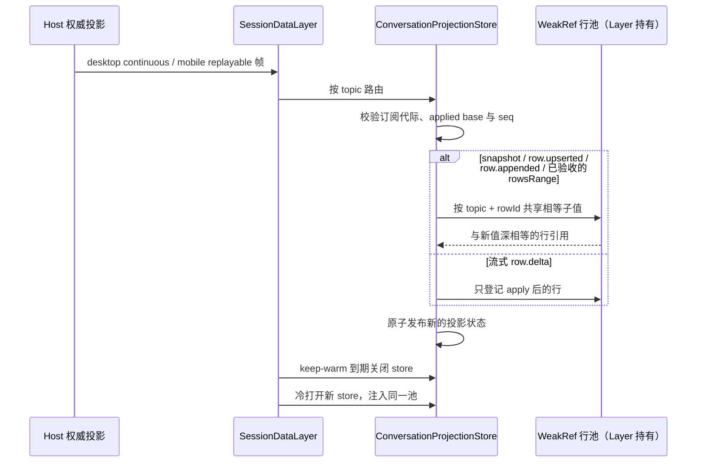

# 长会话行内容结构共享

## 产品规则与来源

吸收 `zai-org/ZCode@aac4755666d09fdcd70272fcf063c077a639015f` 的
`conversationRowSharing.ts` 及其数据层接入，减少切换、重新打开长会话时相同消息和工具输入的重复内存占用。
只复用值相等的数据引用；显示内容、顺序、快照水位、命令与订阅语义不改变。

## 所有者、接口与时序

`SessionDataLayer` 仍是 host 连接上 session store 生命周期的唯一所有者，并持有一个
`ConversationRowPool`。池只保存 `WeakRef<ConversationRow>`；它不保存业务事实，不延长行对象寿命。
store 通过注入的池调用 `shareRow`、`shareWindow`、`remember`，不新增跨模块接口。
独立构造的 store 使用自身的池，保持已有两参数构造兼容。

- 桌面的 `desktop-continuous` 直接流与手机的 `web-remote-replayable` snapshot/recovery
  仍经过同一状态机。`initial`、`online`、`recovery` 的用途及 owner/lease 不变。
- snapshot 仍整体替换；仅 window 中的行值做结构共享。行全相同且顺序/长度未变时复用 window。
- delta 先由协议包 apply，再共享完整 upsert/append 命中的最终行；流式 delta 不逐帧深比较。
- rowsRange 必须通过原有 epoch 和游标陈旧校验后才共享；普通补拉、完整问题目录补拉均接入。
- 幂等边界仍为 subscriptionId、logEpoch、seq。池 key 为 topic + 分隔符 + rowId，禁止跨 session/host 共享。
- rewind 复用 rowId 时值不同就返回新值，绝不将旧分支数据恢复进新快照。
- 终结回调仅删除仍指向该 WeakRef 的条目，不误删后来登记的新行。
- 同键登记新行时取消旧行的终结登记；历史快照仍存活时也只保留该键当前版本的登记，避免流式更新累积回收记录。

## 不变量、失败与迁移边界

- `shareStructure` 只递归 JSON 形态的 plain object 和数组，不修改传入的 next，也不改协议 apply。
- 未变化的子值复用旧引用；增删字段、状态变更、行移除均以 next 为准。
- 弱引用不存在或已回收时直接使用新行；GC 时间不成为行为前提。
- 不新增 IO、遥测、官方服务、持久化或依赖；不重构 SessionPane，不处理其闭包链生命周期。
- 不改变 ZCodium 身份、自有更新源、`.zcodium` 数据根或 Windows/macOS 产品边界。

## 验收与验证

- 移植上游纯函数/行池测试：深相等、部分共享、不修改输入、键/类型/数组变化、topic 隔离、流式登记与 window 复用。
- 数据层测试：重复 snapshot、upsert 状态变化、append/rewind、流式登记、keep-warm 过期冷打开、跨 topic/host 隔离。
- range 测试：普通与完整问题目录补拉共享仍存活旧行；stale epoch/游标结果保持丢弃。
- 对 initial/online/recovery 路径与断档/旧订阅帧验证原有水位和恢复边界。
- 复用 `packages/ui/vitest.config.ts`，定向运行新增用例及现有 projection lease 测试；执行格式、lint、架构与类型检查。
- 本次不构建/安装，故不把上游压测的内存百分比宣称为本 fork 的实测收益。

## 本轮验收结果（2026-10-16）

- 结构共享与数据层的两组 Vitest 共 25 项通过，覆盖快照/增量/range、冷打开、topic/host 隔离、过期帧拒绝与终结登记替换。
- 已加入 Desktop CI 的受控 UI 验收入口；类型、根 lint、格式与架构通过。
- 未做整机堆内存压测；收益以减少重复引用为实现依据，不将上游降幅当作本机实测。
