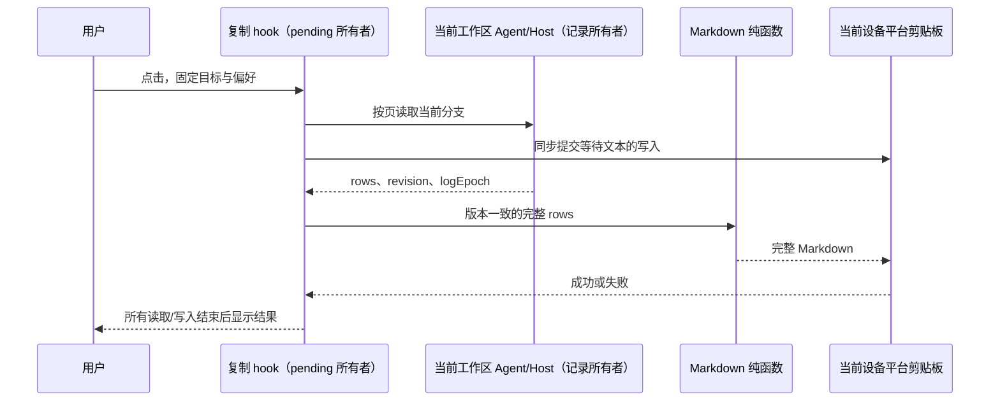

# 顶部会话菜单：复制为 Markdown

## 产品规则

- 仅在顶部会话菜单的「复制会话 ID」之后添加「复制为 Markdown」。复用现有菜单、双语文案和 toast。
- 一次点击复制当前有效分支的全部已保存消息，不依赖 renderer 已加载的尾窗，不保存文件、不发布分享。
- 标题为一级标题；用户消息与助手正文使用角色标题，保留原有 Markdown。工具输入/结果、可见思考、子任务摘要、Hook 执行和重要事件使用默认折叠的 details。
- 遵守现有时间线可见性；思考显示关闭时仍保留每轮首条可见思考。文件 citation 转为普通 Markdown 链接；附件保留名称与可用链接，不嵌入二进制，不递归读取子会话。已截断的工具结果明确标记。
- 支持运行中会话的已生成内容。分页过程中 revision 或 logEpoch 改变时整次失败并提示重试，不混合多个版本，不写入部分文本。
- 无稳定 sessionId、平台不提供剪贴板能力时禁用。只有结构行或空文本的会话提示「会话没有可复制的内容」。复制期间菜单项显示「正在复制…」并禁用。
- 消息拼接前补齐未闭合的顶层代码围栏，避免吞掉下一条消息；关闭围栏只允许空格/Tab 后缀，并兼容 LF/CRLF/CR 换行，代码中的引用示例保持原文。列表/引用内的代码不额外打开顶层围栏。
- 本地文件路径复用已有 `toFileUrl`，正确编码 `#`、`?`、`%` 和 Windows 路径；已存在的网络 URL 保留编码、查询和 fragment。标题、文件名按纯文本转义，空内容在引用转换之后判断。
- 浏览器缺少实际可用的剪贴板写入 API 时，平台不提供 writer，菜单项禁用；权限拒绝仍由既有失败提示反馈。
- 工作流直接启动/配置轮的卡片元数据也属于可见会话内容：保留名称、描述、参数及配置变化摘要；不重复导出已由卡片代言的合成输入，不导出内部 run/tool ID 或读取子运行。

## 所有者、接口与顺序

- 会话记录的唯一所有者仍为现有 Agent/Host。UI hook 使用 exact 工作区服务定位并贯穿 workspacePath、workspaceIdentity、remoteSessionId、sessionId；不读取业务目录或 renderer projection store。
- hook 独占一次复制操作的 pending/单飞状态；点击时捕获服务、身份、标题和显示偏好。切换会话不会改变在途目标；卸载后不更新组件状态。
- 读取使用既有 conversationRowsRangeV4，按协议页上限向前分页。页内/跨页 rowId 必须递增，游标必须严格向前推进；最多 100000 行，最终文本最多 32 MiB，超限明确失败而不截断。
- Markdown 转换是 UI 模块内的纯函数。IPlatformService 新增可选 writeClipboardText(text: string | Promise<string>): Promise<void>；缺少能力时禁用，成功履约才显示成功提示。
- 桌面/Web 适配复用浏览器剪贴板封装。支持 ClipboardItem 的浏览器在点击同步栈内提交 Promise<Blob>，避免分页 await 丢失 Safari 用户激活；不支持时使用 writeText。写入目标是当前设备，而非远端 Host。
- 数据生成与剪贴板写入的所有 Promise 都必须 settled 后才结束操作；正文与异常原文均不写日志。
- 桌面 continuous 与手机 replayable 保持原有 Host 及连接边界；本功能仅新增只读查询，不更改订阅、恢复、队列、owner/lease 或运行时协议。

## 验收与交付边界

- 多页长会话包含最早与最新消息，身份固定且分页严格有序；版本改变、游标不推进、空会话、超限时不复制部分结果。
- Markdown 保留代码围栏/列表/表格，工具正文中的长围栏不会破坏详情结构；普通文件 citation 被转换，代码示例中的 citation 保持原文。
- 工具截断、运行中结果、思考偏好、子任务/Hook/事件与附件都有文本表现；不包含内部附件协议或隐藏工具行。
- 浏览器场景覆盖实际菜单位置、键盘操作、重复点击、切换会话、双语、宽窄布局、成功与失败，并验证 Promise 剪贴板的同步提交。
- 执行类型、架构、格式、lint 和相关 CI 脚本检查；保留无关工作区改动。未获请求不提交、不推送、不触发构建或安装。
