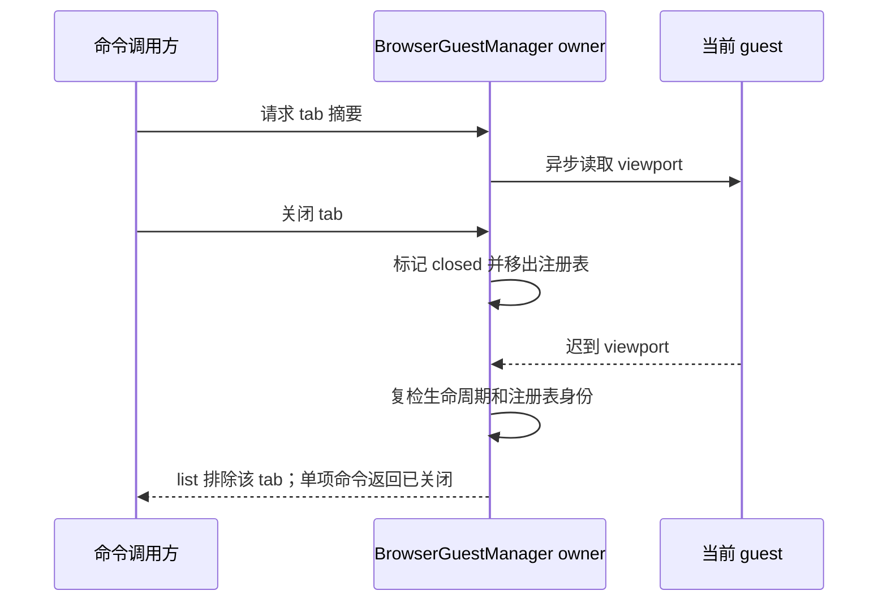

# Desktop Browser Main 类型边界

## 目标

让 Electron main 的严格类型检查准确描述 BrowserView 的运行边界，不改变浏览器操作、tab 生命周期、录制动作或 screenshot surface 协议。

## 所有者与边界

- `BrowserGuestManager` 是 main 侧 tab、guest 和恢复生命周期的唯一所有者。内部生命周期包含 `closed`；`BrowserTabSummary` 是面向调用方的投影，只暴露 `active`、`deliverable`、`handoff`。
- guest 重绑恢复包含异步等待。恢复完成后必须重新读取当前 tab 生命周期和 guest 绑定，丢弃已关闭 tab 或已被替换 guest 的迟到结果。
- tab summary 读取 viewport 也会跨异步边界；若等待期间 tab 被关闭或从 owner registry 移除，list 丢弃该摘要，单 tab 命令返回 `backend_unavailable` 与 `closed` metadata，不得把它投影为普通存活 tab。
- Playwright evaluator 会序列化为函数并在 Chromium isolated world 执行。`document`、`Element`、`HTMLElement`、`HTMLInputElement` 和 `CSS` 属于该页面上下文；Electron main 本身不得直接访问 DOM。页面结构类型只用于编译期检查，不能成为 evaluator 的运行时闭包依赖。
- screenshot surface 的比例模式以 `BrowserViewScreenshotSurfacePreparePayload.surfaceScaleMode` 为协议事实，main 局部类型从该字段派生，不重复声明或另造 shared 公共类型。
- 录制动作仍由 `BrowserRecordingAction` 的 `type` 判别联合驱动；每个分支只访问该动作类型具有的字段，保留现有 selector 与坐标执行路径。
- locator pointer 对齐候选必须为非空集合；按现有尝试序号轮换，force 模式继续使用首项。
- Electron `console-message` 监听器遵守当前安装版本的 WebContents 事件签名，并记录实际 level 与 message。

## 失败与恢复规则

- tab 在 `await restoreGuestState` 期间关闭或替换时，旧 guest 不得继续持久化或作为恢复成功返回。
- `closed` 不是有效 tab summary 生命周期；summary 不应把内部关闭态泄漏到公开 schema。
- evaluator 的结构类型擦除后不改变序列化函数内容语义，也不得引用 main 侧辅助函数或对象。
- 未知或不匹配的录制动作不得通过类型断言绕过分支检查；schema 与执行器保持同一判别字段。

## 验收

1. `packages/desktop/tsconfig.main.json` 类型检查中，本 spec 覆盖的五个 BrowserView 文件没有诊断。
2. 现有 BrowserGuestManager guest attach、恢复与清理测试保持通过。
3. viewport 延迟期间关闭 tab 的 list 不返回该 tab；激活、认领或创建摘要若遇到同一状态，不能返回成功 summary。
4. 代码不改变 BrowserRecordingAction 的运行顺序、timeout、selector/坐标选择或浏览器命令。
5. Electron console 日志从真实事件参数取得 level 和 message；cleanup 仍移除同一监听器。
6. 不修改 main tsconfig 的 lib，也不新增 shared barrel 导出。

