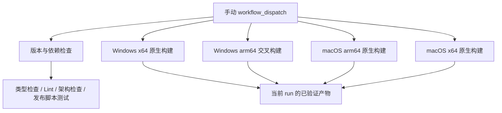

# 桌面 CI 与安装包产物

## 范围与产品规则

- 桌面构建矩阵仅覆盖 Windows x64/arm64、macOS arm64/x64；Windows arm64 在 x64 runner 上交叉打包，其他目标使用 GitHub 托管的原生 runner。
- 只有手动 `workflow_dispatch` 执行检查、Windows x64/arm64 打包与 macOS arm64/x64 打包。Ubuntu 只用于检查，不构建 Linux 安装包或远端运行资源。
- 构建工作流仅 `desktop.yml` 一个，且只响应手动 `workflow_dispatch`；push 分支、push 标签和 PR 均不触发。工作流只上传 `desktop-*` Actions artifacts，不创建或更新 GitHub Release；历史上独立的 `macos.yml`/`zcodium-macos-arm64` 已删除。
- Windows 沿用 NSIS exe；macOS 只发 dmg，打包目标、产物收集与发布校验必须一致，不要求或上传 zip。四个目标的架构名均为 x64 或 arm64。
- Linux 目标在桌面打包入口和资产收集入口明确拒绝；发布校验只要求四个 Windows/macOS 安装包，Linux 文件作为额外资产阻断发布。
- 不再构建、下载、校验或嵌入 `bundled-remote-assets`，桌面开发态也不读取历史 Linux 资源。SSH/WSL/Linux 容器远程工作区部署明确报缺少运行资源；通用 Server/CLI 的平台实现保留，手机远控继续复用本机 Host，与 Linux 远程工作区独立。
- `package.json` 版本必须满足 SemVer（可带预发布标识，不接受 build metadata）。手动从标签运行时，该标签必须为 `v<package.json.version>`；标签 push 本身不会启动工作流。
- 依赖安装使用 frozen lockfile。Node 从 mise.toml、pnpm 从 package.json 读取；同步已有依赖遗漏的锁文件项，不升级业务依赖。
- 工具链读取器显式解析 mise.toml 的 tools 表，只接受固定版本，并验证 pnpm 与 packageManager 一致；缺失或不一致时在安装前失败。
- 构建只使用当前源码与仓库已有资源，不读取 references/，不需要官方账号、服务凭据、私有镜像或签名证书。
- 本 PR 不迁移技能、不新增 CUA 原生实现、不配置应用内自动更新；现有账号及遥测代码的全面移除另行实施。

## 所有者、接口与事件顺序

GitHub Actions 工作流拥有调度和权限；现有 `bundle:desktop` 拥有构建、运行时依赖验证与体积审计；产物脚本只负责筛选、校验和，不复制业务状态或写入 GitHub Release。`packages/server` 的常规 build 仍负责 HTTP 与 server remote bundle；本 fork 没有独立 remote artifact producer，因此不能跳过 `build:remote`。

- 整个工作流仅 `contents: read`，不申请 Release 写权限。
- checkout 不保留凭据；不使用 pull_request_target，不使用 PR 输入拼接 shell 命令。
- 手动运行仅上传 Actions artifacts；构建阶段显式禁止 electron-builder 自动发布。
- macOS 构建复用同一 job 与打包入口；每次手动运行均选择 arm64 与 x64。每个架构只使用对应的原生 runner，不交叉打包。
- Checks 与各平台打包从同一 ref 并行开始，二者无数据依赖；即使检查失败，未取消的打包任务仍独立暴露构建错误。当前 run 被取消时不继续打包。自动产出安装包不等于自动安装，仍由用户选择何时覆盖本地应用。
- 同一 ref 的手动重跑允许取消旧运行；不同 ref 的手动运行互不影响。触发源只有 `workflow_dispatch`，concurrency 不需按事件类型分支。
- 产物只保留在当前 run 的固定 artifact。任何平台缺失、错误版本、空文件或额外文件均由产物校验拒绝。

## 验收场景

1. 手动运行即可获得 Windows 与 macOS x64/arm64 构建；不创建 Release。push 分支、push 标签和 PR 均不触发任何构建（fork Actions 用量停用纪律）。
2. 各平台独立产生所有预期安装包，并通过已有 app.asar 运行时依赖校验。
3. 从分支或标签手动运行均选择完整的 Windows/macOS 四架构矩阵，并且只上传 Actions artifacts。
4. 手动从标签运行时，标签必须与 package.json 版本匹配；标签 push 本身不启动构建。
5. 产物缺包、错版本、空包和额外文件均由本地校验拒绝；脚本测试不访问真实 GitHub Release。
6. 产物辅助脚本用临时目录和模拟 GitHub 调用测试，不访问真实 Release。
7. Windows/macOS 的 x64 与 arm64 产物分别收集；Linux 打包和资产收集请求在启动构建或写文件之前失败。
8. Windows x64 runner 执行 CUA 原生库与打包后 Electron 运行时探针；Windows arm64 交叉打包只校验随包资产文件（`--files-only`）。
9. 执行 typecheck、lint、架构检查以及工作流语法验证；已有失败或环境限制如实记录，不降级门禁。
10. macOS arm64/x64 各自只需一个非空 dmg 即可收集，其他架构及 zip 不进入输出；发布目录中的 zip 作为额外资产阻断发布。
11. 删除历史 `bundled-remote-assets` 后，Windows/macOS 的准备和打包入口不要求 Linux manifest，仍校验本机 Agent、插件与原生库；手机远控的 `web-remote` 继续随包分发。
12. 准备入口回归使用明确的目标平台 fixture，不从运行检查的 Ubuntu/macOS 宿主推断桌面目标；macOS 和 Windows 分别验证子命令，不执行真实资源构建。
13. Gen UI 的 runtime/vendor 清单校验原始文件 SHA256。Git 检出必须按字节保存这些资源及 tweak 运行时，Windows `core.autocrlf=true` 也不能修改换行；不得通过重算清单、归一化待校验字节或跳过校验来放行变更。
14. 打包后 source map 清理由既有脚本负责；普通构建代码继续清理引用和 `.map`，但不得改写 renderer `out/plugin-sandbox/vendor` 或 Agent `glm/packages/visualize-plugin/skills/visualize/assets/vendor` 的固定快照。最终安装包中的 vendor 和许可文件必须仍匹配原始清单 SHA256。
15. 普通文本检出统一使用 LF，避免 Windows `core.autocrlf=true` 将已格式化源码转换为 CRLF 而误报格式失败；现有资源、许可和 vendor 的显式 `-text` 规则继续优先，不改写固定快照。

## 检查阶段的源码测试

远端握手/关闭事件、服务端 ACK 字节交接与启动期 EOF、窗口远程连接退休及工作流沙箱关闭边界的 Vitest 回归进入 Checks。MCP 配置 admission、缓存身份/执行 cwd 隔离与失败资源回收，以及 Git 服务 proxy 换代的单测同样进入现有 Vitest 门禁；Git 换代、关闭面板的在途扩展读取和 StrictMode 重放浏览器场景由现有发布脚本测试入口执行。测试入口必须使用文件 URL 与平台路径转换，不能用 URL.pathname 当 Windows 文件路径；路径断言区分原始字符串与 JSON 转义，比较真实 cwd 时使用 realpath。POSIX mode 只在支持该权限语义的平台断言；SQLite fixture 在删除目录前关闭数据库。共享状态门禁校验测试实际执行且不少于既有 42 项，允许新增回归增加条数，不因精确计数过期而误报。更新请求 fixture 使用 Windows 目标及含有效文件校验值的 manifest，与当前更新契约一致。

源码市场回归只使用合成 catalog 与内存 fetch。测试夹具在调用当前 `NodeWebFetchHttpClientAdapter` 前隔离 `ZCODE_HTTP_PROXY`、`ZCODE_NO_PROXY`、`ZCODE_AGENT_CA_CERT` 与 `ZCODE_TOOL_ENV_PASSTHROUGH_JSON`，结束后按原始存在性恢复，不能让宿主自定义代理/CA绕过测试 fetch 并触碰外网。新增回归注入不可连接的合成代理，再验证原市场规则测试仍全部使用模拟请求；不修改生产代理优先级、不重试网络失败。

会话 workspace 的进程 E2E 必须将 adapters 与 dynamic-workflow-runtime 公开入口也映射到源码，避免新 bootstrap 搭配旧 dist 时漏测资源生命周期修复。Windows 夹具同时隔离 HOME 与 USERPROFILE。排入后台清扫的目录夹具必须等待真实清扫完成，再复位调度标志和删除临时根；不能仅以调度返回 true 作为资源完成边界，也不能靠 sleep 或删除重试掩盖清扫与 teardown 的竞争。

模拟活会话目录被外部替换的场景仅关闭外围 MCP 功能，保留真实 CLI/runtime/协议/数据库；Windows 不允许删除仍是外部进程 cwd 的目录，这个系统限制不能作为路径守卫失败。空目录关闭回收的 A6/A6b 保持真实 MCP，以检验资源回收本身。

浏览器性能回归的每个 Vite server 只扫描当前夹具：显式指定 `optimizeDeps.entries`，或使用 `noDiscovery: true` 仅预构建声明的依赖。禁用 HMR 的聊天夹具在首个导航前完成当前入口的依赖优化，不能依赖优化器发现新依赖后的页面重载修复过期模块 URL。依赖缓存在独立临时目录中生成，避免自动扫描整个仓库及不同 alias 配置共享缓存。测试拥有 server/browser/cache 的生命周期，按 browser → server → 临时缓存顺序释放，任一关闭失败也必须继续清理后续资源；原交互断言、加载边界与超时限制保持。配置回归逐个检查现有 Vite 浏览器夹具，不允许新增漏配扫描范围或共享缓存的入口。MCP pool 租约回收回归也进入 Checks，覆盖专属进程关闭与 workspace 共享引用。真实 Adapter 启动关闭、stdio sibling probe 收尾、关后 admission、迟到 SDK 拒绝与正常共享连接调用通过 `startup-close.test.ts` / `connection-close.test.ts` 直接测试生产接缝；隔离子进程不安装未处理拒绝兜底。客户端 `performHandshake` 到 RPC 的 `remoteHandshakeHandoff.test.ts` 使用真实流和首次公开业务响应，覆盖 ACK 同步/nextTick 数据、失败/EOF/取消和 single-flight backend 回收。

Checks 中的诊断回归直接读取受检源码，不依赖 CLI package 的 `dist`、历史 bundle 或本地增量构建缓存。诊断测试入口共用独立 tsconfig，将需要的 `@zcode/contracts` 公共入口解析到契约源码，并保留 UI 的 `@/*` 源码别名；静态与测试执行时的动态导入使用同一配置。不修改生产 package exports，也不为测试加载整个 CLI 构建流程。

验收：隐藏全部 CLI workspace 构建输出后，使用与 CI 相同的 `node --test --test-isolation=none scripts/ci/*.test.mjs` 执行，必须实际加载全部诊断子用例；导入失败不能算作未执行的成功测试。

Web 远控手机 smoke 在 CI 中必须同时安装并执行 Chromium 与 WebKit；缺少任一浏览器或启动失败都必须使 CI 失败。本地开发可以保留缺少 WebKit 时跳过 WebKit smoke 的 fallback。Relay 的源码测试随 Vitest 检查执行，不依赖预构建的 relay `dist`；使用 UI `@` alias 的测试须通过 `packages/ui/vitest.config.ts` 运行。

## 发行边界

- 桌面、远端和首启 seed 清单保持一致，只分发源码资源完整且满足 seed 契约的插件，不降低资源校验要求。
- CUA 原生运行时按目标 platform/arch 落盘（`@trycua/cua-driver-<platform>-<arch>`），交叉打包不得把构建机架构的原生库带进安装包。
- Windows/macOS GUI 启动和安装体验需在真实目标环境验证；静态检查与脚本测试不能替代安装验收。

## 本地集成构建

- 桌面与本机 Agent 从当前工作树生成；不使用上游 Linux 远端制品替代 fork 的数据目录、迁移与业务修复。准备入口只生成目标 Windows/macOS 的本机运行资源。
- 本地打包需用户明确要求；仅执行代码修复或配置检查时，不生成安装包、不覆盖已安装应用。未获推送授权时不通过推送启动 GitHub 构建。
- 已移除的桌面灰度模块不能保留启动回调。正式包启动检查显式隔离业务数据、Electron userData/session 和默认工作区目录。
- Gen UI 进程测试从数据目录常量构造预期路径；MCP App 使用现有沙箱输入的默认类型，只有 Gen UI 输入声明 `contentKind: "gen-ui"`，不扩大生产接口来迁就测试。
- 根类型检查同时覆盖 Electron Host 与 Main，Main 通过项目引用读取 scheduler 声明，避免主进程错误脱离门禁。回归、功能测试和启动检查分别报告实际结果。

## 参考

- [setup-node](https://github.com/actions/setup-node)：按 mise.toml 安装 Node。
- [pnpm/action-setup](https://github.com/pnpm/action-setup)：按 packageManager 安装 pnpm。
- [upload-artifact](https://github.com/actions/upload-artifact) / [download-artifact](https://github.com/actions/download-artifact)：同一工作流内传递产物。

## 构建阶段避免重复准备

`bundle:desktop` 显式执行 `prepare:runtime-assets` 后调用 `build:no-runtime-assets`。只有 `--skip-prepare` 且未跳过构建时调用完整 `build`，由它负责准备。保留现有 Windows/macOS 目标、本机 Agent 与原生资源校验，不恢复 Linux 资源步骤。回归覆盖普通、skip-prepare、skip-build 及同时跳过两阶段的调用顺序，不执行真实打包。

## CI 关键路径与 asar 最终化

- `checks` 与 Windows/macOS 平台打包没有数据依赖，工作流由同一手动 run 并行启动。打包 job 只因 run 被取消而跳过；工作流不创建 Release。
- 平台 job 依次准备本机 runtime、执行一次 `build:bootstrap`，再通过 `bundle:desktop --skip-prepare --skip-build` 打包。此处不得再次运行 workspace build。
- `packages/server` 保留默认 `build` 和直接 `build:remote` 的完整源码构建。本 fork 删除了 Linux/远端资源 producer 和对应 artifact，不引入依赖该 producer 的 `ZCODE_SKIP_REMOTE_ASSETS` 快捷分支，也不把历史 dist 文件当作可复用输入。
- 打包后 app.asar 的依赖注入与 sourcemap 清理共用一个 staging 事务：最多 extract 一次；先注入缺失的 runtime 依赖，再清理其中所有 sourcemap 注释与 `.map` 文件；仅发生实际变更时 pack 一次。无变更保留原 archive 字节。
- candidate archive/native sidecar 替换、目标平台 `node-pty` unpack、其他平台 native 拒绝规则、resources/unpacked/extraResources 清理和最终运行时依赖校验继续有效。staging 或候选 pack 失败时不替换原 archive/sidecar，并清理临时目录。
- workflow 测试断言只允许 workflow_dispatch、push/PR 不触发、UI alias 依赖的 mobile Vitest 使用 `packages/ui/vitest.config.ts` 且平台打包没有 needs 依赖；asar fixture 覆盖注入与清理合并、零重打包、native unpack 和失败时保留原产物。脚本测试不执行 Windows/macOS 安装包构建。
