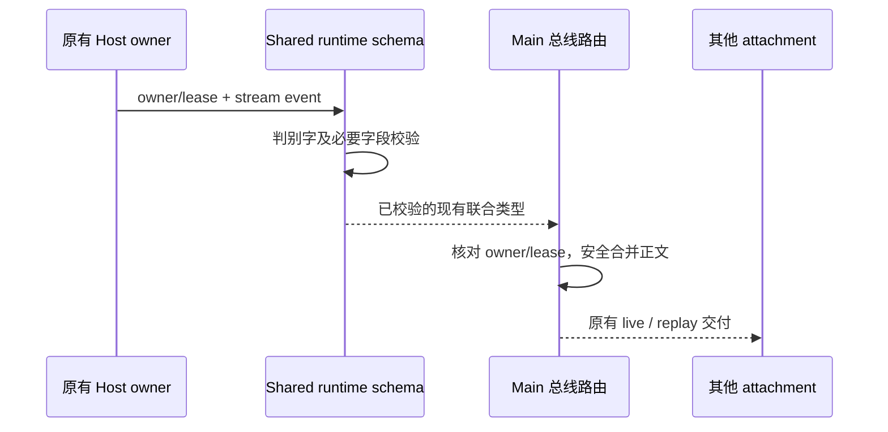

# 桌面实时总线边界校验与类型检查

- Host 是业务会话和流式内容的所有者，Main 的 taskRealtimeBus 只执行 owner/lease 路由、批处理及回放。保留 desktop-continuous 与 web-remote-replayable 的既有区分，不新增业务状态。
- Host 发来的 stream event 必须符合共享 `TaskStreamMirrorableEvent` 的现有联合类型。旧 schema 仅检查 type/taskId/traceId，错误地接受缺少正文、错误工具状态等帧；Main 无法安全地按联合类型合并正文。共享 schema 应按现有事件判别字校验必要字段，并保留兼容元数据，不能通过类型断言假装完成校验。
- 未知事件或不符合当前契约的必要字段在 Host 消息校验入口拒绝，不进入批处理；原有合法 chunk、工具、权限、完成、错误、用量等事件继续接受。使用既有 permission/goal/interaction schema，不复制业务状态或协议命令。
- Main 的文本合并条件必须同时收窄 previous 与 current 两个 op；仅 previous 类型谓词不足以证明 current 携带正文。
- 验收：缺少/错误类型的 chunk content、工具状态、plan steps、网络调试字段及未知事件均拒绝；现有合法事件及 inputId/父工具标识和扩展元数据经 publish/batch 校验后保留。校验结果在 TypeScript 中可直接赋给共享事件联合，不用 any、忽略指令或边界强制断言。
- Main tsconfig 引用现有 scheduler 项目，以声明契约跨越项目 rootDir，不把 scheduler 源码混入 Main 输出。根类型检查在修复后纳入 main，防止该边界再次脱离门禁。

