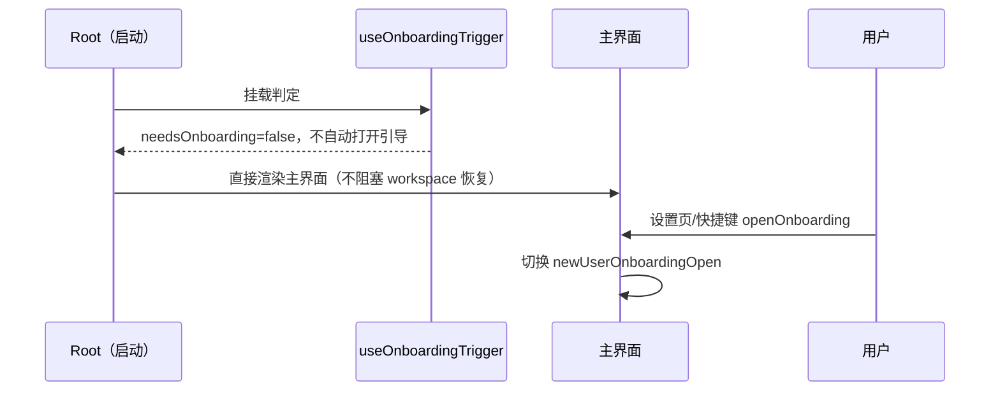

# 首次启动与开屏引导

## 产品规则

首次启动不强制账号登录，也不自动弹出“选择你是什么用户”的开屏职业引导。未登录且本地没有可用模型配置的用户启动后直接进入主界面，由用户自行填写 API Key 或配置 Provider。

账号登录入口、`session-expired`、`logout-provider-required`、provider 可用性登录门禁及 `WelcomeScreen` 已随官方账号链路移除，不再作为启动分支或手动入口保留。

开屏引导只保留手动入口：设置页与快捷键 `openOnboarding` 可切换 `newUserOnboardingOpen`；已保存的偏好和本地引导记录不删除。

默认值只由启动判定函数持有，不新增 settings 字段、不新增持久化状态、不改变 Desktop/Mobile 入口差异。

## 所有者与接口

- `packages/ui/src/onboarding/useOnboardingTrigger.ts` 是开屏引导自动触发判定的唯一所有者，默认不自动触发（`needsOnboarding=false`）；手动打开只读 store 的 `newUserOnboardingOpen`，不依赖该判定。
- 启动路径不再挂载 provider 登录门禁，也不写入 `welcomeScreenOpenReason`；workspace 会话恢复不被登录检查阻塞。
- `packages/services` 的 onboarding-record 服务接口与本地记录文件格式不变，手动引导仍走 `appendRecord` / `getLatestEntry`。
- Renderer 不直接调用 Repo/Service 实现；本次状态不新增跨模块依赖。

## 验收

1. 全新配置（无 provider、无引导记录）冷启动：不出现登录页，不出现“选择你是什么用户”开屏引导，直接进入主界面；启动 loading 不被登录检查延长。
2. 设置页与快捷键仍能手动打开/关闭开屏引导；保存偏好、跳过、写入本地引导记录的行为不变。
3. 源码中不存在官方账号登录、OAuth 登录门禁或 `WelcomeScreen` 启动分支。
4. `pnpm typecheck`、`pnpm lint`、`pnpm architecture:check --changed` 通过，无新增违规。
