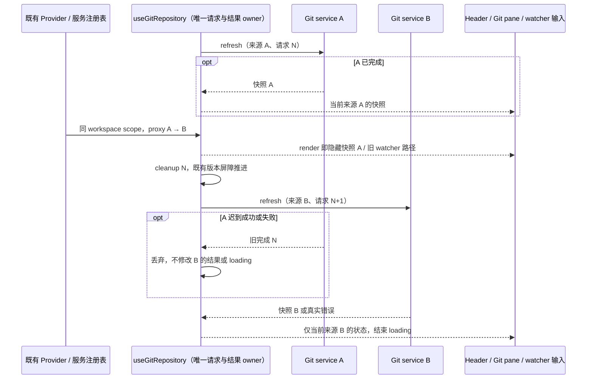

# Git 仓库查询的服务代际

## 范围与已确认原因

修复 `packages/ui/src/hooks/useGitRepository.ts` 在相同 workspace path、workspaceIdentity、remoteSessionId 和 refreshToken 下更换 Git service proxy 时漏发新查询的问题。既有 effect 依赖包含 `gitService`，但内部刷新判据不比较服务对象，导致旧 effect 被清理后，新 effect 直接早退：已完成的旧快照继续显示，或旧在途请求失效后永久停在 loading。

仅修复查询生命周期与来源隔离，不修改 Git RPC 契约、UI 设计、交互、国际化、Host registry 或持久化数据。不新增轮询、重试、超时或第二套 Git 查询路径。

## 唯一所有者与接口

- `ServiceProvider` / 既有 workspace 服务注册表拥有当前服务 proxy 的选择；hook 通过现有 `useServices` 与 `useResolvedRemoteWorkspaceSessionId` 读取它，不直接访问平台或 Host。
- `useGitRepository` 是本组件 Git 请求与结果的唯一 owner。沿用一个结果 state、既有请求版本与刷新输入 ref；结果连同产生它的实际 `IGitService` 对象及解析后的 remoteSessionId 保存在同一个 state 槽中，不另建 serviceId、代际计数器、快照缓存或 accepted 队列。
- 刷新判据比较实际 `gitService` 对象身份，而不是 accessor 包装对象、refresh 方法或仅 workspace key。解析后的 remoteSessionId 同样参与 scope 判定，并保留本地 null fallback。
- 所有 Git 数据仍由一次公开 `IGitService.refresh({ workspacePath, includeIdentity, includeBranchComparison })` 取得；service scope 负责 endpoint 路由，不向 Git 命令增加不存在的参数。
- 为移除当前超长 hook 的既有 max-lines 豁免，仅将现有类型、空态与数据集投影移入 `packages/ui/src/hooks/gitRepositoryState.ts`。该文件是无 IO、无 React 状态的纯投影，原 hook 的公开类型导出及调用方路径不变。

## 不变式与旧结果失效

1. 服务对象、解析后的 remoteSessionId、workspace path 或身份 key 改变，都属于新的请求来源；新来源可用时必须重新查询一次，不能被旧刷新输入吞掉。
2. 结果的来源不匹配当前 service / remoteSessionId / workspace key 时，render 阶段立即投影为空态，不能等 effect 才隐藏旧分支、文件或 watcher 路径。
3. 来源切换沿用既有请求版本屏障：新请求、远端不可用和 hook 卸载推进版本，旧成功/错误不能覆盖新来源的数据、错误或 loading；不尝试取消没有取消契约的 Git RPC。单个取数 effect 的依赖清理不代表请求来源失效。
4. 同来源手动刷新可以保留当前快照并显示 loading；跨来源读取必须清空旧快照。新结果或真实错误结束该次 loading。
5. 不改变既有性能触发条件：相同 service / scope 的父级重渲染、task 切换和 accessor 包装更换不查询；Git pane 从关闭到打开补取扩展数据，关闭不反向补读；手动 refreshToken 改变仍只发一次 refresh。
6. 远端未 ready 时不发 Git RPC；本地路径 fallback 保持。此次不改变 desktop-continuous 或 web-remote-replayable 的 stream、owner/lease、快照恢复语义。

7. 同 service/source 的扩展读取在途时，`includeExtendedData: true → false` 只关闭 pane，不作废请求、不补发基础读取。已在途的 identity/branchComparison 是当前基础数据的 superset，可继续接受其结果或真实错误来结束 loading。真正换来源、发起下一次请求、远端失效及卸载仍必须拒绝旧完成。
8. hook owner 终结时同时推进 `requestVersionRef` 并清空既有 `lastLiveRefreshInputRef`。React StrictMode 的 setup → cleanup → setup 复用 ref 时，第二次 setup 必须重新读取，不能沿用已失效请求的 gate；允许开发态 React 自身的重复 setup 产生新读取，旧成功/错误均不更新当前结果。



## 验收与验证

先增加 `packages/ui/src/hooks/useGitRepository.test.ts` 并在修改实现前实际运行，确认至少以下两项红测：

- settled A → 相同 scope 的 B：B 必须发一次 refresh，切换首帧与 B 在途期间不展示 A；B 返回后正确显示分支、文件和 watcher 路径。
- pending A → 相同 scope 的 B：B 不被旧输入 gate 吞掉；A 在 B 前后迟到成功或失败均不更新 B；B 返回后 loading 为 false。

- 同来源扩展请求在途 → 关闭 pane → 原请求 resolve：修改前定向专测确认 `refresh` 仅 1 次但 loading 永久 true；修复后仍仅 1 次，接受 superset 完成并解除 loading。另验证关闭后卸载 / 换来源时该旧请求仍不能写入。

```text
同source: refresh(N, extended=true) → pane关闭(false，不换代、不补读) → response N → 接受/结束loading
卸载/断连/新请求: requestVersion换代 → response N → 丢弃
```

同时覆盖相同 service 对象的 accessor 重包 / task 重渲染不重复查询，以及 service 对象复用但解析后的 remoteSessionId 改变时重新查询。保持扩展面、手动刷新和断连等待的既有触发边界，不扩大生命周期审计范围。

新增隔离的 `scripts/ci/performance-git-service-browser.test.mjs` 与 `packages/ui/test/performance-git-service*`，用真实 React hook / Provider 和受控 Git 响应执行 settled/pending A → B、同来源扩展请求关闭面板以及 StrictMode effect 重放，不启动用户 Agent、Git 命令或数据库。Vite 使用临时 cacheDir、noDiscovery 与非空 include；浏览器组由父代理调度，本轮不重启或操作真实应用。

最终官方 IAB 受控组件回归实际通过四场景：settled/pending A → B 时立即隐藏 A 并由 B 结束 loading，B 完成后迟到 A 不覆盖；关闭扩展 pane 保持单次请求并接受当前完成；StrictMode 的旧请求结果被丢弃，第二次 setup 的当前结果被接受。宿主高层指针 click 超时且 Enter 未产生可确认事件，改以已观察唯一 locator 的页面 click 驱动实际组件，不能把这写成真实指针或完整键盘 E2E；没有切换外部浏览器、运行 Git/Agent 或访问用户数据库。

单测与门禁使用 Node 24.14.0，经 `node <corepack.js> pnpm` 启动：新 hook 单测、`pnpm typecheck`、`pnpm lint`、改动文件格式检查及 `pnpm architecture:check --changed`。如存在已有失败或浏览器未执行，报告真实边界，不写为通过。
