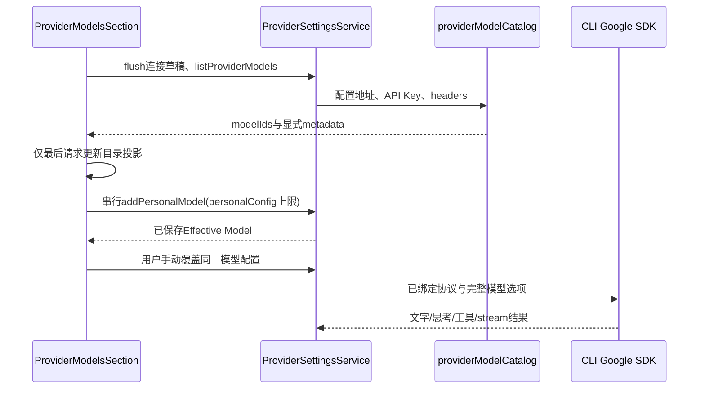

# Gemini 原生 Provider 与模型目录

## 产品规则与迁移边界

- 增加唯一协议枚举 `google-generative-ai`，由 CLI adapters 的 Google AI SDK 编码原生 URL、`x-goog-api-key`、`contents/parts`、`systemInstruction` 与 `model` 角色。地址采用用户配置，不重写为官方地址；官方直连以自定义连接配置。
- 新增 OpenCode Go/Zen Google 模板，不新增账号品牌或套餐 family。保留 fork 的配置归一化、导入及身份性能逻辑，不用上游全文件覆盖。
- 模型目录唯一实现仍为 services/model-provider，通过现有 provider-settings 服务与 hooks 调用。Google 主备 `/models?pageSize=1000`；无版本段时备选 `/v1beta/models?pageSize=1000`；已有版本段不得重复拼接。
- 原生 `models/` 前缀剥离；只映射显式 inputTokenLimit、outputTokenLimit、displayName、supportedGenerationMethods。缺失元数据继续规则匹配，不填零、不依据模型名推断能力。此归一化只适用于 `google-generative-ai`；OpenAI/Anthropic 继续使用原始 `id`（包括合法的 `models/` 前缀），不把 `name` 或 Google 字段作为它们的身份与元数据。
- 目录 token 上限必须写入 `personalConfig` 并走真实 `addPersonalModel` 保存路径；仅写 `model.config` 会在保存时被丢弃。只写两个明确来源叶子，不把推荐能力物化；用户后续手动覆盖优先。
- OpenCode 原生地址的临时站点规则只适用于精确 `https://opencode.ai/inference/(go/)?google/v1beta`。9 个模板模型上下文 1,048,576；两个 Argon 输出 32,768，其余七个 65,536。未知模型、官方地址、自建代理不受此上限影响。端点可返回元数据后删除临时常量，避免两个事实源。
- Gemini `maxOutputTokens` 映射进入 `generationConfig`。思考默认档省略 thinkingConfig，不发送 thinkingBudget:0 或 minimal（上游已确认部分端点会 400）；增强档发送 thinkingLevel:high 与 includeThoughts:true。默认档不承诺端点关闭思考。
- 只声明可实际编码的能力。图片转换需 mock 覆盖；不因为上游模型系列声明就开放未验证的视频、音频、PDF 附件。Google 原生搜索若 SDK 可编码则使用 Google 工具并 mock 验证，否则关闭虚假能力，不能增加兜底。
- 获取模型按钮保持可点击；原生端点可能不实现目录，预防性提示与实际失败并存，手动添加始终可用，不把官方目录误称为恒定失败。

## 所有者与事件顺序

ProviderConfigRuntime/ProviderSettingsService 是配置与持久化唯一所有者；UI 只拥有未提交选择与目录投影；CLI binding 固定 Provider 配置，执行请求通过现有 option-map fetch，不新增缓存或写入路径。

桌面与远程 Web 均复用环境中的 provider-settings owner；此改动不变更会话 stream 的 desktop-continuous/web-remote-replayable 语义。旧目录请求以 requestId 丢弃；失败不修改持久化状态。

## 工具签名契约

Google 返回的 thoughtSignature 属于该 tool-call 的 providerOptions，不能借用 reasoning 字段、生成本地签名或依赖 SDK skip_thought_signature_validator。模型结果 normalizer 是入站映射 owner；ModelToolCall 可选 providerOptions 通过现有 history/persistence 原样保存，恢复后按同一 tool-call 投影回 SDK。历史所有者在接收 entries、init/replace 和返回可写快照时深拷贝工具 providerOptions；调用方修改嵌套 metadata 不得污染 canonical history 或下一次真实签名回放。Core 的 ToolCallInput / ModelInputMessage 复用现有 contracts 类型，保留公开名称，不维护第二份同形字段。新增/stream final call 均保留真实签名，不记录签名或 Key。旧历史没有签名仍可反序列化，但 Gemini 3+ 原生 functionCall 回放缺签名在 adapter 发送前明确拒绝，提示使用新会话，不通过哨兵伪造成功。不改变 desktop/mobile stream投递边界，不新增持久化路径。

## 验收

无真实 Key 的 mock 测试覆盖原生文字、stream、工具及工具结果续轮、图片转换、思考/输出参数、搜索定义与请求编码；目录鉴权/路径/pageSize/元数据缺失；真实新增保存与用户手动覆盖；OpenCode 作用域及九模型上限；目录提示与失败共存。执行目标包测试、typecheck、lint、architecture check，并如实报告限制。

持久 UI 验收运行 `node scripts/ci/self-managed-models-smoke.mjs`，保留已有回归并在中英/390/1280 增加：真实 API 格式 Select 切换到 Google Gemini 原生并保存；获取目录返回显式 metadata，勾选后检查实际 `addPersonalModel` payload 只带目录 token 上限，元数据缺失模型不填零；再次获取目录不覆盖已添加模型；手动编辑并保存上下文/输出上限后优先于目录值。原生目录不支持的预防说明与实际失败提示必须并存，手动添加入口继续可用。夹具不访问外网；`--serve` 保留主代理人工 GUI 验收。
