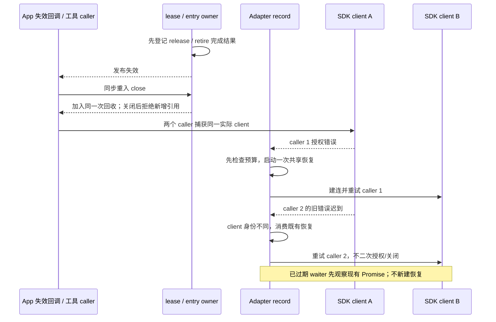
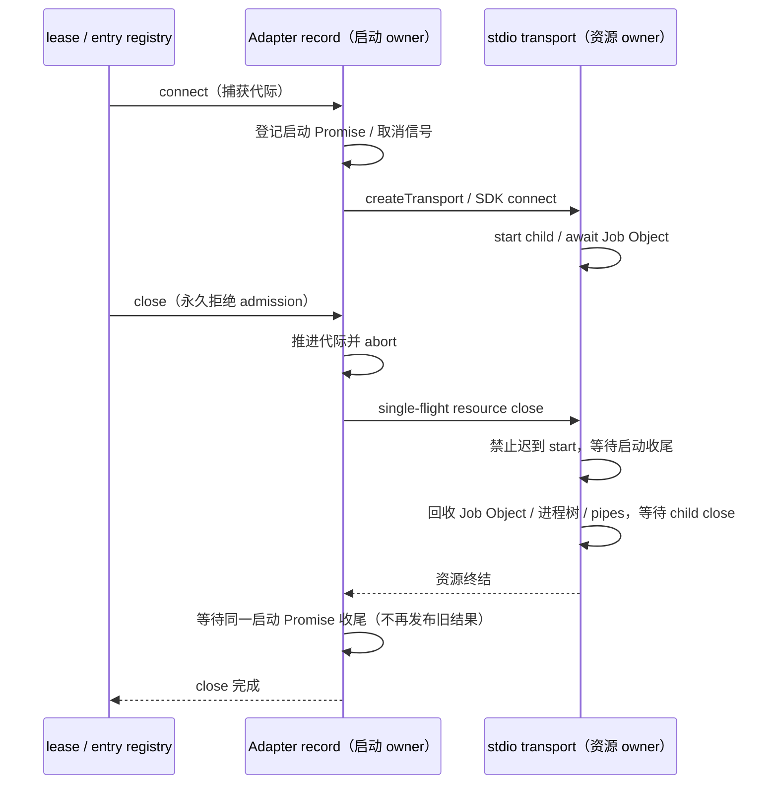
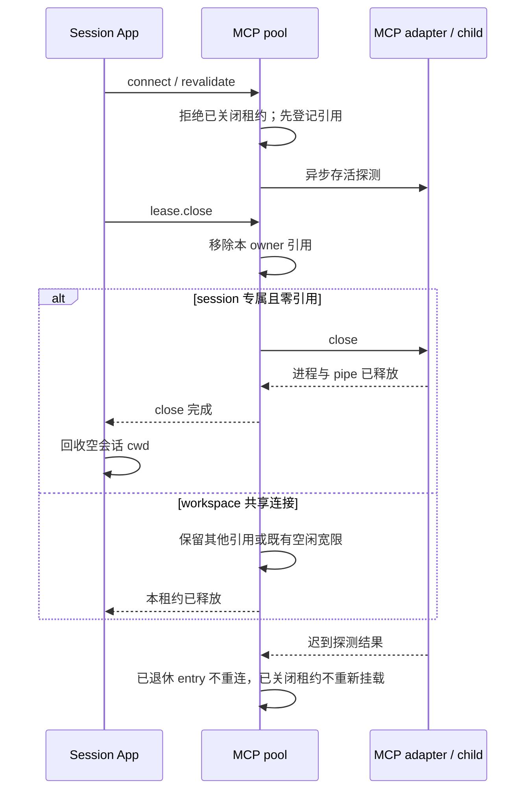
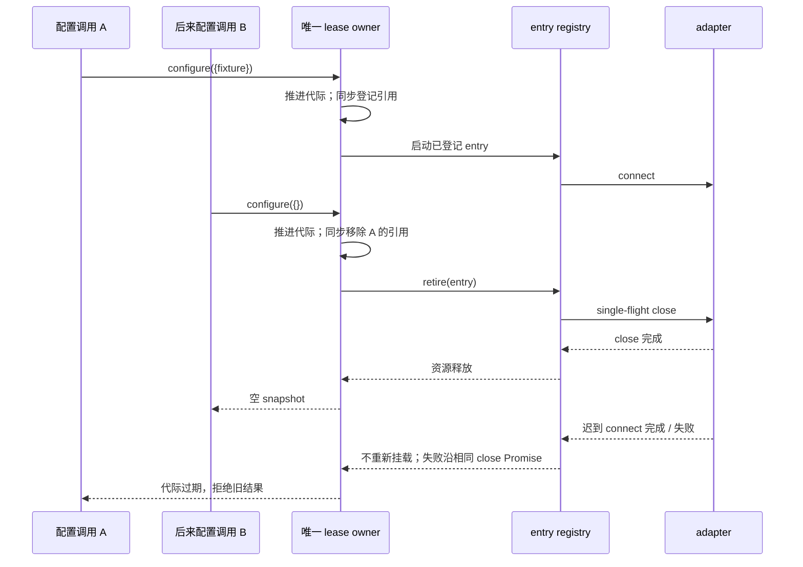

# MCP 会话租约关闭的资源边界

MCP connection pool 唯一拥有 adapter、引用和关闭 Promise。默认 `session` isolation 的连接只能被该租约使用，关闭租约后没有可复用的 owner，必须立即关闭并等待 adapter 释放进程；不能套用共享连接的 30 秒空闲延迟，否则 Windows 会话 cwd 被锁住，草稿删除无法回收空目录。

`workspace` isolation 仍按全部 owner 的引用计数决定是否回收，正常租约关闭保留已有空闲宽限。任何租约只释放自己引用，不影响另一个活跃 owner。相同 entry 的关闭是 single-flight，pool.close 同时等待已开始关闭的 entry，不因它从活跃 map 摘除而提前返回。启动前因零引用被拒绝的 entry 也必须由 registry 立即退休，不保留 rejected connecting 到宽限缓存；宽限只保留可复用的正常连接。

内置 node_repl 虽标为 workspace isolation，其 `config.cwd` 可显式指向某个会话执行目录：配置参与 connection key，只有继承同一 cwd 的会话能复用这条连接。因此 stdio 的显式 cwd 不同于 `workingDirectory` 身份根时，最后一个租约关闭同样立即等待回收；还有其他引用时保持共享连接。真正使用 workspace 根的连接继续保留宽限。

关闭是 admission 边界：已关闭的租约和已关闭 pool 的现存租约均拒绝新连接。对共享 entry 的 revalidate 必须先登记 owner 与租约引用，再等待网络探测；因此等待期间关闭也能释放引用。探测结束后若 entry 已退休，不得再次启动 adapter；仍有其他 owner 的共享连接可以继续探测。迟到完成不能重新挂回已关闭租约。

显式 disconnect、配置移除与配置替换均复用同一引用释放路径：零引用的 session / execution 连接立即回收，调用结果等待回收完成；workspace 根共享连接保留空闲宽限。租约记录自身已开始的回收 Promise，随后 close 必须等待这些仍在关闭的旧连接。pool.close 的重复调用共享关闭 Promise；开始关闭后空配置连接请求也必须拒绝，不能绕过 admission。内部实现拆分 entry 生命周期与 lease 适配，entry registry 仍唯一拥有连接、引用、探测和关闭状态，lease 仅持有引用与自身清理等待。

disconnect 在读取状态的异步等待前释放所捕获的引用，迟到状态不得释放同名新连接。配置替换等待旧资源后再次验证租约与 entry 身份，不能将等待前的成功结果交给已关闭 owner。

同一 lease 是配置 admission 的唯一 owner，不新增第二份 accepted queue。connectConfiguredServers 在第一次 IO 等待前按收到顺序同步完成移除及全部连接引用的登记；后来的空配置也能移除前一请求尚在建连的引用。配置命令推动 lease 代际，旧全量请求或旧 snapshot 在每次 IO 返回后核对代际与 entry 对象，已被替换即拒绝，不得重新挂引用或交付混合新旧配置的快照。不同 server 的单条 connect 可同时等待，各自仍按捕获的 entry 验证结果；disconnect 只返回其捕获的旧连接状态，不改同名后来连接。

connection key 的 session 分支同时包含 lease 与 `workspaceIdentity?.trim() || workingDirectory` 身份；stdio 还包含按 workingDirectory 解析的实际执行 cwd，工作区身份相同但执行目录改变也必须换 adapter。本地不传 workspaceIdentity 时保留 workingDirectory fallback。workspace 分支不包含 lease，因此相同身份、配置及执行 cwd 的多个 lease 仍共享；不同身份或实际 cwd 不共享。引用持有具体 entry 对象而不是只有 key，失败退休后的同 key 新 entry 不得被旧 lease 隐式借用。

新 entry 先进入 registry 并登记 lease/owner，再在同一资源路径启动 adapter。启动前已 release 或 close 的 entry 不再 connect/launch。adapter.connectServer 同步抛错与异步 rejection 都退休该 entry 并等待 single-flight adapter.close 后向调用方拒绝；配置正常返回 failed status 仍可用于诊断，不混同于抛错。adapter factory 抛错时回收已经登记的 process tracker。已退休 entry 的关闭 Promise 保留到该对象释放，任何后续 lease.close/pool.close 不重复 adapter.close。

## 最终独立复核：同步重入与迟到 caller

三条真实接缝另有已确认缺口，修复仍使用现有 lease、entry、record 和 caller deadline，不新增 accepted queue、恢复索引或第二套 owner：

1. lease 引用释放发布 App invalidation 前，必须先登记其 single-flight 退休结果和本 lease 的 pending release。同步 listener 重入 lease.close 时只能等待同一次完整回收，不能先完成空 cleanup。配置替换/新增引用的同步步骤也检查 lease 已关闭：listener 中关闭后，外层 admission 不得继续给该 lease 加新引用或启动 replacement。workspace 宽限和其他 owner 的活跃引用不受影响。
2. `waitWithinMcpDeadline` 的参数 Promise 已经启动；即使检查剩余预算同步拒绝，也先观察其迟到 rejection，不留下未处理拒绝。创建新的重连或 OAuth 恢复前先检查 caller 剩余预算；已过期 caller 不新建事务，已经存在的共享事务仍由 record owner 继续持有，caller 的 timeout/abort 不能取消它。owner.close 继续排空实际启动和资源释放。
3. 工具调用捕获实际使用的 SDK client 对象，不只捕获恢复期间保持不变的 record。旧 client 的授权错误或确定的 `Not connected` 在共享恢复已经 connected 后迟到时，复用同一 record 已完成/在途的恢复，并在当前 client 重试一次，不能再次授权、重连或关闭正在处理其他 caller 的新 client。当前 client 的新授权错误仍按原入口启动新恢复；旧 record、配置替换、App 固定连接和已关闭 owner 仍保持原拒绝边界。

先补回归证明三个缺口：App invalidation 同步关闭后 lease.close 未到实际资源边界即完成、预算到期后的真实 stdio 重连导致隔离进程 fatal rejection、两个旧 caller 的第二个错误晚于首次恢复 connected 时重复授权并击断新 client 的正常请求。测试使用确定的 Promise barrier/合成时钟和真实 SDK/stream 接缝，不用 sleep、删除重试或全局 unhandledRejection 兜底；修复后全部 caller/close 完成边界、授权次数、client 引用与活跃进程计数均验收。

实际结果：租约 disconnect/replace/close 三项重入先红后绿，workspace 根与执行目录的共享兼容补两项；过期 deadline 的 Promise 观察与真实 stdio 迟到重连拒绝两项先红后绿。真实 SDK 内存 transport 验证迟到授权/断连错误各只消费既有恢复，两个新 client 请求都成功，随后当前 client 真正发生新授权错误仍允许下一次恢复。完整 MCP 四文件 66 项通过；相关客户端/服务端握手、RPC、手机和 UI 33 文件 335 项通过。全部使用 Node 24.14.0 与隔离输入，无全局未处理拒绝兜底；CLI 总 Lint 仍是与 HEAD 相同的 56 warning/79 error，不将其写成通过。

## Adapter 启动与关闭的真实完成边界

pool entry registry 拥有引用与 adapter 退休结果，`NodeMcpAdapter` 的同一 server record 拥有启动 Promise、取消信号和 record 关闭 Promise；stdio transport 唯一拥有实际 child、pipe、Windows Job Object 及其启动/关闭完成边界。连接在线或失败时更新同一个 record，不丢掉仍在完成的启动等待。资源关闭按 transport 对象 single-flight，启动失败清理与 record.close 共用资源回收，但资源回收不反向等待 record.connecting，避免关闭与启动互相等待。

adapter.close 是永久 admission 边界，调用即阻止新连接和迟到启动，重复调用等待同一完成结果；向 App 监听器发布代际失效之前先登记关闭 Promise，同步重入也只能加入这一结果。运行期 OAuth 恢复复用同一个 server record 的启动 owner，并发工具的授权错误仍加入一次恢复，不能被关闭护栏误拒。工具调用的迟到 OAuth 错误或断连错误也核对捕获的 record 仍属于当前连接且未关闭；已退休调用不得新建授权事务、重连或覆盖后来配置，调用原错误仍向其 waiter 传播。第一次 await 前尚未公布 record 的 connect，以及同名 connect/disconnect 的迟到 continuation，在原异步边界返回后核对连接代际与关闭状态，不启动进程、不覆盖新 record。createTransport 返回后、SDK connect/listTools 返回后也核对取消与代际，不能让已取消 transport 迟到 launch 或发布 connected。

record.close 先取消并沿唯一资源路径关闭已公布的 client/transport，再等待 record 的整个启动 Promise。启动中的 SDK connect 即使外部等待预算或 AbortSignal 已结束也要被观察并等待其收尾；`withTimeout` 对已取消 waiter 仍必须安装传入 Promise 的拒绝处理，不能让已创建的 SDK Promise 成为 unhandledRejection。OAuth caller 等待预算仍不取消共享授权事务；只有连接 owner 关闭才结束它。

stdio transport.close 同步标记终态，禁止 SDK 探测结束后再启动会话 transport。关闭等待已经开始的 start 与原生 Job Object 接管完成，然后使用既有进程树回收和 SDK pipe 清理，并等待 child close。迟到原生句柄归属于同一个 transport 关闭路径，不能在 close 完成后留存。保留 SDK sibling `_dispose` 的原型接缝、既有 Windows Job Object/taskkill 与 POSIX 进程树边界；不添加空闲延时、删除重试或全局未处理拒绝兜底。

验收：受控 adapter 未关闭前 session lease.close 与 pool.close 均保持 pending；重复关闭只执行一次 adapter.close；共享 workspace 两个租约释放一个不关闭另一个，最后释放继续遵守宽限。真实 Windows CLI 的 v4 deleteSession 与 legacy session/close 后空目录立即消失、恢复可重建。进程测试 HOME、USERPROFILE、数据根和数据库都隔离到临时目录。

补充验收：disconnect、空配置同步、配置替换在受控 adapter.close 完成前保持 pending；其中任何入口正在回收时 lease.close 同样等待。重复 pool.close 在 adapter 完成前不返回；已关闭 lease / pool 的空 connectConfiguredServers 请求拒绝。探测期间一个共享 owner 关闭但另一个存活时，仅存活 owner 得到完成结果。

真实接缝验收：admission 后立即 close、第一次 await 后 close、createTransport 返回前取消、真实 child spawn 后 close、SDK sibling probe 中 close，以及受控 Windows Job Object 接管未完成时 close 均覆盖。关闭结果完成时所有本连接 child/pipe/原生句柄已释放，统计无活跃 entry；关后同名 connect 拒绝，disconnect 或旧同名 connect 不覆盖后来 record；未取消的 stdio legacy/auto/pin 正常连接与其他共享 owner 仍可调用。初始已取消的 timeout waiter 对迟到拒绝必须有处理器，所有测试使用隔离 cwd 与合成协议数据，不注册生产全局 unhandledRejection 监听。

本次回归：连续不等待的 configure({fixture}) → configure({}) 最终只有空 snapshot，旧请求拒绝；移除等待期间后来配置必须获胜，旧命令不得迟到创建 adapter。snapshot 的 status/listTools 待返回时同名替换应拒绝混合结果，不误拒不同 server 的并发单条 connect。protocol-settings 同 lease 的两个本地 workspace（仅传 workingDirectory、revalidate）必须使用各自 adapter；显式 workspaceIdentity 和实际 cwd 变化同样隔离，合法跨 lease workspace sharing 继续复用。同步抛错与异步拒绝的 connect 都等受控 close 完成再拒绝，重复 close 一次；失败后同 key 的新连接不复用旧 adapter，也不被旧 lease 借用或释放；admission 后立即 close 不得开始新 connect。workspace 零引用使启动拒绝后，在非零宽限内另一 lease 以同 key、默认 revalidate:false 建连必须新建 adapter 并成功；新连接 online 后关闭 lease 仍保留原有宽限。
