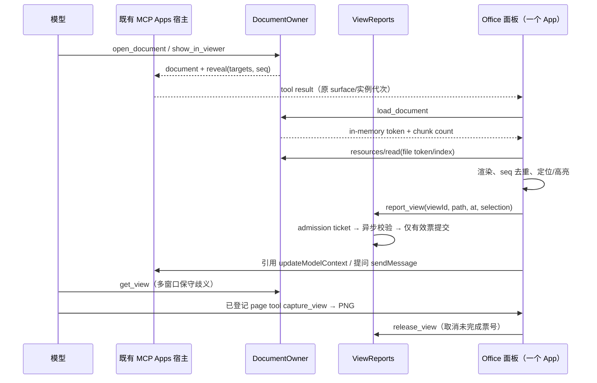

# 官方 3.16.2 Office 共同阅读闭环（本仓只读适配）

## 1. 任务边界与基线

- 实施工作区：`C:\vibecoding\zcodium-adopt-3.16.2`；只读来源：`C:\vibecoding\zcodium-upstream-3.16.2-review`，固定提交 `3c5b227649371507ddc4eb46ac5133afe6db1cab`。
- 开工已证实本仓不存在 `apps/zcode-cli/packages/office-runtime`。择目录吸收官方完整 parser、viewer、共享契约、锚点、资源编译、测试、合成 fixtures 和适用许可；已有四格式普通 PreviewPane 不等同于此共同阅读闭环。
- 原阅读主体实施阶段只修改 office-runtime 新目录、四文档插件 manifest/package.json/新增 viewer 技能、bootstrap 两个 runtime 重写接缝及对应 tests、本 spec。保留原有制作技能、agents、env_setup、0.1.9（documents/spreadsheets/presentations）与 0.2.1（pdf）。发布升版统一由主代理决定。
- 原阶段不改原仓或只读上游；不派子代理；不提交、推送、产品打包、发布、真实安装；不读取真实用户数据。当时未授权公共 package.json、lockfile、architecture-policy.yaml、builtinPluginAssets、SEA/prepare、locales 或总维护交接；后续仅公共资源集成的重新授权见 §9，不重新实施已交付阅读主体。
- 本项资源编译与 MCP/UI fixture 测试只使用 OS 临时目录，不是产品打包；资源用完清理。不得自动下载字体、官方市场或云资源。

## 2. 用户可见规则

四个内置插件在原制作功能外各新增共同阅读面板与 viewer 技能。

| 插件          | 格式    | viewer 技能 | MCP/server/surface 名 | 面板资源                        |
| ------------- | ------- | ----------- | --------------------- | ------------------------------- |
| documents     | `.docx` | docx-viewer | documents             | `ui://documents/panel.html`     |
| spreadsheets  | `.xlsx` | xlsx-viewer | spreadsheets          | `ui://spreadsheets/panel.html`  |
| presentations | `.pptx` | pptx-viewer | presentations         | `ui://presentations/panel.html` |
| pdf           | `.pdf`  | pdf-viewer  | pdf                   | `ui://pdf/panel.html`           |

1. 用户通过工作区文件列表或输入工作区相对路径打开文件；模型调用 `open_document` 打开既有 MCP Apps surface。不提供系统文件选择器、工作区外导入、上传、编辑或保存能力；删除而非禁用不可用的导入按钮。
2. 模型通过 `read_document` 分页获取正文，通过 `search_document` 获取可回读/可定位的锚点，通过 `show_in_viewer` 打开专用 Agent surface 并定位/高亮。同一调用的所有目标必须归属同一文档。
3. 面板可选区引用（`updateModelContext`）和提问（`sendMessage`），复用宿主现有会话动作、权限确认与 CommandInbox admission，不创建 executor、session owner、任务队列或另一条发送链路。
4. `get_view` 返回具体窗口最后上报的文档、可见位置、选区及文本。多个窗口且未指定 viewId 时返回歧义与窗口列表，绝不任选最后写者；指定不存在的 viewId 时返回稳定错误。
5. `capture_view` 是页面提供的只读工具，初始化时公布静态 schema，UI 加载后绑定 handler；打开并渲染成功后可截当前视图或指定锚点的 PNG。没有面板/handler 未就绪/取消/非法锚点均显式失败，不假冒服务器文本截图。请求以静态 schema 同等规则做运行时校验；handler 绑定与 render-ready 用事件唤醒，AbortSignal 在等待和截图前后生效，generation 改变后的截图结果丢弃。
6. 窗口草稿、滚动、菜单、查找是 UI 局部状态；可选恢复状态仅使用宿主提供的不透明 stateKey。没有该能力时仍可阅读，不自行拼路径/sessionId 恢复 key，不向宿主宣称已实现新的窗口恢复功能。
7. 控件、菜单、元数据与浮层使用本仓 `text-ui-*` 语义字号和宿主样式变量；文档本身的原生字体/页面几何属于阅读内容，不用界面字体缩放改变文档布局。兼顾中文/英文、亮/暗、窄视口、键盘查找与 Escape 退出。

## 3. 唯一 owner、接口与事件顺序

### 3.1 所有权

- `contract.ts` 是构建输出和插件 `office.title/kinds` 的共同契约；插件名从 `.zcodium-plugin/plugin.json` 读取，不从带 `-plugin` 后缀的目录推导。
- `src/contract.ts` 是面板/server 共享的格式、DocumentInfo、ViewState、ViewerSnapshot、错误码和限额契约。
- `src/domain/anchor.ts` 是唯一锚点语法/规范化 owner：`<workspace-relative path>#<locator>`；DOCX `p:N[-M]`、`t:N[/rRcC]`；XLSX `Sheet[!A1[:B2]]`（带空格/引号的表名按现有语法）；PPTX `slide:N[-M]`、`slide:N/shape:ID`；PDF `page:N[-M]`；一律 1-based，parser 校验真实边界。
- `src/app/documents.ts` 是解析缓存、文件句柄、模型指定当前文档、reveal sequence 的唯一 owner。官方此提交把窗口 map 内联在该文件，实际不存在 `app/views.ts`；本仓将独立的窗口内存状态收敛到 `src/app/views.ts`，由 DocumentOwner 唯一持有，不创建第二份 view map。
- `src/app/views.ts` 持有窗口 reports/views 与 report ticket；新 report admission 先取得票号，异步校验完成后只提交仍有效的票号；release/close 使旧票号无效，旧 report 不得复活关闭窗口。窗口 report 不改变模型专用 surface 的 current document。
- `src/adapters/files.ts` 负责工作区只读 IO；parser 按格式转换为纯 ParsedDocument。UI 通过既有 App 的 tool/resource/message ports 访问，不直接触摸 fs、Repo、Service 或 `window.zcode`。
- `ui/host.ts` 的一个 App 在 bootstrap 加载前初始化，预先安装 tool-result/host-context/page-tools handlers，缓存并在主 UI 挂载时排空结果。资源 bundle 不建立第二个 App。
- bootstrap seed 是已有宿主生命周期 owner；只改 runtime manifest 输入接缝，不重做 seed、锁、目录缓存、回退或 discovery。
- UI 以受控工作区 picker 替换原文件 input，`list_documents` 只读取已存在文件；路径提交仍经过 `open_document`，不创建另一条加载/写入路径。视图 hook 拆出只读打开、快照 admission、引用/提问、窗口 report，单个新增/修改源码文件控制在 400 行内。
- PDF 的本地 reveal/find/page-text 状态集中到 `createPdfMarks`，渲染器只通过 decorate/paint 与 rendered-page port 交互；资源读取/截图、内部链接与本地 pointer/keyboard 投影分别拆出，不复制 DocumentOwner 的文档事实或创建第二个 accepted queue。关闭或切文档清除本地 marks，失效中的异步定位/查找不提交旧结果。
- `useAgentPointer` 是 Shell 的本地 Agent 标记、异步 reveal admission 与 resize pinning 唯一 owner，保留原窗口 generation/handle 检查；PPTX 几何选中/outline 为纯 DOM 辅助。任何正页和缩略图路径都不提供外链导航，只有真实内部 slideIndex 可导航。
- `resourceManifest.ts` 是 bundle/font 清单及局部资源名称的纯校验入口；bootstrap、asset reader 和 FontFace 均复用，限制分片数量、重复项、UTF-8 总量和 unicode-range，不接受 URL 或二次编码。

### 3.2 生命周期与兼容

- 每个 MCP server 进程隔离一个 DocumentOwner；宿主 workspaceIdentity/remoteSessionId/owner/lease/generation 仍由既有宿主路由负责，本项不更改。
- Desktop continuous 与 mobile replayable 的传输由既有 MCP Apps 实现。Office 使用 reveal.seq 去重与 UI load generation 防 stale result；不靠延迟掩盖同步，不承诺本项已验收真实远程或手机宿主。
- 解析缓存按路径与 size+mtime 失效，revision 为内容 hash；只缓存最近 6 个文档，最多 4 个 in-memory 文件句柄。过期 token 要求重新 load。
- report_view/release_view 修改的只是内存，保留 app-only、readOnlyHint=false，不能因只读裁剪而删除。正常离开 release，异常退出最多导致保守歧义。
- 关闭释放 DocumentOwner 状态与句柄，不在启动/退出进行文件清扫或导入写入。

## 4. 安全边界与失败语义

### 4.1 工作区与本地资产

- 保留 files.ts 已有两次 containment：先 realpath(workspace)，检查解析目标的词法 containment；再 realpath(target)，检查实际路径 containment，拒绝外部 symlink/junction。路径只能指向受支持格式的普通文件。
- 大于 100 MiB 的文件在解析前拒绝；OOXML 解压总量上限 512 MiB，保留 zip-bomb guard。读入后仍检查实际字节数，避免 stat 后增大绕过上限。
- 面板 byte chunk 4 MiB，base64 在宿主单次 8 MiB 限额内；bundle 4 MiB UTF-8 边界分片，不直接把大脚本嵌入模型结果。
- 资产名称先匹配格式白名单，拒绝 `..`、反斜杠、非法/重复编码与越界路径。包括 panel.html 在内所有资产读取都额外 realpath(root) 与 realpath(target)，检查 actual containment，防 bundle/font/wasm 的 symlink/junction 越界；只读普通文件并在读取前后限制资源大小。
- assets.json/script/font 清单来自本地编译资源，UI 二次验证资源名/数目/总大小，不能使用文档内容或清单绕到 http(s)/file URL。

### 4.2 网络、字体与日志

- Office 面板资源 `_meta.ui.csp` 明确空 connectDomains/resourceDomains/frameDomains/baseUriDomains；只按格式声明必要 `wasmUnsafeEval`（XLSX/PDF），不声明 unsafeEval。worker/font/image 使用资源转成 blob，不允许面板外网。
- 关闭 http(s) 外链、脚本 URL、导航入口仅限 Office UI（渲染文档委托拦截并移除外链 href，MutationObserver 处理延迟内容，避免原生“在新标签打开”绕过 click guard），不修改通用 plugin openLink 或宿主 capabilities。内部 DOCX 书签和 SVG 片段资源仍可使用，不调用 app.openLink/window.open。
- 字体只做系统 `local()` FontFace 检查；PDF 未嵌入 CJK 按官方字体链与 CJK 文本归一；系统字体全失败才读随包 Fontsource Noto Sans SC 分片，以 FontFace(ArrayBuffer) 注册。无 CDN、无 font download。制作技能已有字体维护/env 更改完全保留。
- Office server 入口、MCP tool/resource 错误出口仅返回固定错误码与净化后的通用文案，不输出 raw stack/真实路径/文件内容/原始 Error.message；不 log raw stderr。模型主动 read/search 的正文属于功能返回，不属于日志。
- 不引入官方账号、云配置、rollout、市场自动拉取、relay、遥测、分享/上传/额度/更新等控制面。

### 4.3 工具集

- 模型+app：open_document；模型：read_document/search_document/show_in_viewer/get_view；app：list_documents/load_document/check_document/get_viewer/report_view/release_view；页面：capture_view。
- 删除 begin_file_import/write_file_import/finish_file_import/cancel_file_import 注册、importer 类型/IO、启动初始化/清扫、UI 文件 input 与 import RPC，未知导入工具必须由真实 MCP 返回拒绝。
- schema 限制 anchor/path/query/selection/target 数目；read/search 结果受 TEXT_BUDGET 分页/截断控制；invalid_anchor/invalid_token/invalid_resource 等稳定错误码保留。

## 5. 插件与既有 runtime 重写接缝

- 四插件 manifest 保留身份、版本、作者、Apache-2.0、制作 skills/agents，新增真实 stdio MCP `node ["${CLAUDE_PLUGIN_ROOT}/dist/server.mjs"]` 与 session surface；package.json 新增 office.title/kinds 与 build/smoke/fixture 命令，不声明未实现组件。
- 运行时由已有 plugin-host 调用 built server 导出的 main；直接执行 server.mjs 仍可独立启动。不创建新 executor。
- writeOfficialPluginRuntimeManifest 必须接受 seed **原 manifest 内容**。current-cache 复用与 new-seed 发布两条路径都从 source 的 `.zcodium-plugin/plugin.json` 传入，不能以已经重写的缓存 manifest 推测入口。
- 从原 manifest stdio args 提取/校验 plugin-root 内真实 dist/server.mjs 或现有 dist/mcp/server.js 入口，保留其后参数与原 env，注入不可覆盖 plugin identity 与 ELECTRON_RUN_AS_NODE=1；不再把全部插件强制改成 dist/mcp/server.js。HTTP/SSE server 不改成 stdio，skill-only 不生成 MCP。
- 字节一致不写缓存；原子写、Windows retry、seed lock、可用旧缓存和卸载抑制态逻辑不变。

## 6. 资源编译、许可与主代理接入

- 编译脚本插件 manifest 路径改 `.zcodium-plugin`；支持显式 fixture 输出目录，拒绝输出覆盖源/上游/插件根，OS temp 编译四种资源后用完清理。
- 每种构建按 office.kinds 移除其他 parser/viewer，server 与 UI 自包含，运行时不依赖 node_modules；PDF 的 cMaps/standard_fonts/wasm/CJK 字体、XLSX worker/wasm 都整体随资源分发。
- 共同必需路径由公开 OFFICE_RUNTIME_OUTPUTS 定义：dist/server.mjs、dist/ui/assets.json、dist/ui/panel.html；许可证 dist/LICENSE、dist/THIRD_PARTY_NOTICES.txt 亦须随 seed；viewer SKILL.md 须列为必需。
- 保留 office-runtime MIT 全文、Lucide ISC、bundled deps 与 PDF fonts OFL、pdf.js 数据/wasm notices，不改仓主 LICENSE 或四插件 Apache-2.0。新增纯文本修改说明不冒充原版权。
- 许可收集按真实 metafile 与复制的 WASM package 收口；没有根 LICENSE 时只接受包内完整 README 许可段，或精确版本的本地许可补件（来源 tag/commit 与 blob SHA 记录在脚本）。不能用一句 SPDX 替代版权/许可全文；未知缺件显式编译失败。XLSX 随包 WASM 与依赖原件必须字节相同，单独包含 @dukelib/sheets-wasm 0.1.21 的 MIT 全文。构建阶段不联网获取补件。
- 主代理另行登记 office-runtime managed 模块（公共 index.ts/contract.ts，requires=[]，owner=plugin；本地 module.ts 与政策必须一致），必要时把构建消费方 requires/公开入口补齐。禁止本任务刷新 baseline。
- 主代理另行核对并更新 lockfile importer、builtinPluginAssets、official-plugin-definitions、SEA、prepare/dev build/turbo 依赖与随包 seed runtime 路径；版本保持本任务既定值，发行升版须用户确认。当前 shared MCP Apps 已接受所需 MIME 与资源大小，本项未发现必须扩大其公共 allowlist 的证据。不得恢复 Linux 桌面/远端二进制或官方下载源。

### 6.1 原阅读主体交付时的公共接缝（历史只读核对；本轮收口见 §9）

1. `pnpm-lock.yaml` 已有 Office importer 和大部分精确依赖，但 Office importer 尚缺直接声明的 `@modelcontextprotocol/client` 2.0.0 与 `@dukelib/sheets-wasm` 0.1.21；四插件 importer 仍为 `{}`，需补齐其 `@zcode/office-runtime: workspace:*` 链接。依赖在当前环境已可解析；这不等同于 clean/frozen-lockfile 安装验收。
2. `packages/shared/src/builtinPluginAssets.ts` 的四插件 `BUILTIN_PLUGIN_SEED_PATHS` 尚无 viewer 技能与上述五个 `OFFICE_RUNTIME_OUTPUTS`；`RUNTIME_BUILD_SCRIPTS` 尚无四插件的 `../office-runtime/scripts/build.mjs`。应保留所有原制作资源，将 viewer 和完整 `dist` 发布单元纳入必需校验，不能继续把四插件当成只有内容的插件。
3. 已有 shared、bootstrap、Desktop 与 SEA 的 top-level allowlist 都接受 `dist`，无需新建一套资源复制器。必须递归分发 `dist/ui` 全量资源而非只复制入口：所有格式的 `panel.css` 与 `assets.json` 引用的 `bundle-*.txt`；XLSX 的 `xlsx-worker.js`/`sheets.wasm`；PDF 的 `pdf-worker.js`、`pdfjs/{cmaps,standard_fonts,wasm}`、`cjk-fallback.json` 与 `fonts/*.woff2`。五个输出是最小公共契约，不代表只复制这五个文件。
4. `packages/desktop/scripts/prepare-agent-node-bundle.mjs` 与 `scripts/prepare-prebuilds.mjs` 的 bootstrap 特殊分支仍先无条件运行插件本地 `tsc`；四个 Office 插件没有本地 tsconfig，必须经其实际 build 脚本编译，而非套用旧 `tsc + build-mcp` 流程。Desktop/dev、CLI/turbo 与部署入口需遵循同一资源契约及缓存输入，不能因现有 dist 存在复用过期源码产物。此项接入不授权本机产品打包，也不授权新增 Linux 远端运行资源。
5. `apps/zcode-cli/packages/cli/scripts/sea-official-plugin-assets.mjs` 当前 `officialSeaPlugins` 只有 visualize、node-repl-host、browser-use，尚未包含四 Office 插件。接入时使用当前 manifest/version，显式设置真实 `dist/server.mjs` 输出与 viewer/制作资源要求，不能落回默认 `dist/mcp/server.js`。
6. `apps/zcode-cli/packages/bootstrap/src/app/official-plugin-definitions.ts` 已登记四插件及正确版本，并从 shared seed 表读取必需路径；本项没有更改其默认启用、listing 或版本策略。`bundled-plugins.ts` 的 current-cache 和 new-seed 两条正常路径已传原 manifest，继续复用原 owner、锁、原子发布与失败回退；真实 seed/cache/SEA 尚需公共接入后独立验收。
7. 许可必须与完整 `dist` 同步：`dist/LICENSE` 是 Office MIT 全文，`dist/THIRD_PARTY_NOTICES.txt` 包含实际 bundled 依赖、Lucide ISC、精确版本补件及适用 PDF 字体/wasm notices。保留 PDF 数据目录中的原 LICENSE 文件，不改四插件原 Apache-2.0 或仓主 LICENSE；编译阶段不联网拉取许可、字体或其他资源。

## 7. 验收矩阵与执行规则

先新增并实际运行失败测试，再实施使其通过；不以源码 grep 代替行为验收。

| 层级      | 用例                                                                                                                | 验证方式                                                                            |
| --------- | ------------------------------------------------------------------------------------------------------------------- | ----------------------------------------------------------------------------------- |
| 契约/插件 | 格式、版本、surface/MCP URI、outputs、manifest 目录、旧制作技能保留                                                 | node:test/Vitest + JSON/resource 检查                                               |
| parser    | 真实合成 report.docx/budget.xlsx/launch.pptx/paper.pdf/cjk.pdf，标题、正文、公式、shape/notes、CJK、搜索            | 官方实际 Vitest parser tests                                                        |
| 锚点      | 四格式 parse/format/range/引号表名/shape ID/越界、search→read→show                                                  | Vitest + built MCP smoke                                                            |
| views     | 多窗口歧义、选择窗口、异步 report 顺序、release 后不复活、close、report 不改 current                                | Vitest + MCP tools                                                                  |
| IO/安全   | 词法/realpath 双 containment、文件/资产 symlink/junction、普通文件、100 MiB/512 MiB、资源超量/token/chunk、净化错误 | 实际 OS temp 文件与 node:test/Vitest                                                |
| 资源      | 分块 assets、worker/wasm/font/cmap 只读、CSP no-connect、无导入 tool/按钮、许可存在                                 | 编译产物 + MCP resources/read                                                       |
| MCP       | 每格式 stdio 初始化/list/tools/open/read/search/show/get_view/report/release/resource/errors；导出 main 可用        | 实际 built-server smoke                                                             |
| UI        | 初始 tool result 不丢、打开/查找/定位/选区引用/提问/capture、CSP、主题中文窄屏                                      | 可执行 AppBridge + 真实 MCP fixture，官方 browser-use GUI；不用私有 Playwright 会话 |
| bootstrap | 原入口 dist/server.mjs、参数/env、HTTP/SSE、缓存损坏修复、两条 seed sourceManifest 接缝、同字节不写                 | 实际 node:test                                                                      |
| 仓库      | freshness、root/CLI typecheck/lint、architecture changed、模块独立检查                                              | 实际命令，区分已有失败和本项新增                                                    |

GUI 自动化仅使用官方 browser-use 工具技能；fixture 可由主代理 GUI 接续。不得把 node:test、源码守卫或普通预览验收写成真实 Desktop/Electron/手机/远程宿主验收。

## 8. 当前执行记录（持续更新）

- freshness 已执行：实施 HEAD `18cc72cef7bec53eaa543b515e0c9332bc9cd05b`，无跟踪分支，origin/main ahead 31 / behind 0；只读官方 HEAD 已核对。
- 实施前 architecture:check --changed 失败：两项 sqlite-migrations adapters 的 lint-disable（coordination.ts/restore.ts），为开工已有且不在本项范围。
- 本仓 architecture:context plugin-ui、mcp-ui、zcode-cli 成功；office-runtime 未登记，直接生成失败。借实施工作区架构工具在只读上游 cwd 读取 office-runtime context 成功（不修改上游）；其依赖为空、公共入口 index.ts/contract.ts。首次误用 cli-mcp-ui 名称失败后已按真实模块 id mcp-ui 纠正。
- 当前 node v24.18.0；mise.toml 指定 v24.14.0。验证将如实记录实际版本，不擅自修改 pinned 工具配置。
- 收口验证（实际 Windows / Node v24.18.0 / corepack pnpm 10.33.2）：Office `vitest run --root apps/zcode-cli/packages/office-runtime` 为 **20 suites / 89 tests 全通过**，包含五个真实四格式/CJK parser 用例、锚点、OOXML 解压限制、只读 IO、资产 realpath/大小、view ticket、外链 href 净化、capture schema、PDF stale reveal/find、资源清单/字体与完整许可测试。Office 定向 `tsc --noEmit` 与采用 CLI config 的 oxlint 均 exit 0，0 warnings / 0 errors；本地源码（排除依赖目录）没有超过 400 行的新增文件。
- `node --import tsx --test apps/zcode-cli/packages/bootstrap/test/official-plugin-runtime.test.ts` **5/5 全通过**：原 source 入口/args/env、HTTP/SSE、legacy 入口不重复前缀、越界拒绝、skill-only/invalid manifest。最新两入口文件定向 oxlint 0 warnings / 0 errors。本项未执行真实安装缓存播种，不能把这些入口 fixture 记为 seed/SEA 全链路通过。
- 四插件通过当前 `validateLocalPluginPath` 只读验证器，无诊断；使用当前 `discoverNodePluginsSync` 在全新空 OS-temp inventory 只读解析禁用的四插件，surface 的 `plugin:<name>:<server>`、`ui://<name>/panel.html`、session availability 通过当前 `zcodePluginUiSurfaceSchema`，原制作技能、viewer 技能与 agents 均被真实枚举。未启用、启动或安装插件，空 inventory 验证前后无任何 storage 写入，测试后清理临时目录。
- `node apps/zcode-cli/packages/office-runtime/scripts/e2e.mjs` 最终 **四格式全部 exit 0**：每格式 OS-temp 实际 esbuild → built stdio MCP smoke → 导出 main 只导入不占 stdio → 实际 App/AppBridge + InMemoryTransport + built MCP。UI 分格式大小约 DOCX 0.99 MiB、XLSX 2.99 MiB、PPTX 1.83 MiB、PDF 1.21 MiB，每格式 1 个脚本分片，loader 593 KiB。smoke 实测工作区文件读取、锚点/search/read/show、资源/CSP/font/wasm、导入四工具拒绝、report/release 内存可变与多窗口歧义、稳定安全错误及完整许可。AppBridge fixture 实测初始化前 tool result、中文/暗色 hostContext、chunk、锚点 context/message；**不渲染 DOM，也不冒充 capture_view 真图片验收**。
- 许可回归先失败后修复：无 LICENSE 的 npm 包不再用 SPDX 一句话放行；严格 build 首次暴露 saxes 5.0.1 缺件后补齐精确原许可。`@dukelib/sheets-wasm` 0.1.21 与 react-xlsx 所发 WASM 字节一致，编译逐次比对；补件源固定版本/blob，包含 Nodable、Gus Eggert、isarray 与 saxes/继承 ISC/MIT 完整署名。PDF 构建真实读取随包 OFL、standard_fonts 与 wasm 许可，不下载字体。
- 官方 browser-use GUI 只证实合成 Word fixture 可打开 `report.docx` 并看到正文、中文、表格和分页控件。后续 Find/选区/Add to chat/Ask/capture 的 SDK locator/截图调用超时，最终 tab unavailable，**没有成功的截图，也没有四格式完整 GUI 闭环验收**。未启用私有 Playwright。测试外壳与 MCP 自有进程已关闭；两个已识别停止的 GUI 临时目录经合成 fixture hash 核对后删除，四格式自动 fixture 亦由 finally 清理。
- 最后仓库检查是并发 WIP 快照，不替其他任务修复：root `corepack pnpm typecheck` exit 2（`packages/ui/src/v4/V4WorkspaceChatArea.tsx(606,9)` TS1005，`packages/desktop/src/main/webRemoteControl/ipc.ts(78,50)` TS18048）；root lint exit 0，21 warnings / 0 errors。CLI `corepack pnpm --dir apps/zcode-cli typecheck` exit 2（`packages/core/src/runtime/methods/turn-loop.ts(25,10)` 对 `persistRuntimeReminderMessage` 的缺失导出）；该次 Office 与 adapters 类型检查显示 Done。CLI lint exit 1，73 warnings / 79 errors，既有 `bootstrap/bundled-plugins.ts` max-lines 等错误仍在。早前 source-server/模型契约失败不是最新结果，不能沿用旧通过结论。
- 接手及前一次 `architecture:check --changed` 为 OK / 0 violations / 0 baseline / 0 new；**最后复验变为 exit 1 / 1 new violation**：并发 WIP 的 `packages/ui/src/side-pane-full-view/components/ConversationHost.tsx` 414 行，超过 400 行，不在本项授权范围，未修改。Office 尚未登记 managed module，因此前一次 OK 也不是独立 Office managed 边界验收。Office 89 tests、定向 typecheck/oxlint、bootstrap 5 tests 在最后复验仍全通过。Office 全目录及四插件 manifest/package、runtime 入口和新入口 tests 的定向格式检查通过；`bundled-plugins.ts` 自身仍有既有格式问题，本项只格式化新增 helper 语句，不扩大公共 owner 的全文件改动。tracked scoped `git diff --check` 通过。
- 未验收：完整四格式真实 GUI 交互/PNG、Desktop/Electron sandbox、Web/mobile remote、宿主两种 delivery 实机场景、clean/frozen-lockfile 安装、filesystem current/new seed、SEA、生产安装包与升级。本项无 commit/push/产品打包/发布/真实市场注册或插件安装，没有恢复旧失败 agents，原制作/其他同步 WIP 保留。
- 接手后重新执行 freshness/upstream SHA：基线仍 ahead 31 / behind 0；architecture:check --changed 当前已为 OK / 0 violations，与先前记录区分。
- 接手初始验证：真实 Vitest 四格式 parser 5 项通过（含 cjk.pdf），Office 15 suites / 72 tests 通过；security suite 因尚未实现 resourceManifest.ts 无法加载。bootstrap runtime 实际 node --import tsx --test 5 项中 2 通过、3 失败，已确认 Office 入口强制改错、HTTP/SSE 被转换及越界 entry 未拒绝。
- 既有 build.mjs 在 OS temp 插件 fixture 真实执行失败，原因是 plugin-name.mjs 仍读取 `.zcode-plugin`；未运行私有 Playwright e2e（该旧脚本仍包含系统导入/外链预期，需要改为无 browser-launch 的 AppBridge fixture）。此前不带 tsx 的 node:test 和 package script 找不到 Vitest 属命令/安装解析问题，不是 parser 通过证据。

## 9. 公共构建与资源分发集成（独立重新授权）

### 9.1 范围与事实源

- 固定工作区、官方 SHA 与 §1 相同。仅修改 `pnpm-lock.yaml` 的 Office importer/workspace links、`packages/shared/src/builtinPluginAssets.ts`、`packages/desktop/scripts/prepare-agent-node-bundle.mjs`、`scripts/prepare-prebuilds.mjs`、`apps/zcode-cli/packages/cli/scripts/sea-official-plugin-assets.mjs`、`architecture-policy.yaml` 的 office-runtime 登记及必须一致的本地 manifest/contract/example 小接缝、本 spec 与专属 OS-temp 分发/seed/staging 回归。
- 不改已交付模型目录、Office parser/owner/UI/制作技能、ToolSearch、Settings、alias、Source、其他 package/schema 或总维护记录；不刷新 baseline，不改版本，不 commit/push，不安装插件或服务器，不运行 Desktop/SEA 产品打包，不发布，不访问用户配置/数据，不派子代理。
- 已从四插件实际 package.json 与 manifest 确认：版本仍为 0.1.9/0.2.1，build 均是 `node ../office-runtime/scripts/build.mjs`，MCP 均用 `dist/server.mjs`，没有本地 tsconfig。office-runtime 自身的 `tsc --noEmit` 不产出插件资源。
- 五项最小输出从公开 `OFFICE_RUNTIME_OUTPUTS` 核对；四项 viewer 从真实 SKILL frontmatter 核对，路径为 `skills/{docx,xlsx,pptx,pdf}-viewer/SKILL.md`。shared 保留原制作资源并显式登记 viewer 和五输出；SEA 的四 Office 条目复用 shared 资源契约，不建立另一份路径清单。

### 9.2 一个 owner、一条构建/发布路径

- office-runtime 的现有 `scripts/build.mjs` 唯一生成按格式裁剪的完整 dist。公共 prepare 只调度此脚本，不能在它之前运行插件本地 tsc，也不能回落到默认 `dist/mcp/server.js`。
- Desktop prepare 与已有 prebuilds 的 Office 分支均在判断“已有完整 runtime”之前执行真实脚本；普通与 bootstrap 模式对 Office 都不使用旧 dist 的存在性作为源码缓存命中。无需新增 fingerprint 文件、缓存或安装生命周期。
- shared 只拥有不可变的资源/build 路径契约，不保存可变构建状态。已有 Desktop/prebuilds staging owner 递归复制既有 top-level `dist`；使用异步文件 IO。重复 staging 以新完整 dist 替换目标 dist，移除旧格式/旧版本残留，同时保留所有现有非 Office 路由。
- SEA 仍由 `collectSeaOfficialPluginAssets` 递归采集、逐文件 hash 与生成 manifest。Office 五输出及 viewer/制作资源为必需项，缺任一项时拒绝生成新 manifest；完整 dist 包括 panel.css、所有 bundle 分片、workers/WASM、PDF cmap/standard_fonts/wasm/CJK font 清单与分片、原数据许可证。
- seed/cache 唯一 owner 仍是 `bundled-plugins.ts`。只消费 shared 必需路径和现有完整文件清单，保持原锁、双检查、逐文件 hash、原子替换、source manifest 重写、重试、可用旧缓存和抑制态；回归不调用插件安装/启用/MCP 启动接口。
- office-runtime 登记 managed、owner=plugin、requires=[]、公共入口 index.ts/contract.ts。采用固定官方已声明的 `layers: { app: . }` 作为此独立插件包的治理层，不借本轮登记重构已交付内部 parser/viewer；本地 manifest 与 policy 一致，无 baseline 放宽。

```mermaid
sequenceDiagram
  participant C as 现有 prepare 调度
  participant B as Office build owner
  participant S as 现有 staging/SEA owner
  participant O as 既有 seed/cache owner
  C->>B: 插件根 cwd + 真实 build（不复用旧 dist、不先 tsc）
  B-->>C: 完整 dist + 许可（失败直接中止）
  C->>S: 校验五输出/viewer，递归分发完整 dist
  S-->>O: filesystem 文件集 / SEA hash manifest
  O->>O: seed lock → 再检 current → 校验 hash → 临时完整树
  O->>O: 原子发布 → 按 source manifest 重写 MCP 入口
  Note over O: 同内容幂等；新 source hash 失效旧 marker；失败保留可用旧缓存
```

本轮不改 workspaceIdentity/remoteSessionId、Host owner/lease、CommandInbox、Desktop continuous 或 mobile replayable 时序；不把合成 seed 验证写成真机宿主验收。prebuilds 入口本身不会在测试中执行，不下载或构建其历史 Linux/远端资源；只测试授权的 Office 函数接缝。

### 9.3 验收场景（先失败测试，后实现）

1. 实际 Office manifest/contract/package、shared、SEA、bootstrap definitions 的名称/版本/build/server/viewer/输出一致；lock 的 Office devDependencies 精确覆盖实际 manifest，四 workspace links 正确。
2. 在隔离 OS-temp 插件树中，以真实插件 cwd 调用注册的 `../office-runtime/scripts/build.mjs`；临时 sibling office-runtime junction/symlink 只读指向当前源码，dist 仅写入临时插件目录。逐文件 hash 核对 Desktop/prebuild staging、SEA 采集和 filesystem/模拟 SEA seed，不能仅检查五入口或用 grep 代替资源行为。
3. bootstrap/普通调度均只对 Office 发出一个真实 build 命令，无 tsconfig/tsc 前置；已有完整产物和同版本源码变动也不走存在性复用。测试命令调度器接缝，不触发整条产品构建。
4. 缺各 viewer/五输出分别拒绝 staging/SEA 发布；重复 staging 去除旧 dist 多余文件；XLSX worker/WASM、PDF worker/cmaps/font/wasm/data LICENSE、所有分片与第三方全文字节不丢失。
5. 通过现有 `resolveOfficialPluginRoots` 在 OS-temp inventory 做新 seed/current seed、损坏 manifest 修复、source hash 更新、缺必需源资产保留旧缓存、卸载抑制态不变。mock 网络返回失败并核对无请求，不执行真实服务器。
6. 专属回归文件属 CI 测试 adapter，复用现有执行/资源/seed函数；fixture/source/staging/cache/manifest全部在 OS temp，finally/after 清理自有资源。依赖已可解析时不安装；可选 frozen 验证仅离线、ignore-scripts、独立 temp lock 工作区，不写用户配置，不将此写成 clean/full install 通过。
7. 实际执行 root/CLI typecheck/lint、Office 定向测试、格式/diff 与 architecture changed/office-runtime context；记录每次真实结果、范围外失败、未执行产品/GUI/安装边界。

### 9.4 开工快照与待核对出口

- freshness 仍为 HEAD `18cc72cef7bec53eaa543b515e0c9332bc9cd05b`，origin/main ahead 31 / behind 0；官方 SHA 已复核。当前 Node v24.18.0（pin v24.14.0）、corepack pnpm 10.33.2。
- 新任务开工 changed architecture 为 OK / 0 violations / 0 baseline / 0 new；当前 policy 已有 office-runtime managed 登记，本地 manifest/contract/example 与 lock/shared/Desktop 接线、三项专属分发测试也已有 WIP。接手时不覆盖这些落地内容；当前 office-runtime context 已成功，owner=plugin、requires=[]、public=index.ts/contract.ts。
- 已确认范围外普通 dev 出口 `scripts/build-desktop-agent-cli.mjs` 的独立 runtime 清单只含 node-repl-host/browser-use，未把 Office 纳入；`apps/zcode-cli/turbo.json` 的通用 build 依赖通过 workspace graph 可到 Office，但 office-runtime 自身 build 的 outputs 是 dist、实际仅 noEmit，不能据此断言其缓存输出/所有共享源码输入正确。继续核对并在最终回报给出精确缺口，不越权修改。
- shared 顶层白名单与 SEA 顶层白名单没有一般性的 LICENSE/NOTICE.md，而 bootstrap 自身有；Office 本轮用 dist/LICENSE、dist/THIRD_PARTY_NOTICES.txt 覆盖自身义务，但不把这次 Office 修复宣称为其他插件公共许可出口全量审计。
- 接手实际核对四插件 package/manifest：注册的 build 均为 `node ../office-runtime/scripts/build.mjs`，入口均为 `dist/server.mjs`，身份/版本/制作技能与 agents 保持现值。两项 Office 精确依赖及四 workspace links 已在 lock 中，不重解非 Office 依赖。
- 当前源码缺口：prebuilds 的 Office bootstrap 仍先套插件本地 tsc 或按旧完整 dist 跳过；其 Office 调度/staging 尚无可注入接缝、staging 不预检源输出且不清旧 dist。SEA 四 Office 条目尚未登记。实施仅修这些白名单接线，保持既有 build 和 seed owner，不重做阅读主体。
- Desktop 与 prebuilds 顶层均有 entryHref guard，导入不执行产品准备；专属 fixture 在导入前对两个入口都验证该 guard。Office 回归只选四插件，run port 可注入，不调用默认全量远端/Linux/原生准备。
- 后续 freshness 重试已实际失败于 `git fetch origin --prune` 的 GitHub schannel TLS handshake（exit 128）；不改 SSL、代理、权限、模型或配置绕过。离线重新核对本地 HEAD、固定官方 HEAD 和缓存 origin/main 比较仍为上述值，但不声称该重试已刷新远端。
- 实施/执行结果在本节追加，不改写 §8 的原阅读主体历史验收。
- 主线程收尾先红实测：专属分发/seed6项为2通过/4失败；SEA未登记documents，prebuilds缺可调用build/stage接缝，模拟SEA没有当前Node24使用的`getRawAsset`。四格式真实临时编译已执行；不以临时编译成功替代发布链通过。修正模拟端口以符合既有seed实际读取方法，不修改seed业务owner或调用真实安装。
- 补齐prebuilds的异步可注入调度和staging，保持原入口guard；原全量prepare仍不会在本轮运行。Office源必需项必须在清理目标dist之前验证，旧目标文件不能掩盖缺件。既有非Office分支与远端资源范围不扩展。
- 主线程继续原Office整体集成，额外收口普通开发出口`scripts/build-desktop-agent-cli.mjs`及`apps/zcode-cli/turbo.json`；前述子任务的窄白名单不用于跳过已确认的产品入口缺口。Dev必需runtime清单沿shared派生四Office，默认与bootstrap都跑真实共享脚本并验五输出/viewer；Turbo四插件任务显式依赖并禁用存在性缓存，office-runtime noEmit不声明虚假的dist输出。不运行这些产品构建入口，只做可注入函数与任务声明验收，不扩Linux或新增资源producer。

### 9.5 Office 分发回归沙箱收口（本轮执行记录）

- 本节取代 §9.3 第 6 项与 §9 中「专属回归使用 OS 临时目录」的旧口径：Office 分发/seed 回归、document-local-fonts 与 service-diagnostic-boundaries 的 fixture 一律改用 `scripts/ci/project-test-sandbox.mjs` 的项目内 fresh 合成样本（`.run-logs/project-only-validation/…`，`createProjectTestFixture`），并移除整根递归清理；样本保留在项目内供事后核对，不属于产品产物，不写系统临时目录、不写项目外、不读真实 `.zcodium`。office-runtime 包内既有 Vitest 语料中仅 3 个文件使用 OS temp（`src/adapters/files.test.ts`、`src/adapters/readonly.test.ts`、`scripts/licenses.test.mjs`），已一并迁至中央 `createProjectTestFixture` 并删除整根递归清理；阅读主体的产品/合同代码未改。中央 helper fail-closed：无 `PROJECT_TEST_SANDBOX_ROOT` 时 fixture 直接抛 `PROJECT_TEST_PATH_REJECTED`，裸 `vitest run` 不可用不是回归，正常入口是包 `package.json` 的 `test` 脚本 → `scripts/test-sandbox.mjs` 薄入口：每次由中央 `createProjectTestSandbox` 新建唯一 fresh sandbox（目录不复用、无真实用户 HOME/TEMP/APPDATA），以完整 `sandbox.env`（含 `PROJECT_TEST_SANDBOX_ROOT` 与 NODE_OPTIONS 写入白名单）在包根 cwd 执行现有 vitest 真实用例，`VITEST_CACHE_DIR` 与 JSON 报告输出都指向该 fresh sandbox（`vitest.config.ts` 仅新增该 env 覆盖，缺省值保持 `node_modules/.vite` 不变），子进程退出码原样传播；不修改中央 runner。`scripts/e2e.mjs`、`scripts/smoke.mjs` 与 build `--out-dir` 仍是开发/fixture 出口的 OS-temp 设计，不属用例，本轮未迁移、未执行。
- `scripts/ci/office-distribution.test.mjs` 与 `scripts/ci/office-seed.test.mjs` 改为 `runSourceTests` 薄入口（复用既有 source-test-runner 沙箱子进程与写入白名单），实际用例分别移至 `scripts/ci/fixtures/office-distribution.test.mjs`、`scripts/ci/fixtures/office-seed.test.mjs`；`fixtures/office-distribution.mjs` 的 `temporary()` 不再接受 `t` 且不做任何删除。只读边界用例（`readonly.test.ts` 的两处 symlink/junction fixture）与分发 junction 同受权限模型限制（`fs.symlink` 需完整非通配读写授权），统一为「先 Node API、`ERR_ACCESS_DENIED/EPERM/ENOSYS` 时回退平台原生创建（Windows `mklink /J`、POSIX `ln -s`），仅在自有 fixture 路径建链、不写目标」。分发 fixture 的原生回退一律异步（复用既有 `execute`/execFile，显式传入本进程已绑定的 sandbox env），创建前先 `assertProjectPath(linkPath)` 逐级校验，target 只读、绝不加入任何 fs-write 白名单；fixture 注释只保留真实约束，不复述 spec 阶段或声称通过。
- 包测试薄入口合同：`office-runtime/package.json` 的 `test` 改为 `node scripts/test-sandbox.mjs`；入口每次 `createProjectTestSandbox("office-vitest")` 新建唯一 fresh sandbox（目录不复用），以完整 `sandbox.env`（PROJECT_TEST_SANDBOX_ROOT、HOME/USERPROFILE/TEMP/cache/logs 全重定向、无真实用户 HOME）+ `VITEST_CACHE_DIR=<sandbox>/vite-cache`、cwd=包根执行 vitest，`--reporter=json --outputFile.json=<sandbox>/vitest-results.json`，子进程 exit/signal/error 一律非零传播。配置装载用 `--configLoader runner`（当前 vitest 4.1.4 的 on-the-fly 装载，取代该包 bundle/esbuild 临时文件路径；不据此否认其他入口可用的 native loader），不再向 NODE_OPTIONS 追加任何包根整体写白名单；唯一写面是中央 fresh sandbox（其创建已由中央 `assertProjectPath` 逐级 lstat/realpath 并拒绝链接/重解析点），入口另对派生 `vite-cache`、`vitest-results.json` 路径复用同一 `assertProjectPath` 校验后才传给子进程。`vitest.config.ts` 仅保留 cacheDir env 覆盖，缺省不变。中央 sandbox 契约与 runner 不改；若 runner 装载失败，保留失败日志并如实回报，不借回退扩大写权限。
- 本轮实际执行（主线程授权四格式源码编译作为验收，非发行）：audit-boundaries 9 项、契约/接线/调度、document-local-fonts 15 项、service-diagnostic-boundaries 2 项，以及经 runSourceTests 沙箱子进程的 office-distribution 6 项与 office-seed 1 项全通过；distribution #6 与 seed 在 `.run-logs/project-only-validation` 沙箱内真实执行四格式 esbuild 构建、Desktop/prebuilds 递归 staging 与 SEA 逐文件采集、filesystem/模拟 SEA seed 双链路与缺件拒绝，未写系统临时目录、未生成仓库插件 dist、未跑 SEA/桌面产品打包。Windows 沙箱子进程下 `fs.symlink` 需完整非通配读写授权而被拒，junction 创建改用原生 `mklink /J`（只在 fixture 路径创建只读链接，不写目标）。office-runtime 定向 `tsc --noEmit` 与包 lint 各自 exit 0。office-runtime Vitest 全量在注入 `PROJECT_TEST_SANDBOX_ROOT` 的项目沙箱 env 内实跑 **20 files / 89 tests 全通过、exit 0**（JSON `.run-logs/project-only-validation/office-vitest-results.json`、日志 `office-vitest-run.log`、样本 `office-vitest-sandbox/fixtures`）；其迁移首跑因相对深度差一级失败一项，属本轮测试改动缺陷，已修复并重跑，非产品 bug。pnpm test 薄入口首跑 2 项失败（symlink 受权限模型拒绝），加原生回退后 20 files / 89 tests、exit 0（fresh 目录与 JSON 见上条合同），分发/seed 两入口受 helper 修改影响已复跑各 exit 0；office-runtime 包 lint（105 文件）与 `tsc --noEmit` 均 exit 0。随后按上条合同改用 `--configLoader runner` 并移除包根写白名单：`corepack pnpm test` 实测 20/89、exit 0（fresh `office-vitest-1jaxjv`，vite 缓存仅在沙箱 `vite-cache/`，包 `node_modules/.vite-temp` 保持空、`.vite` 无新增，JSON `office-vitest-1jaxjv/vitest-results.json` failed 0）。未验收：真实 Desktop/Electron 宿主、手机/远程、GUI 交互闭环与产品安装包；本轮无产品源码修改，静态审查未发现新增官方端点、自动下载或 Linux producer。
