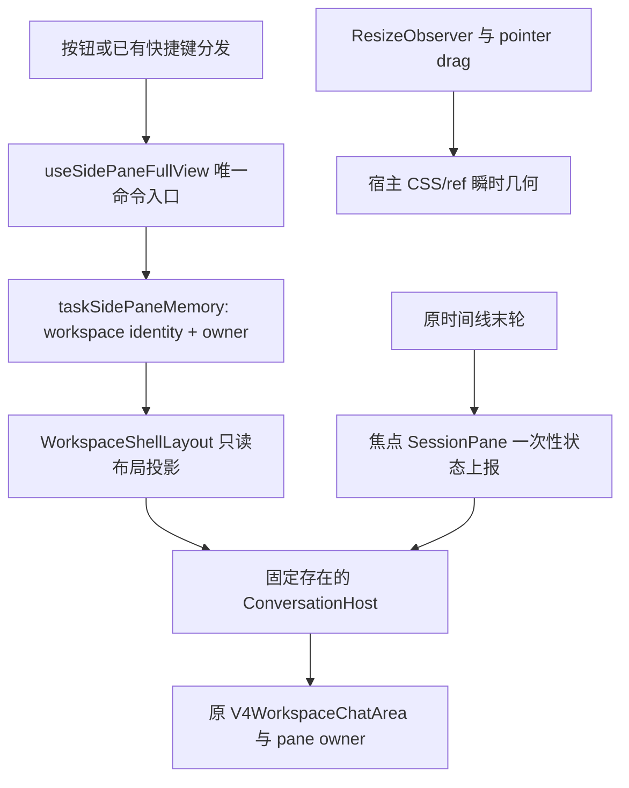

# 官方 3.16.2 择项吸收：侧栏完整视图

官方来源固定为 `zai-org/ZCode@3c5b227649371507ddc4eb46ac5133afe6db1cab`；实施仅在隔离工作区进行，不代表完整 merge 或版本更新。

## 产品规则

- 仅 Desktop 提供面板完整视图按钮和可配置命令 `toggleSidePaneFullView`（`CmdOrCtrl+Shift+f`）；普通 Web 与手机远控无入口、无处理器、设置页不展示该命令。
- 完整视图让当前面板占满左侧任务列表之外的内容区；任务列表与左上按钮照常可用。面板标签栏固定加入不可关闭、不可拖动的「对话」标签。
- 初次进入保持当前面板标签，浮窗收起；选择对话标签时完整显示工作台和原终端，选择面板标签时展示焦点 pane 的浮动输入窗口。
- 面板关闭或同 owner 的最后可见标签按既有规则收起时，退出完整视图。owner 切换造成面板偏好恢复不能清除另一 owner 的记录。
- 退出不回写侧栏显隐、侧栏宽度、面板比例和终端开合。完整视图期间禁用根据被遮盖对话列宽度触发的窗口自动收起。
- 本 fork 保留既有分屏入口、布局、跨工作区绑定和恢复守卫，不吸收上游的入口下线。浮窗只将焦点 pane 投影为满尺寸，其余 pane 隐藏且保持挂载；对话标签与普通视图恢复原二叉分屏布局。
- 收起、展开、最小化共用同一 SessionPane、ConversationComposer 和 Lexical 编辑器节点；不移动 DOM、不用第二个 composer，不改变 accepted input/CommandInbox 所有者。
- 浮窗为单行工具栏布局，编辑器不重挂；附件独占上一行，文字可向上增长。阻塞权限/问答仍使用原 bottom dock，最小化时新的请求恢复到收起态；同一请求不反复弹开。
- 回答气泡仅来自同一个末轮 render unit 的 complete 最终回答，按精确 pane workspace + session + logEpoch 隔离；不依赖先观察到 running，partial/failed/refusal 不产生气泡。已完成历史作为基线。点关闭或点气泡才清除，下一轮运行不清除。

## 状态与接口

- 记录在既有 renderer 内存 LRU 中，最多 50 个 workspace；`workspaceIdentity?.trim() || workspacePath` 是 workspace key，owner 沿用 `sidePaneOwnerId ?? __draft__`。完整视图记录不落 Host/CLI 数据库。
- 浮窗吸附位置为 renderer 本地偏好，使用 `zcodium:side-pane-full-view:floating-anchor`，只接受七个枚举值。不迁移或读取 `.zcode` 数据。
- 几何由宿主 adapter 测量并写 style/CSS 变量；每帧拖动与测量不写 React 业务状态。指针结束才提交吸附枚举。
- 新 managed 模块 `side-pane-full-view` 依赖 `shared` 与 `ui`，domain 纯计算、app 收口内存命令、adapters 处理 DOM/偏好、components 展示。跨模块通过 `contract.ts` / `index.ts`。
- Main、Host、远程 registry、Source 和手机 ACK/replay 协议均不新增状态或写入链。Desktop continuous 与手机 replayable 的执行语义不变。

## 布局与失败语义

- 固定存在的宿主包住原 conversation-column 纵向 panel group。normal 使用原文档流；conversation/floating 使用面板内容 slot 的 fixed 投影。
- 原 resizable panels 的 flex 与比例不改为零；完整视图面板框用 `absolute inset-0 z-0`，保持 plugin parking layer 可见，避免 NaN 尺寸。隐藏拖动柄，不自动 resize 至满宽。
- Floating bottom dock 相对时间线根节点贴底，同一 DOM 不移位；滚动视口让出 dock 高度，浮窗关闭原消息渐隐遮罩。默认 dock 仍 sticky。
- 浮窗使用固定输入树的 CSS 顺序：附件上一行，动作菜单在输入左侧，原模式/模型/发送工具栏在右侧；normal 恢复原两行顺序。布局切换不跨父节点移动动作菜单或编辑器。
- 原终端 open 与 animated panel 的输入只读原终端偏好，浮窗不能调用 collapse/expand 隐藏终端。仅隐藏原终端展示并让原 conversation 内容框 absolute 覆盖纵向 group；两个 resizable group 在完整视图期间暂停布局持久化，退出恢复进入前的比例投影。
- 浮窗恢复优先查询 focused pane 内的输入；存在 pane 外壳时不能回退到较早的隐藏 pane。高度上报、指针捕获与 observer 回调绑定 owner/slot 代际，旧回调不允许写新 owner。
- 宿主/slot/owner 换代时取消指针会话、observer 和 focus frame，旧几何不得落到下一 owner；节点缺席不移动或克隆会话。工具栏测量仅克隆纯控件，不克隆编辑器、附件或会话内容；隐藏 pane 增加 inert/aria-hidden，捕获焦点与拖放不能重新激活它。
- 高度测量按 owner/mode/slot 在 render 时退休旧值，不能在父 layout effect 中清零子树刚发布的新值。回答气泡的 owner 缓存采用最多 50 项 LRU，当前 owner 最近使用；淘汰只清 renderer 展示记录，重新访问以已完成末轮为基线，不产生历史气泡。
- 存储失败保留内存偏好，仅记录安全静态错误，不记录原始错误或用户内容。

## 验收场景

1. 七个吸附位置、窄 slot 边界、拖动阈值与最近点纯测试。
2. 同路径不同 workspace identity、不同 owner、草稿转正式、切换与关闭记录测试；内存更新不能覆盖既有 tabs/URLs/收起偏好。
3. 真实组件/GUI 在 normal、对话、收起、展开、最小化之间往返，断言编辑器节点、草稿、选区/撤销历史和存活 pane 订阅不重建。
4. 两 pane 焦点切换、非焦点隐藏但保留挂载、退出恢复分屏，不删除分屏入口。
5. 新阻塞请求恢复最小化、重复请求不重复恢复；末轮 complete 与快速结束气泡、旧 owner/logEpoch/partial 零发布。
6. 关闭面板、最后 tab、跨 owner、窗口变窄、侧栏 resize 与原终端偏好保持。
7. Desktop 快捷键和设置支持；Web/手机不声明处理器、不展示入口；IME、repeat 和已有键位冲突内核继续生效。
8. `corepack pnpm typecheck`、`corepack pnpm lint`、format、architecture 与可用 UI/CI 测试实际执行。GUI/Electron/真机受限时单列限制，不将静态或纯函数测试写成全量交互验收。
