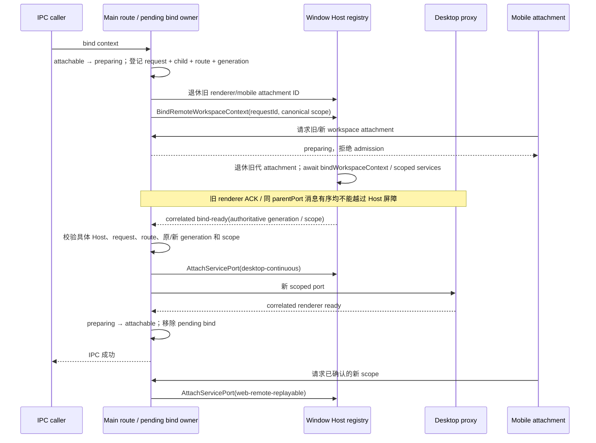

# 官方 3.16.2 Source workspace context rebind admission

## 单一任务与边界

只修改 `C:/vibecoding/zcodium-adopt-3.16.2` 的 Main → Window Host workspace context rebind admission、共享 Host 消息契约、Host 入口 Bind handler 与定向测试。原工作区和官方快照只读；不提交、推送、改版本、打包，不连接真实服务器，不读写用户数据。不修改并行 `official-3.16.2-source-server.md`、workspace alias spec 或 `windowRemoteConnectionRegistry.ts`；registry 继续通过现有 `bindWorkspaceContext(): Promise<void>` / scoped services API 提供权威准备结果。

## 已确认的缺陷

`packages/desktop/src/main/desktopRemoteSessions.ts` 原实现发送随机 requestId 的 Bind 后立即推测 descriptor generation，route 仍为 attachable，再等待 renderer 注册 proxy 的 ACK。Host 入口的 Bind 异步失败仅记录日志；Attach 自己等待 scoped services 失败后关闭端口，没有回传关联 Bind 结果。parentPort 消息顺序只保证进入 handler 的顺序，不保证异步 workspace preparation 成功。因此 renderer ACK 不能证明 Host ready，手机也可以在 rebind 中间态进入旧 route。

## 所有者与公开契约

- Window Host remote registry 唯一拥有 logical session、canonical scope、workspace generation 和 workspace preparation。Source read-only guard / alias 判定仍由该 owner 完成，本任务不重建它们。
- Main 唯一保存 pending bind 请求与具体 child、具体 route、原 generation、请求 scope 的关联，并保存端口转发需要的 attachment ID。不是 task/session 业务状态，不保存第二份已接受输入、队列、snapshot 或服务事实。
- renderer ready 只表示新 proxy 已注册；Main 在 Host 权威 bind-ready 之后才可以发候选 renderer port，在 renderer ready 之后才发布 route attachable / IPC 成功。
- 手机 attachment 继续使用同一 Window Host，Main 的相同 route admission 判定适用于 Desktop 与 mobile；不新建 Agent、Host 或远程 session。
- 实际共享入口为 `packages/shared/src/channels.ts` 与 `packages/shared/src/validation.ts`，经 `packages/shared/src/index.ts` 公开。`protocol.ts` 是其他领域 DTO，Agent stdio 的 `zcode-protocol/index.ts` 不属于本次 Host postMessage 修改。
- 新增严格 `remote-workspace-context-bind-ready` 响应：`requestId`、`remoteSessionId`、必需的 `workspacePath` / `workspaceIdentity`、正整数 `generation`。新增严格 `remote-workspace-context-bind-failed` 响应：`requestId`、`remoteSessionId`、非空 `error`。schema 推导公开请求 / 响应类型，不接受额外字段或空身份。

## 事件顺序与交付语义

Desktop 的 continuous 和 mobile 的 replayable 使用同一准备好的 workspace owner / generation；本任务不改变各自的 stream、snapshot、CommandInbox 或恢复语义。初次 Source connected descriptor 已表示 Host ready，既有 initial preparing + provisioning + renderer ready 两道 Main 屏障不变，不重复增加 connect 能力或 preparation。

## 失败、取消与幂等

- 一个 route 只允许一个 pending rebind；preparing 中的并发 bind 拒绝，不让新 bind 覆盖 pending owner。
- Host 只在现有 registry Promise 成功、session 仍 online、scope 和 generation 未退休、Host 未 shutdown 时发 bind-ready。同步 bind 拒绝与异步准备失败都发送 correlated bind-failed。自动归档扫描不是 bind ready 屏障，其失败不能在成功后再发 bind-failed。
- Main 不预先修改 descriptor generation；只采纳匹配请求的新 Host generation。未知 request、其他 session/scope、旧 generation、旧 child、重复响应或 renderer 的旧 ACK 不推进 admission。
- bind-failed 向 caller 传递 Host 错误；route fail-closed 并退休 logical attachment，不回退旧 descriptor 的 attachable 状态。结果不能复活被取消、dispose、connection-close、window-close、Host exit/replacement、shutdown 或新 route 替代的旧对象。
- 六类既有退休入口（cancel、dispose、connection-close、Host exit、window close、shutdown）在 Host 准备和 renderer 准备阶段均结算 pending bind，并回收相关端口关联。Host replacement 复用现有窗口 reattach 通知与 Main Host listener，不依靠旧 Host 必然退出。
- 每个 pending 请求仅结算一次；内部异步分支全部消费错误，不使用会生成无人等待 rejecting Promise 的 finally。不因 Host 已退出或 postMessage 抛错让清理/响应产生 unhandled rejection。
- 不新增 Host ready timeout 或延迟猜测。既有 renderer ready timeout 仅约束端口传输/注册生命周期，不能替代 Host authoritative workspace readiness。
- 新日志只记录安全固定事件，不转抄原始错误、真实路径、URL 或配置；Host 错误走 caller 响应而不是诊断日志。

## 验收与验证边界

先扩展 `scripts/ci/adoption-source-attachment.test.mjs` 并保留 initial 项，使用现有 Node `registerHooks` Electron shell fixture 执行真实 Main manager。验证 Host 未 ready 时即使旧 renderer ACK 到达仍不成功、不发送新 renderer port、mobile 被拒；Host ready 后 renderer 未 ready 仍 blocked；成功后两种 delivery mode；Host 错误向 caller 传递；六退休入口两阶段结算；Host replacement、旧 Host / 旧 request / 旧 generation、重复响应和旧 renderer ACK 不复活 route；transport 抛错无 unhandled rejection。

共享严格 schema 做实际 parse 测试。Host Bind handler 使用 TypeScript AST 定位生产分支并执行该分支（不整份加载 Host 的真实服务/用户数据），结合现有内存 registry / attachment registry 和 deferred preparation 验证相关成功、同步/异步失败、退休/重复及响应投递失败；不把源码字符串断言当作行为回归。

实际执行定向 Node 回归、`corepack pnpm typecheck`、`corepack pnpm lint` 与 changed 架构检查。只检查/修正任务文件的格式，不修复全树既有格式。结果如实报告；这些内存行为测试不是 Electron 真机、真实 Source 或全量 E2E 验收。

## 开工检查

- `node scripts/check-workspace-freshness.mjs`：基线新鲜；HEAD 无远端跟踪分支，因此未执行 behind-tracking 检查。
- `corepack pnpm architecture:check --changed`：0 violations / 0 baseline / 0 new。
- `architecture:context desktop` 与 `shared`：均为当前 policy 的 legacy unmanaged 模块，无 module.ts / managed contract；本次扩展现有共享 Host 契约，不新增模块。
- PowerShell 7.6.9；当前 Node 24.18.0（仓库 `mise.toml` 要求 24.14.0，未发现 mise 可执行文件）。不为本任务安装/切换运行资源，验证注明实际版本。
