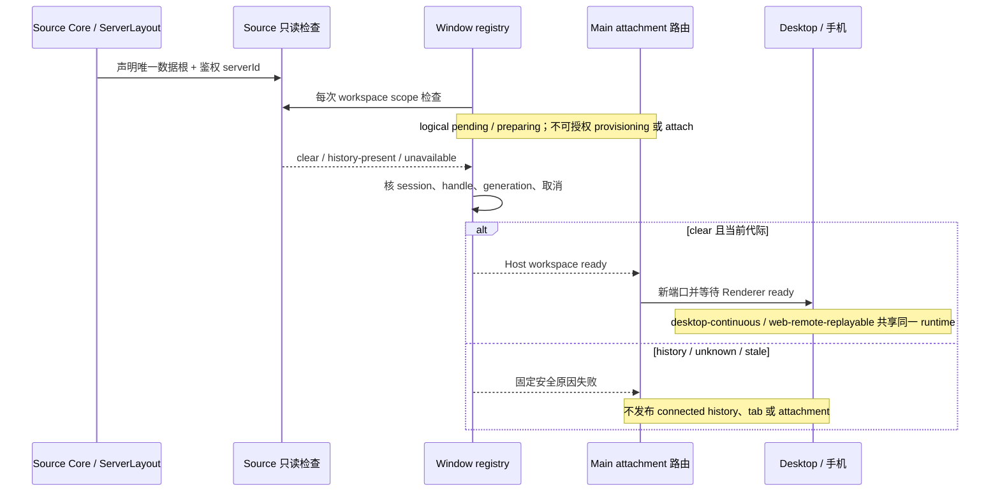

# 官方 3.16.2 Source 工作区只读 admission 门禁

## 适配边界与已确认缺口

在隔离实施工作区择项吸收固定 `zai-org/ZCode@3c5b227649371507ddc4eb46ac5133afe6db1cab`。不改版本、不提交/推送/安装/启动真实服务、不访问或迁移用户数据库。已有 alias 模块的 OS-temp 合并/恢复测试不等于产品 ready 接线；真实全数据根所有进程停写 lease 与原 WAL committed snapshot 区间证明仍缺失。

当前 registry 在 Source 物理握手成功后直接构造稳定 identity，并把 workspace 标记 ready，未检查旧线路历史。后续 bind 也绕过检查。任务及 CLI 会话按 identity 严格匹配，因此已有旧 key 的历史可能不可见，同时新 key 开始接受写入。安装 serverId 确认不是旧历史迁移确认。

## 单一所有者和公开接口

- Source Core 的 `ServerLayout`/启动组合声明该 Source 的唯一独立数据根、任务库、CLI 会话库及配置根；不从客户端接受根路径，不猜测 HOME，不跨其他 Source 或旧产品根。
- `source-server-workspace` 的 Node adapter 提供只读存在性检查，通过独立 `inspection-contract.ts` 的严格 scope/result 合同暴露 inspection RPC（复用既有 alias scope，不把只读检查并入迁移方法集）；此 RPC 无迁移、批准、恢复、写 ledger 或 alias 方法。公开 entrypoints 与模块 policy 同步登记，不增加 public-method 上限或架构 baseline。
- Core 用经鉴权的安装 serverId 创建检查服务，在 HTTP capability 中显式声明版本 1。旧 Source 未声明能力则 logical workspace admission 明确拒绝，不能用 lazy RPC proxy 存在作为能力证明。
- 生产 Core 先解析一次 `sourceLayout` 并校验同一安装身份，再在该 configRoot 物化随包配置、创建固定根 Services，最后注册 inspection 并发布 HTTP。Inspector 消费该 layout 的真实 tasks-index.sqlite、CLI db.sqlite 和旧 v2/sessions 根；不使用 getter 或第二份 HOME resolver。缺安装身份在配置物化前拒绝，不靠 hostname fallback 宣称 Source 能力。Core 组合回归只提取实际生产函数并在 IO/HTTP 边界注入临时 fixture，不启动真实 Core。
- Window registry 独占每次 logical workspace 准备状态。初次 connect、物理 Source 复用及后续 bind 都调用同一 handle 的私有检查端口；capture session/handle/generation，迟到或取消结果不能发布 ready。Main 的 rebind 请求关联屏障独立见 `official-3.16.2-source-rebind-admission.md`。
- 检查服务不加入 Renderer 的 `IServiceAccessor` 或 workspace service facade；Renderer/手机只得到既有安全连接失败与目录连接态投影。物理 manager 的每个 retain handle 直接引用该 connection 的同一私有 inspection proxy（缺能力时为 undefined），不复制检查状态或在 manager 中执行 workspace 检查；workspace admission 仍由 registry 独占。

## 三态只读检查与保守阻断

scope 只包含 `sourceServerId` 和真实绝对 `workspacePath`，result 包含版本、同 scope 的 stable identity、`clear` / `history-present` / `unavailable` 与固定安全原因。不返回真实数据根、配置内容、行、原始 IO 错误或凭据。

检查只能异步 `lstat`/`realpath`，不存在只在明确 `ENOENT` 且祖先结构安全时成立。拒绝相对根、路径逃逸、`.zcode`/嵌套数据根、symlink/junction、文件硬链接和错误类型。权限、传输、未知根、代际/结构变化和读不到不能吞成不存在。显式 `.zcodium` 根和所有声明介质前后复核；检查不 `mkdir`、打开 SQLite、读取普通 settings getter、启动 Agent、claim session、执行迁移或 checkpoint。

- 任务库、CLI 库、任一 SQLite sidecar、会话/config hashed 根中有潜在历史介质，返回 `history-present` 并阻断。presence-only 不能证明只含 stable rows，也不按时间/路径猜归属；此阶段接受保守 overblocking。
- 整个声明历史范围安全且无介质，返回 `clear`，只允许本次 logical attachment 继续，不授予迁移许可。
- 根不存在/不完整、权限或边界错误、并发替换等返回 `unavailable`，阻断并提示需要人工检查。

没有停写 lease 时无历史观察不是所有写者排除证明。独立 daemon 维护和其它客户端可能已经启动业务库；因此既有或启动后已创建的库也会保守阻断。该门禁仅限制本 Desktop/手机 attachment 的新访问，不回滚启动行为、不停止 daemon、不清 CommandInbox、不终止其它运行任务；不得宣称已实现全入口迁移 gate 或正常 WAL Source 的产品迁移。

## 顺序与代际

## 先红回归和验收

1. OS-temp 明确无介质、DB/WAL/SHM/journal 存在、配置根、无根、权限/替换/边界错误；完整介质 manifest 前后不变，检查期间 Agent/业务 getter/SQLite/迁移调用为零。
2. 严格 RPC 输入/输出不允许用户根、secret、任意原因或伪 scope；能力缺失、Source ID 不同、非绝对 scope 拒绝。
3. registry 每次 connect/bind/Source reuse 调检查；pending/blocked 时两种 attachment、provisioning 和目录 connected 投影均拒绝；旧检查不能把新 bind 标 ready。
4. 保留原 registry 的 WSL release、共享握手取消、Source 任务不随 logical release 终止及 Main 初次配置/Renderer 双屏障。
5. 类型、Lint、格式、架构与定向回归按实际执行报告，不把合成端口或 presence-only 阻断写成真机迁移成功。

## 项目内验证入口收口（2026-10-28）

根入口 `scripts/ci/adoption-source-workspace-admission.test.mjs` 改为中央 sandbox wrapper：`runSourceTests` 先建立 `PROJECT_TEST_SANDBOX_ROOT` 绑定与 HOME/TEMP 重定向的隔离子进程，再加载测试本体 `scripts/ci/fixtures/adoption-source-workspace-admission.test.mjs`（非自动发现），wrapper 断言子进程精确用例数。本体每个用例经 `createProjectTestFixture("source-inspection")` 在工作树内创建不复用目录，连接关闭后保留 fixture，不再在 `t.after` 递归删除运行目录；OS-temp 写法仅为历史证据。link 介质 helper 与 [workspace-alias 收口](official-3.16.2-workspace-alias.md) 同一合同：中央 `assertProjectPath` 预检 target/link path、target lstat 拒绝 symlink 且断言 `isFile() || isDirectory()`、win32 spawn 固定 `["/d","/c","mklink",…]`（`/d` 关闭 AutoRun）+ `shell:false` + `windowsHide:true` + sandbox `env`/fixture `cwd`、stderr 绝对路径掩蔽、创建后回读 lstat/stat identity（symlink 可 realpath、硬链接同 dev/ino 且 nlink≥2）后才调用产品代码；helper 仅 fixture 本地，不建第二 owner。只读三态、拒绝绕过与 registry 门禁语义不变。
