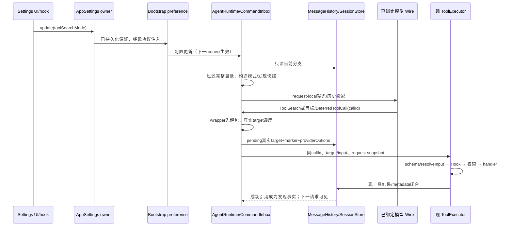

# 官方 3.16.2 ToolSearch 增量

## 状态与范围

代码已落地，定向验证已收口；不是全仓/真机/发行验收。只在 `C:/vibecoding/zcodium-adopt-3.16.2` 实施；官方只读基线 `zai-org/ZCode@3c5b227649371507ddc4eb46ac5133afe6db1cab`。不是完整上游 parity，不运行真实模型、Agent、动态工作流、用户配置、数据库迁移或发行。

吸收 ToolSearch 的 runtime auto/native/local/off、完整 schema 发现、DeferredToolCall、Native wire、历史恢复与工具卡片；设置只提供 auto/local/off，缺省 off。不吸收官方账号/套餐 capability gate、遥测、加速/高速入口或官方依赖。保持 Gemini 每条 tool-call 的 providerOptions/thoughtSignature。

## 产品规则

1. 本仓 session runtime 缺省 `toolSearch.mode=off`。Off 不注册/暴露 ToolSearch、DeferredToolCall 控制入口，保留普通工具集合。旧搜索引用、包装 marker、公告的降级只在 model request 副本发生，canonical history 与落库原记录不改。
2. Native 只有模型绑定的真实 wire capability `requestCapabilities.toolSearch.protocolSupported=true` 才能启用。当前可编码的是 Anthropic Messages SDK 的 tool-reference custom content、deferLoading 和 `advanced-tool-use-2025-11-20` beta。其他 wire 显式 native 在请求前拒绝。Auto 默认选择 Local（支持 tool call 时）；仅 capability 显式 `defaultEnabled=true` 时选择 Native，Auto 绝不等同 Native。能力不由官方账号、模型名称或未知 API 推断。
3. 延迟工具来自 registry 的 MCP descriptor 或显式 shouldDefer；alwaysLoad、providerNative、控制工具永不延迟。核心文件/执行工具常驻，辅助工具按受控策略延迟；任何 toolAllowlist、toolDisallowlist、toolset、automation/current-turn 排除先作用于完整可用目录，搜索不能补回排除工具。
4. ToolSearch 使用本次请求的只读目录快照，返回真实 tool_reference，不执行目标、不修改授权、不创造发现前调用禁令。合法未发现目标调用仍按原 schema/权限/Hook 执行。取消/失败搜索不留下成功发现。关键词排名、`+required`、精确 `select:name[,name]` 与 MCP alias 在当前目录内处理。
5. Local 把成功引用投影为完整 JSONSchema（包括 definitions/$defs/$ref/oneOf/additionalProperties 等）与 `{name,input}` 调用指引；不得套通用结果预算截断 schema。重复搜索只在同一模型已见上下文内去重；并行 sibling 结果不能互相假定已被模型看到。
6. DeferredToolCall 只接受本请求中仍可用的 deferred 非控制/非 providerNative 目标，先解析 wrapper、保持 callId、真实 target/input 与 marker，再按真实属性调度、schema/defaults、resolveInput、PreToolUse、权限、handler、PostToolUse、预算、后台生命周期及取消。wrapper 本身没有第二套授权，解析失败不触发目标 Hook/权限。metadata 持久化真实 target + `modelCallWrapper=DeferredToolCall`，不是复制嵌套包装载荷。
7. canonical assistant 保存真实 target/input 和每条 providerOptions；请求副本 Local 回包为 DeferredToolCall，Off/Native 回放为真实 target。tool result 根据 callId 同步包装名称，避免未配对结果。请求投影不能覆盖 providerOptions。
8. compact summary 和辅助无工具请求都 `tools=[]`、`toolSearchEnabled=false`，先将引用降级为安全文本；没有残留 native-only wire block。compact 把成功发现列表作为现有 summary 的 metadata 保留，Local 可提升这些仍可用目标为常驻；权限/目录删除后的引用从请求副本移除。fork/rewind/coldrestore 只从实际保留分支的成功搜索及 compact metadata恢复，不从其他会话/global cache恢复。
9. 设置更新由既有 AppSettings owner 持久化，runtime preference 注入只有一个入口；UI 只有设置选择投影，不新增权限/发现 store。当前 run 已发出的请求使用原快照，下一 model round读取新配置。跨 workspace identity、remoteSessionId/owner/lease/CommandInbox 的现有边界不变。
10. UI 的成功/失败/取消/待审批卡片显示真实目标；ToolSearch 专用只读卡展示 query、命中工具名与状态，不把完整 schema 或 wrapper JSON作为执行目标。桌面 continuous 与手机 replayable 共用 V4 authoritative tool rows，保持 delivery kind，不新增 stream/replay owner。

## 唯一 owner 与路径

| 事实                                | owner                                           | 读者/派生者                                       |
| ----------------------------------- | ----------------------------------------------- | ------------------------------------------------- |
| App 工具搜索偏好                    | 现有 AppSettings/SettingService                 | Settings UI hook、bootstrap appRuntimePreferences |
| Session 当前 mode                   | AgentRuntime.config.toolSearch                  | 下一请求投影、子 runtime 配置继承                 |
| 可用工具、能力/schema、权限         | ToolRegistry + 现 PermissionService             | 请求目录只读快照；不写另一份授权                  |
| 成功发现、wrapper、compact/fork分支 | MessageHistory + 现 SessionStore parts/metadata | search/history 投影；没有全局发现 Set             |
| 当前请求目录与发现集合              | turn-loop 构造的不可变 request snapshot         | 调度与 executor options，只活到该请求工具结算     |
| 工具执行/取消/审批/Hook             | 现 ToolExecutor                                 | DeferredToolCall 仅先解包，复用原链               |
| tool call产品生命周期               | CLI SessionEvents/V4 materializer               | Desktop continuous / Mobile replayable 同一 row   |



```text
desktop: continuous ── live SessionEvents ──────┐
                                             ├─同一 CLI session/toolCallId 与真实 target
mobile: replayable ── V4 snapshot+gap repair ──┘
```

不新增 timeouts 掩盖时序，不把搜索成功当 grant；request context以 model step 捕获，迟到结果只按原 callId结算。既有 parent trace、owner/lease、workspaceIdentity/remoteSessionId 原样传递。

## 模块与接缝

- CLI contracts/tools 新独立 ToolSearch/DeferredToolCall 严格 schema，公开 index转出；model contract 增可选 capability、deferLoading、wrapper、reference，JSONSchema镜像同步。
- core/tool/search 纯目录/历史/模式投影；core/tool/deferred-call 纯解包；handlers仅目录查询。executor/调度/流式/持久化小接缝复用原路径。
- adapters/model 增真实能力与 wire，现 Google签名逻辑保留；模型绑定/bind/请求必须传播能力与 enabled字段，辅助请求不得隐式继承。
- bootstrap runtime-config/session preference/子 runtime配置继承；UI设置与卡片独立文件，复用SettingsRow/Select/现tool row。
- 设置 seam 复用 `workspace/updateInteractionPreferences` 的 `preferences.toolSearchMode` 与 `session/requestRuntimePreferences` 的 `toolSearchMode`，App 枚举为 auto/local/off、旧 Host 缺省 off。广播、会话偏好和更新结果均用同一枚举在协议边界校验。配置更新只影响下一 model request；当前已发出的请求不得因 Off 更新立即移除 control registry entry 而失败。子 runtime 创建读取父 runtime 当前 mode，不继承父发现记录。
- Settings 的 `update` 先完成既有持久化，再重新读取 AppSettings owner 的已提交快照；共享单飞 refresh 可能仍是保存前快照，不能用它同步另一个偏好。相同快照沿原 Agent/Bot 入口和跨窗口广播发布；保存失败零同步/广播，Agent 同步失败仍广播已提交快照并向调用方报告，不将错误写成配置回滚成功。
- CLI 与 shared V4 的严格展示契约为 `{kind:"tool_search",query,matches,totalMatches,totalDeferredTools,truncated?}`；展示 query≤4096 UTF-8 bytes、matches≤100、每个名称≤512 UTF-8 bytes，保留总命中数与截断标记。展示预算与完整引用/Local schema/成功发现分开；成功卡不猜读完整模型结果，失败/拒绝/取消使用既有权威 status。SettingsRow 用 wide 布局，提供实验标记与 auto/local/off，兼顾窄屏与键盘。
- V4 的 `tool_input_start/delta` 只代表尚未完整解析的 wire 预览；同 callId 的完整 `tool_call` 与 `ToolCallScheduled` 是已解包的权威 target/input，必须替换预览名称。`tool_search` 成功 display 同时保留在 row.display 与 output.display；desktop live、mobile gap repair 和重订阅 snapshot 都以同一 reducer 事实为准，禁止另建客户端解包状态。子 workflow 工厂仅在构造边界读取父 runtime 当前 mode，再按既有显式 configOverrides 优先级装配；配置对象不共享，发现历史不继承。
- shared公共协议、AppSettings、services→CLI注入与 locales 由主代理整合，不自行修改公共package.json/lockfile/architecture-policy/总维护记录；最终提供精确字段/schema/调用点/翻译交接。
- 受控架构检查当前 zcode-cli/ui/shared 为既有 unmanaged模块；只用既有模块公开入口。不添加架构policy或数据库模块。
- feature graph 的 `capability.tool-search` 已补齐 exposure/handler/setting 三个真实种子，关联既有 conversation runtime；此前“无 seed”仅为开工快照。当前相关源码尚未提交，`git ls-files` 的追踪校验仍列为 graph-drift-candidate，不为关闭该项擅自 stage/commit。

## 验收用例（mock/source/GUI fixture，不访问外网）

| 用例                    | 动作与断言                                                                         | 证据                                      |
| ----------------------- | ---------------------------------------------------------------------------------- | ----------------------------------------- |
| 默认Off                 | 无配置；普通工具保留、两个control不存在                                            | core配置/注册测试                         |
| mode能力                | Off/Auto/Local/Native × 有/无真实支持；Auto!=Native，unsupported Native早拒        | 纯mode+model.bind测试                     |
| native wire             | SDK mock fetch捕获body，带defer_loading/tool_reference/beta，现headers不覆盖       | adapters真实serializer mock               |
| Local完整schema         | 嵌套refs/oneOf/长描述与大量schema，解析JSON等于原contract、不截断                  | exposure/history测试                      |
| 发现不授权              | 搜索不调用目标；未发现合法直调仍跑原权限；deny仍deny                               | 真实executor/hook/permission测试          |
| wrapper target          | schema/defaults/Hook改写/permission payload/callId一致；拒绝未可用/控制/native目标 | executor/runtime测试                      |
| Gemini签名              | 多toolcall metadata经过wrapper/off/local/coldrestore仍逐条相等                     | 现Google+新history/wire测试               |
| compact                 | summary tools=[]，无tool-reference/beta；发现metadata跨compact，权限删除不复活     | compact mock runtime                      |
| fork/rewind/coldrestore | 临时fixture/current branch恢复；被切掉搜索不影响新分支                             | hydratation/branch测试                    |
| 辅助请求                | title/project-memory/target verification等无工具投影不带native引用                 | source与helper测试                        |
| 双交付卡片              | 同callId的真实target/ToolSearch display在continuous/live与replayable/snapshot一致  | Bootstrap V4 mock测试                     |
| 实验设置/卡片           | 默认Off，auto/local/off可键盘选，成功/失败/取消卡和窄屏/中英文                     | UI Vitest/GUI fixture（可用环境实际执行） |

## 验证记录

前置：freshness通过（当前无tracking branch；相对origin/main ahead31/behind0），固定上游SHA核验；`corepack pnpm architecture:check --changed`通过0违规。Node实际24.18.0，pin24.14.0，pnpm10.33.2；不改toolchain。

### 定向测试与静态检查（实际执行）

- 最终 `corepack pnpm exec tsx --tsconfig scripts/ci/tsconfig.adoption-tests.json --test` 在以下现有文件范围执行，共 **77 passed / 0 failed / 0 skipped**：core 五个 `tool-search-{exposure,execution,runtime,recovery,display}.test.ts`；adapters `tool-search-wire.test.ts`、`google-generative-ai.test.ts`、`google-provider-options.test.ts`；bootstrap `tool-search-preferences.test.ts`、`tool-search-v4.test.ts`、`web-remote-v4-stream.test.ts`、`active-session-resume.test.ts`；scripts/ci `summary-model-runtime.test.mjs`、`summary-model-selection.test.mjs`、`adoption-tool-search-settings.test.mjs`。其中新增 ToolSearch 41 个用例，既有双交付/驻留恢复 2 个、Gemini 11 个、辅助请求 18 个、主线程设置回调 5 个。没有真实模型、远端连接或 workflow 执行。
- `corepack pnpm --filter @zcode/ui exec vitest run test/adoption-tool-search.test.tsx`：**6/6 passed**；真实翻译文件只读，其他 UI primitives 与 Intl 上下文为静态渲染 mock，不是浏览器 E2E。
- `corepack pnpm exec vitest run packages/shared/src/tool-search.test.ts`：主线程公共契约 **5/5 passed**，未修改 shared。曾误用 node:test 跑该 Vitest 文件而失败；使用正确 runner 重跑通过，未改测试来掩盖失败。
- `corepack pnpm --dir apps/zcode-cli typecheck`：最终 **通过**，contracts/adapters/core/bootstrap/cli 等当前脚本覆盖包均通过。标准脚本内置的 TUI 与 dynamic-workflow 类型产物准备正常执行，不是工作流运行或发行打包。较早的 dist 声明缺失用现有 contracts/core/bootstrap `tsc --emitDeclarationOnly` 准备后解决，没有改 manifest 或恢复删除模块。
- `corepack pnpm typecheck`：本次前两次执行通过；**最后一次重跑失败**，仅报并行非任务文件 `packages/desktop/src/main/desktopRemoteSessions.ts(336,11)` TS2741 与 `(604,36)` TS2345，`RemoteAttachmentRoute`/`PendingConnect` 要求 `child` 而构造对象缺少。未修改该文件，不将早先通过写成当前全仓通过，已交接主线程。
- `corepack pnpm lint`：最后执行 **exit 0，3 warnings / 0 errors**；警告位于并行 `scripts/ci/fixtures/workspace-alias-wal.mjs` 的 unsafe finally，以及 `desktopRemoteSessions.ts` 两个暂未使用函数。较早执行为 0/0；未越界清理并行 WIP。
- `corepack pnpm --dir apps/zcode-cli lint`：最后执行 **exit 1，55 warnings / 79 errors**，错误全部为 max-lines。使用完全相同的当前配置、UTF-8 与 OS-temp 的只读 HEAD 源码副本，对所有当前失败文件逐条比较 file/rule/severity/message **以及数量**；max-lines 数值单独视为长度指标。134 个诊断均在 HEAD 对应失败文件中存在，**未新增诊断**；部分已超限文件增加了长度，这不是全 CLI lint 通过，也不是全仓基线恢复。没有修改规则、增加 disable 或清理不属于任务的文件。
- 新增的 27 个 ToolSearch TS/TSX 源码与测试单独 `oxlint --config apps/zcode-cli/oxlint.config.json --deny-warnings`：**0 warnings / 0 errors**。清掉 task 新建测试的 unused import、冗余 spread、无 yield 的 mock 与不安全可选链，以及描述字符串无用转义。
- 已按当前 formatter 格式化 27 个新 TS/TSX 文件；只对临时副本先预览过的 ToolSearch 接缝 hunks 做格式修改。最终范围格式检查：CLI 84 文件仅 `runtime/methods/tool-part-metadata.ts` 失败，来自 HEAD 已存在的两个函数签名排版；UI 7 文件仅 `SettingsPage.tsx` 失败，来自并行 SourceServer 接缝。ToolSearch 新增代码格式已修；既有/并行非任务 hunk 保持不动，**不称全仓 fmt:check 通过**。未全仓运行 formatter。
- 最后 `corepack pnpm architecture:check --changed`：**violations 0 / baseline 0 / new 0**。模块仍是当前策略中的既有 zcode-cli/ui，状态 owners 与 desktop continuous/mobile replayable 序列按上文不变；未修改架构策略或数据库结构。
- `git diff --check` 的本任务相关 tracked 范围通过。所有对照临时文件用完删除；未创建报告/summary 文件，未提交、暂存、推送、发布或打包。

### 文件与所有权边界

本任务交付路径核对为 **64 个既有 touched 文件 + 28 个新文件（含本 spec，27 个 TS/TSX）**；全部文件存在，精确清单直接返回主线程，不写另一个报告。核对时所选路径相对 HEAD 为 tracked `+599/-66`、新文件 3526 行、net +4059；此数包含保留的并行 hunk 和当时 spec 内容，不可当作 ToolSearch 独占贡献行数。

`contracts/src/model/index.ts` 的 `ModelRequestFailedStatusEvent.usage`、两个子 runtime 文件的 tmpdir/bashOutputTempDir 属并行工作，原样保留；本任务只加 ToolSearch 类型/marker 与构造时当前 mode。`bootstrap/src/app/create-app.ts` 只读，**无本任务修改**。shared/services/locales/App Root、Office/SQLite/Source/UI 全视图/模型目录、package.json/lockfile/architecture-policy/总维护都由主线程或其他任务维护，本任务未修改。

### 未验证与已知限制

- 只验证 mock/source/真实 SDK serializer mock、实际 executor、实际 gateway reducer/恢复 fixture；子工厂测试执行生产函数体但替换构造/IO 边界，不等于真实子 Agent/workflow。
- 浏览器能力只完成 registry 发现，IAB 可用；**没有创建/打开 ToolSearch GUI fixture，也没有键盘、窄屏、主题或真机 GUI 验证**，不是浏览器不可用。UI E2E 尚未验收，手机覆盖是 replayable 协议 fixture，不是手机设备验收。
- 没有真实 Key、外部网络/模型、实际 workflow、用户配置/真实会话数据、数据库迁移、完整 root/CLI 测试 corpus、发行/打包；未对所有辅助入口分别做真实调用。以上不写为通过。
- 当前 capability 将 Anthropic Messages wire 视为可编码，defaultEnabled=false；provider endpoint 是否真正接受 beta/reference 需用户显式授权的后续真实 provider 验收。
- 公告保留 added/removed，`readdedNames` 当前为空；不是官方全部 readdition tracking parity。ToolSearch 仍是默认 Off 的实验能力，不承诺 token 节省，也未吸收官方账号 gate/遥测/云依赖。
- 全仓门禁仍受上面根 typecheck 并行错误与 CLI 既有 lint 欠账影响；未借 ToolSearch 修复这些独立模块。
