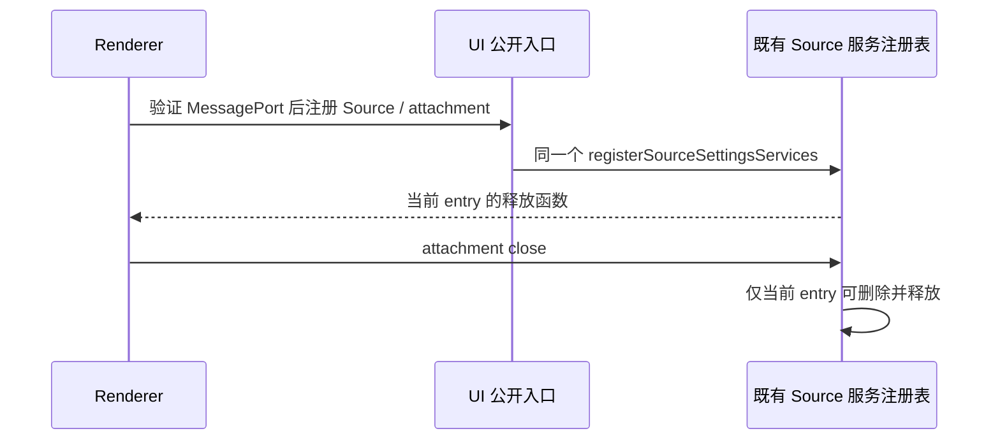

# 官方 3.17.1 构建与发行域（build/CI）

## 范围与所有者

本域只管构建与发行契约：根 `package.json` / `pnpm-workspace.yaml` / `pnpm-lock.yaml`、
`.github/**`、根 `scripts/**`（除 `scripts/ci` 既有文件、`scripts/architecture`、
`scripts/check-workspace-freshness.mjs`）、`packages/desktop` 的 `package.json`、
`scripts/**`、`tsup.config.ts`、`vite.config.ts`、`electron-builder.config.js`。

产品事实源仍是各自的运行域；本域只保证「构建出来的东西符合 ZCodium 契约」。
守卫脚本：`scripts/ci/official317-build.test.mjs`（`node --test`，静态契约与项目隔离的真实配置加载，不运行桌面打包）。

## 版本与工具链

| 项               | 值                                            | 依据                                                                                                 |
| ---------------- | --------------------------------------------- | ---------------------------------------------------------------------------------------------------- |
| 产品版本         | `3.17.1`                                      | 官方 `v3.17.1`；本仓修复不单独改版本号                                                               |
| Electron         | `44.7.0`                                      | 官方对齐；`electron-to-chromium` 固定 `1.5.452`                                                      |
| electron-builder | `26.17.0`（精确，不再用 `^26.8.1`）           | 官方对齐；26.17 的 pnpm collector 需要显式裁剪名单                                                   |
| electron-updater | `6.8.10`                                      | 官方对齐                                                                                             |
| macOS 下限       | `minimumSystemVersion: "13.0.0"`              | 用户确认设备满足                                                                                     |
| Node / pnpm      | 项目内 Node 24.14.0 + Corepack pnpm 10.33.2   | `.github/actions/setup-workspace` 与本仓验证工具链                                                   |
| vitest           | 根固定 `4.1.7` + `patches/vitest@4.1.7.patch` | 上游补丁修的是 `await Promise.resolve(setImmediate)`；补丁键必须与实际解析版本一致，否则 pnpm 装不上 |

`pnpm-lock.yaml` 本轮保留 HEAD 的可解析基线，没有本地 install。需要 install 才能成立的变更（见「待主代理收口的依赖」）由主代理统一 resolve。

## 发行契约（不可回退）

1. 桌面只产 Windows `.exe` 与 macOS `.dmg`。`electron-builder.config.js` 在解析目标平台后立刻拒绝非 `darwin/win32`；
   `mac.target` 只有 `["dmg"]`，官方为自动更新准备的 `zip` 不恢复；Linux 的 `pacman` 依赖名单与 `AppImage`/`deb`/`rpm` 目标不恢复。
   `bundle.mjs` 的 `artifactExtensionsByOs` 仍是 `{ mac: [".dmg"], win: [".exe"] }`。
   受影响的 Builder 工程测试按本仓契约验收：Windows/mac 配置只声明 NSIS/DMG，均无 Linux 分发配置；显式 Linux 目标必须在配置加载时失败。清理官方残留的 Linux 产物与 fuse 成功断言，不通过恢复 Linux 配置让门禁变绿。
2. 唯一工作流是 `.github/workflows/desktop.yml`，只有 `workflow_dispatch`（fork 的 Actions 用量会被 GitHub 停用，push/PR 不构建），
   四个打包目标：`desktop-win-x64`、`desktop-win-arm64`、`desktop-mac-arm64`、`desktop-mac-x64`。
   工作流不构建、不下载、不嵌入任何 Linux 发行资源或远端运行资源。
3. 更新源只认 `ZCODIUM_UPDATE_ORIGIN`（`__ZCODIUM_UPDATE_ORIGIN__` 在 tsup 与 vite 双侧注入）。
   `__ZCODE_AUTO_UPDATE_ENABLED__` 取「构建期显式开关 && 已配置自有更新源」，未配置即关闭，不回落官方更新源。
4. 本域不再把官方遥测/云控制面编译进产物：
   - 不恢复 `@arms/rum-electron` 补丁与 `patches/@arms__rum-electron@0.0.3.patch`；
   - desktop 依赖里不出现 `@opentelemetry/*`；`REQUIRED_ASAR_RUNTIME_MODULES`（builder）与
     `requiredRuntimeModules`（bundle）都不注入 OTel 闭包；
   - `tsup.config.ts` 不注入 `ZAI_OAUTH_*` / `ZAI_BUSINESS_*` 构建变量；
   - 不恢复 `preload/codingPlanWebview`、`preload/rewardsWebview` 与 `VITE_CODING_PLAN_WEBVIEW_ORIGIN` /
     `VITE_REWARDS_WEBVIEW_ORIGIN`；
   - `buildTimeConfigDefines` 只取 `autoUpdateEnabled`，ARMS/RUM 与事件上报端点 define 不进产物。
     `resolveBuildRemoteCdnReleaseRoots` / `resolveBuildPackagedAgentTelemetryEnv` 两个纯函数暂时保留在
     `tsup.config.ts` 的导出面上（`packages/desktop/test/tsupChunkIsolation.test.ts` 还在引用），
     但它们的输出不再被任何 define 使用；桌面域退役该测试后应一并删除这两个函数。

## 电脑操作后端：本轮保留旧实现，官方 helper 链按 producer 自动降级

用户 2026-11-01 决定「保留旧电脑操作后端」，撤销官方占位迁移。本域的契约因此只锁两件事：旧后端的 Windows/mac 原生包资产入口不能丢，以及任何 Linux 运行资源都不能进来。

- 旧后端入口保持原样：`scripts/cua-driver-runtime-assets.mjs`（`@trycua/cua-driver` 及其
  `win32-x64/win32-arm64` 原生随包与校验）、`packages/desktop/scripts/prepare-agent-node-bundle.mjs`
  里的 `stageCuaDriverRuntime(...)` 调用、`scripts/prepare-prebuilds.mjs` 的同一入口，
  以及 `desktop.yml` 的 `scripts/ci/cua-driver-smoke.mjs`（同架构执行探针）与
  `--files-only`（Windows arm64 交叉构建只校验随包文件）、`--packaged`（用打包后的 Electron 复验）三个步骤。
  CUA 域恢复 `packages/zcode-cua` 与 CLI plugin 的旧 driver 时，这些入口即为生产链，不需要本域再改。
- 上游新增的官方 helper 链（`prepare-windows-cua-helper`、`windows-cua-helper-assets`、
  `assertPackagedCua{Sharp,Koffi,Helper}`、`finalizePackagedWindowsCuaHelper`、
  `__ZCODE_CUA_HELPER_BUILD_ID__`）按 `isRealComputerUseProducerInstalled()` 门控：
  旧后端在位时它自己早退，不伪造资产也不阻塞打包，因此本域保留这些代码但**不把它当作强制条件**，
  契约门里也不断言它必须生效。CUA 域若要删除这条链，可直接删本域对应文件，契约门不会失败。
- 构建和开发配置须先通过现有 Helper 能力探针，再由 Node 条件加载公开 helper 常量；缺少契约时不导入该模块，也不构造 helper 路径。测试选择器不能在旧后端路径预先解析不可用导出。真实 Builder 配置在隔离子进程中分别以 Windows/mac 目标加载，验证 exe/dmg 目标和空 Helper 资源映射，不执行打包 hook。

  ```mermaid
  flowchart LR
    Config[构建或开发配置] --> Probe[现有 Helper 能力探针]
    Probe -->|缺少契约| Legacy[旧后端流程，无 Helper 模块加载或路径]
    Probe -->|完整契约| Import[Node 条件加载公开常量]
    Import --> Assets[现有 Helper 资产流程]
  ```

- `prepare-runtime-assets.mjs` 与 `electron-builder.config.js` 都在解析目标平台后立刻拒绝非 `darwin/win32`；
  Linux 变体的 driver 目录（如 `@trycua/cua-driver-linux-x64-gnu`）只能作为待清理的陈旧资产存在，不进包。
- `electron-builder.config.js` 的 afterPack 顺序：`finalizePackagedAsar` → 原生资源策略/node-pty 断言 →
  `rewriteUpdaterCacheDirName`（必须在 builder 写完 `app-update.yml` 之后）→ CUA 的
  `assertPackagedCuaSharp` / `assertPackagedCuaKoffi` / `assertPackagedCuaHelper`（三个断言自身按平台与 producer 早退）→
  `finalizePackagedWindowsCuaHelper`（在 `actualWindowsTarget` 内再按 producer 门控）→
  `writeWindowsInstallManifest`（仅 `actualWindowsTarget`，安装清单不依赖电脑操作是否可用）。
- 构建身份 `__ZCODE_CUA_HELPER_BUILD_ID__` 由 `ZCODE_CUA_HELPER_BUILD_ID` 注入，dev 空串走兜底（开发态 helper 不走下载）。
- 开发链：`scripts/build-desktop-agent-cli.mjs` 在两条构建分支后都调 `stageDevCuaPluginRuntime({ env: { ZCODE_CUA_DEV_MODE: "1" } })`，
  该 env 只作为 staging 输入，不进产品运行环境。
- `prepare-agent-node-bundle.mjs` 的入口段吸收上游新增的 `stageBundledNpmRuntime` / `stageKoffiForCuaPlugin` /
  `stageSharpForNodeReplPlugin`，与 MCP 的 Node/npm fallback 保持同一份随包 runtime。
- 运行时文件核验、复制和清理使用显式导入的异步 fs API；缺少 runtime/seed 文件仍必须失败，不能用旧目标文件掩盖。原生依赖的已暂存插件存在性检查使用本仓实际 `.zcodium-plugin/plugin.json`；旧 `.zcode-plugin` 路径不得使 Koffi/Sharp 暂存静默跳过。
- 共享 Agent 自举暂存保留 node-repl-host 的 `.zcodium-plugin` 清单，不复制旧命名清单。开发态 CUA 原生依赖暂存复用 `isSharpRequiredByComputerUse`：真实 producer 未声明 Sharp 时直接返回空；声明 Sharp 后必须核验当前 `.zcodium-plugin/plugin.json` 并复制本次 Windows/mac 架构依赖，缺少清单仍失败。这遵守既有 Sharp 能力契约，不把保留旧后端当作官方 Helper 或 Sharp producer。

  ```mermaid
  flowchart LR
    Build[构建 Agent 与插件] --> Seed[共享暂存当前插件清单]
    Seed --> Capability[现有 producer 与 Sharp 能力判定]
    Capability -->|未声明 Sharp| Skip[不暂存 Sharp]
    Capability -->|声明 Sharp| Validate[核验当前插件清单]
    Validate --> Native[暂存本次平台与架构依赖]
  ```

- `stageKoffiForCuaPlugin` 复用现有 Koffi 暂存器，来源是当前 adapters 依赖安装目录，目标只带本次 Windows/mac 架构的二进制。它可接受 `root`、`targetGlmDir` 和 `targetPlatform` 的构建范围参数，默认仍为当前仓库/当前目标；隔离回归用项目内合成文件验证复制与架构裁剪，不执行原生库或本机桌面打包。
- 官方 helper 的应用名/可执行名由 `@zcode/zcode-cua/broker/helperConstants` 提供；`scripts/cua-driver-runtime-assets.mjs`
  与 `scripts/ci/cua-driver-*.mjs` 仍是 `@trycua/cua-driver` 旧链路的资产与冒烟实现，等 CUA 域切换依赖后一起退役。

## 本域剥离清单（本轮已执行）

删除（上游新增但属官方云/遥测/营销归因面，`git rm` 后不再进检出）：

- `packages/desktop/scripts/audit-telemetry-fields.mjs`、`lib/telemetry-field-contract.{mjs,d.mts}`、
  `lib/conversation-telemetry-parity.{mjs,d.mts}`，并去掉 desktop 脚本入口 `e2e:telemetry:fields`；
  上游配套 `packages/shared/src/conversation-telemetry/**` 由主代理删除，
  桌面域引用同名的 e2e helper/spec 需一起退役。
- `packages/desktop/scripts/cloud-content-mock.{mjs,d.mts,test.mjs}`、`generate-cloud-content-video.cjs`（官方云内容对话框，本仓 HEAD 无该产品的任何代码）。
- `scripts/marketing-touch-coverage-audit.mjs`、`scripts/marketing-executable-lines.mjs`、
  `scripts/marketing-source-map-evidence.mjs` 及 `scripts/test/` 下三个同名测试（官方营销触达/套餐升级归因面）。
- `scripts/test/arms-patch-install-contract.test.mjs`（被校验对象 `@arms/rum-electron` 补丁已按边界删除）。
- `scripts/dev-official-mcp-server.mjs` 与根入口 `dev:official-mcp`（校验官方 MCP 身份头/JWT、Coding Plan key 的本地假服务）。
- `scripts/dev-web-share-env.mjs` 与根入口 `dev:web-share:test` / `dev:web-share:mock`（把官方分享端点 `https://zcode.z.ai` 写死进 dev env）。
  根入口 `build:web-share` 保留：它只调 `@zcode/web-share` 包自己的 build，不含端点默认值。
- `scripts/cdn-preload.sh`（官方发布链的阿里云 CDN 预热/刷新工具，默认域名 `cdn-zcode.z.ai`；本 fork 不向官方平台上传发行物）。
  配套断言在 `packages/desktop/test/cdnPreloadScript.test.ts`，需桌面测试域一起退役。
- 根 `vitest.config.ts` 的测试态 `define`：上游把 `__ZCODE_TELEMETRY_REPORT_ENDPOINT__` 固定成
  `https://zcode.z.ai/api/v1/event/report`，属于官方事件上报端点，整段 `define` 已删除；读取端都用
  `typeof` 守卫 fail-closed 到空串，所以测试与构建都不会带上该地址。`@arms/rum-electron` 的两条
  alias 暂时保留，仅供仍存在的旧 stub 测试解析，等桌面域退役 ARMS 相关 spec 后一起删除。

保留的根入口删除（fork 规则，不因上游新增而恢复）：`dev:desktop:remote-prod`（脚本已不存在）、
`prepare:remote-assets`、`prepare:remote-assets:linux`（Linux 远端运行资源）。
`scripts/prepare-prebuilds.mjs` 上游已 retire 为 `UD`，本域按原样保留 HEAD 版本：`scripts/ci/fixtures/office-distribution.mjs`
仍以该路径为哨兵，退役需要 CI fixture 归属方一起处理。

## 待主代理收口的依赖

- 需要 install 才能成立：`vitest` `4.1.4 → 4.1.7`（+ `patches/vitest@4.1.7.patch`，`apps/zcode-cli/packages/office-runtime`
  仍写死 `4.1.4`，需 CLI 域对齐，否则那份副本拿不到补丁）、新增根 devDep `yaml@2.9.0`、`@zcode/zcode-cua`（根 devDep）、
  desktop devDeps `electron@44.7.0`、`electron-builder@26.17.0`、`@wdio/cli` 等六件套、`@puppeteer/browsers@2.13.0`、
  `@types/mocha`、`istanbul-lib-coverage`、`react-scan@0.5.7`、`dotenv`，以及 overrides
  `@electron/rebuild>node-abi@4.37.0`、`electron-to-chromium@1.5.452`。
- 明确不恢复：`@arms/rum-electron`、六个 `@opentelemetry/*`、`http-mitm-proxy`（本仓已删在线抓包，
  但 `packages/desktop/test/e2e/helpers/network-capture-proxy.ts` 与 `conversation-session-webfetch.test.ts` 是上游新增引用方，需桌面域退役）。
- `packages/zcode-server-cli/test/stageRemoteAssetsCli.test.ts` 断言根脚本 `prepare:remote-assets:linux` 存在；
  与 fork 规则冲突，需该域改为不依赖根入口。

## 验证状态

已实际执行：`node --test scripts/ci/official317-build.test.mjs`（本域静态契约门）；根与 desktop `package.json` 的 JSON 解析；
`electron-builder.config.js`、`bundle.mjs`、`tsup/vite` 之外各 `.mjs` 的 `node --check` 语法检查。
未执行/未验收：`pnpm install`、`pnpm typecheck`、`pnpm lint`、`pnpm fmt:check`、架构与审计门（由主代理统一跑）；
真实打包（Windows/macOS 安装包）、macOS codesign/公证、CUA 原生输入的真机有效性、Windows arm64 交叉产物在目标机的加载。
本域守卫是静态契约检查，不代表安装包已在真机通过验收。

## Windows 解压与 Renderer 公开入口接线

第四轮 GitHub 打包确认 npm 缓存归档与解压 cwd 不同，Windows PATH 中的 GNU tar 把绝对路径的盘符冒号解释为远端主机。Windows 的 tar 解压固定调用 `SystemRoot/System32/tar.exe`，缺少 SystemRoot 时明确失败；其他构建主机沿用 tar。保留完整性校验、暂存和清理顺序，归档与解压目录无需同层，不引入新的下载源或 Linux 资产。

Renderer 的本地观测初始化沿用 `local-ttft/contract.ts` 的现有公开函数，替换失效的旧 bootstrap 导入；不改变采样、localOnly 或平台能力开关。Source settings 的 MessagePort bridge 从 `@zcode/ui` 根入口获得现有注册函数，唯一注册表仍为 `sourceSettingsServiceStore`，旧 attachment 关闭不得释放新注册。不复制状态、不跨包导入实现。



回归先验证真实 Renderer 导入能绑定既有函数，再验证项目内合成归档跨 cwd 的真实原生 tar 解压与命令选择。测试不启动应用、不联网、不执行本机桌面准备或打包；完整发行与安装结果继续以 GitHub 产物及后续 Windows 验证为准。
