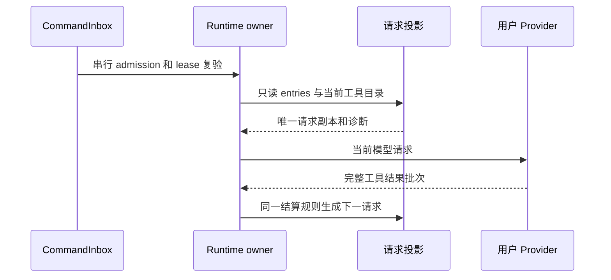

# 官方 3.17.1 CLI 合并收口

官方基线 `a60ba6a7e5a06742270ca605f5d2cc2766afa7e1`，本仓基线 `4ea453673168542c0e3ebf051308fe85d780e2c9`。总体决议见 [集成 spec](../../docs/specs/official-3.17.1-integration.md)。

## 当前合同

- `CommandInbox` 和既有 runtime owner/lease 串行准入已接受输入；不新建接受队列。
- ToolSearch 请求使用 `prepareRuntimeProviderRequest` 的唯一曝光与投影结果；持久历史保留调用当时的 wrapper、Gemini 签名和原工具名。请求副本不改写历史。
- 工具结果预算保留结构化块和工具引用；Hook 追加沿用本仓 UTF-8 预算、artifact 预览和 CUA 图片顺序约束。
- 记忆提取沿用 Main 的逐轮投影、工具调度和批次结算；异步快照保持原工作区身份与只读历史。不能接回旧单工具循环。
- 标题沿用本仓 BYOK 总结模型优先链和 runtime 关闭取消链，不建立官方闲时票据或遥测对象。
- 浏览器 broker 的唯一状态按 server context 共享；子会话绑定保留代际复验，父 tab 生命周期由父会话收尾。不能因重复方法覆盖新的 scope 与关闭失败重试规则。
- 官方账号、闲时执行、请求验证头、会话遥测及 model-IO 原文录制继续退休，不以兼容 stub 恢复。
- 两套实际 CLI 测试目录分别保留为 source/upstream 入口，JSON 不允许重复键静默覆盖。
- Guarded 沿用官方显式可选模式：危险 Bash 匹配由现有 matcher 产生规则，PermissionService 是决策唯一所有者，返回 `approvalMode: user-once`；独立 Plan 优先、工具 alwaysAsk 保留。下游不得用 Hook、项目允许规则或持久许可覆盖这次人工审批，普通 Guarded 调用沿用 YOLO 基础策略。
- 子代理完成、失败和停止仅写既有 `outputFile` / `task.output` 结果；会话 store 已持有历史，不恢复额外 prompt metadata 或 model-IO 原文录制。
- Dream 原文转录执行器不接入产品：扩展后的全仓 dep:refs 与文本搜索只发现两处转录 fixture 调用，没有生产调用或公开再导出。移除该执行器和对应两项转录测试，保留 workspace/session 纯选择与 pending memory update 的消费、失败重试证据；不添加退休 no-op。
- 官方网络采样控制、conversation telemetry producer、OffPeak 控制与加速卡统计写入端口继续退休。Gateway 保留独立 CUA 权限 UI 观察和安全本地 TTFT。新输入不接受官方加速 Provider；旧队列在提升时清除加速材料并按现有会话普通模型选择迁移，仍通过同一 Core admission 与 promotion lease，不能新建接受队列。
- CLI 会话目录回收的在册查询使用 `SessionStore.listSessions()` 的全部未删除行；归档组织态由 Host 管理，不把退休 `includeArchived` 参数接回 CLI。任何读取失败仍放弃回收，不按 directory/path 过滤缩小守卫集合。
- 一次工作流编译的解释 core 同时产出 submit profiles、出生阶段和阶段目录；journal 查询使用真实 `ListEventsOptions`（全部读取显式 `types: all/reportItems: all`），不通过放宽接口接回旧空参数调用。补全原子提交与模型绑定的本仓改动保持。
- 动态工作流根入口公开官方已有的 `interpret`；Bootstrap 从同一个解释 core 派生三个投影，不跨包引用分析实现。并发 retune 经同一控制面先修改引擎，再同步 run seat gate 与进程治理器。
- `native` 是内部 ToolSearch 模式，父会话继承必须逐值保留。内部 record/startup 使用完整 `ToolSearchMode`；外部协议仍由原有 `AppToolSearchMode` schema 约束，不能将 `native` 静默改成 `auto`。
- 外部 `modelExecution` 只接受 `selectionScope`、`memoryExtraction` 和 `subagents` 三项普通单轮约束；严格拒绝 `requestAuth`、`offPeak` 与 `selectionFallback`。用户 Key 与端点由 Provider 配置所有者提供，不经输入命令传票据。历史退回原因和结果类型仅保留用于读取历史，不恢复新加速或闲时执行的 producer。
- 该普通约束 schema 经 shared 公开入口供 Bootstrap 校验，实际入口回归必须通过同一导出。新 sendText/sendGoalCommand 准入忽略旧客户端补供的 `highspeedMeta`，不生成新加速 intent 或 metadata；历史行的读取和 retry provenance 沿用既有合同。

## 验证记录（持续收口，不能作为全仓验收）

- 根 typecheck 曾通过：`official317-typecheck-LxvF2l/logs/validation.log`。此命令未覆盖 CLI 全部源码。
- 使用各包真实公开 exports 派生源码 alias，CLI 当前无输出类型检查 core / bootstrap / cli / node-repl-host 全部 0 错误，证据 `continue317-cli-types-qE58mY/logs/cli-typecheck.log`。
- 当前源码的本地分享上下文、冷恢复和投影回归：4/4，`source-tests-CJbZWA/logs/source-tests.log`。
- 输入准入、原生命令与队列回归 106/106，`continue317-vitest-uQHLlM/logs/vitest.log`；shared 公开入口 schema 回归 1/1，`source-tests-8m19u1/logs/source-tests.log`。
- 真实当前源码 Host/Worker BYOK、dispose 后冷恢复、非法 setter 与单轮附件回归 1/1，`source-tests-Qhq1Fd/logs/source-tests.log`。这是受控 loopback Provider 与真实 CLI stdio，完整桌面和真机验收另记。
- 以上日志均位于当前工作树 `.run-logs/project-only-validation/`。真实 Desktop、实体远端和手机链路不在这些证据范围。
- 子代理报告把一份源码副本写到系统临时目录；该代理已关闭。本任务不擅自清理项目外副本，不采用其自报检查结果，改动由主代理在当前工作树复核。
- 内置插件目录分区化后的 bootstrap resilience 定向复测：`bundled-plugins-resilience.test.ts` 19 项。曾直读 `marketplaces/zcode-plugins-official/marketplace.json` 的两项 ENOENT，改走 `loadMarketplaceManifestSync(storageRoot, ZCODE_OFFICIAL_PLUGIN_MARKETPLACE)` 这一唯一公开读取入口后通过，证据 `continue317-vitest-vYtleK/logs/vitest.log`（固定 Node 24.14.0，项目内 sandbox，测试 tmpdir 与子进程写入均在 sandbox 内）。该文件仍偶发 vitest 5s 单测超时，随机器负载换位出现，与本次改动无关；本记录不作为全仓验收。

续接最终补充（2026-11-02）：固定 Node 24.14.0 下 core/bootstrap/cli/node-repl-host 再次全部 0 类型错误，`continue317-cli-types-zWmPav`。工作流真实 compile/analysis 95/95，`continue317-vitest-s9UKMw`；内置插件 resilience 19/19，`continue317-vitest-Y5kJMV`。先前超时及一次缺席目录断言失败不删记录，后续同源码复跑通过，不以放宽 timeout 取得绿灯。
