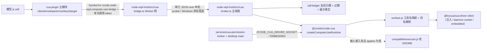

# 官方 3.17.1 Computer Use：保留旧后端（撤销接管）

> **状态：官方 CUA 替换已撤销（2026-11-01，用户明确选择「保留旧后端」）。**
> 本文件保留来源核验结论作为决策依据，并记录本轮实际落地的边界：
> `packages/zcode-cua/**` 与 `apps/zcode-cli/packages/zcode-cua-plugin/**` 回到本仓 HEAD 的
> `@trycua/cua-driver` 旧驱动实现、技能与 tests；`node-repl-host` 保留本轮新增的工程改进
> （调用账本、无进展守卫、浏览器代理、进程守卫），但 CUA bridge 按旧驱动契约装配。
> 主维护 spec（`docs/specs/official-3.17.1-integration.md`）由主代理改写。

## 0. 本轮落地边界

| 范围                                                                                                                         | 处置                                                                                                                                                                                                                                                                                                                                                                                                                                                                                                                                                                                                                                                                                                                                                                                                                    |
| ---------------------------------------------------------------------------------------------------------------------------- | ----------------------------------------------------------------------------------------------------------------------------------------------------------------------------------------------------------------------------------------------------------------------------------------------------------------------------------------------------------------------------------------------------------------------------------------------------------------------------------------------------------------------------------------------------------------------------------------------------------------------------------------------------------------------------------------------------------------------------------------------------------------------------------------------------------------------- |
| `packages/zcode-cua/**`                                                                                                      | 恢复 HEAD：`index.js`/`index.d.ts`、`runtime.js`、`surface.js`、`surface-target.js`、`platform.js`、`permissions.*`、`driver-host.*`、`helper-transport.*`、`macos-permissions.*`、`compatible/**`（老 GNOME/Wayland 物理输入层）、`README.md`、`package.json`、15 份 `test/*.test.mjs`。删除本轮新增的官方占位：`broker*.{js,d.ts}`、`pip-session*.{js,d.ts}`、官方 `tsconfig.json`、`test/availability.test.ts`、`test/official-contract.test.ts`。`vitest.config.ts` 保留但改写为旧后端项目（`name: "cua-driver"`，include `test/**/*.test.ts`），使根 `vitest.config.ts` 的项目项不悬空；新增 `test/old-backend-contract.test.ts`                                                                                                                                                                                   |
| `packages/zcode-cua/index.d.ts`                                                                                              | 按本轮 runtime contract 最小适配：`ComputerUseRuntimeContext` 增加 `actionTitle?: string`（工具卡 badge 跨 broker socket 透传）。`execute()` 返回类型保持 HEAD 的 `Promise<unknown>`，避免为本包新增 `@modelcontextprotocol/sdk` 类型依赖；结果形状由宿主 broker 在出口收敛                                                                                                                                                                                                                                                                                                                                                                                                                                                                                                                                             |
| `zcode-cua-plugin/**`                                                                                                        | 恢复 HEAD：官方单文件 client 换回本仓 `computer-use-{client,envelope,errors,keys,target}.mjs` 五模块、HEAD `docs/computer-use.md`、HEAD `skills/computer-use/SKILL.md`、HEAD `check-sdk.mjs`（存在性 + 真 import）、HEAD `package.json`/`.zcodium-plugin/plugin.json`。删除本轮新增的 `scripts/sync-cache.mjs`（官方 `~/.zcode` 缓存 + sharp/koffi staging，与旧后端无关）与 `tsconfig.json`                                                                                                                                                                                                                                                                                                                                                                                                                            |
| `node-repl-host/**`                                                                                                          | 保留 HEAD 之外的本轮上游改进：`src/call-ledger/**`（账本）、`src/no-progress-guard.ts`、`src/browser-bridge.ts`、`src/process-lifecycle.ts`、`src/result.ts`、`src/tool-contract.ts`(0.7.0)、新 tests（bundle-boundary/bundle-smoke/mcp-server/call-ledger/no-progress-guard/process-guards）。`scripts/build.mjs` 回到 HEAD 旧驱动产物链路（`stageCuaDriverRuntimeFiles` + `compatible/helper` 整目录拷进 `dist/mcp/`，不再注入 `__ZCODE_CUA_HELPER_BUILD_ID__`），只并入上游那条 sharp 修复 —— 合成一条 `external: ["@trycua/cua-driver", "sharp"]`，两个原生闭包都不进 bundle。CUA 装配改回旧驱动：`captureComputerUseRuntimeFromEnvironment()` 只认 `ZCODE_CUA_DRIVER_SOCKET` / `ZCODE_CUA_DRIVER_EMBEDDED`，经 `@zcode/zcode-cua/platform` 的 `assembleComputerUseRuntimeAsync` + `probeGnomeEnvironment` 异步装配 |
| 账本剥离                                                                                                                     | 保留：`NodeReplCallFacts` 只有 `cuaApps` + `browserScreenshots`；官方 `browserUse`/`computerUse` 会话能力统计位与其写入点删除；`result.ts` 仍无条件丢弃 cell 伪造的两个 `_meta` key                                                                                                                                                                                                                                                                                                                                                                                                                                                                                                                                                                                                                                     |
| `packages/services/src/cua-permission-broker/**`（本域独占，除 `node.ts`、`zcodeSessionService`、`zcodeTaskServiceAdapter`） | 6 个 HEAD 文件回到旧实现：`index.ts`、`cuaPermissionService.ts`、`cuaAgentAdmissionGate.ts`、`windowsCuaDevRuntime.ts`、`windowsCuaDevHelperHost.ts`、`windowsCuaHelperHostSupport.ts`。删除仅此轮新增、依赖已不存在的官方空契约（`@zcode/zcode-cua/pip-session`、`/broker*`）的 5 个文件：`cuaPipSession.ts`、`cuaPipSessionService.ts`、`cuaHelperInstaller.ts`、`cuaStandaloneStatusLaunch.ts`、`stableCuaTransport.ts`                                                                                                                                                                                                                                                                                                                                                                                              |
| 平台范围                                                                                                                     | 保留旧后端的 Windows/macOS 支持（`macos-permissions.*`、`windowsCua*`、`driver-host`）。本轮不新增任何 Linux 依赖；`compatible/**` 是 HEAD 既有代码，`pnpm-lock.yaml` 由主代理统一处理，本域未跑 install                                                                                                                                                                                                                                                                                                                                                                                                                                                                                                                                                                                                                |
| 审计边界                                                                                                                     | 不引入官方下载/更新源/账号/遥测/relay；旧后端 client 只由宿主显式注入或显式 env 指向，缺失即 fail-closed                                                                                                                                                                                                                                                                                                                                                                                                                                                                                                                                                                                                                                                                                                                |

## 1. 来源核验结论（保留，作为撤销依据）

| 事实                                                                                                                                                                                                                                                                   | 证据                                                                               |
| ---------------------------------------------------------------------------------------------------------------------------------------------------------------------------------------------------------------------------------------------------------------------- | ---------------------------------------------------------------------------------- |
| 官方 `@zcode/zcode-cua` 是 API 兼容的**契约占位包**，`"zcodeCuaPlaceholder": true`                                                                                                                                                                                     | `git show refs/upstream-tags/v3.17.1:packages/zcode-cua/package.json`              |
| 许可 Apache-2.0（非本仓自创 MIT）                                                                                                                                                                                                                                      | 同上 `license`；根 `LICENSE` 为 Apache-2.0 全文                                    |
| README 明说 runtime、broker RPC、Helper install/launch/verify、PiP session client、native addon loader 全部 **unavailable + fail-closed**                                                                                                                              | `git show refs/upstream-tags/v3.17.1:packages/zcode-cua/README.md`                 |
| 开源树内**不含**任何 Windows/macOS 原生执行源码：`broker.js` 的 `callBrokerMethod` 直接 `throw BrokerError("Computer Use is not available in this build.")`，`broker-server.js` 注释「开源构建不携带 Computer Use Helper：没有安装根目录，也没有独立 Helper 候选路径」 | `git show refs/upstream-tags/v3.17.1:packages/zcode-cua/{broker,broker-server}.js` |
| 上游自带的守卫测试就把这套状态钉成「明确报告不可用 + 不触发真实 broker 准备」                                                                                                                                                                                          | `packages/zcode-cua/test/availability.test.ts`                                     |

结论：切到官方实现等于把已可用的 `@trycua/cua-driver` 后端换成 fail-closed 占位，可用性倒退。
用户据此选择保留旧后端；官方占位不作为本仓 Computer Use 的实现，也不作为「第二后端」保留。

`@trycua/cua-driver`（MIT）继续是唯一原生引擎，`third-party/cua-driver/NOTICE.md` 的归属声明仍然有效。

## 2. 所有者与事件顺序

- **账本是唯一可信事实所有者**：token 每次 `tools/call` 签发、`close()` 后一律拒绝；会话信息只取条目
  `requestMeta`（来自 core），Worker 自报的 context 不采信；`cuaApps` 只由主线程 broker 从 runtime
  结果 `_meta` 的 `zcode.cua/app-associations-v1` 读取后入账。
- **CUA 拒绝 subagent**：Worker 侧 `cua-bridge` 先拒、主线程 `cua-broker` 兜底；Browser Use 的 subagent 放开不回退。
- **原生执行端唯一**：`@trycua/cua-driver`（`surface.js` 负责 ZCode 14 工具名 ↔ driver 工具映射与
  app/window/element 目标解析）；老 GNOME 兼容层只接管输入类工具，观察与语义不二次实现。
- **权限与平台入口**：`@zcode/zcode-cua/permissions`（`ICuaPermissionService` / `CuaPermissionStatus`）
  与 `platform.js`（`assembleCuaPermissionServiceAsync` / `assembleComputerUseRuntimeAsync` /
  `probeGnomeEnvironment`）由 `services/src/node.ts` 与 `cua-permission-broker/*` 消费；
  `driver-host.js` / `helper-transport.js` 承载 macOS 自起 daemon 与 Windows transport。

## 3. runtime contract 最小适配（本轮实际改动）

1. `node-repl-host/src/server.ts`：
   - `captureComputerUseRuntimeFromEnvironment()` 恢复异步旧驱动装配 —— `ZCODE_CUA_DRIVER_SOCKET` 或
     `ZCODE_CUA_DRIVER_EMBEDDED === "1"` 才构造 runtime，Linux 附带 `probeGnomeEnvironment()` 探针；
     其余情况返回 `undefined`，不建 CUA broker、不注入 CUA globals（Browser-only 会话不受影响）。
   - 官方 `ZCODE_CUA_PERMISSION_BROKER_SOCKET` / `_REFRESH_MARKER` 不再是 CUA 装配入口；
     `main()` 内 `await` 捕获，保持「factory 之前捕获 env」的既有修复。
   - `createNodeReplCuaBroker({ runtime, ledger, platform })` 保留上游签名。
2. `node-repl-host/src/cua-broker.ts`：runtime 返回 `unknown`（旧 d.ts 形状），在 broker 出口处
   显式收敛为 `CallToolResult` 后再读 `_meta`，不改 `packages/zcode-cua` 之外的类型面。
3. `packages/zcode-cua/index.d.ts`：context 增加 `actionTitle?`；`execute()` 仍返回 `Promise<unknown>`，
   MCP 结果形状由 `cua-broker.ts` 在出口收敛，不在本包引入 `@modelcontextprotocol/sdk` 类型依赖。
4. `zcode-cua-plugin` 的 envelope 继续把 driver 结果投影成 MCP `CallToolResult`，
   与新账本的 `cuaApps` / 截图下标口径一致。
5. Electron 44：本域不含 Electron API；宿主侧仅需保证 `sharp`/`koffi` 原生闭包继续 external
   （`scripts/build.mjs` 现为 `external: ["@trycua/cua-driver", "sharp"]`）。Electron 44 的 main/renderer 适配归主代理。

## 4. 交回主代理 / 构建代理的接口

- `@zcode/zcode-cua` exports 回到 HEAD：`.`、`./platform`、`./frame-contract`、`./host-display-contract`、
  `./request-access-contract`、`./permissions`、`./driver-host`、`./macos-permissions`、`./helper-transport`。
  **不再导出** `./broker`、`./broker/server`、`./broker/ports`、`./broker/socketPath`、
  `./broker/helperConstants`、`./broker/helperHealth`、`./pip-session`、`./pip-session/node`。
- 因此仍引用官方占位 subpath 的位置必须回到旧实现或改指 `@zcode/zcode-cua/{platform,permissions,helper-transport,macos-permissions,driver-host}`：
  - 本域已处理：`services/src/cua-permission-broker/**`（6 个 HEAD 文件恢复 + 5 个官方新增文件删除）。
  - 主代理处理：`services/src/node.ts`（同时引 `/platform`、`/helper-transport`、`/broker/helperConstants`、
    `/broker/socketPath`、`/broker/helperHealth`）、`services/src/zcode-session/zcodeSessionService.ts:30`、
    `services/src/zcode-agent/zcodeTaskServiceAdapter.ts:201`（`CuaProductMcpServerResolver` 类型改回 helper-transport）。
  - 桌面侧仅本轮新增、依赖 `@zcode/zcode-cua/pip-session` 与 `/broker/helperConstants` 的文件需要撤或改：
    `packages/desktop/src/main/{cuaPipFocusRouter,desktopCuaPipIpc,desktopCuaHelperInstaller,cuaPermissionDragPanel,cuaPermissionPanelPositioner,cuaSystemSettingsWindowWatcher,cuaAccessibilitySettings}.ts`；
    HEAD 对应面是 `desktopCuaPermissionIpc.ts` + `windowsCuaOperationIndicator*.ts` + `cuaOsSupport.ts`。
  - `packages/desktop/scripts/windows-cua-helper-assets.mjs`、`computer-use-producer.mjs`、`tsup.config.ts`、
    `sharp-package-assets.mjs` 若引 `__ZCODE_CUA_HELPER_BUILD_ID__` 之外官方常量，需按旧后端调整。
- 根配置：`vitest.config.ts` 的 `projects` 里 `"packages/zcode-cua/vitest.config.ts"` 可继续保留
  （本域已把它改写成旧后端项目，项目名 `cua-placeholder` → `cua-driver`）；若根 `tsconfig` 引用链
  新增过 `packages/zcode-cua/tsconfig.json`（官方占位包入口），需要移除。
- 保留 `@trycua` 生态：`scripts/cua-driver-runtime-assets.mjs`、`scripts/ci/{cua-driver-runtime-assets.test.mjs,cua-driver-smoke.mjs}`、
  `packages/desktop/scripts/prepare-agent-node-bundle.mjs`、`scripts/prepare-prebuilds.mjs`、
  `third-party/cua-driver/NOTICE.md`、`node-repl-host/scripts/build.mjs` 的 `stageCuaDriverRuntimeFiles` 与
  `packages/zcode-cua/compatible/helper` 拷贝逻辑，均为旧后端有效链路，不删。

## 5. 验证覆盖与边界

本域实跑（项目内 sandbox + 固定 Node 24.14.0，2026-11-01）：

- `packages/zcode-cua` 旧后端 `node --test test/*.test.mjs`：**158 passed / 0 failed**。
- `packages/zcode-cua/test/old-backend-contract.test.ts`（vitest，只注入假 client）：**36 passed / 0 failed**。
- `node-repl-host`：`call-ledger` 15/15、`cua-bridge`+`no-progress-guard`+`process-guards` 33/33、
  `computer-use-onboarding` 2/2。
- 解析检查：20 个 TS 文件 esbuild transform 通过、42 个 JS/MJS `node --check` 通过、本域 marker 清零。
- 阻塞：`node-repl-host/test/mcp-server.test.ts`、`bundle-*.test.ts` 未跑通 ——
  `packages/shared/src/zcode-protocol-v4/rows.ts:11-14` 自动合并后重复声明
  `backgroundResultOriginMetaSchema` / `workflowLaunchMetaSchema`，属主代理域，需先修。

未验收（如实记录）：真机鼠标键盘输入与截图、macOS TCC 授权链路、Windows driver 安装/ Scheduled Task 常驻、
老 GNOME/Wayland 物理输入（本轮未起过 Linux 环境）、`@trycua/cua-driver` 原生包在各目标机的加载、
Electron 44 下宿主产物与 sharp/koffi 闭包、以及撤销后残留官方引用的全仓类型收敛（根 typecheck 由主代理统一跑）。
本轮不触发 Actions、不打安装包、不安装依赖、不操控用户真实桌面或真实数据 App。

## 6. 自动合并/新增文件的审计结果（本轮实扫）

- 扫描范围：本域全部自动合并与新增文件（`packages/zcode-cua/**`、`zcode-cua-plugin/**`（含新增
  `sync-cache.mjs`、`tsconfig.json`）、`node-repl-host/**`（含新增 `call-ledger/**`、`no-progress-guard.ts`、
  `dist-types/**`、6 份新测试）与官方 `docs/computer-use.md`、`skills/computer-use/SKILL.md`。
- 关键词：telemetry/ARMS/analytics/attribution/marketing/deviceId/client-config/rollout/relay/upload/
  session-features/push/model-IO 录制。结果：新增文件里没有任何采集、上报或上传实现；
  唯一命中的是「会话能力统计」的两个来源位，已按 §3.4 剥离，现存的 `x-zcode-session-features` 字样
  全部是说明「本仓不采集」的注释与断言。
- 官方 `sync-cache.mjs` 原本把开发态插件写进 `~/.zcode/cli/plugins/...` 并复制 `.zcode-plugin`，
  属跨身份写入：已改为 `.zcodium` 数据根（可用 `ZCODIUM_PLUGIN_CACHE_ROOT` 覆盖）与 `.zcodium-plugin`；
  该脚本仍只是开发者手动工具，CI 与真机验证不得依赖它。
- 本域不含官方账号/登录/市场自动拉取/购买/额度/推送代码；`docs`、`SKILL`、client 内无 URL、
  无 marketplace、无登录或购买文案。
- 遗留（跨域，主代理处理）：根 `vitest.config.ts` 仍以
  `__ZCODE_TELEMETRY_REPORT_ENDPOINT__ = https://zcode.z.ai/api/v1/event/report` 作为测试注入值，
  并存在 `packages/desktop/src/main/desktopStabilityTelemetry.ts` 等文件名；主代理已计划删除
  `packages/shared/src/conversation-telemetry` 与 `main/web-remote-relay` 官方控制面，保留本仓 LAN attachment 链路。
- 架构闸门遗留：恢复官方文件后 `architecture:check --changed` 报 983 violations / baseline 0，
  其中本域命中全是 `unmanaged-new-file`（`packages/zcode-cua` 与 `zcode-cli` 均为 `managed: false`）：
  `broker*.js`、`broker-helper-*.js`、`broker-ports.js`、`broker-socket-path.js`、`pip-session*.js`、
  `vitest.config.ts`、`node-repl-host/src/no-progress-guard.ts`、`node-repl-host/src/call-ledger/*`。
  需要主代理决定 `pnpm architecture:adopt`（本域建议 `zcode-cua` 为 `adapters` 层；
  `call-ledger/module.ts` 自称 `node-repl-call-ledger`，adapters 层，`requires: [zcode-cli]`，
  需与 `architecture-policy.yaml` 对齐），或按已审阅的恢复变更刷新 baseline。本域新测试文件
  `test/official-contract.test.ts` 未被该规则命中。
- `pnpm-lock.yaml` 仍含 `@trycua/cua-driver@0.28.2` 与 6 个平台原生包（含 linux/darwin/win32 多架构），
  `third-party/cua-driver/NOTICE.md`、`scripts/cua-driver-runtime-assets.mjs`、`scripts/ci/cua-driver-smoke.mjs`、
  `scripts/prepare-prebuilds.mjs`、`packages/desktop/scripts/prepare-agent-node-bundle.mjs`、
  `packages/desktop/src/main/cuaOsSupport.ts` 仍引用旧后端；lockfile 需由主代理在获准环境再生，本轮不安装依赖。
