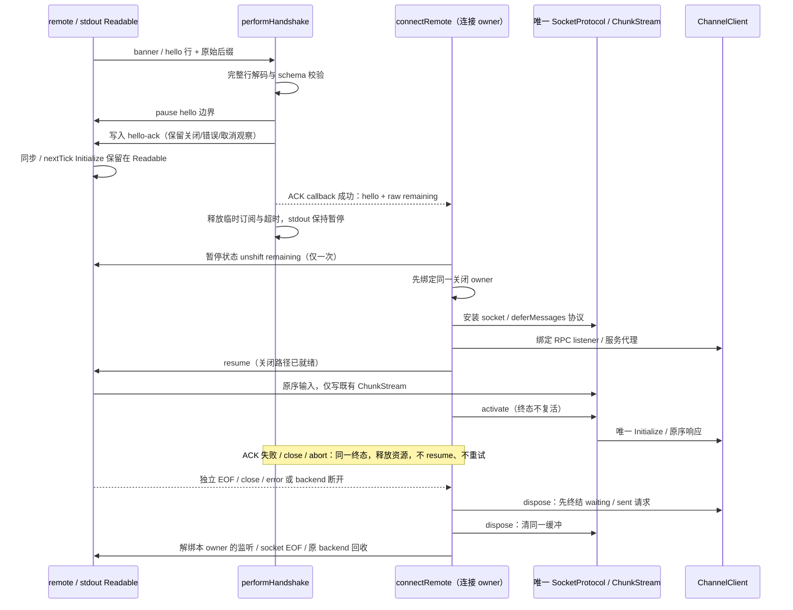
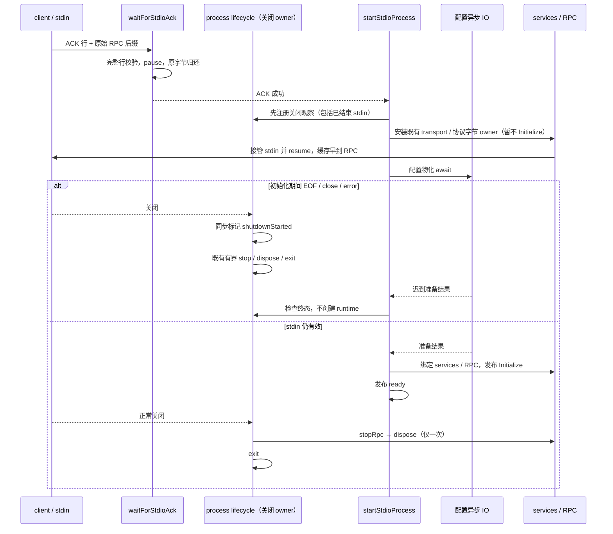

# 远端握手的字节与生命周期边界

## 产品规则、所有者与接口

`performHandshake` 独占 hello 前的 stdout 读取、握手超时与临时监听器。按字节累积到换行后才解码这一行；SSH banner 可以跳过，合法 hello 后的剩余字节必须原样交给 RPC，不能经 UTF-8 往返。接口继续返回 `HandshakeResult`（`hello` / 原始 `remaining`），可接收连接已有的 AbortSignal，不改 hello/ack 协议。

已确认客户端 P1：删除最后一个 data listener 不会暂停已经 flowing 的真实 Readable。ACK 回调中同步或 process.nextTick 发出的 Initialize 会在 connectRemote 的 await continuation 安装 RPC listener 之前被消费丢弃，首个业务请求永久 waiting；hello 与 Initialize 同 chunk、setImmediate 发送是必须保留的正常对照。

合法 hello 的换行边界先 pause stdout，再发送 ACK；握手解析器从这一刻不再读取新输入。当前 chunk 的 raw remaining 只移交一次，后到字节留在同一 Node Readable 的既有缓冲中，不能另建临时 reader、后缀队列或重放缓存。ACK 的 write callback 成功后才完成握手；同步 throw、callback error、stdin error、stdout EOF/close/error、命令关闭或取消在成功交接前都只拒绝一次，释放本 owner 的计时器、原生监听与关闭/取消订阅。write 返回 false 只是背压，不是失败。ACK callback 尚未归还时取消/关闭也立即释放握手订阅；若迟到 callback 失败，只有同一 ACK owner 可以短暂接收 Node 紧随其后的配对 error，不能复活 stdout reader、超时或 RPC。已 destroy 的 stdin 拒绝 write 时可能只回调 ERR_STREAM_DESTROYED 而不再发布 error；写入后先 close 再归还的失败 callback 同样不再发布 error，不得为不存在的配对事件保留永久 listener。以 Writable 公开 closed 终态界定配对 error 的释放，不读取 Node 私有状态；仅 destroyed 不能代表 error 已发布，destroy(error) 的 error 仍可能排在 callback 之后。关闭订阅注册时同步触发也必须安全回收迟到返回的句柄，失败路径不恢复 stdout。

`connectRemote` 是连接、RPC 和 backend 的生命周期 owner。自己的 stdout EOF/close/error 观察在调用 performHandshake 前安装，并连续保持到 RPC 接管；ACK callback 成功清理握手订阅与 await continuation 之间不得出现 error 无人观察的空窗，真实 Readable 暂停并不阻止 nextTick error/close。握手成功后在暂停状态原样 unshift remaining，安装唯一 wrapStdioStream → SocketProtocol → ChannelClient 和 RemoteServiceAccess，并在恢复输入前绑定既有 reportRemoteClose / beginDisposal 关闭入口。复用 SocketProtocol 的 deferMessages / activate；早到输入只归其既有 ChunkStream，所有 listener 与关闭路径就绪后才 resume / activate，不发送第二个 Initialize。恢复或注册期间同步重入关闭/abort 时，迟到归还的 socket / protocol / client 也立即释放，终态不能继续恢复或发布有效连接。独立 stdout EOF/close/error 与 backend/命令断开进入同一连接终结入口，不等待另一个 close 通知才释放 waiting 请求。

初始化的 AbortSignal 同时交给握手 owner 和连接 owner，取消不能只结束外层 Promise 并把握手 listener/timer 留到超时。backend 的同步 dispose 与 disposeAndWait 复用一个所有权标记；取消后的迟到结果不重复 dispose backend，也不恢复 reader。connectRemote 自己注册的 stderr diagnostic listener 随失败或连接释放解绑，保留其他 owner 的监听器。正常显式 disposeAndWait 仍沿既有 EOF 等待 → backend.disposeAndWait 顺序，不被自己的 EOF 改走同步回收；stdin.end 内同步收到 command-close/EOF 时同样实际等待 backend.disposeAndWait，不因 hasStreamClosed 已同步变 true 而提前返回或改走 backend.dispose。

Desktop 的 continuous 与手机经已有 Host 的 replayable 链路共用远端连接初始化；本改动不涉及 CommandInbox admission、owner/lease、workspaceIdentity/remoteSessionId、快照或重放，后续投递语义保持各自的现有契约。测试使用独占的内存 backend，不连接真实远端或现用 Host。

## 服务端 ACK 与启动期关闭

服务端 waitForStdioAck 是 ACK 前 stdin 字节和临时监听器的唯一所有者。输入按 Buffer 累积，只解码完整 ACK 行并使用已有 helloAckMessageSchema 校验；ACK 后的 RPC 帧原样归还，不能整体 UTF-8 往返。成功时暂停 stdin，直到既有 stdio transport / SocketProtocol 在配置准备前接管后恢复；既有 10 秒握手超时不变，同步 close/error 与迟到事件均只结束一次并释放本 owner 的监听和 timer。

ACK 后不能一直 pause 到配置准备完成：真实 Readable 有未消费 RPC 后缀时不会发布 end，readableEnded 也尚未变为 true。既有 transport 在 prepare 的第一个 await 前唯一接管并消费底层 stdin，早到字节只由已有协议缓存保留；不读 Node 私有终态、不丢弃数据、不另建临时 reader 或后缀缓存。services 在配置完成后才绑定，Initialize 在绑定完成后仅发布一次；在此之前不得分派业务 RPC 或启动未知 channel 的等待期限。正常客户端继续等 Initialize 后才发送业务请求。

`SocketProtocol` 的构造可选项 `deferMessages` 默认为 false，所有现有调用维持立即解帧。stdio 在创建 transport 时显式启用，输入仍只写入既有 `ChunkStream`，不提前解码或分派。`activate()` 只从延迟态进入活动态一次，按原序解帧；dispose 清空同一缓冲后 activate 不得复活。`createStdioTransport` 拥有该协议与后续 ChannelServer，services 绑定后 ready 沿 Initialize → activate 推进；`createStdioServer` 保留立即绑定与 ready 的兼容入口。生命周期先注册，再安装 transport 和恢复 stdin，最后等待配置；已创建 services 的回收回调先交给同一 runtime owner，再执行绑定与 ready，绑定失败也能释放资源。准备失败也进入同一 shutdown 完成边界，不另造清理路径。

registerStdioProcessLifecycle 是 ACK 后进程关闭的唯一 owner，startStdioProcess 只持有配置准备与已创建 runtime。生命周期在配置物化的第一个 await 前注册；已 end/destroy/error 的 stdin 也进入同一个幂等 shutdown。关闭标记同步生效，迟到配置结果先检查终态，不能创建 services/RPC 或发布 ready。同步创建 runtime 时发生关闭，清理等当前创建步骤归还资源，随后沿已有 stopRpc → service dispose → exit 处理；正常在线关闭仍同步开始 stopRpc。

配置准备只执行已有异步文件 IO，关闭不等待该 IO 才启动 shutdown。stopRpc / dispose 契约返回 Promise，但调用本身仍可同步抛错：每阶段必须把同步 throw 与 Promise rejection 都记录为该阶段失败，继续下一阶段并 exit(1)，不得留下 unhandledRejection；正常 stopRpc 调用仍同步开始。

不增加 timeout、第二套关闭 owner 或清理路径。既有握手与两阶段关闭期限、hello/ack wire、CLI、业务 owner/lease、workspaceIdentity/remoteSessionId、Desktop continuous 与手机 replayable 均不变；客户端仅修复上节已确认的握手字节交接与同一生命周期接缝。

## 验收

1. hello 与含任意 0..255 字节的 RPC 数据粘包时，remaining 与原始 RPC 完全相等。
2. UTF-8 hello 跨字节边界分片、banner 与 hello 混合时正确解析，只发送一次 ack。
3. 同步关闭、非法 hello、ack 写入抛错及超时立即或按既定超时拒绝，清理所有临时订阅与计时器；不删除其他 owner 的监听器。真实 Writable 在 hello 前或 ACK callback pending 时无错误 `destroy()`，即使 backend 没有命令关闭事件、write callback 尚未归还，也应由既有握手 owner 观察 stdin close 并立即拒绝；迟到 callback 不能成功交接。close 监听只注册一次，失败 callback 重新接管配对 error 时也不得重复注册。
4. 已关闭命令的晚订阅在微任务补发前 dispose 后不再触发；有效晚订阅仍得到原退出码。

5. 服务端 ACK 粘真实二进制 RPC，后缀字节与 frame length 完全保真；ACK UTF-8 逐字节分片正确解析，成功后 stdin 暂停，后续 reader 恢复后原序接收后缀和后来输入。
6. 非法 ACK、既定超时、订阅时同步 close/error、已结束 stream 均拒绝一次，释放自己 data/end/close/error 监听及 timer，保留其他监听。
7. 配置 await 期间 stdin EOF/close/error：立即启动既有 shutdown，迟到准备结果不创建 runtime 或发布 ready；同步创建期间关闭也回收归还的 runtime。
8. 生命周期注册前 stdin 已 end/destroy/error 时，stopRpc、dispose、exit 仍按序仅一次；重复关闭/信号不重建资源，错误按既有规则提升退出码。
9. 活动连接正常启动、关闭清理及邻近 stdio/backend/双 delivery 回归保持通过。新回归直接导入实际生产 helper 与生命周期函数，使用真实 Node stream，不以 VM 复制实现作为交付证据。
10. 真实 waitForStdioAck → 暂停 stdin → startStdioProcess 的串联，ACK-only 与 ACK 粘完整/部分二进制 RPC 均覆盖；配置 await 时直接 stdin.end()，测试不手动 resume，EOF 必须及时关闭；close/error 也只清理一次。迟到配置不绑定 services 或 Initialize，早到字节不另建缓存。
11. stopRpc 与 dispose 分别同步抛错时，直接生产生命周期 helper 各记录一次失败，dispose 仍有执行机会，退出码为 1，且无 unhandledRejection；正常同步 stop、既有分阶段期限及幂等关闭保持不变。
12. 真实 PassThrough + performHandshake + connectRemote + ChannelServer/SocketProtocol 双向串联，coalesced / ACK 内 synchronous / process.nextTick / setImmediate 四种 Initialize 时序均以公开 services.systemService.info() 的首个响应验收；hello UTF-8 与 Initialize header/body 分片也完整且原序，只写一个 ACK 和一个 Initialize。不读 ChannelClient 私有 initialized 充当成功证据。
13. ACK write 同步抛错、异步 callback error（含返回 false 的真实 Writable）、ACK 内命令同步 close、stdout EOF/error 以及取消均及时拒绝并清理，不留未处理 error/rejection。握手成功必须观察 stdout.isPaused()，下一 owner 接管并 resume 后首帧完整。
14. hello 后尚未 Initialize 的独立 stdout EOF/close/error、关闭订阅时同步补发、resume 内同步关闭/abort、取消后的迟到 hello/RPC 均终结一次；waiting 业务请求被拒绝，backend 回收一次，自己的 data/end/close/error/diagnostic/abort 监听和 timer 归零，其他 owner 的监听不删除。显式 disposeAndWait 仍实际等待原 backend 完成。
