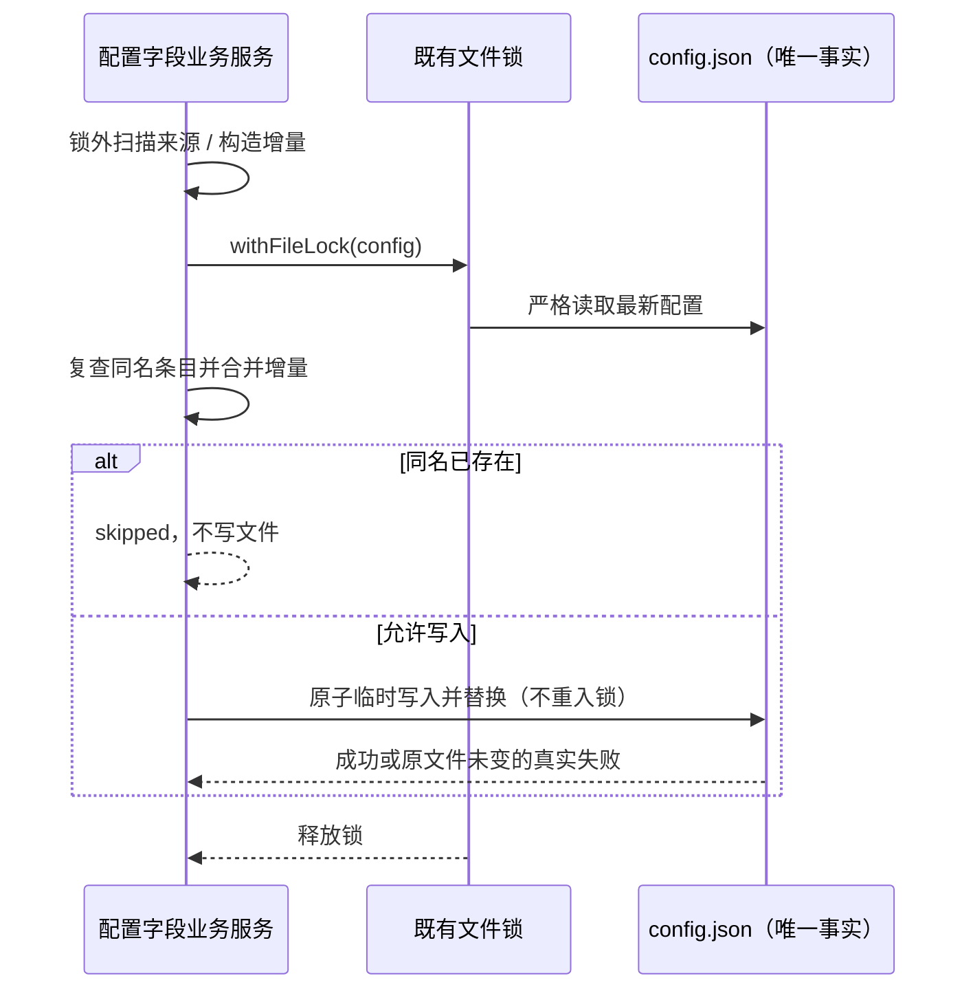

# 共享状态文件跨进程读改写持锁

> **状态：已实现**（2026-10-09）。

## 背景与范围

审计发现多个共享状态文件存在**跨进程读改写丢更新**：Main（Electron main）、Host
（utilityProcess，跑 `packages/services`）与 CLI（每个 workspace 一个 Node 子进程）共同写同一份
JSON，而各调用点的读和写都在跨进程锁之外。后写的一方用旧快照整文件覆盖，抹掉其他进程刚写入的字段。

受影响文件与未持锁读改写点（审计结论，行号为审计时快照）：

| 文件                             | 写入进程          | 未持锁读改写点                                                                                                                                                                                                                                                                                                                                                                      |
| -------------------------------- | ----------------- | ----------------------------------------------------------------------------------------------------------------------------------------------------------------------------------------------------------------------------------------------------------------------------------------------------------------------------------------------------------------------------------- |
| `~/.zcodium/cli/config.json`     | Main / Host / CLI | `desktop/src/main/mcpUserDirectory/index.ts`（4 处）、`services/src/mcp-sync/mcpSyncService.ts`（6 处）、`services/src/plugin-sync/pluginSyncService.ts`、`services/src/commands/commandsService.ts`、`services/src/skills/skillsService.ts`、`services/src/settings-sync/settingsSyncService.ts`、`apps/zcode-cli/packages/adapters/src/config/file-config.adapter.ts`（8 处异步） |
| `<settingsDir>/setting.json`     | Main / Host       | `services/src/setting/settingService.ts` 的 `enqueueSettingsWrite`                                                                                                                                                                                                                                                                                                                  |
| `<storage>/v2/agents-state.json` | Host / CLI        | `services/src/subagents/subagentsService.ts`（CLI 侧 `migrateSubagentStateFile` 已持锁，形成不对称）                                                                                                                                                                                                                                                                                |
| `~/.zcodium/cli/mcp.json`        | Main / Host       | `services/src/mcp-sync/mcpSyncService.ts`                                                                                                                                                                                                                                                                                                                                           |

本 spec 只修**跨进程**丢更新。单写入方（仅 Host 注册）的 `onboardingRecordService`、
`gen-ui/adapters/stateStorage` 不在范围内——它们只有进程内并发风险，属另一类问题。

## 产品规则

1. 共享状态文件的读-改-写必须在同一把跨进程锁内完成。锁的粒度是**单个文件**，不是全局锁。
2. 锁必须覆盖「读取 → 合并 → 原子替换」全过程；只在临时文件写入和 rename 时原子不足以防止丢更新。
3. 持锁期间不得执行网络 IO 或等待用户输入；锁内只做本地文件读写。
4. 未持锁的读（纯读取方）不受影响，也不需要加锁。
5. 锁超时沿用 `withFileLock` 既有语义（默认 8 s，`ZCODE_FILE_LOCK_TIMEOUT_ERROR_CODE`），
   不新造超时策略。

## 状态所有者

- **文件内容是唯一状态**，没有第二个 accepted queue 或缓存。
- 锁的所有权归 `withFileLock`（`packages/shared/src/node/privateFilePersistence.ts`）：
  它已实现跨进程 OS 锁（目录锁 + owner 元数据 + stale 回收）与进程内 FIFO。本 spec 不重写锁。
- 各业务服务仍是自己字段的唯一所有者；锁只保证读改写序列化，不改变字段归属。

## 接口

不新增锁入口，复用既有 `withFileLock`（`packages/shared/src/node/privateFilePersistence.ts`，
经 `@zcode/shared/node` 导出）。Main / Host / CLI 三个进程都能导入它。

各调用点的统一形态：

```ts
await withFileLock(filePath, async () => {
  const current = await (<站点自己的读取器>filePath);
  // …合并…
  await (<站点自己的原子写>(filePath, next));
});
```

- **读取器保持站点原有语义，不统一。** 曾实现过一个 `withLockedJsonFile(file, op)` 把读取也包
  进去，但其「JSON 损坏 → `{}`」的降级比多个站点宽（例如 `mcpSyncService.readJsonObject`
  损坏时抛错），会把用户手改坏的文件静默当成空配置后整文件写回，造成数据丢失。已撤回，
  改为只加锁、不改读取语义。
- **写入仍在锁内由站点自己完成。** 持锁调用方内部的原子写助手必须传 `useFileLock: false`：
  `atomicWriteText` 默认会自取同一把锁，同进程重入会走 FIFO 死等到 8s 超时。
- 不新增第二个锁入口。既有 15 处直接用 `withFileLock` 的非 JSON 场景保持不变。

## 事件顺序与失败语义

```
调用方 → withFileLock(file)             ← 跨进程目录锁 + 进程内 FIFO
           → read + parse（保持原有错误语义）
           → operation(current)          ← 合并并原子写回
           → release lock
```

- 锁获取失败（超时）向上抛，调用方行为不变：原本会丢更新的路径变成明确失败，不静默继续。
- `operation` 抛错时锁正常释放，临时文件由既有原子写助手清理。
- 不做重试、不做兜底分支；超时是显式失败，符合 AGENTS.md「不能用超时掩盖同步问题」。

## 验收

1. `pnpm typecheck`、`pnpm lint`、`pnpm fmt:check` 通过。
2. `pnpm architecture:check --changed` 不引入新违规（基线违规单独报告）。
3. 新增跨进程测试：两个真实子进程并发更新同一文件的**不同字段**，修复前丢更新、修复后都在。
   形态为 `node --import tsx --test` + `spawn` 真实子进程（`packages/services/test/sharedJsonFileLock.test.ts`）。
   已验证测试有牙：临时去掉锁后 `alpha` 只剩 7/12，加上锁后 12/12。
4. 锁在 `operation` 抛错后正常释放，后续调用不撞 8s 超时。
5. `pnpm typecheck` 覆盖 shared / services / desktop host / cli adapters 四个包。

## 实现偏差

### D1 撤回 `withLockedJsonFile` helper

见「接口」。结论：只加锁，不接管读取语义。

### D2 `mcpSyncService.importMcpServers` 改为增量合并

该函数的读写在多个外部 IO（`collectEffectiveUserMcpRecordByName`、`rewriteFilesystemMcpConfig`）
之后，不能把整段塞进文件锁。改为：锁外算出**本轮新增条目**（`addedServers`，纯增量），
锁内重读并把增量合并到最新值上。既避免锁内做网络/文件 IO，也不用旧快照整文件写回。
锁内还必须按归一化名称复查新增条目：若并发写入方已添加同名 server，保留最新配置，
本条导入结果改为 skipped，不覆盖对方配置。

### D3 CLI `loadFileConfig` 的迁移写回未持锁（已知缺口）

`apps/zcode-cli/packages/adapters/src/config/file-config.adapter.ts` 的
`persistPluginConfigMigration` 用同步 API（`writeFileSync`/`renameSync`），而锁原语只有异步版。
把 `loadFileConfig` 改成异步会牵连其同步调用方，超出本 spec 范围。

实际影响有限：迁移只在存在 legacy CUA 插件 id 时触发一次，归一化后不再写。后续需要单独处理。

### D4 `commandsService.writeUserCliConfig` 仍是非原子 `writeFile`

预存问题（崩溃在截断与写入之间会留下半文件），与本 spec 的跨进程丢更新是两类问题，未一并改。
后续应换成 `atomicWriteText` 并传 `useFileLock: false`。

### 未纳入范围

单写入方（仅 Host 注册）的 `onboardingRecordService`、`gen-ui/adapters/stateStorage`：
只有进程内并发风险，无跨进程写入方，属另一类问题。

## fork 补强：MCP legacy enable 迁移

Main（mcpUserDirectory）与 Host（mcpSyncService）的迁移均适用：锁外读取只用于判断是否需要迁移。取得锁后必须重新读取文件、重新计算迁移，并返回锁内最新 server map。并发更新的 provider、MCP 条目及 enabled 状态均以锁内快照为准；文件已删除时不重建。解析或写盘失败仍沿用原有加载降级语义，不用旧快照写回。回归覆盖锁等待期间并发更新、删除和损坏文件。

## fork 复核：锁外派生值

- 技能 setEnabled 只传本次目标路径及布尔值，不将锁外旧开关表作为增量传入；其余技能以锁内文件为准。
- 命令改名在锁内读取旧路径的最新 override 并迁往新路径；并发启用或禁用均须保留。
- MCP 导入执行 D2 的锁内同名复查。测试经公开服务入口，用真实文件锁制造等待窗口，再由并发写入方提交最新值。
- Main/Host 的 MCP 手动 upsert/delete 只向持锁写入路径传递目标名称及本次配置；服务器表在锁内读取、迁移并修改，不接受锁外派生的整表。并发新增、编辑和开关更新均保留，删除只移除目标条目。

## Windows 技能路径开关的一致性

`skillsService` 的读取与写入必须使用相同的路径归一化规则（反斜杠转正斜杠）。修改目标开关时在文件锁内删除所有归一化后等于目标的旧 key，再按规范 key 写入禁用 override；启用则删除 override。否则旧 Windows 反斜杠 key 仍被读取为禁用，出现开关保存成功但技能无法启用，或者旧 key 覆盖新值。

验收沿用 `sharedConfigMutations.test.ts` 的真实服务和文件锁：原始 Windows key、正斜杠 key 与两种 key 同时存在时，启用均删除目标 override，禁用只留一个规范 key；其他技能及并发更新字段保持锁内最新值。文件内容仍是唯一事实，接口与默认启用语义不变。

## fork 补强：设置导入与技能保存的完整事务

设置同步的 MCP 导入与其他配置 writer 共用目标文件锁。外部扫描和候选判重在锁外；锁内重新读取目标并按归一化名称复查，增量写入只合并本次条目。锁等待期间新建同名 server 时保留最新值，公开导入结果返回 `skipped` / `sameNameExists`，不得误报 imported。Plugin 与 MCP 的既有配置写助手均在调用方锁内使用 `atomicWriteText(..., { useFileLock: false })`，不嵌套取锁。

技能展示仍可沿用既有损坏配置降级；修改开关的锁内最终读取只允许 ENOENT 视为空配置。损坏 JSON、非对象根与权限/其他 IO 错误必须拒绝写入；设置同步的目标配置读取遵守相同 fail-closed 规则，外部来源解析语义不变。技能开关同样使用既有原子文本写助手；临时写入或 rename 失败不得截断目标文件，原始配置字节与 provider/MCP 字段保持，失败临时文件清理。



验收：经公开 settings-sync importSelected，用真实锁制造并发更新与同名碰撞，结果统计与最终文件一致；技能临时写入部分成功后 ENOSPC、目标 rename 失败、坏 JSON/数组根/权限错误均保持原始字节且无临时残留，重试后仍保留无关配置。类型、Lint、架构与定向回归必须实际执行。

## 私有配置原子替换的文件权限

CLI 配置的正常 writer 使用 `0600` 创建文件；旧技能与设置导入 writer 原地写入时会保留已有权限。改用临时文件替换后，未指定 mode 的新文件在 POSIX 常见 `umask 022` 下变成 `0644`，使配置中的鉴权头、OAuth secret 或插件选项对其他本机用户可读。这是原子写改动引入的权限回归，不修改配置事实或字段归属。

- 技能开关与设置导入的 JSON 配置仍只走既有锁内 `atomicWriteText`，明确传入 `mode: 0o600` 与 `useFileLock: false`。临时文件在创建时即为私有，rename 后正式文件保持私有；不在替换后另加 chmod、写入路径或权限修补状态。
- `atomicWriteText` 仅增加可选的创建 mode；未传入时保持通用文件 writer 原有默认权限语义，不改变其他业务调用。目录权限、锁、重试、ENOENT、严格读取、失败保留原始字节与临时文件清理均不变。

```text
私有配置服务 → 原文件锁 → 严格读/合并 → writeFile(temp, mode=0600) → 原 rename → 释放锁
通用文件服务 → 原 atomicWriteText（mode 缺省仍按原系统默认权限）
```

验收在 `sharedConfigMutations.test.ts` 经公开技能开关、插件导入与设置 MCP 导入，使用真实临时目录并记录生产 helper 的实际 `fs.writeFile` mode，Windows 也必须断言 `0o600`；POSIX 额外 stat 正式文件确认 `0600`。通用 helper 不传 mode 的路径保持缺省语义，原有部分写入/rename 失败与坏 JSON 回归继续通过，不触及用户配置。
