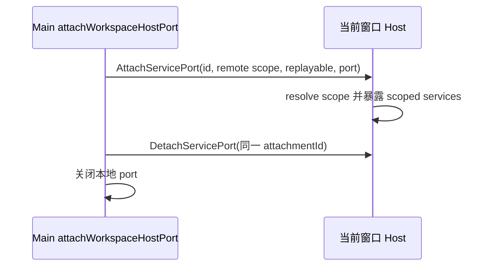

# Web 远控 Host Attachment 契约测试

## 边界

Main 的 `attachWorkspaceHostPort` 负责把当前窗口已解析的 workspace 目标编码为 `AttachServicePort` 消息。远端目标必须保留 `remoteSessionId`、`workspacePath`、`workspaceIdentity` 三项 scope，并固定使用 `web-remote-replayable`；缺少 identity 时拒绝转移 MessagePort。Host 继续负责验证 session、scope 与 readiness，本测试不替代 Host registry 集成验证。

## 验收

1. 对有效 remote target，生产 `attachWorkspaceHostPort` 恰好发送一条 `AttachServicePort`，消息包含准确的 remote session、path、identity 与 `web-remote-replayable`，转移其新建的 peer port。
2. `dispose()` 使用相同 `attachmentId` 发送 `DetachServicePort`，并关闭 attachment 所持本地 port。
3. remote target 缺少 `workspaceIdentity` 时抛出错误；不创建 MessageChannel，也不发送 Host 消息。
4. 本测试只断言 Main 发出的 attachment 契约，不声称覆盖 Electron IPC 转移、Host scoped registry 或真实 Gateway 端到端路由。
