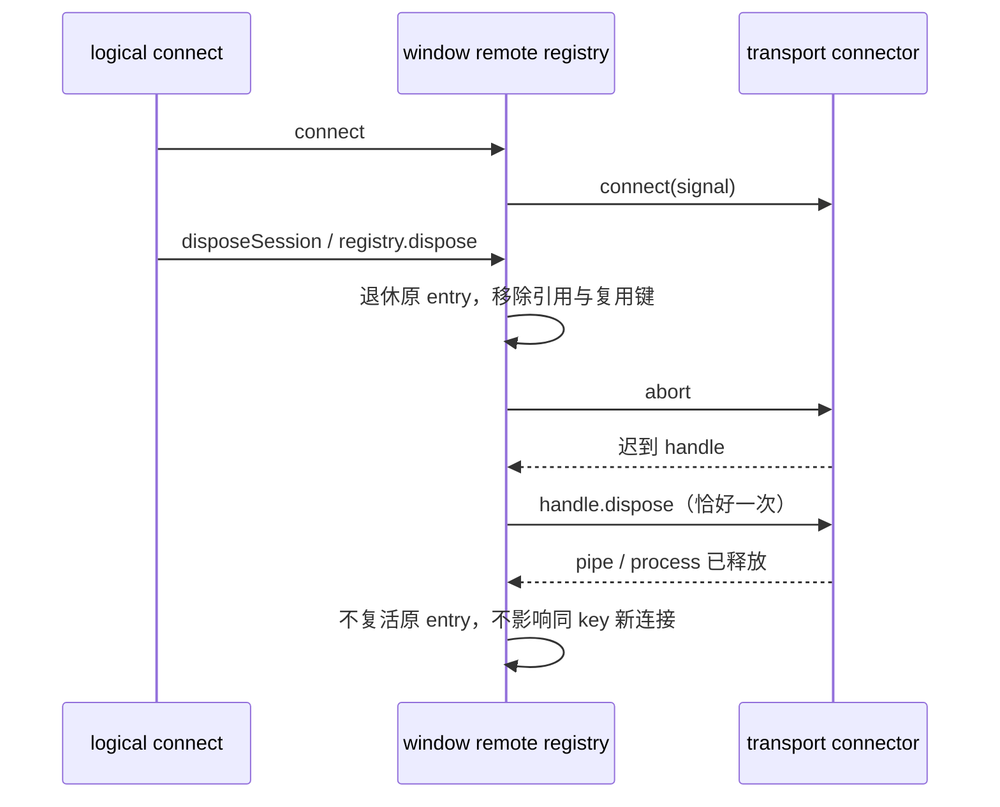

# 窗口远程连接退休与迟到资源释放

## 产品规则与所有者

窗口内 `windowRemoteConnectionRegistry` 唯一拥有 SSH/WSL/Docker transport 与 logical session 引用。关闭 registry、释放尚未连接完成的最后一个 logical session 时，立即退休该 entry、取消底层连接并从可复用表移除。认证或部署可能不响应 abort；迟到成功的 handle 仍归原 entry 清理，不能复活旧连接，也不能删除同 key 的新 entry。

`entry.disposed` 表达拒绝再使用，不代表尚未产生的 transport 已释放。`entry.disposePromise` 只在真实 handle 存在时登记，所有关闭入口对同一个 handle 共用该资源完成边界；没有 handle 时不能缓存一个已完成 Promise 而吞掉迟到资源。同步抛出的 handle.dispose 与异步失败都进入同一 Promise，不能使后续关闭重复调用 handle。

SSH 已 online 的连接仍为 window-scoped cache；WSL 空闲宽限、workspace generation 与 running task 的释放规则保留。手机继续 attachment 桌面已有 Host，不另建 remote owner。

## 事件顺序

## 验收场景

- 正常连接完成后 registry.dispose 及重复 dispose 只释放 handle 一次。
- connector 未完成时 registry.dispose 或最后一个 logical session dispose，随后迟到 handle 必须释放，原 connect 不返回可用 descriptor；重复清理不重复释放。
- 原 SSH 请求取消后立即连接同 key，新连接仍可用，迟到旧 handle 只释放自身。
- handle.dispose 同步抛错与异步拒绝不触发第二次资源释放。
- 测试用 deferred connector 与内存 handle，无真实网络、进程或用户数据；执行 Host 类型检查和架构检查。
