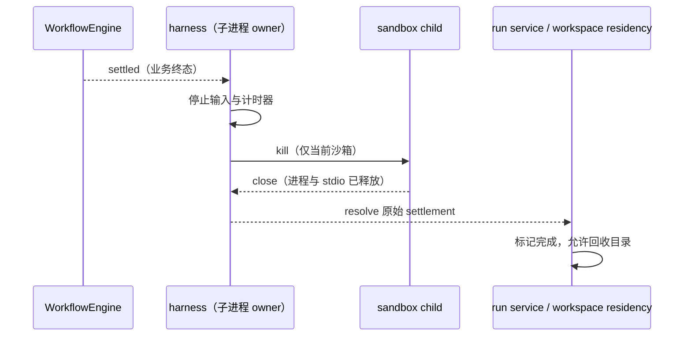

# 工作流沙箱的完成与资源关闭边界

`WorkflowEngine` 唯一拥有业务终态与 journal；`runWorkflowScript` 的 harness 唯一拥有子进程、stdio 与临时监听器。引擎结算后 harness 停止读取、取消计时器和 abort 订阅，并终止仍存活的子进程；返回的 Promise 必须等到该子进程 `close`，才能使上层 `waitForTask`、`close` 和 workspace residency 释放资源。不能只调用 `kill()` 就声称已关闭：Windows 子进程退出前仍会锁住 cwd，立即删目录将得到 EBUSY。

不新增业务状态所有者，不改变 completed/errored/stopped 判定。子进程先退出时仍由引擎收敛 interrupted；引擎先终态时保留它的原始结果。启动前已经 abort 的路径也先注册子进程关闭监听，不能漏掉退出事件。

验收使用真实引擎和受控子进程事件验证 completed、abort、启动前 abort、子进程先关闭及 spawn error。kill 后 close 前结果保持 pending，close 后只完成一次。现有真实 sandbox/model bindings 测试必须通过，不以文件删除重试掩盖资源未关闭。
