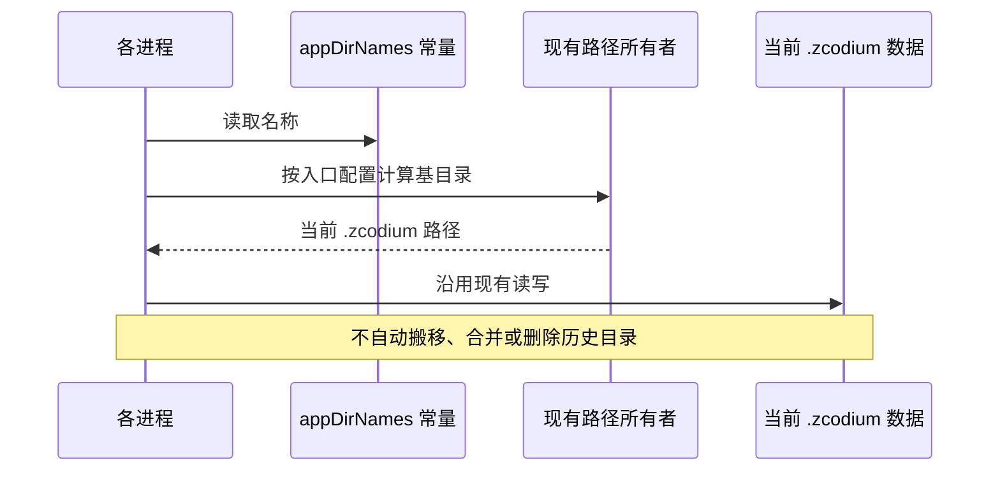

# ZCodium 数据命名空间

## 当前产品规则

本仓当前用户级数据根为 `{dataBaseDir}/.zcodium`，默认 `~/.zcodium`；业务配置、会话、数据库、附件和安全诊断沿用其下现有目录。工作区配置为 `<workspace>/.zcodium`，可同时使用根 `zcodium.json`。忽略规则为 `.zcodiumignore`，插件清单为 `.zcodium-plugin/plugin.json`。

这些是当前名称，不表示执行 `.zcodium` 到 `.zcodium` 的迁移。旧改名阶段的“新版本空目录”“不再读取 .zcodium”叙述已失效；本次维护清理不改路径、不搬移、不合并、不删除任何用户数据。其他历史目录的迁移必须由用户选择，保留既有显式导入/恢复接口，不增加启动自动迁移。

`ZCODE_*` 环境变量、CLI 命令 `zcode`、包名 `@zcode/*` 与协议标识不因产品名变化而重命名。各入口已有的数据基目录覆盖规则保持不变；不能假设所有运行形态共用同一设备或目录。

## 所有者与接口

- `packages/shared/src/appDirNames.ts` 是当前共享目录/文件名常量的唯一来源。
- `packages/services/src/paths.ts` 计算用户数据路径；Main、Host、工作区配置与远端接口复用各自已有路径所有者。
- 独立随包恢复脚本没有 workspace 包依赖，保留一致的默认字面量与显式 `--legacy-dir`、`--task-index`、`--cli-db` 参数；扫描旧 ACP 快照不等于移动目录。
- 诊断出口只归档 `diagnostics-v1`，不将历史模型原文日志纳入安全日志。

## 验收

1. 共享常量保持 `.zcodium`、`v2`、`zcodium.json`、`.zcodiumignore`、`.zcodium-plugin` 和 `plugin.json`。
2. 配置读写、显式旧会话扫描/恢复和 MCP 历史导入遵守现有路径契约；本次没有数据迁移实现变更。
3. 文档/注释不再把同名路径描述为互相迁移；历史 spec 的旧目录仅作为已标记的阶段记录。
4. 类型、Lint、格式、架构和相关回归结果按实际执行记录，不能用文本核对代替真机迁移验收。
