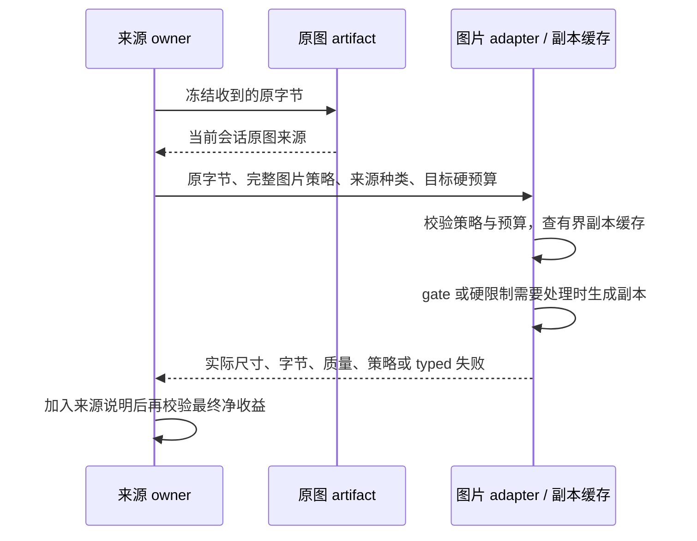

# 原生图片发送副本

`NativeContextImagePreparer` 是现有 `ImageProcessorPort.prepareForModel` 的策略分支。输入完整图片参数与冻结原字节，输出发送副本；每个 Jimp adapter 实例通过一个 preparer 持有有界副本缓存。原图、稳定 message/part 引用及成功发送证明归 Runtime/artifact owner。

- 有图片策略时直接进入此分支，不先调用旧固定 JPEG 质量或最小尺寸链。参数通过共享唯一 schema 校验，编码始终从收到的原字节生成，不从旧发送副本继续转码。
- 只有 `rescale` 开启且真实 `sourceKind` 在来源集合内时应用性能 gate；边长 gate 检查 `maxEdge`，`edge-or-bytes` 另检查解码后的文件字节。没有来源或来源被排除时只遵守既有硬尺寸和字节预算。
- 只缩小，不放大小图。质量从 `jpegQuality` 到 `minJpegQuality`，边长不低于原图长边与 `minEdge` 的较小值。硬尺寸低于这一有效下限或下限仍不满足硬预算时返回 `too_large`。
- PNG 默认无损保留透明度；明确选择 `jpeg-if-opaque` 后仅不透明副本可转 JPEG。`flatten` 使用固定 RGB 底色混合到独立副本。BMP 可靠解码后使用 PNG 副本，明确允许不透明 JPEG 时可转 JPEG。GIF/WebP 与不能安全编码的格式保留原字节，仍验证已有硬预算；不提取动画帧。
- `targetRawKiB=auto` 使用既有预算；显式目标不能超过有效 hard raw/base64/token 上限。目标是质量和最小边长内的发送目标，达不到软目标但存在符合硬限制与最低收益的副本时返回该副本。
- 副本必须严格小于原字节并满足 `minReductionPercent`；原字节本来满足硬限制且没有合格收益时返回原字节。此处只验编码字节，Runtime 再包含说明开销校验，不把字节收益换算为视觉 token。
- 缓存 key 包含原字节 hash、完整图片参数、处理器版本、来源、输入 MIME、`targetCapabilityKey` 与全部目标预算/尺寸能力。entries 与 MiB 两个上限同时有效，任一为 0 时清空并禁用；只缓存完成且有收益的发送副本，不缓存原图、失败或编码 promise。取出和放入均复制字节，外部改写不能污染缓存。
- 取消在解码和每次编码边界检查，取消或失败不产生缓存结果。没有日志、文件系统写入、网络请求或跨请求原图所有权。
