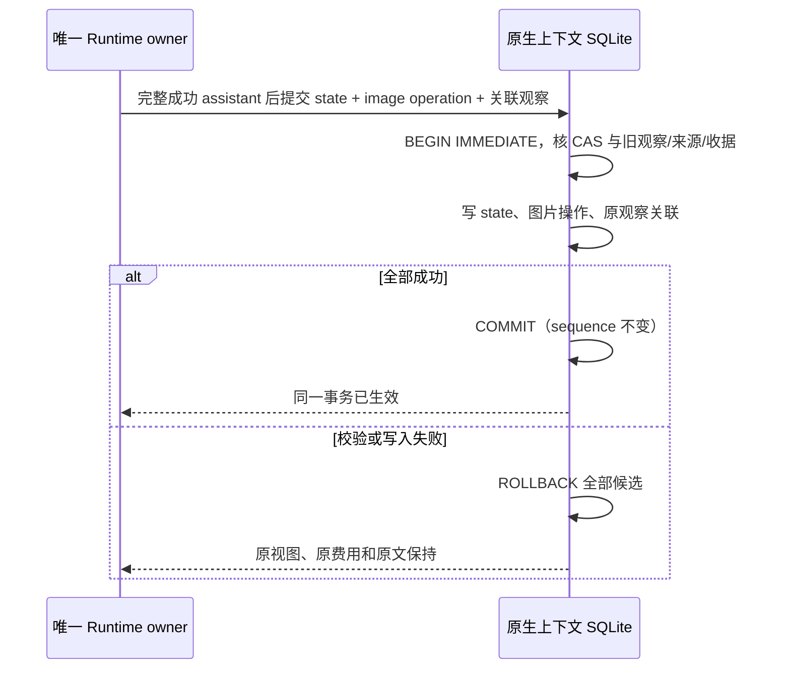

# 原生上下文压缩 CLI 存储

唯一事实所有者是 AgentRuntime。这里使用已有 CLI SessionStore 的同一个 SQLite 连接，保存策略/内核状态、维护操作和数字请求观察；不读写 Host tasks-index，不调用模型、artifact 或外部服务。

`getState` 可读取回退前的状态供 Runtime 重建。初始化要求 `expectedRevision=null`、新 revision 为 0，不能覆盖另一份已存在状态；之后每次提交要求当前 revision 与 expectedRevision 相等，新 revision 为 expectedRevision+1。expectedGeneration 与新状态 generation 均核对当前 session.revert.branchGeneration（旧会话缺省 0），旧状态 generation 可以落后，便于回退重建。只有状态与传入记录均与已提交内容完全相等的同一次重试才幂等成功。冲突返回 contracts 公共的 NativeContextStoreConflictError，code 为 `native_context_store_conflict`，不吞错。

所有业务写事务都是同步的 `BEGIN IMMEDIATE` → 检查 → 写状态/操作/观察 → `COMMIT`；其间不 await。fork 用既有 child/transcript/entries/input/command fact 事务调用 `writeForkBundleInTransaction`，任何阶段失败整组回滚。fork 业务筛选、ID 映射和 inherited 标记归 Runtime。

观察 ID 及 logicalRequestId/attemptIndex/purpose 在任务内唯一，sequence 只在第一次插入时分配，终态更新不产生新点。主请求估算、模型、预算、generation/historyVersion/segmentId 等请求字段冻结；prepared 只能推进终态，终态不能改写或回退。操作同样不能回退终态。未知数字为 JSON null，真实零保持 0；没有 30 天 usage 裁剪或补造主请求点。

成功图片收据是终态冻结的唯一关联补写例外：已存在的 `origin=own/purpose=main/status=completed` 观察，只能在同一次 CAS 新增 `origin=own/kind=image/status=completed` 操作时给 `operationIds` 追加去重后缀，现有前缀与除此字段外的整个观察保持严格相等。操作必须持有 `observationIds=[观察ID]`，模型、generation、historyVersion、policyVersion、segment、实际 assistant 锚点和 requestSeq 与该观察一致，且仍属于本次旧/新 state 的同一执行边界。新 image 操作不能单独引用旧观察而遗漏另一方向；prepared、maintenance、inherited、取消/失败观察或操作均不获得此例外。

来源逐项对照旧/新 state 中唯一且未改写的 image ref、message、part、imageIndex 与原图可用性。发送来源由新 state 的同模型/世代、同 logicalRequestId/assistant 收据及相应 image view 证明；省略来源还需旧 state 已持有成功收据、相同表示及新 state 已提交省略标记。不能给不存在的操作、另一请求或错误来源追加关联。观察冻结的图片计量不会因此重算，发送/省略的来源数量不能超过其已有计量。检查、图片状态/收据、操作和观察更新位于同一个同步事务；任一校验或 SQLite 写入失败整组回滚。完全相同的 CAS 重试幂等，不增加 observation sequence 或记录数。

`active_generation` 是数据库内的当前分支成员列，不是请求测量值。回退重建提交保留前缀的原样记录，使它们成为新 generation 的成员；没有重新提交的未来记录继续保存在旧 membership 中。观察 JSON 的 generation/historyVersion/模型和估算不因此改变。fork 新成员属于 child generation 0，JSON 保留祖先冻结事实，origin=inherited。

列表、详情、fork 快照先按 active_generation=当前状态 generation 筛选，再按可选 segmentId 与稳定 sequence 分页，默认最近 50，最大 200。cursor 是上一页最后一个 sequence，下一页取更小值；expectedRevision 不匹配时拒绝整页。页面 metadata 和记录在同一个同步只读事务中读取；状态尚未初始化返回空页，historyVersion=uninitialized，不因查询写配置。状态落后 session branch 时拒绝列表/详情，要求 Runtime 重建。

观察列表还在 SQL 分页前按可选 purpose 和 operationId 筛选；operationId 精确匹配已提交的 operationIds 数组。主请求与维护分页共用 revision，维护记录不会挤占最近主点，旧操作的用量查询不依赖最近 200 条的窗口。操作列表忽略 purpose 和 operationId，摘要只返回公共 summary schema 字段，完整 canonical 操作供 CLI 业务读取。

若会话回退已经保存而内核重建尚未提交就中断，Runtime 冷恢复可给 getForkBundle 显式传 allowStaleGeneration=true，读取状态 generation 对应的旧 membership，以真实 canonical 锚点筛保留前缀后重新 CAS 提交。默认仍拒绝分支不匹配，列表与产品查询不暴露此选项，不能用它把旧分支直接显示成当前事实。

三张新增表通过 session_id 外键 ON DELETE CASCADE。软删除保留正文及压缩事实；彻底删除沿用现有文件先于行的生命周期。原图 URI 保存在 canonical FilePart 的 metadata.image.originalArtifactUri；图片字节或内容不从内核对象向 UI snapshot 广播。

公开纯解析器 `readFilePartOriginalImageArtifactUri` 只解码 canonical FilePart 的原图 URI，供既有会话附件引用扫描使用；不执行 IO、不读取内核状态，不改变扫描 SQL、事务或删除所有者。畸形旧 JSON 返回 null，转义过的斜杠按 JSON 原义恢复。

迁移为追加的 0024_native_context_compression，只触碰三张新表。旧 25 项 ledger ID/SQL/checksum 保持不变；新增 touchedTables、schema guard 和 schema baseline 同步。验证以逐表内容 hash、PRAGMA foreign_key_check、事务失败与分支分页等可观测结果为准，不使用真实用户目录或系统临时目录。

审查基线使用实际启动迁移后的完整 `dumpSqliteSchema` 输出。手工追加新表 SQL 会使对象顺序和 SQLite 保留的缩进与导出结果不同，即使结构一致也会触发基线精确匹配失败。规范化前须双向通过 `assertAdditiveSchema`，确认既有表、列、索引和约束等价；规范化不修改迁移 SQL、checksum 或运行时结构。

独立追加的 0025_native_context_goal_usage_receipt 只创建 session_target_usage_receipt。此表属于既有 Goal 存储，迁移代码在本受管模块登记，计数单写者仍是 session-target.ts 的 accountSessionTargetUsage。accountTargetUsage 的可选 usageID 按 session_id/target_id/usage_id 隔离，receipt 插入、Goal 数字更新和 session 时间更新在同一同步 BEGIN IMMEDIATE 事务中提交。重复键返回当前 Goal，不重复累计、不覆盖首次结算数字；真实零也持有 receipt。未提供 usageID 的旧调用维持原契约。

receipt 不依赖有 30 天保留期的 model_usage，不随 fork 复制，并通过 session 外键 ON DELETE CASCADE 清理。已结算的 receipt 不因清 Goal或替换丢失；迟到调用只可命中冻结 targetID，当前 Goal 不存在或已被替换时不插入 receipt、不计入新 Goal。任一插入、计数或 session 更新失败整组回滚并向调用者抛错，不能留下误去重 receipt。旧 25 项和 0024 的 SQL/checksum 均不改写，schema baseline、guard 和备份 touchedTables 一同追加。
