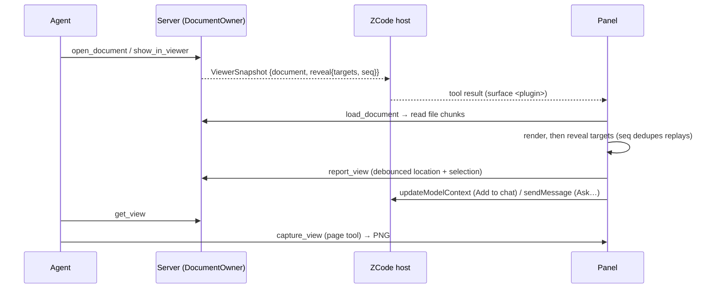

# Office viewer owner and ports

This runtime builds the viewer panels of several plugins. Each built-in plugin package (`apps/zcode-cli/packages/<plugin>-plugin`) declares its panel title and the formats it opens under `office` in its package.json; `scripts/build.mjs` turns that into the plugin's profile (`src/profile.ts`) and keeps only the parsers and viewers of those formats (`src/adapters/parsers.ts`, `ui/viewers/registry.ts`, lines tagged `kind:<format>`). The plugin's name names its MCP server, its panel surface and its resources (`ui://<plugin>/…`). Today `documents`, `spreadsheets`, `presentations` and `pdf` each open one format: docx, xlsx, pptx and pdf. Below, `<plugin>` is the plugin's name.

`DocumentOwner` (`app/documents.ts`) is the only owner of viewer state. Server tools and the panel read and write through it; the plugin never writes workspace files.

- **Documents**: parsed by format (`adapters/parse/*`) into a `ParsedDocument` (outline, paged text, search, locator check). Cached per path and invalidated by size + mtime; the revision is a content hash.
- **Anchors** (`domain/anchor.ts`): `<path>#<locator>` shared by panel, server and model. docx `p:N[-M]`, `t:N[/rRcC]`; xlsx `Sheet[!A1[:B2]]`; pptx `slide:N[-M]`, `slide:N/shape:ID` (the shape's `cNvPr` id); pdf `page:N[-M]`. 1-based. `check()` returns the canonical form (e.g. the real sheet name).
- **Model surface state**: only `open_document` and `show_in_viewer` set the current document, one per server process.
- **Window reports**: `DocumentOwner` owns one `createViewReports()` instance (`app/views.ts`). `report_view(viewId, …)` and `release_view(viewId)` change only this in-memory owner, not the model surface document. An admission ticket rejects late reports after a newer report, release or close. `get_view(viewId?)` returns a conservative ambiguity with window choices if more than one report exists.
- **Bytes to the panel**: `load_document` hands out a token; the panel reads `ui://<plugin>/file/{token}/{index}` in 4 MiB chunks. Tokens are in-memory and expire after newer loads.

## Tools

| Tool                                                                                             | Visibility                                | Panel routing                                               |
| ------------------------------------------------------------------------------------------------ | ----------------------------------------- | ----------------------------------------------------------- |
| `open_document`                                                                                  | model, app                                | surface `<plugin>`, opens the panel                         |
| `show_in_viewer`                                                                                 | model                                     | surface `<plugin>`, opens the panel                         |
| `read_document`, `search_document`, `get_view`                                                   | model                                     | none                                                        |
| `list_documents`, `load_document`, `check_document`, `get_viewer`, `report_view`, `release_view` | app                                       | none                                                        |
| `capture_view`                                                                                   | page tool (`app__<plugin>__capture_view`) | defined statically in `ui/host.ts`, bound once the UI loads |

## Panel

The page uses one official `App`; `ui/bootstrap.ts` connects it before loading the UI bundle through resources, retaining initial tool results. The sandbox has no network: pdf.js cMaps, fonts and wasm, the pdf.js and react-xlsx workers, the xlsx wasm and the PDF plugin's bundled CJK fallback font (`fonts/*.woff2`, listed in `cjk-fallback.json`) are read as local resources (`ui://<plugin>/assets/…`). Only PDF/XLSX declare `zcode/csp.wasmUnsafeEval`; no format declares unsafe eval or external connect/resource/frame/base-URI domains. Outbound hrefs and Office host openLink routes are removed; DOCX bookmarks and internal PDF/PPTX destinations remain local. `FontFace` uses installed local fonts or bundled bytes, never a download.

The shell separates document-load generation, selection/context/message actions, Agent marks and capture admission into local hooks. Capture validates the live parser locator through app-only `check_document(path, at)`, requires render-ready, and rejects aborted or stale generations. Optional window restoration consumes only an opaque host-provided stateKey; without it the panel uses a page UUID and does not derive a workspace/session persistence key. Existing desktop continuous and mobile replayable host semantics are unchanged and require their own real-host acceptance.

Implementation rules and the bounded verification record are in the repository's `.agents/specs/official-3.16.2-office-viewer.md`. The viewer is read-only in files/server/main/UI; original document-creation skills are separate and retained.
