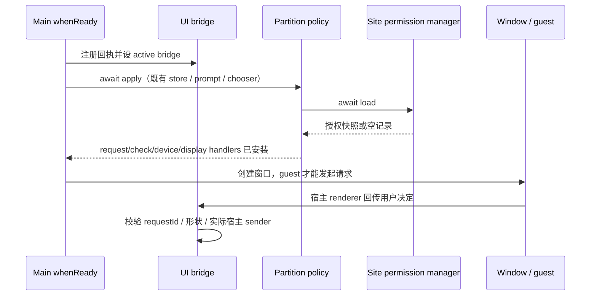
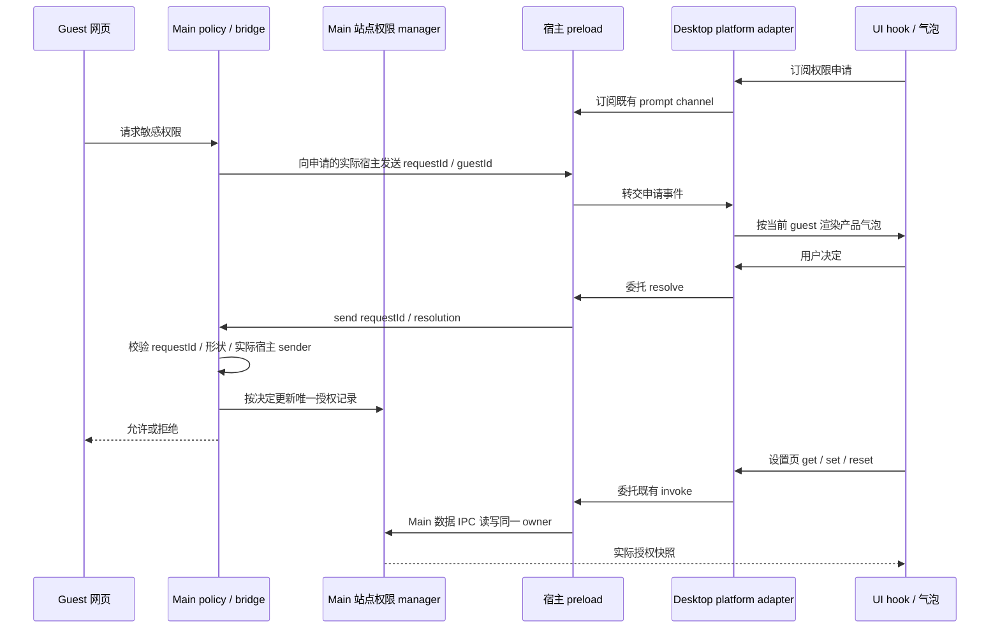

# 内置浏览器权限治理 Spec

## 背景

CNVD 报告「ZCode 内置浏览器未授权访问」（中危）：内置浏览器对不可信网页缺少默认拒绝的权限控制，攻击者页面可在无产品弹窗确认的情况下静默获取摄像头/麦克风、剪贴板、地理位置等敏感能力。

现状核实（2026-10-08）：

- 内置浏览器为标准 Electron 41 `<webview>`（`packages/ui/src/browser-use/BrowserViewportSurface.tsx:151`），session 为持久分区 `persist:zcode-embedded-browser`（`packages/desktop/src/main/browserDataManager.ts:32`）。
- 该 partition 未注册任何 `setPermissionRequestHandler` / `setPermissionCheckHandler` / `setDevicePermissionHandler`；`desktopNetworkPolicy.ts` 只覆盖代理与证书。Electron 默认行为是**自动批准所有权限请求**，因此恶意页面 `getUserMedia` / `clipboard.readText` / `geolocation` 等请求被静默放行，无 UI、无日志。
- 现有加固（`desktopWindowChrome.ts` `will-attach-webview`：sandbox / contextIsolation / URL 协议白名单 / 开窗路由）只做进程隔离，不做能力闸门。插件沙箱 partition 已有权限闸门（`pluginSandbox/session.ts` + `permissionGate.ts`），其 inflight 去重与内存同意模式被本 spec 复用。
- 设备类（WebHID/WebUSB/WebSerial/蓝牙）在 Electron 中未监听 `select-*` 事件时**默认静默授权第一个匹配设备**；屏幕共享在未注册 `setDisplayMediaRequestHandler` 时请求直接失败。

## 目标

- 内置浏览器 partition 的所有权限请求默认不自动放行：无害白名单静默放行，敏感能力经产品级弹窗由用户决策，其余显式拒绝。
- 三类产品弹窗：权限确认气泡（"仅本次允许/访问此网站时允许/不允许/关闭"四态）、屏幕共享源选择器、设备选择器。
- 持久化站点同意记录 + 设置页「网站权限」管理（允许/阻止/询问）。
- 每条权限决策输出审计日志（info 级，低频，生产保留）。
- 摄像头、麦克风、剪贴板读取、地理位置、通知、MIDI、USB、HID、Serial、蓝牙、屏幕共享等能力全部纳入上述治理。

## 非目标

- 不改动 defaultSession、Coding Plan、Rewards、插件沙箱、录屏临时 session 的权限行为（范围按 2026-10-08 决策收窄为仅内置浏览器 partition）。
- 不改变分区持久化策略（登录态为产品功能，CNVD「非持久化隔离分区」建议以权限默认治理为主要防线回应）。
- 不实现 Chrome 式"记住站点设备授权"（设备类每次弹选择器）；不做"仅本次允许"的 tab 级作用域（按应用运行期）。
- 不做 macOS 系统级（TCC）授权引导；网页层允许后仍受系统约束，属 Chromium 层行为。
- 不影响 Web 端与手机远控链路；权限弹窗只存在于承载 `<webview>` 的桌面端内置浏览器面板。

## 架构与决策链路

main 进程新增 `embeddedBrowserPermissionPolicy` 模块，应用启动时对 `fromPartition(EMBEDDED_BROWSER_PARTITION)` 一次性注册全部 handler（紧随 `applyDesktopChromiumNetworkPolicies` 之后）：

```text
guest 页面发起请求
  │
  ├─ permission request ──► ① 无害白名单？ ──是──► 放行 + info 日志
  │                            │否
  │                            ▼
  │                    ② 查同意记录（内存 sessionAllow → 持久 JSON）
  │                       ├─ 命中 allow（任一层）──► 放行 + info 日志
  │                       ├─ 命中持久 deny ────────► 拒绝 + info 日志（不再弹）
  │                       └─ 无记录 ──► 弹窗 A：确认气泡
  │                                      允许/仅本次/阻止/✕超时 → 回写记录 + 日志
  ├─ getDisplayMedia ──► setDisplayMediaRequestHandler
  │                       └─► 弹窗 B：源选择器（每次询问，不记住）
  ├─ requestDevice（hid/usb/serial/蓝牙）──► select-* 事件监听
  │                       └─► 弹窗 C：设备选择器（每次询问，不记住）
  │                       （注册监听本身阻断"静默授权第一个设备"默认路径）
  └─ permission check ──► 与同意记录一致：allow（任一层）→ granted，其余 → 非 granted
```

弹窗时序：request handler 挂起 callback → main 经 IPC 通知主窗口 renderer → 内置浏览器面板内渲染弹窗（同 origin+权限去重单弹，复用 pluginSandbox 的 inflight 模式）→ 用户操作或 20s 超时 → renderer 回传 main → callback → 页面拿到结果。面板不可见时弹窗无法交互，20s 超时自然拒绝——agent 后台跑的页面天然被拒，无需特殊分支。

## 权限分级表

| 级别 | 权限 | 记忆策略 |
|---|---|---|
| 静默放行 | `clipboard-sanitized-write`、`fullscreen`、`pointerLock`、`mediaKeySystem` | 无 |
| 弹窗 A：确认气泡 | `media`（按 `details.mediaTypes` 标明摄像头/麦克风）、`clipboard-read`、`geolocation`、`notifications`、`midi`、`midiSysex`、`idle-detection`、`speaker-selection`、`window-management`、`storage-access`、`top-level-storage-access`、`keyboardLock`、`fileSystem` | 见弹窗 A 四态 |
| 弹窗 B：源选择器 | `display-capture`（屏幕共享） | 每次询问，不记住 |
| 弹窗 C：设备选择器 | `hid` / `usb` / `serial` / 蓝牙 | 每次询问，不记住 |
| 显式拒绝 | `openExternal`（外部协议开窗已有独立的"默认浏览器打开"路由）、`unknown`、`deprecated-sync-clipboard-read` | — |

未在上表中的任何 permission 字符串一律显式拒绝并打 warn 日志（fail-closed，防 Electron 后续版本新增枚举）。

## 弹窗交互

### A. 确认气泡（地址栏下方左侧，内置浏览器面板内，自动弹出）

```text
┌──────────────────────────────────────┐
│ example.com 想要使用            [✕]  │
│  🎥 摄像头                           │
│ ╭──────────────────────────────────╮ │
│ │ ●  访问此网站时允许                │ │
│ ╭──────────────────────────────────╮ │
│ │ ●  仅本次允许                     │ │
│ ╭──────────────────────────────────╮ │
│ │ ●  不允许                        │ │
│ ╰──────────────────────────────────╯ │
└──────────────────────────────────────┘
```

请求到达即自动弹出（Chrome 式锚定气泡，`w-80` popover 卡片：`rounded-xl` +
`bg-popover` + `border-popover-border` + `shadow-md`）。头部为 origin 标题与 ✕ 关闭；
正文为能力图标逐行列表（摄像头/麦克风/剪贴板等，复用 `BrowserPermissionIcon` 字形）；
三选项为竖排胶囊按钮（`rounded-full` secondary，左对齐、可换行）。
2026-10-08 实测定稿：不做「永久阻止」按钮——误点后站点异常难以自愈，持久 deny 只保留在
站点权限设置里管理（弹窗层不提供）。✕ 关闭与「不允许」同为本次拒绝不记忆。

| 操作 | 语义 | 存储 |
|---|---|---|
| 访问此网站时允许 | 持久放行，之后不再询问 | 持久层 `origin+permission → allow` |
| 仅本次允许 | 本次应用运行期间放行，重启失效 | main 内存 `Map<origin, Set<permission>>` |
| 不允许 / 20s 超时 | 本次拒绝，不记忆，下次再弹 | 无 |

### B. 源选择器 Dialog（屏幕共享）

`desktopCapturer.getSources()` 缩略图列表（整个屏幕 / 各窗口）→ 选中即共享该源（`callback({ video: source })`）；取消/超时 → `callback({})`，页面拿到 `NotAllowedError`。

### C. 设备选择器 Dialog（WebHID/USB/Serial/蓝牙）

请求站点名 + 设备列表（名称/厂商/序列号）+ 允许/取消 → `event.callback(选中设备)` 或 `callback(undefined)`。

三个弹窗遵循 `DESIGN.md`，双语 + 双主题，兼顾桌面端与手机远控两端显示。

## 数据模型与持久化

- 持久层：独立 JSON（`embedded-browser-site-permissions.json`，main 原子读写），结构 `{ [origin]: { [permission]: "allow" | "deny" } }`，未记录 = 询问。不进全局 settings，避免与跨窗口广播耦合。
- 内存层：main 进程 `sessionAllow`（仅本次允许）+ `inflight`（同 origin+权限去重）。
- 「仅本次」作用域 = 本次应用运行期间。

## 站点权限的数据清理

设置页「内置浏览器」区**不再提供**「网站权限」区块（2026-10-09 决策：编辑入口收敛到站点权限设置标签页，避免双入口）。「清空数据」操作仍同步清掉站点权限 JSON 与 embedded partition 存储（修复现状 `desktopCommandHandlers.ts` 清数据只清 defaultSession、漏清内置浏览器分区的附带问题）。

## 站点权限设置标签页（2026-10-09 整合新增）

站点权限编辑的唯一产品入口，位于浏览器面板内：

- **入口**：地址栏输入框左侧常驻滑杆图标（不随权限请求变化；聚焦编辑 URL 时隐藏且不结算任何待处理申请）。点击弹出小气泡，展示当前站点 origin 与唯一操作「权限设置」，进入独立设置标签页。
- **设置标签页**：sidepane 内的独立设置标签，按工作区/对话作用域复用（同一作用域重复打开复用同一标签）。不创建 webview、不计入站点存活页面、不暴露给 Agent 作为可操作网页。
- **页面能力**：展示该站点在 main 持久层已记录的各权限状态，逐项可设为 询问/允许/阻止（询问即删除记录回到每次询问）；支持整站重置（main 侧 `resetSite(origin)`，清除该 origin 全部持久决定）；「仅本次」临时态不展示（与设置页区块口径一致）。
- **数据源唯一**：读写全部经 main 站点权限 store（`getEmbeddedBrowserSitePermissions` / `setEmbeddedBrowserSitePermission` / `resetEmbeddedBrowserSitePermission`），页面持有独立的读取失败/写入失败状态与显式重试，不推测修改后的授权，不加授权缓存、自动重试或操作队列。
- 地址栏 URL 非编辑态居中，聚焦编辑时左对齐并隐藏左侧图标。

## 整合决策记录（2026-10-09）

`fix/missing_tool` 分支（ZP-20260916-09，spec 见其 `2026-09-24-embedded-browser-permissions-spec.md`）
与本 spec（CNVD）为同一权限治理的并行实现。整合结论：

- **逻辑以本 spec 为准**：main 决策链、权限分级表、三类弹窗语义、20s 超时、fail-closed、
  持久层结构与审计日志全部保留；`fix/missing_tool` 的 main 侧实现与协议接线弃用。
- **弹窗视觉采纳 fix 分支**：确认气泡的卡片结构、能力图标列表、竖排胶囊按钮与 ✕ 关闭；
  交互仍为本 spec 的自动弹出 + 三态语义（第三按钮为「不允许·本次」，非 fix 分支的持久「从不允许」）。
- **站点权限设置标签页采纳 fix 分支**：地址栏滑杆入口 + 独立设置标签页 + sidepane 作用域复用，
  数据层适配到本 spec 的 main store。设置页原有「网站权限」区块随后移除（2026-10-09
  用户定稿：单一入口，避免两处编辑面漂移）；其专属 i18n 键与死测试一并删除，
  `clearEmbeddedBrowserSitePermissions` 协议保留（「清空数据」链路与整站清空能力仍在 main 侧）。
- fix 分支的「地址栏图标随请求变化、点击展开申请气泡」交互不采纳（请求气泡自动弹出）；
  其 iframe 级取消、请求生命周期重构、MessagePort 握手等 main 侧增强不采纳（属弃用的逻辑侧）。

## 审计日志

```text
[embedded-browser-permission] decision=granted|denied permission=… source=allowlist|site-setting|session-allow|user-prompt|prompt-timeout|device-picker|source-picker|default-deny
```

info 级（低频、生产保留）；弹窗类路径日志量与权限请求数同数量级（极低频）。
origin 只用于授权键及产品弹窗，不进入日志；加载、保存、选择器失败只输出固定分类，不输出原始错误、路径或设备内容。

### 2026-11-07：启动接线恢复（BUG-005）

2026-11-06 两次独立 guest 查询证明：当前 Main 仅注册恢复协议，没有调用权限装配入口，未授权 geolocation 为 `granted`。启动链必须在 Chromium 网络策略完成后创建既有 bridge、注册回执、设为 active bridge，并等待 `applyEmbeddedBrowserPermissionPolicy` 完成 JSON 加载与 handler 注册；之后才能创建窗口/guest。装配失败不得继续创建未受治理的浏览器。沿用 app 已隔离的 `userData/embedded-browser-site-permissions.json`，授权管理器仍为唯一持久 owner。

Main 仅在该 await 成功后设置装配完成标志；primary window coordinator 的既有 `canCreateWindow` 统一门禁在此前拒绝创建，以覆盖冷启动期间并发的 activate/open-url。初始 app-ready 路径随后负责创建窗口，已记录的启动 workspace 请求仍由原单飞 coordinator 消费。



回归使用本树隔离 HOME 与 loopback 页面，不访问真实位置、摄像头、设备或屏幕：保留既有站点设置 E2E 的默认 denied→允许 granted→重置 denied；补充 notifications 请求的产品拒绝及再次询问。启动装配守卫验证 await、唯一接线与窗口创建顺序。macOS 系统权限、设备/屏幕共享和重启持久化仍按实际执行证据登记，不能由源码守卫宣称通过。

### 2026-11-07：Desktop platform 与 preload 能力补线（BUG-005）

`qa-fix-20261107-browser-retry` 已确认 Main 默认拒绝生效，但设置页缺少权限控件，通知请求未出现产品气泡。当前 shared 与 client 已声明六个权限接口，Main 也已注册对应数据 IPC 与回执 listener；Desktop platform adapter 和宿主 preload 未提供它们。站点 hook 因此判定 `supported=false`，气泡组件无法订阅申请事件。恢复既有契约只补平台委托，不新增授权状态、IPC channel、UI 状态源或设备能力。

| 既有平台接口 | 宿主 preload 使用的既有 channel / 操作 |
| --- | --- |
| `getEmbeddedBrowserSitePermissions()` | `GetEmbeddedBrowserSitePermissions` / `ipcRenderer.invoke` |
| `setEmbeddedBrowserSitePermission(request)` | `SetEmbeddedBrowserSitePermission` / `ipcRenderer.invoke` |
| `clearEmbeddedBrowserSitePermissions()` | `ClearEmbeddedBrowserSitePermissions` / `ipcRenderer.invoke` |
| `resetEmbeddedBrowserSitePermission({ origin })` | `ResetEmbeddedBrowserSitePermission` / `ipcRenderer.invoke` |
| `onEmbeddedBrowserPermissionPrompt(handler)` | `EmbeddedBrowserPermissionPrompt` / `ipcRenderer.on`，disposer 移除同一 handler |
| `resolveEmbeddedBrowserPermissionPrompt(request)` | `EmbeddedBrowserPermissionResolve` / `ipcRenderer.send`；Main 保留实际宿主 sender 校验 |

Desktop renderer 的 `desktopBrowserPlatformBridge` 经现有 `createDesktopPlatform` 合并进入 `IPlatformService`。六方法仅在对应 `window.zcode` 能力存在时提供，旧 preload 缺能力时保持 `undefined`；不能用空快照、空 disposer 或成功 fallback 伪造支持。数据 IPC 的实际 Promise、返回快照及拒绝继续交给既有 hook；adapter 不缓存授权、不吞错，不记录载荷、origin、路径或原始错误。宿主 preload 只通过已有 `contextBridge` API 暴露这六方法，guest 网页仍不能直接读写站点授权或提交用户决策。



本段是既有 Desktop 连续交互链的补线；手机/Web 未提供这些可选平台方法时仍显示不支持，不新增手机权限恢复链。回归守卫须从当前 adapter/preload 源码抽取实际方法执行，验证六接口、载荷委托、事件订阅/注销、旧 preload 能力缺失及真实 Promise 拒绝；不能只检验复制的 mock 实现。UI 回归仍由隔离 runner 串行执行上述两条 E2E。当前请求前截图仅证明 loopback 页面已挂载且查询默认 denied；通知请求是否进入 Main、其 host/guest 归属及页面 Promise 是否结算尚未采证，不能由气泡缺失直接认定 Chromium 的通知触发条件有缺陷。调查与原失败证据见 [adapter 缺口报告](../testing/qa-2026-11-06/browser-permission-adapter-gap.md)。

## 兼容性影响面（已逐项验证）

| 链路 | 影响 |
|---|---|
| agent browser-use（CDP 截图、虚拟剪贴板） | 零影响——截图走 `Page.captureScreenshot`，粘贴走合成 `ClipboardEvent` + `execCommand`（`browserVirtualClipboardPageScript.ts`），均不触发 permission |
| 网页复制按钮 / DRM 视频站 / 网页全屏 | 不受影响（白名单） |
| `window.open` / 新标签路由 / 「默认浏览器打开」 | 不受影响（已有 `setWindowOpenHandler` 独立机制） |
| 屏幕共享 | 从静默失败变为弹窗可控可用，由源选择器把关 |

## 测试要求

- 权限 E2E 必须先发起页面请求而不等待它完成，再点击产品确认条，最后读取页面结果。
  `executeJavaScript` 会等待返回的 Promise；发起 `getUserMedia` 时使用 `void`，避免测试自身等待用户决策而无法点击。
  顺序：发起请求 -> 确认条可见 -> 点击允许/拒绝 -> 断言结果与二次请求行为。

- 单测：决策表全枚举（白名单/记录命中/无记录无弹窗能力时拒绝/未知权限 fail-closed）、check 与 request 一致性、持久层读写与原子写、sessionAllow 生命周期、inflight 去重、20s 超时拒绝、select-* 与 displayMedia 的拒绝回调。
- e2e（desktop e2e）：确认气泡出现 → 三种按钮 + ✕ 各自的页面侧结果与二次请求行为；重启后持久记忆生效；设置页改状态后生效；源选择器选源后 `getDisplayMedia` 成功、取消失败；`requestDevice` 弹设备选择器，负向断言"未选择设备时不再静默授权第一个设备"。

### 权限查询与请求的 origin 一致性

修复测试自身等待权限 Promise 的死锁后，`browser-permission-prompt.test.ts` 仍在持久允许后的
`permissions.query('camera')` 断言失败。运行时记录显示 `getUserMedia` 已返回 `ok`，查询仍为
`denied`：授权写入标准 origin，而 Electron check 回调传入带尾部 `/` 的 origin，原样查询未命中。
证据见本地 `packages/desktop/.e2e-artifacts/desktop-e2e-accountless-diagnosis-20261014b/`。
request 与 check 都使用 URL.origin 归一化后查询同一份记录；持久允许和本次允许均遵循此约束。
单测覆盖裸 origin、尾部斜杠、页面路径，以及协议、站点、权限隔离；E2E 保留授权后 `granted` 断言。

## 实施顺序（四步提交，每步独立可验证）

1. main 策略模块：request/check/device handler + `select-*` / displayMedia 监听全量注册；弹窗未实现前敏感项一律拒绝 + 日志（安全闭环，可单独发版堵漏）。
2. 弹窗层：确认气泡 + 源选择器 + 设备选择器（IPC + UI + 去重 + 超时）。
3. 持久化 + 设置页：站点权限列表 + 清数据联动。
4. 单测/e2e 补齐与文档收尾。

## 验收标准

- 任意网页在无用户确认的情况下无法获得摄像头、麦克风、剪贴板读取、地理位置、通知、MIDI、设备、屏幕共享能力（自动放行路径不存在）。
- 敏感权限的每条决策可审计；白名单权限不产生功能性故障（复制、全屏、DRM 播放正常）。
- agent browser-use 现有回归（CDP 截图、虚拟剪贴板粘贴、tab 生命周期）不受影响。
