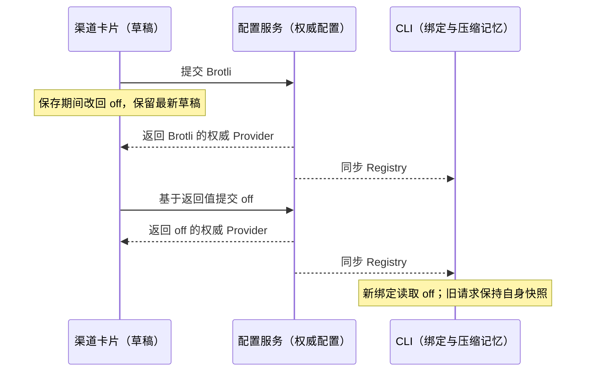
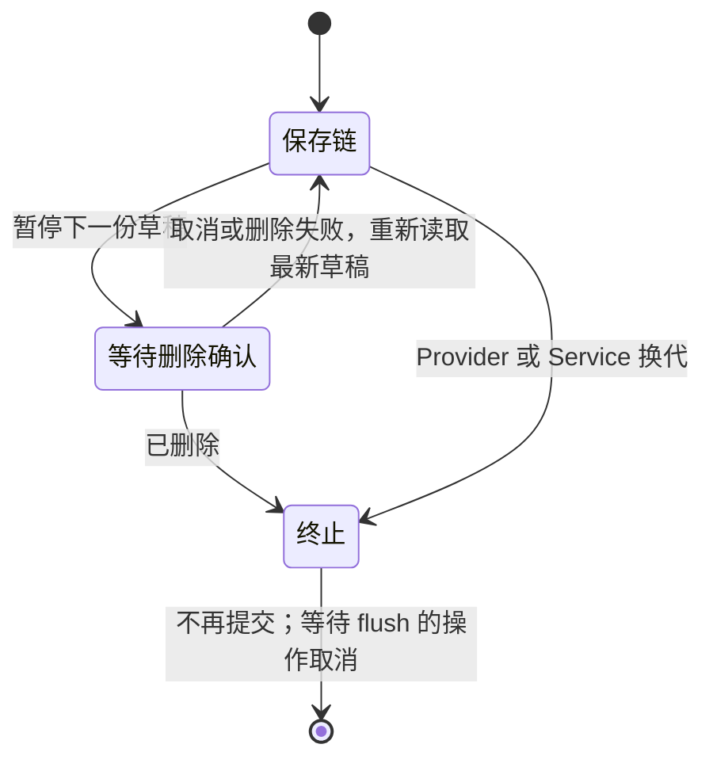

# 渠道级模型请求压缩（Provider Request Compression）

> 来源：参考 `No-ni/dsh-plugin-model-request-accelerator` 的请求体压缩能力。
> 本仓只吸收「上传正文压缩」这一项；该插件的预热/预传输与分阶段耗时视图不引入。

## 产品规则

- 压缩是**渠道（provider）级**配置，不是全局开关：同一 endpoint 上的不同渠道各自独立。
- 取值三态：`off`（默认）/ `brotli` / `gzip`。
- 只作用于**模型请求的上传正文**（provider HTTP 请求的 JSON body），不影响响应解码、
  MCP、websearch 或其它任何 HTTP 调用。
- 只压缩 `RequestInit.body` 中类型可确认的 JSON 字符串；二进制、FormData 或流式正文原样发送。
  `Request` 自带的 body 已统一为流，无法确认原始类型，不能通过 `clone().text()` 无界读完后再压缩；
  只有显式传入字符串 `init.body` 时才压缩该 `Request`。
- 调用方已经设置 `content-encoding`（正文已编码）时跳过压缩：二次编码会把正文写坏。
- `off` 时零开销：不读 body、不加头、不加载压缩实现。
- brotli 固定使用 quality=4，避免默认最高质量使图片或长上下文在发送前花费数秒。
- HTTP **415** 才尝试 gzip **重发一次**；gzip 返回 2xx 后才记住当前渠道、Base URL 和协议的
  「brotli 不可用」事实，后续绑定直接用 gzip。gzip 仍失败时保留其响应/异常，不记为成功降级。
  普通 400 不足以证明编码被拒，保留原错误，不额外上传、不改变记忆；不靠错误文案判断。
- 415 既可能表现为返回响应，也可能表现为内层抛出的 `responseStatus` / `statusCode`；两种形态
  使用相同的一次重发规则。业务层仍在压缩层外，最终错误由既有错误处理链负责。
- 请求头、字符串正文与 signal 在首个异步操作前捕获；重发复用同一正文快照，不能重新读取调用方
  后来修改的 `init`。取消前不压缩，取消期间立即结束等待；迟到压缩结果不发送、不触发降级。
- 降级记忆按渠道 + Base URL + API 协议隔离。切换网关或协议的新绑定重新尝试 brotli，旧绑定的
  迟到结果只能更新旧作用域；关闭压缩始终旁路，重启后清空记忆。
- 生效边界：保存后由 Host 同步到 CLI 的渠道配置，**新建立的模型绑定**读取新值；运行中的请求
  不受影响（与既有的 endpoint/协议快照语义一致，见 `model-execution.ts` 的 `bindModel` 注释）。
- 设置卡片同一时间只提交一份 Provider 草稿；保存期间保留用户最新选择，上一份保存完成后基于
  返回的权威 Provider 投影再提交最新草稿。切回旧值也不能被旧 props 的比较丢弃。
  连通性测试等待整个草稿提交链；失败保留最新草稿，并显示可重试反馈，即使用户在等待期间又编辑。
  渠道启停更新复用这条提交链；启停保存尚未结束时，连接/压缩编辑继续排在其后，不能并发提交
  两份包含旧连接配置的 Provider Overlay。启停失败的重试保留已确认的启停意图和最新连接草稿。
  重试从当前草稿重新生成补丁；旧 Provider 或旧 Service 的错误不能出现在新所有者的设置页。
  草稿与迟到结果不能跨 Provider 或 Service/Environment 所有者。
  每次所有者切换创建新的代次，即使后来切回同一对象也不接受旧结果；旧失败不得恢复当前
  草稿的名称确认标记、保存中状态或错误反馈。未 Enter/失焦确认的新名称不能被连接保存夹带。
  名称保存失败只恢复该次已确认且尚未再次编辑的名称，不能把等待期间新输入的名称视为已确认。
  所有者切换后旧提交链以取消结束，等待它的启停/连通性操作不再执行。删除确认期间暂停后续草稿：
  取消或删除失败后恢复最新草稿；确认删除后保持终止，不让迟到结果重新创建渠道。

## 状态所有者

| 状态                | 所有者                                                                     | 说明                                                       |
| ------------------- | -------------------------------------------------------------------------- | ---------------------------------------------------------- |
| 压缩选择            | `ProviderApiConfig.requestCompression`（personal overlay）                 | 唯一真源；设置页写入，走既有 `savePersonalProviderOverlay` |
| 表单草稿            | `ProviderDraftValues.requestCompression`                                   | UI 局部草稿，不构成第二份真源                              |
| 「brotli 被拒」记忆 | CLI 进程内 `AiSdkModelExecution` 的 per-provider / endpoint / protocol Map | 只在 gzip 成功后记录，不落盘、不进配置                     |
| 待提交草稿          | 渠道卡片的最新草稿与单个 pending 保存操作                                  | 只表达尚未完成的 UI 意图，配置服务仍是唯一写入入口         |

## 接口

配置 schema（`packages/provider/src/config/provider-data-schema.ts`）：

```ts
providerRequestCompressionDataSchema = z.enum(["off", "brotli", "gzip"]);
// api.requestCompression?: "off" | "brotli" | "gzip"
```

传输层模块（`apps/zcode-cli/packages/adapters/src/model/request-compression/`，受管模块
`model-request-compression`）：

```ts
createRequestCompressionFetch({
  fetch,      // 内层 transport（已完成代理与证书；压缩层紧贴其上）
  providerId, // 只用于日志与记忆分桶
  algorithm,  // off 时直接返回 fetch 本体
  state,      // 跨请求共享的按渠道记忆
}): typeof fetch
```

装配顺序（`model-execution.ts` 的 `createFactory`，由内到外）：

```text
proxy/CA transport → 压缩层 → business-error → option-map → 协议兼容层 → SDK
```

压缩层必须位于 option map 与协议兼容层**之内**（更贴近 wire）：那两层要读写**明文** JSON 正文，
把压过的 `ArrayBuffer` 交给它们会 fail-closed（option map 直接抛
`Model option maps require a JSON text request body.`，请求发不出去）。
压缩只能发生在正文改写完成之后、真正上网之前。

设置页入口（`ProviderRequestCompressionSelect`，定义在
`packages/ui/src/settings/model-provider-section/ProviderApiFormatSelect.tsx`，在渠道卡片「连接」区块渲染）：
压缩是渠道属性，与 Base URL、API 格式并列，不新增顶层设置页。

卡片的 `onSave` 返回权威 Provider 投影；`onDelete` 返回是否已确认并完成删除（取消或命令未执行为 false）。
删除保护与草稿提交链由同一卡片所有，不新增配置写入入口。

## 事件顺序（一次请求）

```text
SDK 发起请求
  → option map / 协议兼容层按明文 JSON 改写正文（压缩层在其内侧，因此看到的是改写后的正文）
  → 压缩层捕获字符串正文、请求头与取消信号（非字符串则直接透传）
  → brotli/gzip 压缩 + 写 content-encoding，丢弃旧 content-length
  → 内层 transport 发送（返回 Response，或抛错）
  → 415 且当前为 brotli 且未取消（状态码取自响应或异常的 responseStatus/statusCode）：
        丢弃被拒响应 → 用同一正文的 gzip 重发一次 → 2xx 才记录当前作用域 brotli 不可用
        → 返回重发结果（响应或原样抛出 gzip 那次的错误）
  → 其余结果原样返回（不读取流式响应正文）
```





## 验收场景

1. `off`：请求不带 `content-encoding`，正文与未启用时字节一致。
2. `brotli`：正文被压缩，带 `content-encoding: br`，且不残留旧 `content-length`。
3. `gzip`：带 `content-encoding: gzip`。
4. 网关返回 415：自动以 gzip 重发一次；成功才记忆；仍失败则原样返回，不无限重试。
5. 非文本正文（FormData / 二进制 / 流式）：跳过压缩，请求照常发出。
6. 同一渠道、网关与协议成功降级后的第二次请求：直接使用 gzip，不再先试 brotli。
7. 关闭开关后：该渠道请求恢复未压缩，且不再产生压缩相关头。
8. 内层以 `ProviderBusinessError`（`statusCode: 415`）抛错时：仍先试 br、再以 gzip 重发一次，
   最终把 gzip 那次的错误原样抛出，不记为成功降级。
9. 调用方已带 `content-encoding`：正文与头部原样发送，不再叠加压缩。
10. 渠道同时配置 option map（如 `reasoningLevel.map`）与压缩：option map 仍能改写明文正文，
    改完的正文才被压缩上网；不会出现 `Model option maps require a JSON text request body.`。
11. 普通 400 或 gzip 仍失败：不更新记忆；400 不重发，下条请求仍尝试 br。
12. 首次发送后调用方修改 `init.body` / headers：gzip 重发的解压正文与首次完全相同。
13. 请求在压缩前、压缩期间或 415 后取消：保留取消原因，不发送迟到字节、不再重发。
14. JSON MIME 精确匹配（支持 `application/problem+json` 与参数），`application/json-seq` 原样发送。
15. 同一 provider 改 Base URL 或协议后重新尝试 br；其他渠道不继承降级记忆；旧绑定保持旧事实。
16. 保存被延迟时 `off → brotli → off` 和 `off → brotli → gzip`，最终 UI、持久化与新绑定选择一致。
17. 保存期间继续编辑后失败：仍显示可重试反馈，重试提交最新草稿；连通性测试不能越过正在
    保存的最后一次选择。切换 Provider/Service（含切走再切回）后不展示旧保存结果或错误；
    旧名称保存失败不恢复新所有者的名称确认标记，后续压缩保存不能夹带未确认的新名称。
18. 保存期间进入删除确认：取消/删除失败后最新选择仍落盘；确认删除后旧保存回执不能另起保存。
    等待草稿的启停/连通性操作在 Provider/Service 换代后取消，不向旧所有者提交。
19. 启停保存被延迟时再选择 Brotli/gzip：两份 Provider 更新严格串行，最终启停值与最新压缩均落盘；
    启停保存失败后重试仍使用已确认的启停意图和最新压缩选择。

## 已知限制

- 只压缩上传方向；响应本来就已由运行时协商压缩。
- 短请求（标题生成、compact 小报文）压缩收益有限；固定 quality=4 只控制压缩成本，不保证所有
  网络条件下都比未压缩快。
- 不校验网关是否真的解压：只以 HTTP 415 作为可重试的拒绝信号；某些网关可能返回 400/500 或静默 200 的
  错误体，此时需要用户自行降级到 `off` 或 `gzip`。
- 取消会立即结束等待并禁止发送；已经进入原生 zlib 的计算可能完成当前工作，迟到结果仅丢弃。

## 2026-11-10 回归修复

确认的缺陷：快速切回旧配置被忽略；默认 Brotli 质量拖慢大正文；普通 400 错误污染降级记忆；
重发读取可变正文；取消后仍压缩；`Request` 流被无界读取；网关切换沿用旧记忆。模块契约与本 spec
同时收敛装配顺序，避免旧 `CONTRACT.md` 把压缩层写到正文改写层之外。

继续检查补修了启停与连接保存的并发、取消删除后的草稿恢复、删除后迟到回执重新保存、旧所有者
失败恢复名称确认标记，以及切走再切回后旧错误被重新接纳。删除入口未执行的命令明确返回 false。

### 2026-11-11 验证

- CLI 四个持久回归文件共 **30/30** 通过：`request-compression-fetch`、`boundaries`、`cancellation`
  和 `scope`，位于 `apps/zcode-cli/packages/adapters/tests/`。包括实际 SDK 绑定、受控 transport、
  原生 zlib 回调取消、重发快照和作用域隔离；不调用真实模型 API。
  命令：`corepack pnpm exec vitest run --root apps/zcode-cli --config vitest.config.ts packages/adapters/tests/request-compression-fetch.test.ts packages/adapters/tests/request-compression-boundaries.test.ts packages/adapters/tests/request-compression-cancellation.test.ts packages/adapters/tests/request-compression-scope.test.ts --maxWorkers=1`。
- 实际 React 卡片的延迟保存诊断 **18/18** 通过，日志
  `.cache/compression-fix-20261110/logs/provider-card-regressions-final.log`。子控件和服务回执使用夹具，
  覆盖名称确认、启停失败重试、卸载、删除和所有者切换；这些临时诊断不计作正式 E2E/CI 覆盖。
- 当前源码的 Windows x64 Electron 回归 **6/6** 通过（PCOMP-SAVE-01 两种最后选择、02–05），
  没有自动重试或 flaky。使用隔离 HOME、合成渠道、真实 Host 配置服务和真实文件读写，
  不发模型请求；证据见 [最终桌面运行报告](../packages/desktop/.e2e-artifacts/desktop-e2e-compression-20261111-004/summary.md)。
  候选保持 `covered / pending-review`，未转正或加入 CI。
- 根 `corepack pnpm typecheck`、`corepack pnpm lint`、`architecture:check --changed` 均 exit 0；
  架构违规为 0。Adapters 类型检查、Desktop E2E 类型检查、17 个相关文件的定向格式检查及
  `git diff --check` 通过。覆盖矩阵的历史格式保持 HEAD，仅追加本轮条目。

初跑 `desktop-e2e-compression-20261111-002` 为 3/5：删除用例停在测试菜单点击或回执暂停机制，
不能据此计为删除场景通过。修正测试驱动后 `003` 为 6/6；补齐删除命令完成结果后，最终 `004` 再次 6/6。

验证限制与既有检查失败：

- 全库 `fmt:check` exit 1，报告 **773** 个文件；未批量重写这些与本次修复无关的格式。
  输出保存在 `.cache/compression-fix-20261110/logs/root-fmt-check.log`。
- CLI 全量 lint 仍 exit 1，**89 errors / 76 warnings**，与既有审计记录一致；本轮压缩相关文件没有诊断。
  输出保存在 `.cache/compression-fix-20261110/logs/cli-lint.log`。不把这项失败写成通过。
- 本机实际 Node 为 **24.18.0**，`mise.toml` 要求 **24.14.0**，pnpm 为要求的 **10.33.2**。
  开工时 freshness 的远端 fetch 失败，`--no-fetch` 本地缓存基线检查通过；未声称已验证最新远端基线。
- 未执行 macOS、实体手机、实际远端 Environment 切换或真实网关验收。所有者切换目前为真实卡片加
  夹具回执验证；Brotli 性能数据来自合成正文，不能代表实际网络端到端耗时。
