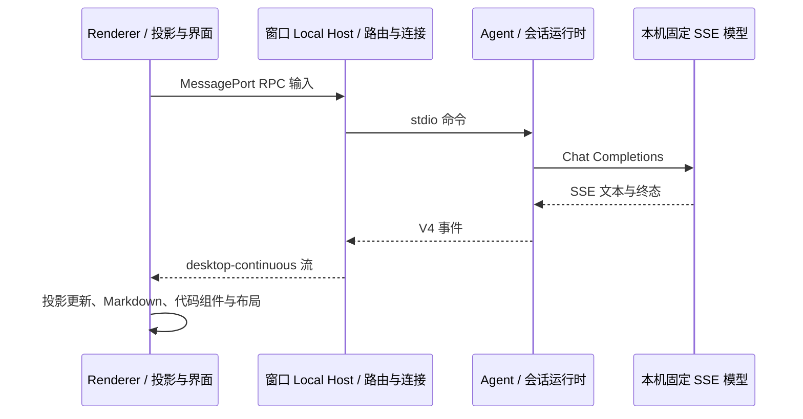

# Windows Electron 整机性能实测（2026-10-17）

已完成真实 Electron 的启动、前后台空闲、流式会话、长回复、滚动、查找和设置往返测量，覆盖整棵应用进程树。确认的主要瓶颈在长正文和代码组件的批量重建：长回复终态稳定出现约 0.5 秒主线程阻塞，查找触发虚拟窗口更新时也可能卡顿数秒。

本轮没有修改产品代码。结果及口径保存在同目录 `evidence.json`；没有修复前后的同机 A/B 数据，不能据此声称之前改动带来了多少百分比的提速。

## 环境与口径

- Ryzen 7 7735H，8 核 / 16 线程，15.24 GiB 内存，Windows 11 IoT 企业版 LTSC，build 26100。
- 仓库版本 3.15.1，HEAD `82ab95f0fea6b0e9a3ab877905473cb483ed2998`，包含当前未提交改动；Electron 41.0.3，Node 24.14.0，corepack pnpm 10.33.2。
- 使用 `ZCODE_ENV=production`、`NODE_ENV=production` 生成的压缩 Main、Host、Preload、Renderer 和配套当前源码 Agent。直接运行 Electron，`app.isPackaged=false`，没有生成安装包，没有开发服务器或文件监听构建器。
- 正式采样时，桌面数据、浏览器 profile、Agent 存储及用户目录均指向临时测试目录。预跑发现的旧 Agent 不兼容及用户插件配置影响均排除。
- 使用本机固定回复的 Chat Completions SSE 服务，不调用外部模型。长回复每条 34,122 字符、240 个 TypeScript 代码块，128 字符一批，名义间隔 12ms。回复结束耗时包含这个人为生成节奏，不能代表真实模型速度或 TTFT。
- Windows 进程树约每秒采样一次，包含 Main、Renderer、GPU、Host、Scheduler、Agent 和插件子进程；采样器、测试模型服务、Codex 自身不计入。CPU 为进程 CPU 时间增量之和除以墙钟时间及 16 个逻辑核，100% 表示占满整台机器。
- 内存分别统计各进程工作集之和、私有提交量之和。工作集可能重复计算共享页，不等于应用独占的物理内存；`MiB = 2^20 bytes`。Renderer JS heap 另行采集。
- 使用 CDP PerformanceObserver 和 CPU Profiler 观察长任务。确认轮次使用固定 test-id/CSS 定位并保持窗口前台可见；截图和结果提取放在测量阶段之外。数字仍包含观测开销。

## 启动与主要负载

三次独立进程重启，复用已配置的隔离数据与文件系统缓存。应用默认进入新任务页；这里没有测自动恢复长会话的耗时。

| 次数 | 首个窗口出现 | 输入框及发送控件可见 | 脚本首条短回复完成（从进程启动起） |
| ---- | -----------: | -------------------: | ---------------------------------: |
| 1    |       1.154s |               4.689s |                             9.149s |
| 2    |       1.082s |               4.503s |                             8.237s |
| 3    |       1.051s |               4.466s |                             8.332s |

“窗口出现”不等于可操作；“首条回复完成”还包含 CDP 操作、首次运行时准备和固定模型回复。它们不能当作操作系统冷启动或真实模型首 token 指标。

首次会话完成 30 轮连续短回复，其中 29 轮取得有效时延；最后一轮已完成，但脚本漏过短暂 busy 状态，因此该轮时延排除。随后在另一会话确认长回复，另有 26 轮短回复完成。两组各完成 3 条长回复。下表的长回复、滚动、查找和设置来自固定定位的确认阶段。

| 场景                 | 样本数（约 1Hz） |  CPU 平均 / P95 | 工作集平均 / 峰值 MiB | 私有提交平均 / 峰值 MiB |
| -------------------- | ---------------: | --------------: | --------------------: | ----------------------: |
| 初始前台空闲约 60s   |               61 |   0.11% / 0.47% |       1158.9 / 1173.2 |           934.0 / 983.8 |
| 3 条长回复流式生成   |               18 | 11.36% / 17.26% |       2143.4 / 2205.0 |         1821.6 / 1860.7 |
| 连续 40 次滚轮输入   |                5 |   4.25% / 5.30% |       2204.6 / 2206.9 |         1888.2 / 1889.8 |
| 7 个查找词及结果导航 |                7 |  9.60% / 12.10% |       2212.3 / 2224.4 |         1948.2 / 1977.9 |
| 设置往返 5 次        |                4 |  9.46% / 12.45% |       2224.4 / 2225.8 |         1978.0 / 1978.9 |
| 负载后前台空闲约 60s |               60 |   0.18% / 0.30% |       2054.4 / 2225.3 |         1786.7 / 1978.2 |
| 最小化后空闲约 30s   |               30 |   0.15% / 0.36% |       2029.3 / 2037.6 |         1749.4 / 1769.3 |

短回复有效样本的具体分位数见 `evidence.json`。设置首次打开约 942ms，后四次约 401～528ms。短阶段的样本量很小，P95 接近最大值，不适合解释细微差异。

初始进程树为 8 个进程，后续包含第二个会话的插件运行时、Tracing Service 和 Audio Service，共 11 个进程；不能把新增的全部内存解释为泄漏。长回复结束时 JS heap 约 145.5 MiB，操作和自然静置后约 96.0 MiB；工作集仍约 2 GiB，说明长正文保留的成本显著。CDP DOM 数量包含 Shadow DOM，普通 `querySelectorAll` 不包含，不能把两者差额直接当作未回收节点。没有足够的长时间重复循环来排除泄漏。

## 已确认的渲染瓶颈

固定定位复测的三轮终态长任务分别为 **497 / 524 / 515ms**。最初观察到的 1061ms 来自 Playwright 全页角色查询，已明确排除，不能归因给应用。

源码与 profile 对应的结构为：

1. `conversationTimelineLiveTail.ts` 在终态撤销 live tail，同一轮正文迁入历史虚拟列表的另一个父节点，引发 React 整轮重挂。
2. `components/ai-elements/message.tsx` 同时从 streaming 切换到 static；当前 Streamdown 的两种模式使用不同正文树。
3. 每个代码围栏都创建完整 CodeViewer / `@pierre/diffs File`，包括 Shadow DOM 和交互资源。当前预算主要在轮次虚拟化，单条长正文内仍会批量构建大量组件；`contentVisibility:auto` 不能省掉这些 JS 构建。

干净的 18.039s 长回复 profile 中，Streamdown 调用链约 3297ms，嵌套的 Markdown 解析链约 2581ms；`@pierre/diffs` 链约 585ms，容器创建自身约 202ms。主线程 Shiki 链约 15ms。它们覆盖流式与终态，调用链有重叠，不能相加，也不能把完整阶段的 CPU 时间分摊成单次终态成本。

查找的命中数符合预期。主测中 153 / 333 命中的首次查询约 1203 / 2316ms；重启后选择相同历史会话，前两个查询约 3270 / 4320ms，后续 153 / 333 命中则仅 77 / 53ms。因此不能归纳为“命中越多必然越慢”。补充 9.260s profile 中，虚拟列表 `flushSync` 链约 4853ms，`@pierre/diffs` 约 2125ms；索引计算约 36ms，DOM 高亮链约 300ms。证据指向虚拟窗口变化和冷正文重建，尚缺逐查询分页标记，无法量化分页、冷渲染和布局各自的贡献。

按本次测量时的状态，聊天代码围栏的轻量展示与按可见性启动工作量预算尚未实施；后续展示调整见[聊天代码片段报告](../chat-code-2026-10-17/report.md)，稳定挂载调整见[时间线稳定挂载规格](../../specs/performance-timeline-stable-mount.md)。选择实现方式时仍需保留 live tail 的滚动测高职责和 static 模式的 React 错误防护，不能直接删除；单纯扩大缓存、增加延时或局部 memo 不能解决当时观察到的重建路径。

## 验证、清理与边界

- 已接受的两组流式负载完成；采集期 Renderer pageerror 为 0，未观察到应用崩溃或已接受请求挂起。
- 脚本曾因过渡页面、发送 ACK / 编辑器清理尚未完成、短暂 busy 状态及选择器问题超时；相关试验与前后台焦点不明确的短回复时延排除。没有将这些自动化失败当作产品 RPC 故障，也没有使用 rAF 数据声称帧率达标。
- 复跑 `corepack pnpm typecheck` 与 `corepack pnpm lint` 均通过，Lint 为 0 warnings / 0 errors。本轮没有产品行为修改或新回归测试。
- 测试 Electron、Agent、插件、采样器、控制器和本机模型服务均已退出。开发运行改写的协议和 Explorer 右键入口已恢复到已安装的 ZCodium。测试相关生成产物、隔离数据、profile 与 trace 在当时未完成清理；此处省略具体本机临时路径。原始 profile、测量日志及控制脚本保留用于复核。
- 尚未覆盖安装包 / ASAR、macOS、实体手机及远程恢复、大仓库文件树、终端与 CUA 负载，也未验证真实用户插件和模型网络性能。此次属于 Windows 本地桌面主要链路的整棵进程树实测，不能表述为所有功能或所有平台的性能验收通过。
