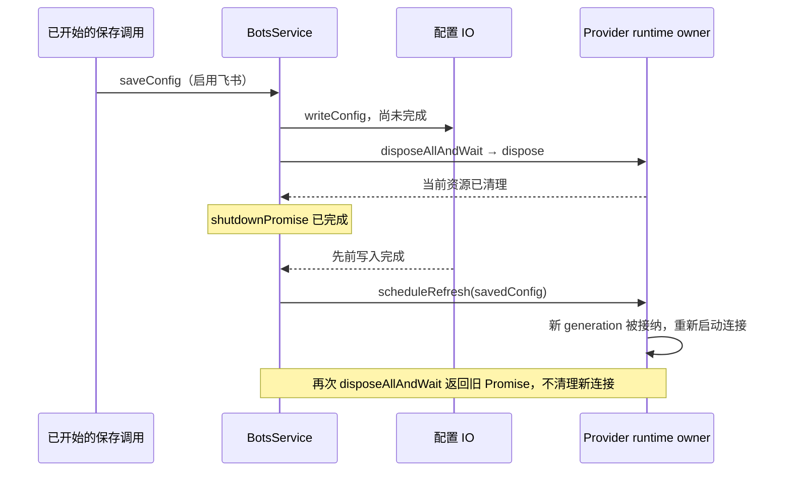

# 系统性性能优化第二轮复查（2026-10-19）

本轮沿上次优化继续检查相邻生产调用链。当前 HEAD 仍为 `47fcbe890a14994dbd2f28ac42a16bd6de875b4d`，已有生产差异与上一轮一致。上一轮记录的 3 项（Bot 对端关闭/缓存失效、迟到端口、插件裁决表回收）仍未修复，详见 [第一轮复查](systematic-performance-followup-2026-10-19.md)。

**本轮新增确认 2 项 P2 问题，累计 5 项。** 两项均为当前已有实现的遗漏，不认定为上次性能补丁新引入的回归。本轮只新增此报告，生产代码、正式测试、规格和其他本地改动均未修改；未提交、推送、构建。

## 4. P2：关闭期间的配置保存迟到完成，会重启已经 dispose 的 Bot runtime

位置：

- `packages/services/src/bots/botsService.ts:5230–5235`：saveConfig 在 repo 写入完成后直接调用三个 scheduleRefresh。
- `packages/services/src/bots/botsService.ts:6334–6336`：后续 disposeAllAndWait 返回先前的 shutdownPromise，不再清理新 runtime。
- `packages/services/src/bots/feishuChannelRuntime.ts:336–347` 以及 Telegram/Weixin 对应 dispose：invalidate 只使已有 refresh 失效，不禁止后续 enqueue。
- `packages/services/src/bots/channelRuntime.ts:44–55`：关闭后新 enqueue 仍可获得最新 generation。

触发不是“用户故意对已关闭对象再调用保存”，而是**关闭前已启动的正常保存**跨异步 IO 完成：



隔离复现使用真实 BotsService、真实飞书 runtime/refresh queue，只替换持久化、锁和外部 WebSocket：

1. 初始配置为空，等启动刷新完成。
2. 开始保存启用飞书的配置，将 writeConfig 保持 pending。
3. 等待 disposeAllAndWait 完成。
4. 让原 writeConfig 返回，再等待保存/刷新链完成。
5. 观察到 **WebSocket start=1，signal 未 abort，close=0，lock.release=0**。
6. 再次调用 BotsService.disposeAllAndWait，状态不变。探针最后通过捕获的 runtime 直接 dispose，确认 close/release 各为 1，未留下实际资源。

影响：服务声明关闭完成后仍可占用网络连接、轮询或跨窗口锁，旧实例与新实例可能竞争资源。新 runtime 会持续存在到其他外部回收（例如进程退出）；本轮没有宣称应用退出后 OS 仍保留活进程。Telegram/Weixin 具有同样的 admission 结构，但本轮运行时复现只覆盖飞书。

修复边界：先定义 BotsService 的关闭终态与在途保存完成后的返回语义。关闭时同步禁止新的 runtime 工作，所有跨 IO 的调度路径恢复后检查 owner 终态；Provider runtime 的 dispose 也需阻止新的 refresh admission。覆盖 saveConfig/saveBot/removeBotSecret 等调用路径，不能只在一个按钮或单个调用前加检查，也不能用延迟掩盖竞态。

## 5. P2：Main 重连失败额外产生未处理的 Promise 拒绝

位置：`packages/desktop/src/main/desktopRemoteSessions.ts:859–864`。

`reconnect.finally(cleanup)` 会创建新的 Promise；原 reconnect 被 reject 时，这个新 Promise 也 reject。这里用 void 丢弃派生 Promise，而调用方只能捕获被返回的原 reconnect，因此“原错误已被正确处理”仍不能消除派生的 unhandledRejection。

隔离 Node 子进程仅替换 Electron 的窗口/进程壳，执行真实 createRemoteWorkspaceSessionManager。连续进行 3 次重连，向合成 Host 投递经真实 schema 校验的 RemoteWorkspaceConnectFailed，调用方每次均 catch 原错误。实际仍额外收到 **3 个 unhandledRejection 事件**。

影响：每次正常网络失败/连接取消都可能额外进入 Main 的全局错误日志，造成重复错误及诊断噪声。当前 `packages/desktop/src/main/index.ts:238–240` 已有 unhandledRejection 记录器，本轮**不将其描述为必然崩溃**。

修复边界：使用有明确拒绝处理的清理链，并保持调用方获得原始 rejection；保留 Map 的同实例判断和并发去重，避免老请求清理掉新请求。应补失败、取消、Host 退出以及后续重试的未处理异常断言。

## 排除与验证

- 文件存在性缓存：实际容量上限 **100**，不是无限增长；每次写入的扫描被该上限约束。本轮未取得重要瓶颈证据，未列为问题。
- Timeline：render cache 比较完整 row 引用和 pin 布尔值，resolver 函数重建本身不必然重建历史 unit；不据此宣称历史 DOM 重渲染。
- Provider WebSocket 启动：凭据加载后、SDK 动态导入后均检查 abort，连接阶段也监听 abort；未将“异步启动必然忽略停止”列作问题。
- CUA 重试、请求缓存的 finally、已知有界缓存等相邻路径进行了源代码检查；没有足够证据的候选不加入问题列表。

| 验证                                     | 本轮实际结果                                                     |
| ---------------------------------------- | ---------------------------------------------------------------- |
| freshness 含 fetch                       | 失败：GitHub 连接重置，不能确认远端实时状态                      |
| freshness --no-fetch                     | 本地引用 ahead 0 / behind 0                                      |
| typecheck                                | 通过                                                             |
| lint                                     | 3098 文件，0 warning/error                                       |
| architecture:check --changed             | violations/baseline/new = 0/0/0                                  |
| Bot timer/bridge/adapter/飞书 + RPC 回归 | **97 项通过**                                                    |
| 迟到保存探针                             | 1 项验证问题仍存在；与上述回归一起运行合计 10 文件、98 项，6.92s |
| Main 重连探针                            | 子进程退出 0，确认 3 次已处理失败产生 3 次未处理拒绝             |
| git diff --check                         | 通过                                                             |

回归命令：

```powershell
corepack pnpm exec vitest run --config packages/ui/vitest.config.ts --maxWorkers=1 packages/services/test/botRemoteBridgeLifecycle.test.ts packages/services/test/botRemoteRuntimeServices.test.ts packages/services/test/botRemoteRequestTimers.test.ts packages/services/test/feishuAbortWaitCleanup.test.ts packages/rpc/test .tmp/performance-review-round2/bot-shutdown.test.ts
node --import tsx .tmp/performance-review-round2/main-reconnect.mjs
```

本轮没有重复上一轮全部 708 项及浏览器夹具，因为生产代码没有变化；那些结果属于上一轮。使用 PowerShell 7、corepack pnpm、Node 24.18.0，指定 24.14.0 与真实网络/Electron E2E 验证仍未完成。

迟到保存探针首跑因合成配置缺少 required allowedWorkspaces 字段失败，并产生探针自身未消费的 rejection；补齐字段后已独立及整合复跑通过。该首次错误不计为产品缺陷。两份探针刻意断言问题存在，不能直接当作修复后的绿色验收。

## 探针源码

临时探针已清理。需要重放时，将以下代码保存到注释所示路径；运行期间持久化、锁、WebSocket 均为合成实现，没有账号或网络请求。

<details>
<summary>.tmp/performance-review-round2/bot-shutdown.test.ts</summary>

```typescript
import { expect, it, vi } from "vitest";
import { createBotsService } from "../../packages/services/src/bots/botsService.js";

const mocks = vi.hoisted(() => ({
  readConfig: vi.fn(),
  writeConfig: vi.fn(),
  readState: vi.fn(),
  start: vi.fn(),
  acquire: vi.fn(),
  runtimes: [] as any[],
}));
vi.mock("../../packages/services/src/bots/repo.js", () => ({
  BotsRepo: class {
    readConfig = mocks.readConfig;
    writeConfig = mocks.writeConfig;
    readState = mocks.readState;
  },
}));
vi.mock("../../packages/services/src/bots/providers/feishuProvider.js", async (original) => ({
  ...(await original<object>()),
  startFeishuBotWebSocket: mocks.start,
}));
vi.mock("../../packages/services/src/bots/channelRuntime.js", async (original) => ({
  ...(await original<object>()),
  acquireFeishuWebSocketLock: mocks.acquire,
}));
vi.mock("../../packages/services/src/bots/feishuChannelRuntime.js", async (original) => {
  const actual =
    await original<typeof import("../../packages/services/src/bots/feishuChannelRuntime.js")>();
  return {
    createFeishuChannelRuntime: (...args: Parameters<typeof actual.createFeishuChannelRuntime>) => {
      const runtime = actual.createFeishuChannelRuntime(...args);
      mocks.runtimes.push(runtime);
      return runtime;
    },
  };
});

async function flush() {
  for (let i = 0; i < 80; i++) await Promise.resolve();
}

it("characterizes late save restarting a disposed Bot service", async () => {
  const config = { version: 3, bots: [] };
  mocks.readConfig.mockResolvedValue(config);
  mocks.readState.mockResolvedValue({ version: 3, bots: {} });
  let completeWrite!: (value: unknown) => void;
  mocks.writeConfig.mockImplementation(
    () =>
      new Promise((resolve) => {
        completeWrite = resolve;
      }),
  );
  const release = vi.fn(async () => {});
  mocks.acquire.mockResolvedValue({ release });
  const close = vi.fn();
  let actualSignal: AbortSignal | undefined;
  mocks.start.mockImplementation(async ({ signal }) => {
    actualSignal = signal;
    let finish!: () => void;
    const terminated = new Promise<void>((resolve) => {
      finish = resolve;
    });
    close.mockImplementation(finish);
    return { close, terminated };
  });
  const bots = createBotsService({
    credentialService: { load: async () => "synthetic-value" },
    runStartupBackgroundTasks: true,
  } as unknown as Parameters<typeof createBotsService>[0]);
  try {
    await flush();
    expect(mocks.start).not.toHaveBeenCalled();
    const saved = {
      version: 3,
      bots: [
        {
          id: "synthetic",
          name: "synthetic",
          provider: "feishu",
          enabled: true,
          credentialRef: "synthetic-ref",
          feishuAppId: "cli_synthetic",
          allowedWorkspaces: [],
        },
      ],
    };
    const saving = bots.saveConfig(saved as any);
    await flush();
    await bots.disposeAllAndWait();
    completeWrite(saved);
    await saving;
    await flush();
    expect(mocks.start).toHaveBeenCalledOnce();
    expect(actualSignal?.aborted).toBe(false);
    await bots.disposeAllAndWait();
    expect(actualSignal?.aborted).toBe(false);
    expect(close).not.toHaveBeenCalled();
    expect(release).not.toHaveBeenCalled();
    process.stdout.write(
      "AUDIT late save: start=1 after shutdown; repeated shutdown leaves signal active, close=0, release=0\n",
    );
  } finally {
    for (const runtime of mocks.runtimes) await runtime.dispose();
    await bots.disposeAllAndWait();
  }
  expect(close).toHaveBeenCalledOnce();
  expect(release).toHaveBeenCalledOnce();
});
```

</details>

<details>
<summary>.tmp/performance-review-round2/main-reconnect.mjs</summary>

```javascript
import assert from "node:assert/strict";
import { EventEmitter } from "node:events";
import { registerHooks } from "node:module";
import { setImmediate as nextTurn } from "node:timers/promises";

// Only replace Electron shell objects; all manager/reconnect logic is production source.
const electronStub =
  "data:text/javascript," +
  encodeURIComponent(
    "export const BrowserWindow = { getAllWindows: () => [] }; export class MessageChannelMain {}",
  );
const hooks = registerHooks({
  resolve(specifier, context, next) {
    return specifier === "electron"
      ? { url: electronStub, shortCircuit: true }
      : next(specifier, context);
  },
});
const { createRemoteWorkspaceSessionManager } =
  await import("../../packages/desktop/src/main/desktopRemoteSessions.ts");
const unhandled = [];
const listener = (reason) => unhandled.push(reason);
process.on("unhandledRejection", listener);
const child = Object.assign(new EventEmitter(), { pid: 123, postMessage() {} });
const win = {
  id: 11,
  isDestroyed: () => false,
  webContents: { id: 22, isDestroyed: () => false, send() {} },
};
const manager = createRemoteWorkspaceSessionManager({
  windowHostProcessMap: new Map([[22, child]]),
  logger: { info() {}, warn() {}, error() {} },
  resolveRemoteAssetDirs: () => ({}),
});
try {
  for (let i = 0; i < 3; i++) {
    const requestId = `synthetic-${i}`;
    const result = manager
      .reconnectBotRemoteWorkspaceSession(win, {
        target: { kind: "local" },
        workspacePath: "C:/synthetic",
        workspaceIdentity: "synthetic",
        requestId,
      })
      .catch((error) => error);
    child.emit("message", {
      type: "remote-workspace-connect-failed",
      requestId,
      error: `synthetic failure ${i}`,
    });
    assert.equal((await result).message, `synthetic failure ${i}`);
    await nextTurn();
  }
  assert.equal(unhandled.length, 3);
  process.stdout.write(
    `AUDIT reconnect: 3 normally caught failures also emit ${unhandled.length} unhandledRejection events\n`,
  );
} finally {
  await manager.disposeAllAndWaitForAppShutdown("synthetic cleanup");
  process.off("unhandledRejection", listener);
  hooks.deregister();
}
```

</details>
