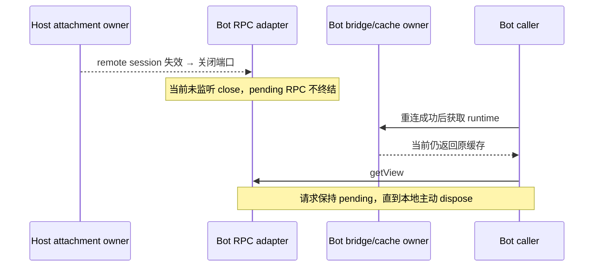

# 系统性性能优化复查（2026-10-19）

复查对象：上次系统性性能优化报告与当前工作树，HEAD `47fcbe890a14994dbd2f28ac42a16bd6de875b4d`。本轮只调查、复现与验证，未修改生产代码、正式测试或原规格，未提交、推送、构建。手机远控与 Markdown round26 的独立改动保持原样。

结论：原有优化仍通过回归，但另确认 **3 项生命周期遗漏（1 项 P1、2 项 P2）**。它们在上次优化之前的代码中也存在，不能说是上次性能改动新引入的回归；上次“没有遗留的重要候选”应限定为当时覆盖的场景。

## 1. P1：Bot 远端断开后，挂起 RPC 不终结，重连后仍复用已关闭的适配器

位置：

- `packages/services/src/bots/botRemoteRuntimeServices.ts:80–89`
- `packages/services/src/bots/botRemoteWorkspaceBridge.ts:307–309,366–368`
- 真实触发链：`packages/desktop/src/host/index.ts:1396–1399`，remote session 断开时会调用 `detachRemoteSessionAttachments`；attachment dispose 关闭端口。

原因：适配器只订阅 message，只在显式 `dispose()` 时调用 `client.dispose()`。对端关闭事件没有接入请求终结。Bridge 按 workspace 缓存适配器，没有对端关闭失效入口；`ensureConnected` 成功只更新 connected 集合，后续 get 直接返回旧缓存。

复现使用生产适配器、生产 Bridge、真实 Node MessageChannel 和真实 ChannelServer：

1. RPC 未收到初始化时关闭对端；已观察到真实 close 事件后，请求依然 pending；主动 dispose 才得到 ConnectionClosed。
2. 先完成正常 getView/preferences 初始化并缓存，再关闭对端。
3. 模拟 Main 返回重连成功；下一次取得的 service 与旧实例严格相同，runtime-port 请求数仍为 **1**。
4. 对旧实例再次调用 getView，经历后续事件循环仍未完成；Bridge dispose 才能释放。

影响：远端断线/Host 失效后，本地 Bot 等待可能持续占住请求链；仅执行重连不能恢复缓存中的服务。上次两项 adapter 测试只覆盖本地主动 dispose，未覆盖 peer close 与重连后的缓存替换。

建议边界：在连接适配器接入真实关闭事件，并向唯一 Bridge owner 提供失效通知；按实例身份移除旧缓存和所有权记录，终结其 RPC，下一次访问才重新申请 attachment。必须防止旧实例迟到 close 删除新实例，保留 workspace identity、remoteSessionId/generation 与既有错误契约；不靠加超时替代断线传播。此项涉及状态/时序，应先补规格再实现。



## 2. P2：runtime 请求超时后，迟到端口未被回收

位置：`packages/services/src/bots/botRemoteWorkspaceBridge.ts:97–103`。

原因：60 秒 deadline 删除 `pendingRuntimePorts` 登记。随后 Main 返回真实 port 时，`!resolve` 分支直接 return，既不 close，也不放入 `receivedRuntimePorts`；因此之后 Bridge dispose 也找不到这个端口。

复现：启动 getZCodeTaskService → 推进 60000ms → 确认初始化超时 → 投递相同 requestId 的成功回包和带 close spy 的端口 → dispose。结果 **close 调用数为 0**，timer 已是 0。这说明“计时器已清空”不能证明端口/attachment 已释放。

影响：超时或重复回包遗留的连接端点缺少确定性回收；对应 Host attachment 没有获得显式关闭信号。实际内存停留时间仍受端口实现及 GC 影响，本轮没有测量堆字节数。

建议边界：对已识别的 runtime-port 回包，即使 requestId 已过期/已完成，也要回收无法交付给调用方的转移端口。主动关闭之后仍在途的回包还需明确接收层的回收责任。测试需断言端口关闭和 Host attachment 释放，不能只检查 Promise/timer。

## 3. P2：插件裁决表没有会话回收，长期使用会持续保留历史数据

位置：

- `packages/ui/src/plugin-ui/app/pluginUiInstanceStore.ts:11–20,32–40`
- `packages/ui/src/v4/ConversationTimeline.tsx:427–430`

原因：模块级 derivations Map 按 sessionKey 持有完整 instances/byToolCallId。Timeline effect 只写入，没有卸载/换会话清理。取消订阅只删除 listener。全仓调用搜索确认唯一清表入口是测试用 reset，生产路径没有 delete/clear/容量淘汰；即使任务已删除也无法释放其裁决。

复现：通过真实 derive/store 写入 300 个不同会话，每个 128 条插件行，无任何订阅者；最终仍能读取全部 **38400 条裁决**。这只是可达对象数量，不是内存字节测量。生产调用链缺少释放这一点由源码确认，探针未启动完整 Timeline。

影响：useShallow 已消除同字段快照引起的多余 render，但没有解决底层会话数据随访问历史增长的问题。窗口不退出时，累积量与访问过的会话及插件调用数量相关。

建议边界：为派生数据建立会话级释放规则，并接入任务删除、workspace 释放或有界缓存淘汰。不能随单张虚拟卡片卸载删除整个会话，也不能破坏侧栏和保活页面；多个 Timeline 发布同一 session 时需有实例身份或引用所有权。应补换会话/删除/卸载重挂及保活交互测试。

## 本轮验证

| 验证                         | 实际结果                                         |
| ---------------------------- | ------------------------------------------------ |
| freshness（含远端 fetch）    | 通过，main 相对 origin/main ahead 0 / behind 0   |
| typecheck                    | 通过                                             |
| lint                         | 3098 文件，0 warning/error                       |
| architecture:check --changed | violations/baseline/new = 0/0/0                  |
| 上次整合 Vitest 命令         | 96 文件，708/708 通过，76.80s                    |
| 插件订阅浏览器对照           | 1/1 通过；1280×900、390×844 额外 render 均 360→0 |
| local/desktop diagnostics    | 14/14 通过                                       |
| 本轮遗漏探针                 | 4/4 验证上述问题仍然存在；不是修复后的绿色回归   |
| git diff --check             | 通过                                             |

整合命令沿用 `docs/specs/systematic-performance-progress.md` 的最终命令。确认重放 op 序列化访问量仍为 5550→120，分片仍为 454529→1200；飞书监听器与 Bot 正常完成后的 timer 回归通过。重新检查了文件扫描/缓存、Shiki/滚动记忆、RPC、启动懒加载、日志队列与数据库准备等相邻路径；未取得足以再认定其他重要问题的证据，不把关键字命中或理论收益列作缺陷。

使用 PowerShell 7、corepack pnpm、Node 24.18.0；mise 指定 24.14.0 的验证仍未完成。本轮未下载运行时。整机启动 profile、真实网络/Electron 端到端恢复和堆占用未实测；浏览器测试为隔离夹具，不代表真实插件完整 E2E。

## 可重放探针

以下探针刻意断言“问题仍存在”，用于审计取证，不能作为修复后验收的期望。将代码保存到仓库 `.tmp/performance-review-20261019/probe.test.ts`，运行：

```powershell
corepack pnpm exec vitest run --config packages/ui/vitest.config.ts --maxWorkers=1 .tmp/performance-review-20261019/probe.test.ts
```

首次执行探针因仓库根未链接 `@zcode/rpc` 无法导入，尚未运行任何用例；将探针改为引用 RPC 的源码公开入口后，4 项全部运行成功，未修改生产导入路径。本轮执行的临时探针已删除，源码保留如下。

<details>
<summary>完整探针源码</summary>

```typescript
import { EventEmitter, once } from "node:events";
import { MessageChannel } from "node:worker_threads";
import { setImmediate as nextTurn } from "node:timers/promises";
import { expect, it, vi } from "vitest";
import { ChannelServer, Event, MessagePortProtocol } from "../../packages/rpc/src/index.js";
import { createBotRemoteWorkspaceService } from "../../packages/services/src/bots/botRemoteWorkspaceBridge.js";
import { createRemoteRuntimeServicesFromPort } from "../../packages/services/src/bots/botRemoteRuntimeServices.js";
import { IModelSelectionService } from "../../packages/services/src/model-provider/providerFacadeServices.js";
import { IZCodeAgentService } from "../../packages/services/src/zcode-agent/zcodeAgent.js";
import { deriveLogicalUiInstances } from "../../packages/ui/src/plugin-ui/domain/pluginUiInstancePolicy.js";
import {
  setPluginUiInstanceDerivation,
  getPluginUiRowDisposition,
  resetPluginUiInstancesForTest,
} from "../../packages/ui/src/plugin-ui/app/pluginUiInstanceStore.js";

const target = { workspacePath: "C:/synthetic/review", workspaceIdentity: "synthetic-review" };
function bridge(parentPort: EventEmitter & { postMessage: (message: any) => void }) {
  return createBotRemoteWorkspaceService({
    parentPort,
    settingService: {
      get: async () => ({
        lastWorkspaceSession: [{ kind: "remote", ...target, target: { kind: "local" } }],
      }),
    },
    credentialService: { load: async () => null },
  } as unknown as Parameters<typeof createBotRemoteWorkspaceService>[0])!;
}
async function flush() {
  for (let i = 0; i < 30; i++) await Promise.resolve();
}

it("characterizes pending RPC after real peer close", async () => {
  const { port1, port2 } = new MessageChannel();
  const adapter = createRemoteRuntimeServicesFromPort(port1);
  let settled = false;
  const result = adapter.modelSelectionService.getView().then(
    () => {
      settled = true;
    },
    (error) => {
      settled = true;
      return error;
    },
  );
  try {
    const closed = once(port1, "close");
    port2.close();
    await closed;
    await nextTurn();
    expect(settled).toBe(false);
    process.stdout.write(
      "AUDIT peer-close: pending RPC remains unsettled after actual close event\n",
    );
  } finally {
    adapter.dispose();
    port2.close();
  }
  expect(await result).toMatchObject({ name: "ConnectionClosed" });
});

it("characterizes cached runtime after peer close and successful reconnect", async () => {
  const parent = Object.assign(new EventEmitter(), { postMessage: vi.fn() });
  const service = bridge(parent);
  const pair = new MessageChannel();
  const protocol = new MessagePortProtocol(pair.port2);
  const server = new ChannelServer(protocol, "synthetic");
  server.registerChannel(IModelSelectionService.channelName, {
    call: async () => ({}),
    listen: () => Event.None,
  });
  server.registerChannel(IZCodeAgentService.channelName, {
    call: async () => undefined,
    listen: () => Event.None,
  });
  let runtimeRequests = 0;
  parent.postMessage.mockImplementation((message) => {
    if (message.type === "bot-remote-workspace-runtime-port-request") {
      runtimeRequests++;
      parent.emit("message", {
        data: { type: "bot-remote-workspace-runtime-port", requestId: message.requestId, ok: true },
        ports: [pair.port1],
      });
    } else if (message.type === "bot-remote-workspace-reconnect-request") {
      parent.emit("message", {
        data: {
          type: "bot-remote-workspace-reconnect-result",
          requestId: message.requestId,
          ok: true,
          sessionId: "synthetic-new-session",
        },
      });
    }
  });
  let pending: Promise<unknown> | undefined;
  try {
    const first = await service.getModelSelectionService(target);
    const closed = once(pair.port1, "close");
    server.dispose();
    protocol.disconnect();
    await closed;
    expect(await service.ensureConnected(target)).toEqual({ ok: true });
    const second = await service.getModelSelectionService(target);
    expect(second).toBe(first);
    expect(runtimeRequests).toBe(1);
    let settled = false;
    pending = second!.getView().then(
      () => {
        settled = true;
      },
      (error) => {
        settled = true;
        return error;
      },
    );
    await nextTurn();
    expect(settled).toBe(false);
    process.stdout.write(
      "AUDIT reconnect: returns same closed adapter; runtime requests=1; new RPC remains pending\n",
    );
  } finally {
    service.dispose();
    server.dispose();
    protocol.disconnect();
    pair.port1.close();
    await pending;
  }
});

it("characterizes unclosed runtime port delivered after the 60s deadline", async () => {
  vi.useFakeTimers();
  const parent = Object.assign(new EventEmitter(), { postMessage: vi.fn() });
  const service = bridge(parent);
  const close = vi.fn();
  try {
    const result = service.getZCodeTaskService(target).catch((error) => error);
    await flush();
    const requestId = parent.postMessage.mock.calls[0]![0].requestId;
    await vi.advanceTimersByTimeAsync(60_000);
    expect(await result).toMatchObject({ message: "远端 workspace runtime 初始化超时。" });
    parent.emit("message", {
      data: { type: "bot-remote-workspace-runtime-port", requestId, ok: true },
      ports: [{ close }],
    });
    await flush();
    service.dispose();
    expect(close).not.toHaveBeenCalled();
    expect(vi.getTimerCount()).toBe(0);
    process.stdout.write(
      "AUDIT late port: close calls=0 after timeout, delivery, and bridge dispose\n",
    );
  } finally {
    service.dispose();
    vi.useRealTimers();
  }
});

it("characterizes retained plugin dispositions with no subscribers", () => {
  resetPluginUiInstancesForTest();
  try {
    for (let session = 0; session < 300; session++) {
      const rows = Array.from({ length: 128 }, (_, index) => ({
        kind: "toolCall" as const,
        rowId: index + 1,
        turnId: "turn",
        createdAt: 1,
        createdAtSeq: index + 1,
        toolCallId: `tool-${index}`,
        toolName: "synthetic",
        status: "success" as const,
        inputText: "{}",
        display: {
          kind: "mcp_tool" as const,
          serverName: "synthetic",
          toolName: "view",
          ui: { pluginId: "synthetic", resourceUri: "ui://synthetic/view" },
        },
      }));
      setPluginUiInstanceDerivation(`session-${session}`, deriveLogicalUiInstances(rows));
    }
    let retained = 0;
    for (let session = 0; session < 300; session++) {
      for (let index = 0; index < 128; index++) {
        if (getPluginUiRowDisposition(`session-${session}`, `tool-${index}`)) retained++;
      }
    }
    expect(retained).toBe(38_400);
    process.stdout.write(
      `AUDIT plugin store: 300 inactive sessions retain ${retained} dispositions\n`,
    );
  } finally {
    resetPluginUiInstancesForTest();
  }
});
```

</details>
