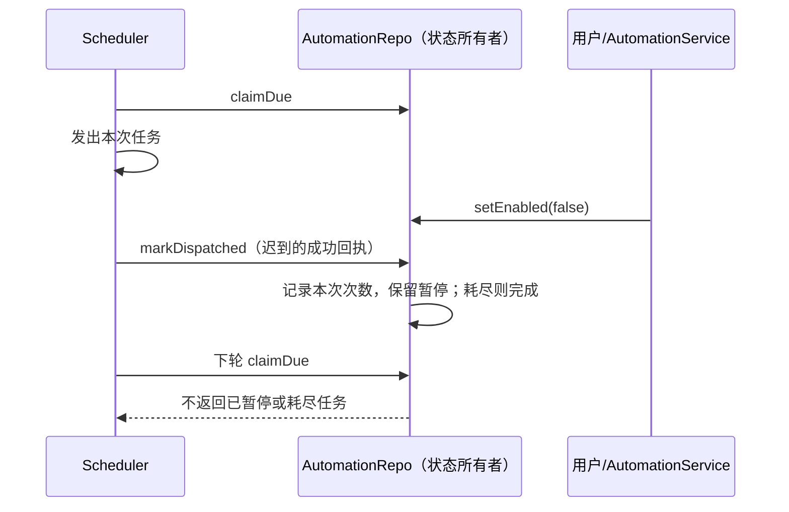
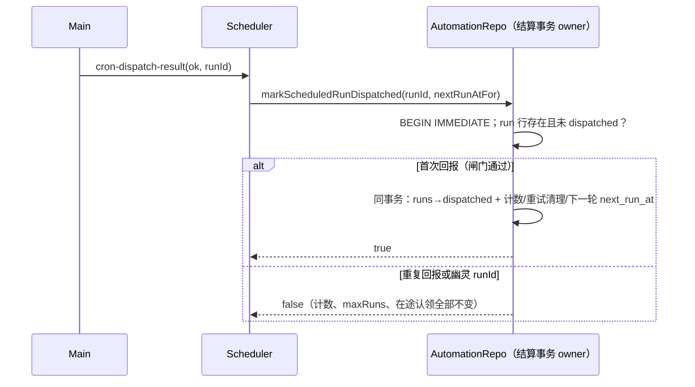
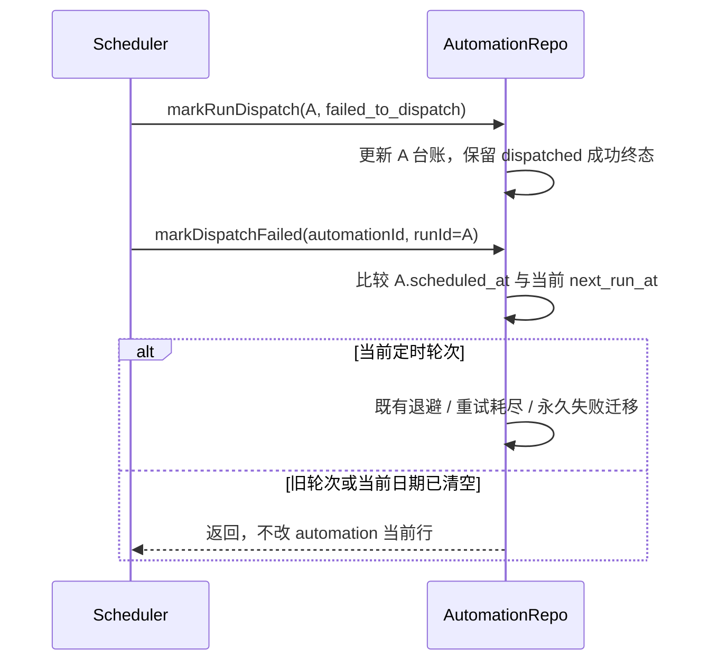

# 定时任务的暂停与执行上限

## 产品规则与所有者

- AutomationRepo 是持久化启用状态、生命周期、定时执行次数的唯一所有者；AutomationService 负责编辑规则，scheduler 只认领和结算派发。
- tasks-index 初始化由 `prepareTasksIndexStorage` 这个异步启动 owner 完成，Repo 只检查已完成迁移；真实 SQLite 测试夹具必须先等待准备，不能依赖 Repo 恢复旧同步迁移。
- 用户暂停后，已经发出的本次派发可以完成，但成功回执不能恢复后续调度。达到次数或截止时间上限时仍进入 completed。
- 只修改截止时间不能解除已经耗尽的执行次数上限。只修改次数也不能解除截止时间限制；两个约束同时成立才允许恢复。
- 保留现有 workspace identity 隔离、manual run 计数语义和 claim/runId 边界；不新增状态库或调度路径。

## 接口与事件顺序

沿用 setEnabled、update、markDispatched 和 claimDue，不修改协议。

### 成功结算的事务 owner（同 runId 幂等）

- scheduled run 的成功结算由 `AutomationRepo.markScheduledRunDispatched` 单一事务 owner 完成：automation_runs 首次进入 dispatched，与 automations 的计数推进（run_count/scheduled_run_count）、last_run_at、重试态清理、running/claimed_at 释放、lifecycle/next_run_at 写入，全部在同一个 BEGIN IMMEDIATE 事务内提交。计数与 run 台账不允许分属两次写入。
- scheduler 收到 ok 的 cron-dispatch-result（trigger=schedule）只调用一次该方法；不再先 markRunDispatch('dispatched') 再 markDispatched 双写。失败路径（markRunDispatch failed_to_dispatch + markDispatchFailed）与 manual 路径（markManualRunDispatched）维持原方法。
- runId 沿用既有入站格式 `${automationId}:${scheduledAt}`（manual 为 `${automationId}:manual:${uuid}`），不发明新 ID；repo 不感知 cron 语义，nextRunAt 由调用方以纯函数注入，在事务内基于最新行计算。
- 同 runId 的重复回报（scheduler 重启后的迟到回报、CLAIM_STALE 回收后旧持有者回执）命中幂等闸门：返回 false，run 台账、计数、maxRuns 消耗、以及重复回报到达前已建立的下一轮 running/claimed_at/next_run_at 一律不变。
- automation_runs 中不存在对应 run 行的幽灵回报（从未被 upsertRunClaimed 记账）同样按 false 跳过，不推进任何计数；run 存在但 automation 已删除时仅记账 run，不复活任务。
- markDispatched 保留为兼容旧调用（历史测试与外部消费方）；其读行后无条件推进、不具备同 runId 幂等的语义如实记录于此，生产结算不再使用。
- 成功终态单调：dispatched 是 automation_runs 的终态。markRunDispatch、upsertRunClaimed、skipAndReschedule、recordSkippedRun 的冲突/条件更新一律不得把已 dispatched 的 run 改回 claimed/failed/skipped（SQL 层 WHERE dispatch_status <> 'dispatched'）；markDispatchFailed 接收 runId 时，若该 run 已 dispatched 或从未记账（幽灵回报）则整体跳过，不把 automation 推入幻影重试退避。claimed→failed、failed→claimed（真实重试再记账）等非终态迁移不受影响，failure/manual 语义与其应有终态保持不变，调度 lease 策略不改。
- 计数与生命周期推进只有一份业务写入：markDispatched 与 markScheduledRunDispatched 复用 Repo 内同步私有函数 applyScheduledDispatchProgress（计数/last_run_at/重试清理/认领释放/lifecycle/next_run_at），事务内绝不 await；nextRunAtFor 注入函数抛错时整个事务回滚，run 台账与 automation 计数保持认领态原样。
- 迟到成功与在途认领的 owner 边界：用既有 owner 事实判定——run 行 scheduled_at 与 automation 当前行 next_run_at 相等时，本次成功属于当前在途 occurrence，按现有口径全量推进（释放认领、写下一轮 next_run_at）；不相等（规则更新/超时回收后调度已前移到新的 runId）时，A 的首个成功只推进计数（run_count/scheduled_run_count/last_run_at）与 reachedMax/reachedEnd 终态转换，绝不释放 running/claimed_at、不改写 next_run_at/dispatch_status/dispatch_attempts/retry_at/last_error——不能仅因 A 真实成功就释放另一 occurrence 的在途认领。
- markDispatchFailed 携带 runId 时必须绑定 automation_id：run 行归属与目标 automation 不一致（其他 automation 的 runId）或 run 已 dispatched / 从未记账时整体跳过，防止跨行写坏。
- 协议边界（如实记录）：同一 runId 的多次在途 attempt（CLAIM_STALE 回收重派）无法用现有 owner 事实区分持有者——claim 不记录 runId；首个成功按当前 occurrence 全量结算并写下一轮 next_run_at，不会造成同 occurrence 重认领或重复计数，但 attempt 级精确归属需要 claim 记录 runId，本轮不新增 lease/attempt 状态，不宣称完整 stale 安全。

## 失败回执的 occurrence 归属（与成功侧同一条 owner 边界）

- 迟到/重复的失败回执使用与成功结算同一个 owner 事实：run 行 `scheduled_at` 与 automation 当前行 `next_run_at` 相等才是当前 occurrence。`markDispatchFailed` 携带 `runId` 时只在当前 occurrence 上写 automations；不相等（规则更新或超时回收后调度已前移到新的 runId）、或 `next_run_at` 为 NULL（无法证明归属）时，automations 行一字不改——不得清 `running`/`claimed_at`、不得写幻影 `retry_at`、不得动 `dispatch_attempts`/`dispatch_status`/`last_error`，更不得把在途任务推入 `failed`/`completed` 终态。
- 不新增第二写入路径：scheduler 失败结算仍按现序「先 `markRunDispatch(failed_to_dispatch)` 记本次 run 台账，再 `markDispatchFailed(..., runId)` 推进 automation」。被挡掉的只有 automations 的写入；失败事实本身照常落 `automation_runs`（`dispatch_status`、`error`），run 台账既有的成功终态单调守卫不变。
- 非当前 occurrence 的失败既不改变生命周期，也不推进 `run_count` / `scheduled_run_count` / `last_run_at`。这与迟到成功仍记录一次真实执行的计数语义不同。
- 兼容性边界：不带 `runId` 的旧调用（历史消费方与既有测试）保持无条件推进的原语义；manual 派发失败路径不经 `markDispatchFailed`，不受本节约束。守卫不得反向挡住当前 occurrence 自己的失败（`claimed→failed` 与真实重试退避必须照常生效），也不得影响同一在途任务随后自己的成功或失败结算。
- 缺陷根因：`runId` 闸门此前只校验存在性、automation 归属和成功终态，不校验轮次归属。三条失败写入分支会清除 `running` / `claimed_at`，并改写退避或生命周期；因此旧轮次 A 的首个迟到失败可破坏新轮次 B 的在途状态。红测以 automation 行变化为证，不把尚未执行到的后续派发断言当作已观察到的重复模型请求。
- 实现落点：`markDispatchFailed` 在 `ensureReady()` 之后先读一次 automation 行（供三条失败分支复用，也作为归属判定的当前调度事实）；`runId` 闸门保留既有的「存在 / 归属一致 / 未 dispatched」校验，并把 SELECT 扩到 `trigger`、`scheduled_at`；当 `trigger = 'schedule'` 且 `scheduled_at` 与当前 `next_run_at` 不相等（含 `next_run_at` 为 NULL）时整体跳过 automations 写入。三条失败分支的 SQL、成功结算的同一事务与事务内 `nextRunAtFor` 回调契约均未改动，未新增状态字段或 lease。
- 剩余边界（如实记录，本轮不扩大）：失败侧仍是「读 automation → 写 automation」的非事务序列，与 host 回写或用户编辑并发时的跨进程原子性没有在本轮扩展；`end_at` 到期清扫把 `next_run_at` 置为 NULL 之后才到达的失败回执按「归属不明」跳过，失败事实只留在该 run 的台账里。

## 调度规则可行性校验（yearly 窄口径）

- yearly 规则在既有归一化与 anchor 回退后选中的 (月, 日) 对，若在所有年份都不存在——2 月 ≥30 日，或 4/6/9/11 月 31 日——属于永不执行的僵尸规则（computeScheduleRuleNextRunAt 恒 null、next_run_at=null 永不被 claimDue 认领、永不终态），必须在写库前走现有 InvalidAutomationScheduleRuleError 拒绝，create/update 整体失败、无部分写入。
- 解析必须与引擎一致：months[0] 缺省回退 anchorAt 月份、monthDays[0] 缺省回退 anchor 日；多月份/多日期仅首项参与调度（引擎现状，多值支持属未定设计，只记录不扩展）。
- 明确不拒绝：Feb 29（闰年存在，引擎逐 year 溢出守卫维持原语义）；monthly 任意 monthDays 1-31（引擎按月遍历并跳过溢出日、months 不参与 monthly，任何值都能命中长月，校验会错拒）；「未来 N 年内不可行」等弱条件；months 非首项的可行性。
- 不改变任何日期计算语义；UI/CLI 侧契约不动，services 持久化边界为最终防线。
- 校验时机：可行性校验只作用于最终 canonical rule（归一化/重锚定解析后）。create 在重锚定（anchorAt=createdAt）后校验；update 不再用调用方原始 rule 及其 anchor 提前校验——原始 anchor 不代表引擎实际使用的 anchor（定义变更会重锚定到 updatedAt，定义未变才保留旧锚），提前校验会把「旧 anchor 不可行、新 anchor 可行」的合法更新误拒。update 仅对解析锚点后的 explicitScheduleRule 复验一次，carrier 分支同样只按 build/重锚定后的最终规则校验；scheduleRule 清除（null）与不携带规则的更新路径无新规则写入、无需校验。所有写入路径在写库前恰好完成一次最终校验。公开出口不变：InvalidAutomationScheduleRuleError 原本即模块内错误类，非公开导出。

## 回归夹具的写边界（写前拒绝）

- 本节只约束测试夹具落盘范围，不改变任何产品行为；适用于定时任务的全部三套 SQLite 回归——`automationScheduledSettlement.test.ts`、`automationYearlyFeasibility.test.ts`、既有 `automationLifecycleControls.test.ts`（8 项，含 `for (const edit of …)` 展开的两个同体用例）。三套的临时库目录只能来自中央 owner `scripts/ci/project-test-sandbox.mjs` 的 `createProjectTestFixture(label, env)`，不得自行 `os.tmpdir()` + `mkdtemp`；第三套的迁移与断言口径不变（只换夹具目录来源）。
- **直接执行必须在任何写入之前失败**：未经沙箱 runner 运行（`env.PROJECT_TEST_SANDBOX_ROOT` 缺失或指向沙箱根之外）时，中央 owner 在创建目录前就抛 `PROJECT_TEST_PATH_REJECTED`，既不建目录也不落库文件。写后校验不合格——`mkdtemp` 已把目录写进真实系统临时目录，断言只是在污染发生之后报错，既违背本仓「测试写入只允许落在获准工作树」的边界，也让「拒绝」变成无法兑现的声明。
- 项目内判定不在测试里复制：各套件自带的字符串式 `assertInsideProject` 只比较相对路径，不能证明真实路径未被 junction/symlink 写穿；统一以中央 `assertProjectPath` 的逐级 `lstat`/`realpath` 校验为准。
- 清理边界：`t.after` 只删除本次夹具自己创建、且经 `assertProjectPath` 再次确认仍在项目工作树内的当前 fixture 目录；不递归删除沙箱运行根或其他并行验证证据。
- 迁移只动测试与本文，不改断言语义、不减少用例、不触碰产品源码；`scripts/ci` 入口与用例数阈值保持不变。

## 验收

- 真实 SQLite 两个连接模拟用户暂停与 scheduler 成功回执，后续 claimDue 不再认领；用户显式恢复后可正常认领。
- 暂停中的最后一次派发完成后进入 completed；manual run 不计入定时次数上限。
- 已耗尽任务仅延长/清除截止时间仍为 completed；未耗尽但因截止时间结束的任务延长期限可以恢复。
- 修改运行次数但截止时间仍不允许下一次运行时，不得恢复为 active。
- 失败回执 owner 边界（回归覆盖）：表驱动覆盖三种迟到失败（transient 未达上限、transient 达上限后跳下一轮、permanent 终态）在「A 尚未成功、B 已认领下一轮」时的行为——automations 整行与结算前逐字段一致（含 `updated_at`）、本次 run 台账仍写 `failed_to_dispatch` + `error`、B 的 run 台账保持 `claimed`、B 未越过 `CLAIM_STALE` 前 `claimDue` 仍返回空。另两条是兼容 pin：当前 occurrence（B）自己的失败仍照常进入 `claimed→failed` 与退避，且 A 的重复迟到失败持续无效；不带 `runId` 的旧调用保持无条件推进语义。
- 夹具写边界（永久 CI 验收场景）：给上述三套回归各起一个子进程直接运行首个用例（共 3 个未绑定场景），环境**不注入 `PROJECT_TEST_SANDBOX_ROOT`**，但 HOME/USERPROFILE/APPDATA/LOCALAPPDATA/TEMP/TMP/TMPDIR/XDG*\*/ZCODE*\* 仍指向项目内，并且 Node 文件写白名单 `--permission --allow-fs-write=<path>` 保持与沙箱 runner 同样的形态——注意它放行的是**当次项目沙箱根**（`createProjectTestSandbox` 为该次运行新建的 `.run-logs/project-only-validation/<label>-<rand>` 目录），不是整个项目根；这层白名单只是附加防线，写范围仍由中央 owner 的逐级路径校验决定。每个子进程断言两处：夹具抛出 `PROJECT_TEST_PATH_REJECTED`，且子进程退出码为 1。红绿对照依据——旧夹具（先 `mkdtemp(join(tmpdir(), …))`、再断言目录在项目内）在这套环境下会因为 TEMP 已重定向进项目而正常通过，所以这 3 个场景只对写前 guard 成立，证明「写前拒绝」本身是必要约束而不是等价改写；全程不接触真实系统 TEMP。该场景的 CI 入口（`scripts/ci/automation-fixture-isolation.test.mjs`）与用例阈值由维护者接入，本文只固定其验收语义，不把它写成已执行结果。

无需数据迁移，现有桌面与手机只读取原有任务状态。验证使用隔离临时数据库，不派发真实模型请求。

## 验证结果

- Node 24.14.0 下 8 项 SQLite 回归通过，覆盖暂停/恢复、最后一次派发、截止时间修改、次数与日期约束、手动运行计数和 identity 隔离。
- 修复前已实际看到暂停和截止时间相关断言失败；修复后全部通过。新增测试单独完成类型检查。
- 经 `scripts/ci/automation-lifecycle.test.mjs` 接入现有 Release tests；未运行真实模型任务或完整定时任务页面 E2E。
- 结算幂等回归（本 fork 修复）：新增 `packages/services/test/automationScheduledSettlement.test.ts`，经 `scripts/ci/automation-scheduled-settlement.test.mjs` 项目沙箱 runner（tmpdir 重定向进项目 .run-logs）执行；当时夹具只做写后路径断言，该不足由本轮夹具写边界迁移修正（见下条）。修复前 7 项测试 6 失败/1 通过（`markScheduledRunDispatched is not a function`，红）；实现 Repo 单事务结算 owner 并把 scheduler ok 回执改为单次调用后 7/7 通过（绿）。同 runId 重复回报、幽灵 runId、已删除 automation、transient 重试、manual 语义、有限任务两轮耗尽均有断言。定向类型检查 `tsc -b packages/services` 与 `packages/desktop/tsconfig.main.json + tsconfig.host.json` 通过；oxlint 0 警告 0 错误；oxfmt 通过；`architecture:check --changed` 0 违规。未运行真实模型任务与完整 E2E。
- 结算单调性与乱序回归（第二轮）：settlement 套件扩至 12 项，新增 legacy 三步对照探针（同 runId 重复回报实测计数 2/提前 completed，与新 API 计数 1/active 对照）、nextRunAtFor 抛错整事务回滚、迟到失败回报不得撤销 dispatched/不得触发幻影重试、run 台账终态单调（含陈旧再记账不得拉回 claimed）、真实 transient 重试不受守卫影响。红：守卫临时摘除时乱序相关 2 项失败、其余 10 项通过（证明修复不破坏既有语义）；恢复守卫后 12/12。markRunDispatch/upsertRunClaimed/skipAndReschedule/recordSkippedRun 增加成功终态 WHERE 守卫；markDispatchFailed 增加 runId 乱序守卫；计数与生命周期推进抽取为 Repo 内共享同步私有函数 applyScheduledDispatchProgress，markDispatched 与 markScheduledRunDispatched 复用同一段写入。
- yearly 可行性窄口径：调度入参校验自 automationService 抽出为 session/automationScheduleValidation.ts（service 回到 400 行内），create 校验移至重锚定后、update 对解析锚点后的最终规则复验。新增 automationYearlyFeasibility.test.ts（6 项）：修复前 4 失败/2 通过（防错拒项先行通过），修复后 6/6；anchor 回退用 node:test mock timers（Date 定在 1 月 30 日）验证 Feb 30 拒绝、Feb 29/monthly 31/months[0]=7 的多值组合不误拒。tsc 定向、oxlint、oxfmt、architecture:check --changed 全部通过。
- owner 边界（第三轮）：settlement 套件扩至 14 项。红：迟到成功释放 newer claim（2 项失败）+ 跨 automation runId 绑定缺失；修复后 14/14。markScheduledRunDispatched 以 run.scheduled_at ↔ automation.next_run_at 既有 owner 事实判定当前/迟到 occurrence，迟到成功只推进计数与终态转换（applyScheduledDispatchProgress 增加 preserveClaimSchedule 分支），绝不触碰在途认领的 running/claimed_at/next_run_at/dispatch_status/重试态；markDispatchFailed 的 runId 闸门绑定 automation_id，跨行 runId 直接跳过。同一 runId 多 attempt 无法以现有状态区分持有者，已作为协议边界如实记录（不新增 lease/attempt 状态）。
- 既有回归经 runSourceTests 项目沙箱入口复跑：automationLifecycleControls.test.ts（8）+ automationCron.test.ts（1）共 9 项全部通过；两 wrapper 增加 tests>=14 / >=6 阈值断言。
- 重锚定误拒修复（第四轮）：update 移除对调用方原始 scheduleRule 的提前校验与对未重锚定 effectiveDirectScheduleRule 的中期校验（早期用调用方旧 anchor 会把「旧 anchor 不可行、重锚定后可行」的合法更新误拒，如 Jan 31 anchor + months=[2] 省略 monthDays、定义变更重锚定到 7 月 15 日后 Feb 15 可行），规则校验统一收敛到解析锚点后的最终 canonical rule（explicitScheduleRule 复验）单点；create 此前已移后正确，carrier 分支同样只按 build/重锚定最终规则校验。新增正向重锚定回归（mock 时钟 7 月 15 日，旧 anchor Jan 31 不可行、最终 anchor 可行须接受），红 1 项失败 → 修复后 yearly 套件 7/7、settlement 14/14、既有 lifecycle+cron 9/9；yearly wrapper 阈值更新为 >=7。公开出口核实：InvalidAutomationScheduleRuleError 原本即非公开导出（HEAD 版本类无 export，node.ts/contract.ts 未导出），抽出后公开面未变。tsc 定向、oxlint、oxfmt、architecture:check --changed 全部通过。
- 写前拒绝复核：三套自动化夹具统一使用 `createProjectTestFixture`，清理前重新 `assertProjectPath`。新增 [隔离入口](../../scripts/ci/automation-fixture-isolation.test.mjs) 覆盖三套未绑定运行；旧 lifecycle 夹具实测未拒绝（预期子进程 exit 1、实际 exit 0），外层 3 项中 1 失败，证据 `resume-targeted-gWPoSV`。迁移后 3/3 通过，原 lifecycle 8/8 不变。settlement/yearly 旧夹具的缺陷依据是源码写入顺序，本轮没有对它们执行旧代码红测，也没有使用真实外部 TEMP。
- 迟到失败回执复核：先加 5 项用例，实际旧实现 19 项中 15 通过 / 4 失败（`resume-targeted-CUnvjo/children/source-tests-zAuUap/logs/source-tests.log`）；最小轮次守卫后 19/19 通过，入口阈值提高到 19。三个分支保持新轮次整行不变，当前轮次真实退避、run 台账和 legacy 无 runId 行为保留。红测在整行断言失败后停止，未实测到第三次派发；修复后的 claimDue 断言确认不会误释放。
- 最终统一复验：固定 Node 24.14.0 / pnpm 10.33.2，`resume-regressions-J2AA44` 中结算 19、yearly 7、lifecycle 8、未绑定隔离 3 项全部通过；`resume-types-jHRhB4` 的 package-aligned noEmit 同时覆盖三套源码测试并退出 0。根门禁与整轮边界见 [维护记录](maintenance-model.md)。未运行真实模型、完整调度 E2E 或跨进程失败结算竞争测试。
