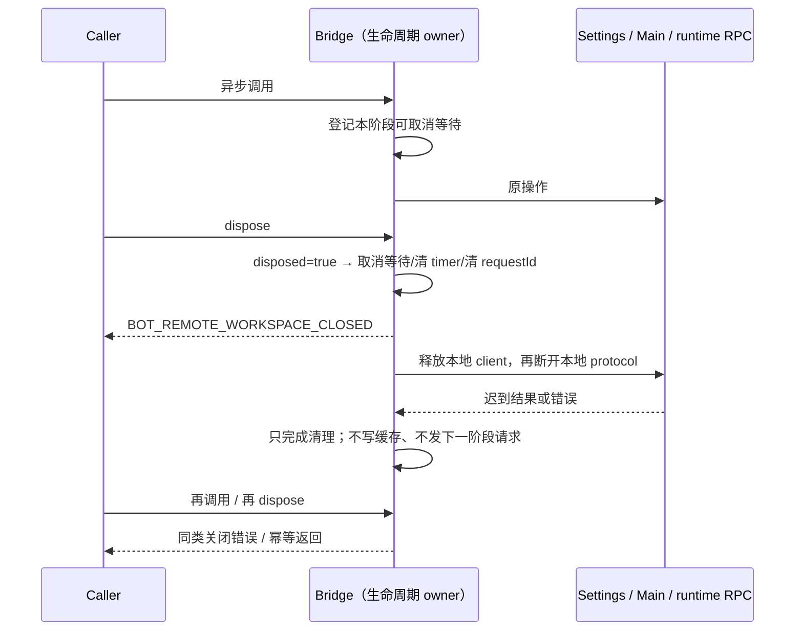

# Bot 远端桥接关闭契约

用户已授权“制定关闭错误契约并修复”。本项是有意修复既有关闭语义，不计为纯性能等价优化：原 dispose 清空三个关联 Map 后，超时也找不到 resolver，调用 Promise 永不完成。

## 所有权与接口

对端关闭、迟到端口和 Provider 关闭 admission 的补充规则见 [性能复查生命周期修复](performance-followup-lifecycle-fixes.md)。其中 parentPort 分发器与传输同寿命，Bridge 关闭注销实例 consumer，替代下文原“移除 parentPort 监听”的实现方式；其他关闭错误/等待契约保留。

- 唯一生命周期 owner 是 `createBotRemoteWorkspaceService` 实例。`disposed` 单向从 false 变 true；在途等待集合只持有本实例的取消回调，三个原 Map 仍只负责 Main requestId 关联。每次等待完成即移除取消回调及其计时器/登记，不持有历史结果。
- 全部异步入口在关闭后拒绝，错误为 `Error`，`name = BotRemoteWorkspaceClosedError`、`code = BOT_REMOTE_WORKSPACE_CLOSED`、`message = 远端 workspace 桥接已关闭。`。连接查询也不能把关闭伪装成缓存中的 connected。原接口已经允许 transport 发送失败时拒绝；不新增 wire 消息或 schema。
- dispose 幂等：先禁止新工作，再取消全部在途等待并释放 timer/关联，移除 parentPort 监听，清空派生缓存，释放桥接拥有的 runtime RPC adapter。client 先 dispose，protocol 后 disconnect；RPC 等待沿原 client dispose 契约终结，不停止远端 Host/Agent、不发送取消 task/run 指令。
- 组合根将 bridge 独占注入 BotsService；由既有 `disposeAllAndWait` 在同步阶段调用其可选 dispose，`disposeAll` 复用同一条关闭路径。原先 bridge 的 dispose 没有生产调用方，必须接入这条 Host 服务回收链。已收到但尚未包装的 runtime port 在微任务交接期间归 bridge 持有，关闭时一并释放。
- 等待范围包括 settings/credential IO、三类 Main 回包、runtime getView/preferences 初始化和已有 runtime 的 preferences 同步。关闭时立即拒绝这些本地等待，不要求底层不可取消 IO 完成；保留 rejection handler，迟到结果不得触发下一阶段、更新 connected/cache 或发起新 IPC。
- 已返回的 runtime services 在 bridge 存活期间继续可用。桥接拥有其创建的每个 adapter（包括并发初始化产生的多个实例）；初始化失败立即释放，关闭释放其余实例。adapter 的 dispose 幂等。这里不合并请求或改变并发初始化结果。
- 正常时 settings/credential 顺序、5s/60s deadline 起点、status fallback、identity 优先匹配、preferences revision 重试和先就绪后缓存保持。无持久化、权限、owner/lease、跨 Host 路由、stale run 或 desktop-continuous/web-remote-replayable 变更。

## 验收

真实 Bridge + 合成 port/依赖验证三类请求在途关闭、重复关闭、关闭后全部入口、同步 postMessage 内关闭、reply 后 continuation 前关闭、延迟配置/凭据/就绪/偏好等待时关闭、迟到成功/失败、并发与计时器释放。正常响应和原 deadline 回归必须继续通过。另用真实 RPC adapter + 内存 port 验证 dispose 完成挂起调用、移除 port 监听并只关闭一次。测试不连接真实远端，不使用用户凭据。
