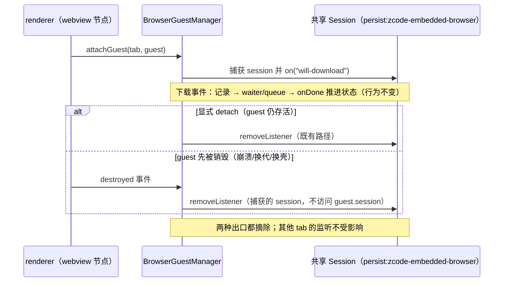

# 内置浏览器下载监听的所有权生命周期

## 范围与所有者

- `BrowserGuestManager`（packages/desktop/src/main/browserView/browserGuestManager.ts）拥有每个 tab 的下载跟踪：`setupDownloadTracking` 在 guest attach 时把 `will-download` 监听挂到 `guest.session` 并生成 `tab.downloadCleanup`。
- 关键事实：内置浏览器全部 tab 共用同一个持久 Session（`persist:zcode-embedded-browser`，见 packages/ui/src/browser-use/BrowserViewportSurface.tsx 的 webview partition 与 packages/desktop/src/main/browserDataManager.ts 的 `EMBEDDED_BROWSER_PARTITION`）。`will-download` 监听挂在 Session 上，不随 guest（WebContents）销毁而释放。
- 因此 `detachGuest` 摘除下载监听不能以 `guestDestroyed` 为前提：guest 先被销毁（renderer 崩溃、webview 换代、挂起换壳卸载）时也必须摘除，否则监听在同一共享 session 上随 tab 崩/换代线性累积，且每次下载事件都会遍历全部陈旧监听。
- `setupDownloadTracking` 在 attach 时捕获 session 对象，cleanup 闭包只引用已捕获的 session：已销毁 guest 上再访问 `guest.session` 会抛 "Object has been destroyed"，捕获后摘除不依赖 guest 存活。
- 不改动其他监听（activity/crash guard/dialog/CDP message）的 `guestDestroyed` 守卫：那些监听挂在 guest 自身，随对象释放，守卫是既有正确行为。
- 不改变下载业务语义：`will-download` 记录、`waitForEvent(download)`/`downloadPath` 命令、`onDone` 状态推进、residency 统计均保持原状。

## 事件顺序

## 验收与安全边界

- 回归：packages/desktop/src/main/browserView/browserGuestManagerLifecycle.test.ts 追加定点用例（保留既有 6 个场景）；外层入口 scripts/ci/browser-download-listener-lifecycle.test.mjs 经项目沙箱执行 vitest 并断言计数。
- 覆盖：guest 已销毁且 guest.session 访问抛错时仍能摘除已捕获 session；N 个 guest 在同一共享 session 上轮换后 will-download 监听归零；其他活跃 tab 的监听不被误摘；正常 download/onDone 经生产命令路径仍生效；重复 detach 幂等；guest 存活时显式 detach 仍摘除（守护既有路径）。
- 测试只使用生产 manager + fake Electron（vi.mock("electron") 仅提供 webContents.fromId）与 EventEmitter，不启动真实 Electron/浏览器，不读写真实数据。
- 红灯先行：旧实现（guestDestroyed 时跳过 downloadCleanup）下新增用例失败；修复后全绿。

## 验证结果

- 红灯（旧实现）：vitest pass=8 fail=5；失败的 5 项为新增所有权用例（destroy 前 detach、session 访问抛错、轮换归零、其他 tab 监听保留、重复 detach 幂等）；「正常 download/onDone」与「guest 存活时显式 detach」在旧实现下即通过（业务行为与既有守卫路径未变），计入 8 项通过。
- 绿灯（修复后）：node .run-logs/performance-rescan-exec-20261031.mjs browser-download-listener-green node --test scripts/ci/browser-download-listener-lifecycle.test.mjs，vitest pass=13 fail=0 exit=0（既有 6 项 + 新增 7 项），wrapper 1/1 通过。
- 计数均在真实生产方法上观测（session.listenerCount("will-download") 与 owner.execute 的生产命令路径），未复刻实现逻辑。
- 未验证范围：未启动真实 Electron/浏览器；未做真实 tab 长会话内存测量；未运行手机/桌面 E2E。
