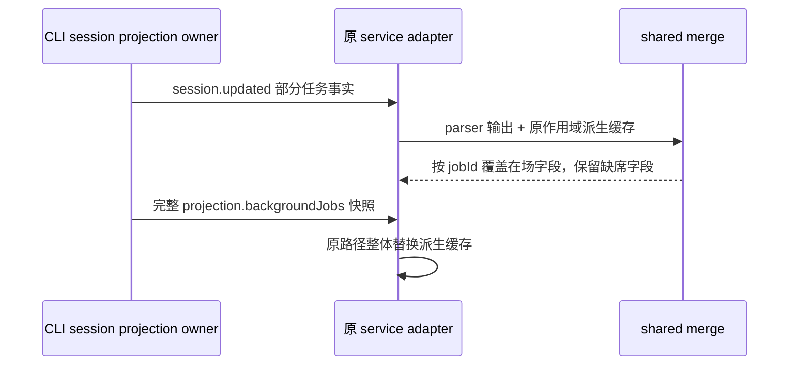

# 后台任务合并与任务状态投影扫描（第 5 轮）

## 范围与所有者

- 本轮只审查 `packages/shared/src/background-task-control-merge.ts` 和 `packages/shared/src/zcode-session-task-status.ts`。
- 后台任务事实的唯一所有者是 CLI runtime 的 session projection（`SessionProjection.backgroundTasks`）。服务层 `backgroundTaskControlsByTaskKey` 只是为旧 task 流派生缓存，快照与事件都来自该 projection；共享合并函数不新增事实、队列或持久化状态。
- 任务状态事实的唯一所有者也是 CLI runtime session projection。`deriveZCodeTaskStatusFromSessionSnapshot` 只把协议快照派生成旧的 `ZCodeTaskPersistStatus`，不产生第二个任务状态源。

## 后台任务合并边界

- 同一输入数组内按首见顺序去重；`updates` 覆盖同 `jobId` 的既有项，新项追加到尾部。
- `session.updated` 里的 background task 载荷是 CLI reducer 的部分更新事实：`BackgroundTaskUpdatedPayload` 的字段多为可选。旧栈把该载荷解析成共享 item 后交给 merge，因此 merge 对同 `jobId` 不得把 `updates` 中缺席的当前字段抹掉。
- 共享 item 没有显式 clear 通道；`undefined` 与字段缺席表示“本次更新没有携带该字段”，不表示清空。这沿用 CLI reducer `mergeBackgroundTask` 过滤 `undefined` 的既有契约。
- merge 不因 `updates` 中缺少其他 job 而删除它们；完整快照替换由调用方已有的 `projection.backgroundJobs` 路径负责。
- 终态（completed/failed/killed/lost）只在后续协议更新明确覆盖同一 `jobId` 时改变；没有事件序号或 stale 标记，merge 不自行推断过期。

## 任务状态投影边界

- 优先级保持既有行为：`projection.lastError` 先派生 `error`；session 终态 `error`/`completed` 次之；然后才是活跃 runtime 与已完成 assistant turn 的收口判断。
- `runtime.activeTurnId`、`runtime.activeTurnKind`、待处理权限、pending/running 工具调用是阻塞运行态事实。session 状态为非终态且存在阻塞事实时，应直接派生 `running`，不得为了排除 completed 收口先扫描全部可见历史。
- 已完成可见 assistant turn 只在无阻塞 runtime 时可以派生 `completed`，用于修正旧投影残留的 `currentTurnId`。

两条输入均来自同一 projection owner。scope、workspaceIdentity、remoteSessionId 与事件路由由原 adapter/Host 维护，本 helper 不新增接受队列或自行裁定迟到事件。

## 验收

- 新回归经项目内固定 Node、runSourceTests 和 project-test-sandbox 运行，不写真实 HOME、`.zcodium` 或系统临时目录。
- 回归覆盖：部分更新保留当前字段且不把 `undefined` 当 clear；新 job 追加；状态投影在存在阻塞 runtime 时避免读取可见消息集合，同时保持 error/completed 优先级。
- 修复前回归红灯：4 个 source tests，2 个通过、2 个失败，分别证明同 `jobId` 字段被稀疏 update 抹掉和阻塞 runtime 仍扫描可见历史。
- 修复后回归绿灯：5 个 source tests 全部通过；`architecture:check --changed` 为 0 violations / 0 baseline / 0 new。完整 typecheck 和 root lint 由父代理统一执行，本轮未宣称其结果。
