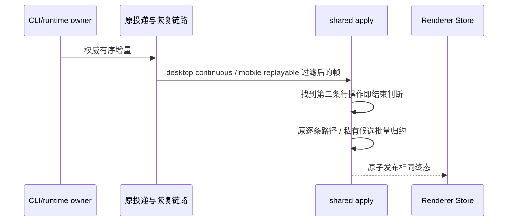

# 第三轮：会话批量增量的预扫描工作量

## 证据与规则

`applyConversationDeltas` 被 CLI ProductProjection 和 Renderer ConversationProjectionStore 共用。当前入口用 `deltas.filter(rowOperation).length > 1` 选择私有批量归约：只需知道是否存在两条行操作，却先扫描整帧并分配包含全部行操作的临时数组。长恢复帧与流式行批次因此多做一次完整预扫描。

判断在找到第二条行操作时立即结束，不收集行操作。零条和一条行操作仍走原不可变逐条路径；多条行操作仍只建立一份私有 accumulator，整帧完成后发布。空帧、未知行、rewind、状态更新、workflowRuns、live-only 通知及其顺序保持原契约。

## 所有者、接口与边界

CLI/runtime 持有会话事实、权威事件序列与恢复日志。共享 `applyConversationDeltas` 只在一次调用内派生候选快照，Renderer 继续由原 Store 持有订阅投影。公开签名、schema、seq/ACK、owner/lease、workspaceIdentity、持久化与失败语义不变；不增加缓存或另一条写入路径。

## 验收与测试写入边界

- 冻结输入，对 append/upsert/text/input/remove/state/workflow/live-only 交错序列，分别经两种 delivery profile 比较批量与逐条规范归约。工具输入定稿行必须收口手机过滤掉的 inputText delta。
- 零/一条行操作保留原引用与不可变路径；多条未知行不发布无意义快照，已加载的未改行保留引用。
- 用通过公开 schema 的 500 条真实文本增量 Proxy 统计判别字段读取量；两条行操作位于帧首时，预判只读前两条，而后续完整归约仍逐条执行。旧实现在该夹具读 2,500 次 `op`；新预算不高于 2,002 次。不设耗时阈值。
- 新回归为内存计算，导入真实 TS 入口；只通过 `runSourceTests` 和 `project-test-sandbox` 在当前项目内运行，HOME/TEMP/日志指向新建沙箱，不联网、不启动 Host/Electron 或真实模型。
- 先记录扫描预算失败，再修改实现；执行相关既有 DeltaBatch/Coalesce 回归和根 typecheck/lint/changed architecture。真实设备性能未验证。

## 扫描中保留的既有协议决策边界

`performance-round4-conversation.md` 已记录显式 `workflowRuns: undefined` 与整键浅合并的次序问题。JSON wire 会省略 undefined，而内存 Object.assign 会写入它，统一该第三态需要明确协议规则；本次预扫描优化不改变该行为，不把旧算法对照通过写成这个设计问题已修复。普通 owner 产出的完整 workflowRuns 更新和正常状态屏障仍按现有契约验证。

## 执行结果

固定 Node 24.14.0、项目内隔离运行 `scripts/ci/bug-scan-conversation-delta-batch.test.mjs`：修改前 9 项中 8 项通过、扫描预算 1 项失败，500 条增量读取 `op` 2,500 次；修改后 9 项全部通过，读取 2,002 次，且不再分配预筛选数组。两种 profile 的混合终态、工具输入收口、未知行及输入冻结检查通过。根门禁与相邻既有回归由五轮汇总记录，尚未执行真机性能或 Host 联调。
