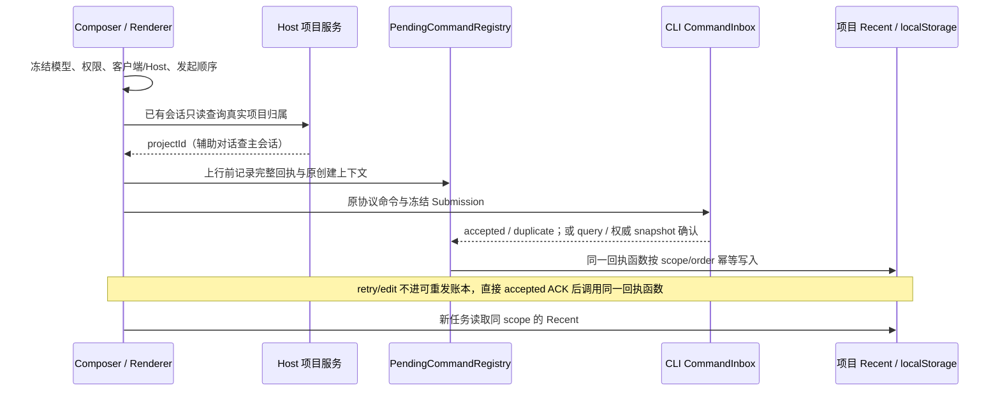

# Composer Recent 项目作用域回归修复

状态：2026-11-05；已实现并通过工程检查；恢复 [项目草稿生命周期](../ui/project-task-draft-lifecycle.md) 已规定的行为，完整桌面/手机 E2E 尚未验收。

## Feature Summary

| 项目     | 决定                                                                              |
| -------- | --------------------------------------------------------------------------------- |
| 用户目标 | 成功发送所选模型与权限后，新会话继承；检查相邻持久化与恢复路径                    |
| 改动层   | draft-default、persistence、recovery；不改变候选目录或 CLI admission              |
| 模式     | planning / implementation-handoff                                                 |
| 源码种子 | SessionPane.dispatchCommand、composerRecent、newTaskDraft、pendingCommandRegistry |
| 范围外   | 自动化/Subagent 默认值、模型 API、数据库迁移、安装包发行                          |

## 根因与接口

`85866798` 合并后，新草稿读取 `zcode-composer-recent:v2:[clientNamespace,hostId,projectId]`，
发送仍调用未传 scope 的 `captureComposerRecentSubmission`，写旧 workspace key。
`prepareComposerRecentReceipt` 没有生产调用方，命令账本的 Composer 接纳路径因而没有回执可消费。
这同时使 ACK 丢失后的 query/snapshot 接纳无法恢复 Recent。

恢复既有 `prepareComposerRecentReceipt → PendingCommandRegistry → acceptPendingComposer`。
可重发输入由命令账本结算；retry/edit 不进入该账本，明确 accepted 时仍调用同一回执函数。
`acceptComposerRecentReceipt` 是 Recent 的唯一生产写入函数，不再另用 accepted 回调写旧 key。
不修改业务数据根，不从旧 workspace 偏好猜项目或迁移真实用户数据。

## UI Surface Matrix

| 场景 / UI                  | 草稿与默认来源                         | 校验 / 提交                                         | 权威与落点                                        | 隔离                       |
| -------------------------- | -------------------------------------- | --------------------------------------------------- | ------------------------------------------------- | -------------------------- |
| 项目新任务 / SessionPane   | Composer，项目 Recent / Host preferred | 现有 View 门禁、createSession 首输入或预热 sendText | Host 提供项目；客户端保存 Recent                  | 客户端 + Host + 项目       |
| 已有会话续发 / SessionPane | 当前 Composer 选择，不采用运行中旧模型 | sendText / 用户 Goal Submission                     | Host resolveSessionDirectories 查询真实 task 项目 | 同目录项目不串值           |
| 辅助对话续发 / SessionPane | child Composer                         | 命令仍发 child；归属查 root 主会话                  | 同一项目 Recent                                   | 普通会话 / fork 查自身     |
| 查询、快照、duplicate 恢复 | 原命令持久上下文                       | 账本核实接纳                                        | 同一回执幂等结算                                  | 导航变化不改变 scope       |
| 桌面与手机                 | 共享代码，各自本地存储                 | desktop-continuous / web-remote-replayable          | CLI 仍为同一 admission owner                      | namespace / 稳定 Host 隔离 |

## Shared And Divergent Behavior / State Owners And Commit Sinks

模型和 reasoningLevel、权限 mode 属于同一完整提交元组。Composer 唯一持有未发送选择；
Host 唯一持有项目组织态；CLI CommandInbox 唯一接纳输入；Renderer 回执函数唯一写入 Recent，
可重发输入的 ACK/query/snapshot 结算归 PendingCommandRegistry；retry/edit 沿用直接 ACK 边界。
自动化、Subagent、Provider Config 自有默认值，不消费或写入 Composer Recent。
文字草稿与 Recent 不合并：已初始化或有文字草稿仍保留自己的选择，Plan 不继承到全新任务。

## Feature Relationships / Must-Preserve Invariants

| 等级           | 关系                                                         | 要求                                           |
| -------------- | ------------------------------------------------------------ | ---------------------------------------------- |
| must-inspect   | Composer → dispatch → pending ledger → Recent → newTaskDraft | 写读同一 scope，真实用户 Submission 接纳后更新 |
| must-inspect   | 真实 session → Host 项目服务                                 | 不用 draftProjectId 或 cwd 猜已有会话的项目    |
| must-inspect   | ACK / query / authoritative snapshot → 同一回执              | 失败不更新；重复不回退；迟到旧提交不覆盖新提交 |
| should-inspect | 新建 / 已有 / 辅助 / fork                                    | 新建用冻结的创建归属；辅助查 root；fork 查自身 |
| invariant-only | 模型目录 / 自动化 / Subagent / 队列                          | 不变更各自选择与执行配置，不增加 accepted 队列 |

## 事件顺序与幂等边界

顺序必须在任何异步归属/上下文查询前冻结；query 或刷新后恢复仍沿用原 order。
重发入口已传递原 clientContext，修复后继续保留其中的 scope/order，不重新制造最新偏好。
项目查询失败遵循现有发送错误边界，不降级到另一个项目；不通过超时猜归属。
桌面和手机只共用客户端结算代码，不改变订阅、租约、连续/可回放流或远端身份协议。

## Codegraph Evidence / Graph Drift Candidates / Graph Delta

codegraph 工具不可用；使用精确调用检索与真实 callback/模块回归替代，深度为提交的一跳与接纳的一跳。
功能图已声明 Composer 冻结 Submission，但缺少接纳后的项目 Recent 落点；本次补充该节点与边。
其他候选：无证据认定 Provider Config、自动化或 Subagent 有同一错误；不扩大修复。

## Clarification Log / Boundary Decisions / Domain Scope

本次行为由用户要求与既有项目生命周期 spec 确定，无新增产品设计裁决。
包含 draft-default、组织归属、持久回执；外观叉乘、真实模型套餐、数据库及安装包均剪枝。
权限以 build / guarded / yolo 为代表，模型以同 Provider 两个模型与 reasoningLevel 为代表。

## Accepted Cases / Candidate Combinations / Matrix Backfill

| ID   | 前置与操作                                              | 必须断言                                                                       | 证据                                   |
| ---- | ------------------------------------------------------- | ------------------------------------------------------------------------------ | -------------------------------------- |
| CR01 | 项目首发 B + guarded，被接纳后新建                      | 新草稿为 B + reasoningLevel + guarded；不写旧 key                              | 真实 dispatch + 模块；Desktop I74 扩展 |
| CR02 | 已有会话属 P，草稿导航为 Q，切 B 续发                   | 只更新 P；同目录 Q 不变；命令仍发原 session                                    | callback + 原模块；已有 P/Q E2E        |
| CR03 | ACK 丢失，账本刷新后 query / snapshot 确认              | 原 scope/元组被结算；没有二次上行                                              | 原账本与内存存储                       |
| CR04 | 早发 A 的归属查询 / ACK 晚于 B                          | 已接纳 B 不被 A 覆盖；duplicate 幂等                                           | 显式 deferred callback / 原账本        |
| CR05 | failed / rejected / provider 未就绪；无 Submission 预热 | Recent 不变；菜单与历史浏览也不更新                                            | 原 dispatch / 已有用例                 |
| CR06 | 辅助 child 与普通 fork                                  | 辅助查 root 项目；fork 查自身；上行 sessionId 不改                             | callback                               |
| CR07 | 同路径不同远端、desktop/mobile namespace                | scope 隔离；不同 Host/客户端记录不串值                                         | 原模块                                 |
| CR08 | 已有文字草稿 / Plan                                     | 不覆盖文字草稿配置；全新任务 planEnabled=false                                 | 原初始化与已有 E2E                     |
| CR09 | E2E 预置偏好与诊断快照、分享导入组件夹具                | 预置写当前项目 v2 key，保留权限/order；诊断包含 v2；组件夹具也使用 scoped 回执 | 实际 helper 内存执行与组件夹具         |

目录：新增工程回归置于 scripts/ci，不恢复退役 App 业务单测；扩展现有正式 E2E 的场景，不自动晋级新 case。
Coverage matrix 本轮结果以实际运行 artifact 为准；工程验证不写成真机或全量验收。

相邻排查发现 `upstream-provider` 的预置与 `conversation-session-store-snapshot-script` 的诊断
仍只访问旧 key，`share-import-selection` 组件夹具也未传 scope；这三处为测试代码，不能据此推断
还有其他生产写入故障。本轮对齐预置和诊断，防止新回归遗漏实际 v2 状态。

## Unresolved Questions / Planning Handoff / E2E Handoff Notes

无待用户回答的语义问题。测试只写当前工作树，使用 project-test-sandbox 审查真实路径与子进程环境；
无法证明写入范围的 GUI 流程不执行。复用 composer-recent-mode case 的受控回放与既有 fixture；
不触发 GitHub 构建、不提交、不推送。

## 本轮验证

最终工程验证使用项目内已缓存的 Node 24.14.0（与 `mise.toml` 一致）和 corepack pnpm 10.33.2，
HOME、TEMP、应用数据及日志均指向当前树的新隔离目录；未使用真实业务数据。

- 新工程回归 21/21 通过，执行真实 dispatch、提交配置提取、Recent、草稿初始化、命令账本及测试 helper。
  日志：`.run-logs/project-only-validation/source-tests-3ajy5T/logs/source-tests.log`。
  同批相邻创建上下文、Root 草稿和模型选择 21 项通过；外层 TAP 22/22，其中一个 wrapper 内含上述 21 项。
- CR09 基线为 18 passed / 3 failed，失败断言直接证明预置写错 key、诊断漏 v2；修复后为 21 passed / 0 failed。
  基线日志：`.run-logs/project-only-validation/source-tests-oz5M28/logs/source-tests.log`。
  核心问题已以源码与内存执行定位；最初含 deferred 的全套 red 运行被取消，不作为完整基线结果。
- `corepack pnpm typecheck`、`corepack pnpm lint`、`corepack pnpm architecture:check --changed` 通过。
  日志分别位于 `composer-root-typecheck-PifTbQ`、`composer-lint-l4mWMu`、`composer-architecture-nUbJKP` 的 `logs/`，
  均在 `.run-logs/project-only-validation/` 内；Lint 0 warnings / 0 errors，架构 0 violations。
- 独立 `corepack pnpm --filter @zcode/desktop typecheck:e2e` 通过，
  日志：`.run-logs/project-only-validation/composer-typecheck-s1w7vt/logs/typecheck.log`。
  最初子命令误选另一 pnpm 的失败已通过固定项目缓存和命令 shim 后复验；不计为源码类型失败。
- 正式 E2E fixture 检查通过（`composer-fixture-USM8jl/logs/fixture.log`），保留 7 个既有 PD marker warning；
  本轮没有新增这些 marker，也未把未发送文字 marker 当作成功模型回放证据。
- 功能图 YAML 解析通过，新节点与两条边均存在，无重复节点、无新增或既有悬空边。
- 本轮改动文件的格式检查通过，`git diff --check` 通过；未将全仓格式检查列为已执行。
- Desktop `I74/I75` 定向重跑在启动准备阶段失败：Electron `path.txt` 缺失，runner 自动安装也未完成。
  日志：`.run-logs/project-only-validation/composer-e2e-snufQq/logs/e2e.log`。交互断言一项也未执行，不能记为 E2E 通过。
- 分享组件的 Recent 390/1200 两项定向浏览器验证未执行到页面：本机 Chrome 远程调试启动拒绝，
  日志：`.run-logs/project-only-validation/composer-browser-9QcCnj/logs/browser.log`。
  相关生产接口及 E2E helper 已通过工程与类型检查；此 UI 夹具未执行到页面，不宣称浏览器回归通过。
- 实体手机、真实远端 Host、完整桌面交互均未验收；没有触发安装包构建、提交或推送。

依赖预检曾因定制的 `electron/index.js` 自动触发安装下载，发现后已停止；随后确认本地
存在 executable、但 `path.txt` 缺失。未审计初次预检可能涉及的默认外部缓存，不宣称该次预检
完全没有项目外写入，也未清理任何项目外缓存。后续验证使用上述显式隔离环境。
