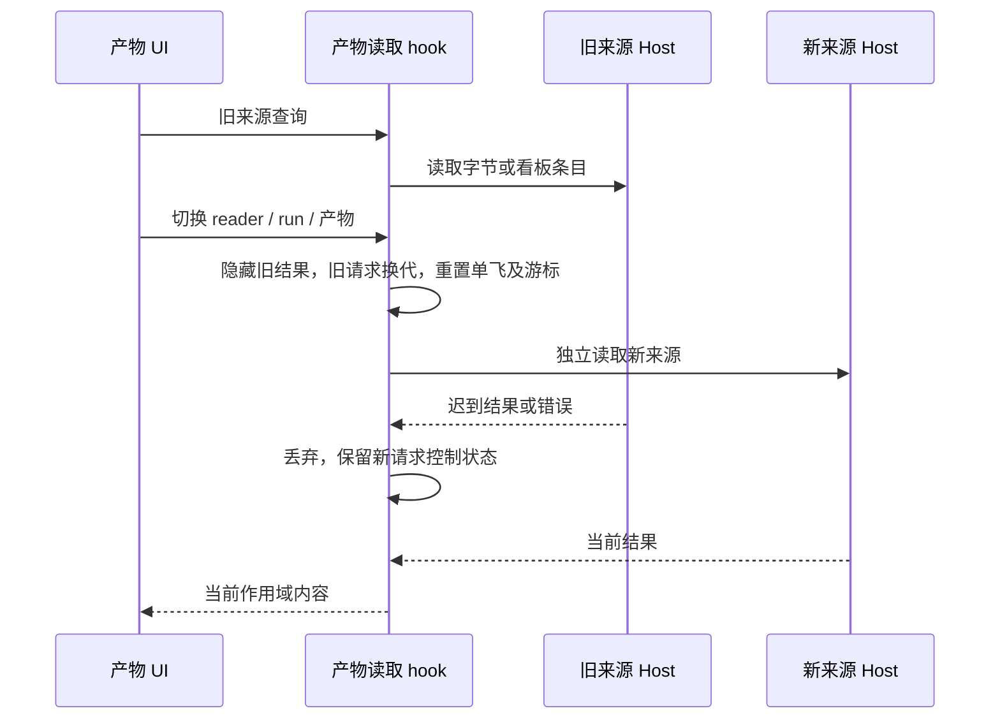
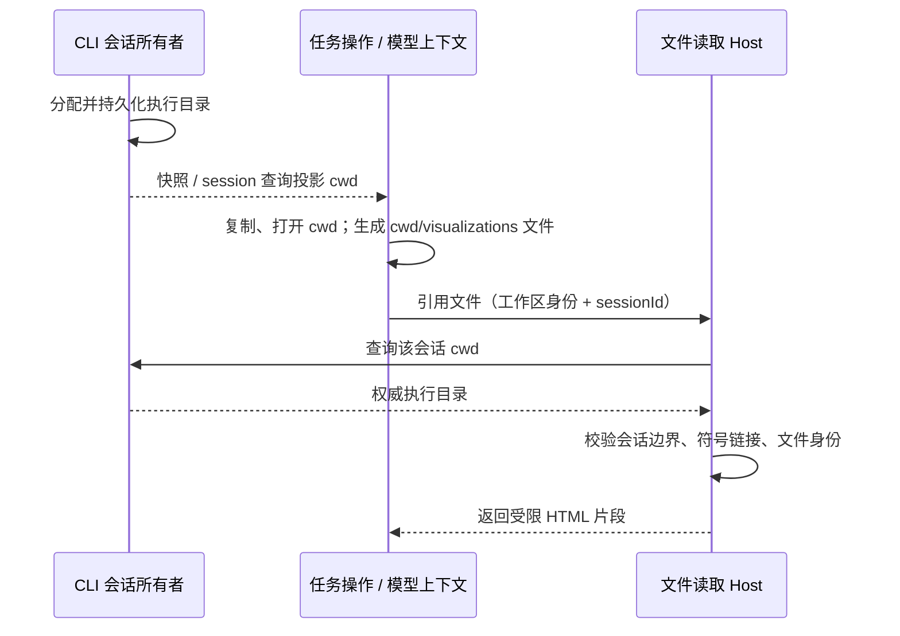
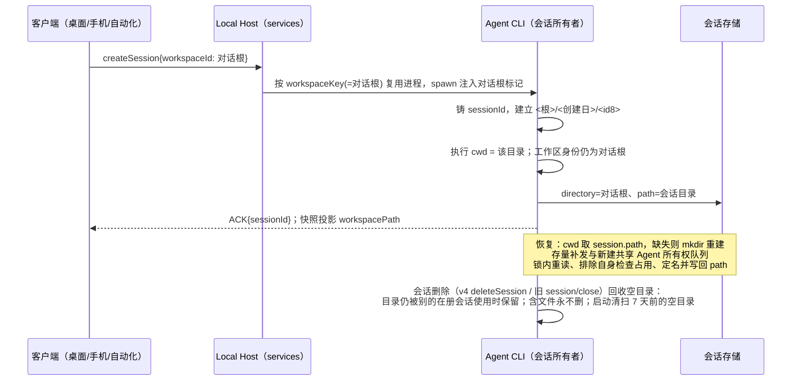
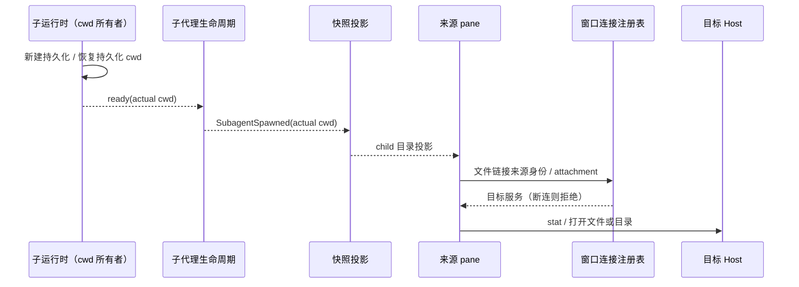
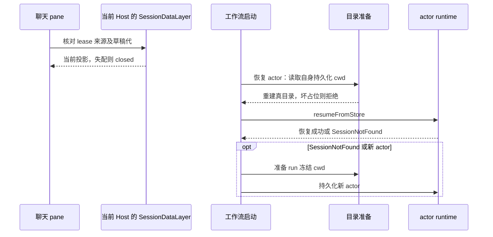
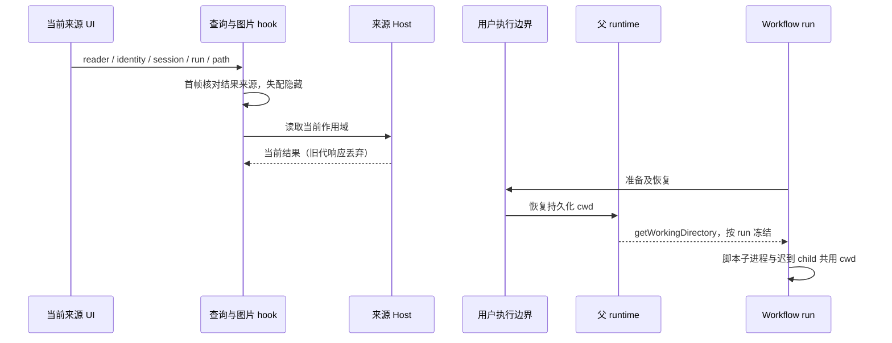

# 对话会话独立工作目录

## 背景与目标

未指定项目的会话（对话工作区）当前共用 `getConversationWorkspaceDir()` 返回的
`~/.zcodium/workspace/default` 作为 Agent 执行 cwd（`packages/services/src/paths.ts`）。
并行会话因此互相看见对方的临时文件、脚本产物与工作区条目。

本规范把「执行 cwd」从「工作区身份」中拆出来：每个对话会话拥有独立的真实目录，
而对话工作区的身份（tab 路径、`workspaceKey`、任务索引键、工作区级配置根）保持为
`~/.zcodium/workspace/default` 不变。

目录布局（`<对话根>` = `~/.zcodium/workspace/default`，日期为会话创建日的本地日期）：

```
<对话根>/2026-10-11/a1b2c3d4/
```

- 目录名 = `sess_<uuid>` 形态会话 id 的 uuid 段前 8 位，不含随机串。其它 id 形态
  （子代理 / workflow 子会话的 `sess_subagent_*` / `sess_workflow_*`、导入历史的显式 id）
  的前缀没有区分度，取 id 稳定哈希的前 8 位——否则同一天的所有同类子会话会挤进同一个执行目录。
- 定名对同一会话**幂等**：`<日期>/<id8>` 已经是**目录**、且不被**别的在册会话**占用时一律复用它
  （第二次解析看到的是自己的目录，不是碰撞）；被别的在册会话占用（同日两个会话 id 撞前 8 位，
  量级 2^-32）、或 8 位路径被**非目录**占住时回退 12 位。占位的失败形态按类型不同：同名**普通
  文件**或**悬空链接**会让 `mkdir` 报 ENOTDIR/ENOENT（确定性失败），指向别处的**活链接**则会让
  `mkdir(recursive)` 跟随链接成功——把目录建到对话根之外（词法包含判定仍说"在根内"，回收与清扫
  都拒绝这种中间链接）。因此这里的判据必须是 `lstat` 语义、不跟随链接。
  结果随会话持久化，之后不再重算。「占用」事实来自 CLI 进程内的会话注册表与会话库
  （含归档，按 sessionId 排除本次会话自己）——**只对别的会话成立**，因此
  写库失败后的重试、并发冷恢复、带 sessionId 的导入二次创建都仍复用同一个名字，不会换名把
  前一次目录里的文件变成孤儿（这是本规则的第一优先级）。

## 产品规则与所有者

| 状态                                 | 唯一所有者              | 访问方式                                               |
| ------------------------------------ | ----------------------- | ------------------------------------------------------ |
| 会话执行 cwd、目录创建/补发/重建     | Agent CLI（会话所有者） | 会话创建与恢复边界；Host 不代建、不代算                |
| 「哪些 workspace 是对话根」这一事实  | Local Host（services）  | spawn 时注入 `ZCODE_CONVERSATION_WORKSPACE_ROOT`       |
| 对话工作区身份（tab/key/任务索引键） | 现有 Host 与 UI，不改   | 仍为对话根路径；本地不引入 `workspaceIdentity`         |
| 会话 cwd 的对外投影                  | CLI 写、UI 只读         | conversation snapshot 的 additive 字段 `workspacePath` |
| 文件树/提及/终端/文件搜索的归属目录  | UI（只消费会话 cwd）    | 会话已绑定时用会话 cwd，否则回落 tab 的 workspacePath  |
| 会话目录的空目录回收                 | CLI（会话删除边界）     | 只删空目录；非空目录永不自动删                         |

规则：

1. 新建对话会话（含 pane 草稿预热、手机 replayable 首发、自动化与定时派发）在
   `<对话根>/<创建日>/<会话id前8位>` 建立目录，该会话的 Agent 执行 cwd 即此目录。
   导入历史会话的「创建日」取记录自带的历史时间（与 sqlite `time.created` 同源）。
2. 会话持久化区分两个路径：`directory` = 工作区键路径（对话根，冷启动列表与分组依据），
   `path` = 会话执行 cwd。本地 `workspace_id` 保持为空，不把对话根写成身份。
3. 恢复会话时执行 cwd 取持久化的 `path`；目录缺失则按同一规则重建（mkdir 幂等）。
   名字里的日期只用于整理与可读性，恢复不从名字反推，因此草稿跨零点不受影响。
   创建/恢复/fork 都会刷新会话目录 mtime：启动清扫的年龄门禁是「空且 7 天没人动过」，
   而 `mkdir` 对已存在的目录不改 mtime，不刷新就会删掉"只用对话、没写过文件"的在用目录。
   重建必须盖住**两条恢复边界**（第十一轮补齐）：协议路径的重建在 server-operations 的
   创建/复用/补发/降级分支；裸 CLI/TUI（`zcode --resume` / `--continue`，与桌面 app-server
   同一个会话库，不经过 createRecord）过去只赋 cwd 不建目录——本特性把 `path` 从「Host 每次都
   保活的对话根」变成了可被回收/可被手工删除的叶子目录，这条边界漏掉会让首个 Bash 即 spawn
   ENOENT。bootstrap 的 `resumeFromStore` 包装器在 `runtime.resumeFromStore` 之前调
   `ensureConversationSessionDirForBareResume`（读行、只对「本规则铸造的会话目录」动手、
   过规则 8 的两层门禁、失败只记稳定 warn 不阻断），core 业务层不碰 fs。
4. 存量会话（`path` 仍为对话根）在首次恢复时补发目录，日期取该会话自身的创建日；
   补发只发生一次，随后随会话持久化。补发后该会话在对话根遗留的旧文件不再出现在其工作目录。
   补发写库失败时回退旧行为（`cwd = workspacePath`）且**不回收**刚建出的目录：`stat` 与 `mkdir`
   之间不原子，「我查看时它不存在」不等于「它是我建出来的」，跨进程并发冷恢复时回收会删掉另一个
   进程刚建出的空目录（它下一次相对写入即 ENOENT）。残留空目录无害：定名对同一会话幂等（同名真
   目录一律复用），下次恢复仍补发到同一个 8 位名；真没人要的空目录由启动清扫的 7 天门禁兜底。
5. 会话内派生的侧会话与 fork 继承父会话的执行 cwd，不回落对话根。fork / 侧会话的「继承」写在
   宿主侧（`resolveConversationSessionWorkspaceInherited`，见接线契约）；进程内的**派生 live 子会话**
   （subagent child / workflow actor）没有 record 时按 spawn 捕获的子执行目录投影；旧事件缺席
   该字段时才按父 record 回落（见规则 17 与边界 27）。
6. 项目工作区会话与 CLI/TUI 独立运行不受影响：没有标记即沿用旧行为（cwd = workspacePath）。
7. 明确不做：给本地工作区引入 `workspaceIdentity`；每会话一个 workspace tab 或
   `workspace_key` 分桶；迁移或重命名对话根下已有文件；修改任务索引、checkpoint、
   automation、手机远控的键（conversation-share 的安全边界键也不改，只有引用解析根按规则 11
   两分）。
8. 回收只针对空目录：会话被删除时若其目录为空则删除（含因此变空的日期目录）；
   Agent CLI 在 app-server 启动时清理 7 天前**且 7 天内没被创建/恢复/fork 碰过**、**且不在会话库
   `path` 集合里**的空目录（宿主不代算、不代建会话目录）。清扫只认**本规则会产生的目录名形状**
   （8 位或 12 位小写十六进制），日期目录下的其它名字（用户自己建的 `notes/` 等）一律不碰。任何含文件的会话目录不自动删除。目录仍被别的在册会话使用（fork / 侧会话继承父会话
   执行 cwd）时一律不回收，否则删父会话会拆掉存活子会话的工作目录。两条删除入口（v4
   `deleteSession` 与旧 `session/close`）都必须回收。**「别的在册会话」包含别的进程里的会话**
   （第十轮修）：同一对话工作区开两个窗口（各自一个 window-scoped Local Host）时，A 窗口 fork
   的子会话继承父执行 cwd 并把行写进共享 sqlite，B 窗口删父会话时进程内注册表看不到那条子会话
   ——删除边界必须像启动清扫一样查会话库（`isConversationSessionDirectoryInUseAcrossProcesses`：
   注册表命中、或查库失败 / 端口缺席 / 返回非行数组 ⇒ 一律视为在用 = 保留空目录；被关会话
   **自己的行必须排除**，v4 `deleteSession` 是 close 语义、行留在库里，不排除就永远回收不了）。
   复检**惰性传入**（`resolveSharedByOtherSession`）：只有判定链（启用 + 形状 + 所有权）全部通过、
   真的要 `rmdir` 之前才查库——项目工作区 / 远端 / 未注入标记的宿主每次都必然被拒，急切求值会让
   每次 `session/close` 白跑一次全表 `listSessions`（与清扫「未注入标记零 IO」同一原则）。
   跨进程比较的行侧也必须 `realpath` 对称（第十一轮修）：比较用「折叠大小写后的 resolved 形态」
   做廉价预筛，预筛未命中时**逐行懒算规范 key**（与清扫侧收在册集合同源）再比对——预筛 miss
   既可能来自行侧拼写也可能来自目标侧，不能只看目标侧决定要不要 realpath；目标拼写规范、而行是
   链接形态（`/var` vs `/private/var`）时纯词法比较全 miss，短路行侧 realpath 会把别的进程仍在
   使用的空目录判成「不在册」删掉。正常路径预筛即收口，每次删除仍只多一次 `listSessions`。
   启动清扫必须**先取得会话库的在册路径集合再动手**：查库失败、返回值不是行数组、或装配处没给
   存储端口时，整个清扫放弃（fail-closed），绝不静默退回「只按年龄删」——年龄只是本进程能看见
   的事实，别的 CLI 进程里仍在使用的空目录会话只能靠库里的 `path` 认出来。
   破坏性判定必须**恰好是布局本身**：`<对话根>/<YYYY-MM-DD>/<名字>` 两层（深度与日期父目录
   都校验），且日期父目录必须是 `lstat` 意义上的真目录——包含判定全是词法的，`rmdir` 会跟随
   中间符号链接，用户把 `<根>/<日期>` 换成指向外部的链接时删的就会是对话根之外的目录。
   创建侧的同一判据必须**提前到两层**：`<根>/<日期>` 或**会话目录自身**（末段）被文件/符号链接
   占位（含悬空链接）时不铸目录、不复用、不跟随链接，该会话退回旧行为 `cwd = workspacePath`，
   绝不因为用户在那个位置放了一个同名文件就让当天所有会话创建失败、或让某条存量会话永远打不开
   （那个文件属于用户，不删、不修）。判据只有一份（`classifyPersistedConversationExecutionPathUnusable`，
   从日期目录到持久化 cwd 逐层 `lstat`，见边界 35），创建侧复用门禁、恢复复用分支与三处降级日志都读它。
   末段这一层的漏判后果与日期目录同构：普通文件 ⇒ `mkdir` 报 EEXIST（该会话每次打开都失败）；
   符号链接 ⇒ `mkdir(recursive)` 跟随成功，会话跑在对话根之外而回收与清扫都不认它。
   这份逐层判据也必须盖住**常驻恢复的 mtime 刷新**（第十一轮修）：touch 的幂等 `mkdir` 同样会
   跟随活链接，常驻早退分支（命中注册表、不经补发/复用门禁）若只做词法包含判定就直 `mkdir`，
   是复用门禁之外的漏网入口；占位（文件/链接）时静默跳过 touch，不铸目录、不告警——
   该分支不做 cwd 裁决，mtime 略旧只影响清扫年龄门禁的读数。
   这条降级**必须落盘**：core 的冷恢复只认库里的 `path`（`resumeFromStore` 用
   `session.path ?? session.directory`），只把裁决留在内存里会让 runtime 继续在坏掉的会话目录
   （不存在，或经链接落在对话根之外）里跑，而 UI 快照已回落对话根——两边分叉。因此恢复/派生边界
   要复用补发的同一条落盘机制把 `path` 写回工作区键路径（写回后该行回到存量形态：日期目录恢复
   可用后按**同一个 8 位名**补发，不搬目录、不丢文件）。
   调用方的兜底也必须与「规则是否适用」绑定：`undefined` 在规则**不适用**时才是「沿用持久化
   `path`」的信号（未注入标记的旧宿主 / 回滚态，core 反正只用库里的 path），规则**适用**时它的
   含义是「解析被拒」，此时再兜回 `session.path` 等于把本条裁决丢掉（`mkdir` 报 ENOTDIR 或跟着
   链接把目录建到对话根之外）。唯一实现是 `resolvePersistedConversationExecutionFallback`。
9. CLI 中「workspace 级配置」读点（plugins 配置、hooks 发现与信任、skills/commands、MCP 工程
   配置、workflow 定义与草稿）必须使用**工作区级根**而不是执行 cwd，否则对话会话的 workspace
   级插件与 skills 静默失效。工作区级根 = 有 `workspacePath` 时的工作区键路径，CLI/TUI 独立运行
   没有 `workspacePath` 时是**当前执行 cwd**（改动前这些读点用的就是它，`cd` 之后必须继续跟随；
   `workspaceScopeRootOf` 冻结的是另一件事：项目身份与项目记忆根不得随 `cd` 漂移；MCP 连接身份
   在有 workspacePath 时按工作区隔离，没有时保留当前 cwd 的旧语义）。Hook 的**执行** cwd
   与 `CLAUDE_PROJECT_DIR` 反过来是模型当前 cwd（hook 脚本作用在
   模型正在编辑的目录上），只有发现与信任根是工作区级。
10. 文件搜索的忽略规则文件不再自动写入会话目录：对话会话以对话根作为规则根，
    复用根上的 `.zcodiumignore`。
11. **「模型写的相对路径」只有一个解析根：会话执行 cwd**。凡是展示或读取模型产出/工具入参里的
    路径，都必须按会话执行 cwd 解析；工作区键路径只承担身份与作用域（分享的安全边界、
    code-viewer tab 作用域、忽略规则根、mention 的同源匹配）。覆盖面：assistant 正文
    （markdown 链接 / `:zcode-file-citation` / 图片 / 预览卡片）、工具卡子树（变更 chip、
    文件变更摘要面板、工具输出 markdown、viewer 打开路径）、文件变更摘要面板进 diff tab 后的
    「查看源文件」、文件树拖拽与 Add to chat 的相对路径（主 composer 与行内消息编辑器两条入口）、
    `@` / `+` 菜单的文件候选、git 提交弹窗的「当前会话文件范围」与提交消息的会话文件列表、
    conversation-share 的发布/预检引用解析、权限确认弹窗的工具预览、workflow 产物 `sourcePath`
    与脚本 `files.read` 的相对路径（基准是 run 的 cwd，见边界 17；`files.read` 这一条**只有代码
    复核**：`dynamic-workflow-runtime` 当前没有任何测试设施，第九轮审查确认 `grep files\.read` 在
    测试里 0 命中）、checkpoint/rewind
    （基准是**创建 checkpoint 时的 cwd**，见边界 24）、计划文件的落点与读取根（见边界 25）。
    **解析根必须与「它是不是会话事实」一起传**：`FileReferenceRoot`（`{ rootPath, resolved }`）
    是跨包统一形状，`resolved: false`（根是回落值、接收方 cwd 未知）时引用只能写成绝对路径，
    否则首发会话按自己新铸的 cwd 解析会找不到文件（见边界 14）。
    缺省（不传 `resolved` / 根缺席）一律回落工作区键路径 = 改动前行为。
    依据：write/edit 等工具的输出回填的是**原始入参路径**（`file_path` / `inputFilePath`），
    真正落盘才用解析后的绝对路径，因此 `fileChanges[].path`、`rawFileSummaries[].path`
    既可能是绝对路径、也可能是相对模型 cwd 的相对路径。
12. 展示与读取是两个基准，且都不改写工具数据本身（`summary.path` 保持原文）：
    展示取「最深包含根」（会话目录优先、回落工作区键路径，`resolveFileDisplayBasePath`），
    读取取「模型 cwd」（`resolveToolCallFilePath`）。任何一环缺省都回落工作区键路径 = 改动前行为。
13. 「指向对话根（身份根）的路径」在文件树里也要能定位：reveal 目标落在身份根内、会话目录外时，
    **该次 reveal** 的树根切回身份根（`resolveSidebarFileTreePath`）；关掉再开文件树即回到会话目录。
    同一函数还要分辨**这次请求属于哪个会话**：对话工作区里每个会话的 `task.workspacePath` 都是
    对话根，所以「另一个会话的任务行」产生的 target 与激活 tab 的 workspaceKey 相等——只看 key
    会把树根换成**激活会话**的执行目录（点 B 的文件树看到 A 的文件，拖拽/Add to chat 也拿 A 的）。
    判据因此是 `taskId`：本地任务请求在打开时取得该任务的执行目录并冻结到 target，解析器优先
    使用这个目录；没有冻结目录时，只允许 `taskId === activeTaskId` 的请求借用激活会话快照。
    缺席（reveal / tab 级请求）才无条件跟随，显式 `null` 表示工作区根请求。
14. 任务级「复制路径」「在文件管理器打开」「在编辑器打开」均使用目标会话执行目录。
    非激活任务及尚未取得快照的激活任务在动作发生时经既有 session 读取接口取得目录，
    不为整个任务列表建立订阅或恢复 runtime。文件树亦按该规则查询并冻结目标目录，
    异步结果遵守后一次点击优先；关闭或 reveal 新目标须使旧查询失效。
    「复制任务路径」仍表示会话记录文件，不与工作目录混淆。文件树 tab 请求必须携带该 tab 的 taskId，
    不能仅因两个 tab 共用对话根就借用激活 tab 的会话目录（取代已知边界 26 的待确认行为）。
15. 对话会话的 Gen UI 文件写入 `<会话执行目录>/visualizations/<title>.html`，不再写入
    应用全局的 `visualizations/<scope-hash>`。CLI 负责目录分配和创建；模型上下文与执行 Host 的读取
    校验共用路径解析规则。Gen UI 状态键仍按工作区身份和 sessionId 隔离。
    Host 只信任 CLI 查询投影的执行目录，不信任 Renderer 或模型提供的目录；读取拒绝其他会话、
    对话根本身、路径上溯、符号链接、过大文件与非 HTML 片段。派生会话继承父目录。
    项目及远程会话仍使用项目外的 Host 全局输出目录；旧版对话会话的全局输出仍可读取，
    不搬迁或删除既有文件。没有有效独立目录时保持全局输出，不创建共享对话根输出。
16. Markdown 文件预览及计划详情中的相对引用按**来源文档所在目录**解析，不能回落到
    对话根或当前聚焦会话。无来源文件路径时使用打开时冻结的 `fileReferenceRootPath`，
    再回落工作区根；解析根与 service/workspace 身份分开传递。计划卡内联与详情采用相同优先级，
    计划详情 tab 冻结来源会话根，切会话不会改变已打开计划的路径归属。
17. 派生 live 子会话优先使用子运行时在 spawn 事件中投影的初始执行目录，不能在父会话
    `cd` 后仍使用父 record 的初始目录。字段可选以兼容旧事件；子会话路径事实与持久化 `path`
    同源，在首个子会话快照前种入 publisher，迟到的父映射不能覆盖已知子目录。
18. 新终端必须使用目标会话已确认的执行目录，草稿也使用 primary pane 的预热会话事实。
    目录未确认时不创建 PTY；不得用回落身份根抢先创建。创建后冻结 cwd，切换任务不重启既有 PTY。
    底部终端的会话选择作用域与 workspace 回收作用域分开，保留先前任务的终端，关闭工作区时
    按原身份根统一回收；侧栏终端按 tab id 保活。预热生命周期仍由原 prewarm owner 唯一管理，
    壳层只消费带 primary pane / workspace 归属和失效门禁的只读 binding。
19. expert workflow 的 run `cwd` 是工作区枚举键，不能在阶段/节点提示词中将它标成执行工作目录。
    子运行时系统上下文负责声明真正 cwd；工作流提示只将这个路径标为 workflow workspace。
20. 常驻草稿首次提升/接受执行输入前，CLI 必须再次确认自有会话目录存在。空草稿目录被另一进程
    清扫或被手动删除后直接首发，不依赖额外 `session/resume` 才能重建；复用已有严格包含与
    日期/会话目录占位门禁，不跟随符号链接、不删除占位者。无法安全恢复时拒绝执行并保留错误语义，
    不能持久化坏 cwd 后继续启动工具，也不能静默切到共享 default。
    门禁覆盖所有启用独立目录的会话（immediate 与 deferred）：创建/恢复降级后缺少执行目录、
    或执行目录等于身份根时仍可保留只读会话记录，但首次接受执行输入必须显式失败，不能在共享根运行。
21. dynamic workflow 的 run `cwd` 保持真实执行目录；项目历史查询同时以已有
    `parent_session_id → session.directory` 关联识别工作区归属，不能因会话独立目录漏掉 run。
    状态、名称、排序和上限仍在 SQL 中过滤，不新增数据库字段；尚未落库的注册表 run
    通过宿主已知 workspaceDirectory 匹配当前项目，输出仍保留实际 cwd。
    `workflows/runs` 另从同页父会话记录投影 optional workspacePath，供全局历史识别目标项目；
    `cwd` 继续用于冻结文件引用根，不能再用它反查已打开的项目。旧 CLI 缺席时沿用 cwd。
    模型的 `ListWorkflowRuns` 同样按 `workspaceScopeRoot` 查询项目历史；只在工作区根缺席的
    CLI/TUI 上回退执行 cwd。Bash cd 或切换对话会话不能让同项目的历史消失。
22. 文件预览、工作流产物正文与完成卡的 Markdown 引用以源文档目录解析；没有源文档时使用
    打开时冻结的执行目录。`../` 可指向仍处于工作区边界内的目标，越出身份根则拒绝；
    不能把文档解析根当作安全边界。工作流后续设置/目录/产物与 transcript 文件预览
    必须保留原请求的执行根及 workspace/remote scope，不借用当前聚焦会话或本地服务。
    计划详情的状态面板请求没有来源根时，由所属 pane 补齐并冻结；工具卡已带来源根时保留它。
    sidebar `TaskWorkflowRunLines` 按目标 identity/remoteSessionId 路由服务：本地使用 baseServices，
    远程精确选择目标 Host，缺连接时停止。再按 `sessionId` 查询并冻结执行目录到详情 tab；
    查询中发生 workspace/session/side-pane 切换或关闭时丢弃迟到结果。
23. 自定义 slash command 的发现根保持工作区目录，但 shell 展开在会话当前执行目录运行；
    两者分别传递，不能让命令中的相对写入落到共享对话根。
24. checkpoint 级联/分叉恢复按每个 artifact 自己的创建根（存量缺席时工作区根）解析成绝对路径，
    再归并相同目标与调用文件系统端口；不同 cwd 下同名相对文件不能被错误合并或恢复到当前会话。
25. 目录占用同时检查进程内 record 与已有会话库行（含归档、排除自身），不能在会话去激活后复用
    别的任务目录。同一 app-server 的对话创建从定名到 record 登记串行，覆盖显式导入 ID 的并发
    前缀碰撞；创建失败必须释放队列，项目/未启用标记的创建沿用原流程。
    12 位候选也被认领时以 `guard.conversationSessionWorkspaceCollision` 拒绝创建，不共享目录。

26. 存量会话首次恢复补发目录也遵守新建时的占用判定与同一所有者的串行分配边界，包含
    fork 的补发入口。同日不同会话的 ID 前 8 位碰撞时改用 12 位；已有持久化执行路径和
    父会话明确继承的路径仍复用，不因占用重新命名。

27. 任务导航和工作流文件入口在有 identity 时以身份键匹配，路径规范化不改变身份；
    本地与旧远程 tab 的匹配复用 `isSameWorkspaceTab`：缺席远程身份的目标
    只匹配真正本地 tab，旧数据中只有 `remoteSessionId` 或 `remoteTarget` 的 tab 也属于远程。
    已知远程 endpoint 时显式传递 `remoteSessionId`，保持旧远程 tab 可寻址；本地历史跳转、
    目录查询和工作台会话选择不得借用同路径旧远程 tab 的 endpoint。
    验收包含旧远程 tab 排在本地 tab 前、只有旧远程 tab、以及按 endpoint 寻址旧远程 tab。

28. 通过 `SendMessage` 继续已结束的子代理时，bootstrap 在 core 子运行时恢复之前准备
    该子会话持久化的执行目录。目录缺失时按原路径重建（包含父会话 `cd` 后派生的深层 cwd），
    从对话根到目标的任一现存层被文件或符号链接占位时拒绝执行，不跟随链接、不切回父当前目录。
    core 仅调用可选宿主准备端口，不操作 fs；项目和远程工作区保留原行为。没有宿主标记时，
    恢复已持久化的受管派生会话仍按规则 39 准备，新建继续保持原行为。
    显式 `cd` 到对话根外的目录保留原有执行语义；目录准备只管理对话根内的路径，并拒绝共享根。
    准备成功才恢复子运行时并发出 Ready；验证已完成子会话的目录缺失重建、链接拒绝与持久化 cwd
    不受父会话后续 `cd` 影响。

29. 动态工作流产物与脚本 transcript 的文件读取使用该 run 冻结的执行目录，不能把
    conversation snapshot 的初始执行根当成 run 根。CLI 从已有 journal 元数据投影可选执行根，
    UI 在聊天卡、详情及目录页消费同一事实；旧 CLI 字段缺席时保留冻结根回退。
    expert workflow 的 `cwd` 是工作区身份键，不作为动态 run 执行根。验收在会话根和 `nested`
    放同名文件、于 `nested` 启动动态 run 后从聊天与详情打开，确认读取 `nested` 的文件。

30. 动态工作流 transcript 的刷新水位以会话、run 及 Host 查询入口为作用域。切换时以新 run
    当前序号建立基线，不能让旧 run 的大序号压住新 run 的后续事件；旧请求和延迟刷新在切换时
    失效，新 run 的节点变化仍触发已有的合并刷新。

31. 壳层消费的会话执行目录必须同时属于当前工作区、Host 和会话。连接或 lease 换代首帧
    不得仅凭相同 sessionId 复用旧 cwd；远端来源始终回落自身身份根。本地新作用域目录尚未
    确认时继续等待快照，不能以旧本地目录提前创建 PTY。
    聊天 pane 同样只消费当前 SessionDataLayer 所属租约；草稿还须匹配当前工作区及预热代。
    pane 换代首帧的旧租约或旧预热 binding 不能证明目录，引用回落身份根且 `resolved: false`。

32. 执行准入可重建受管会话目录下任意深度的缺失 cwd。前两段须满足日期目录和会话目录
    规则，覆盖子会话及 fork 继承父 `cd` 后目录的情形；仍逐层拒绝现存文件与符号链接，
    不重建共享对话根或不属于本规则的目录。

33. 工作流 transcript 的节点正文缓存按当前会话查询 transport 隔离。同一会话/run/站点/序号
    在不同 Host 上不能复用正文；同一 transport 内仍复用已结算结果并保持容量上限，切换后
    旧请求迟到不得写入新作用域。

34. 对话会话显式进入根外目录后，新建工作流 actor 的执行 cwd 保持原语义。该 cwd 不属于
    会话目录所有权，Gen UI 使用原有 Host 全局输出，不能因目录不在对话根内阻断上下文初始化；
    Host 仍拒读根外 cwd 中的任意文件，仅授权对应会话的全局输出。

35. 裸 CLI/TUI 恢复受管会话路径时，已确认的文件或符号链接占位必须拒绝恢复，不能仅跳过
    mkdir 后让 core 继续采用坏路径；未启用宿主标记也适用此持久化受管路径判据。普通重建 IO
    失败仍保留既有 warn 语义，不改项目、远端及其他不受管路径；无标记恢复的受管结构限定
    遵循规则 39，普通项目的派生 cwd 不能仅因是 directory 的后代而被纳入目录管理。

36. 动态工作流 actor 的新建及恢复在执行前复用 bootstrap 会话目录准备：新 actor 使用 run
    冻结 cwd，恢复 actor 使用自己的持久化 path。受管目录缺失时重建、文件或链接占位时拒绝
    ask；缺失会话仍沿用 `SessionNotFound` 后新建的既有流程，不借父当前 cwd 替换恢复路径。

37. 工作流产物与 transcript 查询结果同时绑定 reader、会话、run 和启用状态。作用域切换
    首帧不能返回旧 executionWorkspacePath、journal 产物、节点、加载结论或错误；同 run 的
    实时摘要变化仍复用已有结果，旧响应继续按请求代次丢弃。

38. Markdown 图片与正文使用相同的冻结来源 Host。消息、Code Viewer 及计划详情把工作区
    身份路径与 identity/attachment 传到图片读取 hook；相对图片仍按文档目录解析。本地冻结
    来源不得借活动远端服务，明确远端断连不得回落另一 Host；图片结果也按读取服务与路径
    绑定，来源切换首帧隐藏旧图片，不等待 effect 清理。

39. 裸 CLI/TUI 恢复终态子代理或动态 actor 时，没有宿主标记也必须查询其持久化会话。
    只有本地且 path 按既有受管判据落在其 directory 下、前两段符合既有日期/会话目录
    命名规则时，复用 bootstrap 目录准备：缺失
    cwd 重建、文件或链接占位拒绝。项目、远端、不受管路径及无标记新建保持原语义；
    缺行仍交给 core 的 SessionNotFound，不借父当前 cwd 为旧 child 伪造路径。判据使用
    持久化 directory 而非 CLI 启动 cwd，主会话裸恢复与派生恢复共用同一受管结构判断。

40. Markdown 文档中的父目录相对链接及图片，在 Streamdown harden 之前按文档目录解析，
    并核对冻结工作区身份根。合法 `../` 引用先改为确定的绝对路径，保留行号；越过身份根的
    相对引用拒绝改写为可点击/可读取路径，不能让 URL 归一化丢失 `..` 后被当成当前目录文件。
    改写序列化保护字面百分号，后续 renderer 解码不能把文件名中的 `%20` 再变为空格。

41. legacy `Workflow` 脚本在用户执行边界准备及主会话恢复之后，冻结当前 runtime cwd。
    同一次 run 的脚本子进程及所有 child runtime 共用这份执行目录，父会话后续 `cd` 不使
    在飞 run 漂移；工作流发现根与 run 项目键仍使用 workspaceDirectory，不新增持久化目录字段。

42. 工作流产物字节与看板条目只属于当前 reader、会话、run、产物、版本及启用状态。
    来源切换首帧隐藏旧内容，旧请求失效；新作用域独立启动读取，不能被旧请求的单飞门阻挡。
    旧请求迟到或失败时不得清除新作用域的游标、补拉标记或单飞状态；卸载后不再写入状态，
    产物 object URL 沿用既有释放边界。
43. 新建与存量补发的在册目录占用比较复用回收侧的平台大小写规则：Windows/macOS
    下不同大小写形态也算占用，8 位及 12 位候选同时适用；Linux 仍区分大小写。
    不能因已持久化路径的拼写不同，给另一个会话分配同一物理目录。
44. Markdown 文档目录与工作区身份根的包含比较按路径所属平台进行：Windows 盘符及 UNC
    路径忽略大小写并统一分隔符，保留身份根的原始拼写用于生成结果。不同盘符、不同 UNC
    share、同名前缀邻居及越界 `..` 仍拒绝；POSIX 路径保持大小写敏感，不借 Renderer
    所在系统推断远端文件系统。验收须经过真实 Streamdown harden 管线，覆盖链接与图片。
    UNC 目标沿用 Windows 盘符路径的安全序列化边界，harden 前保留 server/share，文件
    renderer 对称还原；不能将 UNC 当相对目录，也不能让 URL 归一化吞掉服务器名。
45. 新建与存量补发的占用检查须覆盖候选目录下的派生 cwd：父行删除后，只要仍有会话
    认领 `<日期>/<名字>/nested`，整个 `<日期>/<名字>` 都不能分配给另一会话，8 位与 12 位
    候选同样适用，目录暂时缺失也不释放认领。占用事实仍由 CLI 的注册表与会话库提供，
    排除本次 sessionId 后，在异步观测边界按物理路径映射到当前对话根的拼写，再交给既有
    定名判据；`/var` 与 `/private/var` 等根别名不得漏判。路径缺失时以最近可解析祖先的
    realpath 加剩余路径比较，不能因叶目录被手动删除而失去根别名。既有路径恢复及明确
    父子继承不重新分配；不增加持久化字段或新的状态所有者。

    ```text
    创建/补发请求 → CLI 分配队列 → 排除自身的注册表/会话库路径
                                       ↓ 异步规范化根别名，保留缺失路径后缀
                                  候选目录及后代占用检查 → 定名 → 持久化/投影
    ```

    桌面 continuous 与手机 replayable 共用这一 CLI 准入路径，传输契约保持不变。

46. 本地 HTML 工作流产物直开浏览器时，补查 sourcePath 与 run 执行根必须使用本机
    baseServices，不能使用壳层当前远程 Host。全局历史点击在同一个同步块中先导航、再打开
    产物，导航不代表 ServiceProvider 已换代；查询来源由该打开请求的本地身份确定。
    本机查询失败仍退回既有产物 tab，不向当前远程 Host 重试；明确远端产物仍使用原有
    带冻结 scope 的产物 tab。目录事实继续由 CLI journal 提供，UI 不新增缓存或目录推断。

    ```text
    全局历史点击本地产物 → 发起会话导航（React 尚未提交）
                       → 现有产物打开入口 → 本机 Host 查询 journal → run cwd + sourcePath → 浏览器
                                                  └── 失败 → 冻结本地 scope 的产物 tab
    ```

    desktop continuous 的本地 HTML 直开使用这条查询路径；手机 replayable 仍通过原产物
    tab 读取字节，协议与会话执行所有者不变。



### 本轮修复的路径查询与顺序

`ZCodeSessionInfo.executionWorkspacePath?` 是 CLI 所有的执行目录只读投影，与 V4 snapshot
`workspacePath` 同源；`session/read` 覆盖尚未落库草稿，`session/list` 精确 ID 查询覆盖持久化任务。
字段缺席表示旧 CLI 或没有独立目录，任务动作沿用工作区路径；查询失败直接反馈错误，不当成缺席。
精确列表未找到尚未落库的草稿时，动作仅以 `existing-only` 读取已存在 record 的快照，
不启动或恢复 runtime；没有快照或读取失败则停止动作，不能误开共享 default。
Host 向 Gen UI 注入异步目录解析端口，仅在本地对话根内文件读取时查询 CLI，不新增缓存、订阅、
目录命名器或会话所有者。文件打开前再次核对 canonical 路径及文件身份。

动态工作流沿用 `workflowRunArtifacts` 与 `workflowRunWorkspace` 查询，两者响应新增可选
`executionWorkspacePath`（`dwf_run.cwd`），不改变 `sourcePath`、live `WorkflowRunState` 或 expert
workflow 的身份 cwd。`DynamicWorkflowRunPort.getExecutionWorkspacePath(runId)` 是唯一目录读面，
只在 journal 父会话等于 service 所属父会话时返回；未知及越权 run 的目录缺席，产物清单也不返回。
app 与 gateway host 原样透传，旧 Host 缺席该能力时沿用请求冻结根。UI 在既有查询响应内保存目录，
切换 run 时清空并按请求版本丢弃迟到响应；产物预览、Markdown、源文件动作和 `files.read` 统一
优先读取该字段。HTML 快开始终先查询已有产物元数据，不能因请求已带 `sourcePath` 跳过目录查询。

进程级 E2E 将 bootstrap/core 包入口映射到当前 TypeScript 源码，避免旧 dist 让本轮修复
未被执行。源码入口的纯类型符号须明确 `export type`，不能把不存在的运行时值交给 tsx。
CLI 子进程提前退出时立即报告启动失败并清理临时数据根，不消耗完整启动超时。



## 接口

- `AgentRuntime.getWorkingDirectory()` 返回当前命令 cwd，供自定义命令 shell 展开；
  `getExecutionWorkspacePath()` 返回冻结的会话执行根，供恢复后的准入校验，不随 Bash cd 漂移。
- `ZCodeSavedWorkflowRun.workspacePath?` 投影父会话项目归属，`cwd` 保留实际运行目录。
- `SubagentSpawnedPayload.childExecutionWorkspacePath?` 携带初始子执行目录，兼容存量事件。
- `ZCODE_CONVERSATION_WORKSPACE_ROOT`（新增 env，Host → Agent）：值等于对话根时，
  CLI 对该进程内的会话启用独立目录规则；未注入即旧行为。常量与读取器在
  `packages/shared/src/node/conversationWorkspaceEnv.ts`（`@zcode/shared/node`），
  Host 侧唯一注入点是 `zcodeAgentProcessManager` 的 spawn env，构造器为
  `buildAgentConversationWorkspaceEnv(workspacePath, workspaceIdentity, conversationWorkspaceRoot)`：
  仅在「路径等于对话根」且「无 workspaceIdentity」时注入。
- 运行时配置沿用既有两字段表达分工，不新增第三个字段：
  `runtimeConfig.workingDirectory` = 执行 cwd，`runtimeConfig.workspacePath` = 工作区键路径
  （协议入口由 `createWorkspaceZCodeApp` 注入）。会话持久化写
  `directory` = 工作区键路径、`path` = 执行 cwd、`projectID` = 按工作区键路径派生。
  Gen UI 额外读取 Host 环境标记 `conversationWorkspaceRoot`，它是启用边界而非新的 cwd 所有者。
- `ZCodeProtocolSessionRecord.executionWorkspacePath?`（CLI 内存字段，非协议参数）：
  **只在会话真正拥有独立目录时写入**；v4 草稿是 deferred 持久化，落库前该字段是唯一事实。
  消费方：快照投影、派生会话继承、删除边界的空目录回收、创建边界的「占用」判定。
- 判据与护栏拆到 `conversation-session-workspace-guards.ts`（包含关系、两层目录可用性、复用门禁
  分类器、降级 warn）：主模块已顶到 400 行有效行上限，这组函数只回答「这个路径、这层目录能不能
  用」，不建目录、不写库、不依赖会话状态。主模块把它们的符号**原样 re-export**，协议层、回收模块
  与测试的既有 import 路径不变（`apps/zcode-cli` 的 lint 因此保持基线 80 errors / 50 warnings）。
- 跨进程观测面拆到 `conversation-session-workspace-registry.ts`（第十轮）：会话库窄端口
  （`ConversationSessionPathSource`）、在册路径读取（fail-closed）、目录 key 的大小写折叠与
  realpath 规范化、注册表命中判定（`isConversationSessionDirectoryInUse`）、删除边界的跨进程复检
  （`isConversationSessionDirectoryInUseAcrossProcesses`）。这一组只回答「库里/注册表里谁在用这个
  目录」，不删、不建；回收模块把符号**原样 re-export**，调用方与测试的 import 路径不变
  （回收模块自身因此回到 lint 基线内）。计数口径记一次以免误判：`eslint(max-lines)` 数的是
  **有效行**（排除注释与空行），回收模块拆出 registry 前 683 物理行被报 422 有效行、拆后
  501 物理行不再进列表；主模块 614 物理行（有效行 < 400）本来就不在列表里。
- 恢复/派生边界的两个新导出（`conversation-session-workspace.ts`）：
  - `resolvePersistedConversationExecutionFallback({conversationRoot, workspacePath, workspaceIdentity,
persistedPath})`：`resolveConversationSessionWorkspaceForResume` 没有给出目录时的兜底裁决——
    规则**不适用**时才返回持久化 `path`（未注入标记的旧宿主 / 回滚态，core 反正只用库里的 path），
    规则**适用**时一律 `undefined`（`undefined` 的含义是「解析被拒」，见规则 8）；
  - `degradeConversationSessionDirectoryToWorkspacePath({store, sessionId, workspacePath, timeUpdated})`：
    把 `path` 写回工作区键路径（复用补发的同一条落盘机制：先建目录再写库、维护性写入不动
    `time_updated`、以重读值为准、失败不抛错但记只带稳定字段的 warn）。
  - `isPersistedConversationExecutionPath(candidate, workspacePath)` 由 server-operations 移入本模块，
    与 `isConversationSessionWorkspacePath` 并列（唯一一份「严格落在工作区键路径之下且不等于它」）。
- 创建边界的定名输入 `occupiedDirectories?: Iterable<string>`（`resolveConversationSessionWorkspaceForCreate`
  / `resolveConversationSessionDirNameForCreate`）：被**别的在册会话**占用的执行目录集合，
  由 `createRecord` 从 `context.sessions` 与会话库收集（含归档，按 sessionId 排除自身），仅对启用
  本规则且需要新分配的创建查库。8 位被占用 → 12 位；12 位被其他会话认领则抛稳定 collision 错误。
- 启动清扫的存储端口 `ConversationSessionPathSource`（reclaim 模块导出，结构上由
  `SqliteSessionStore` 满足）：`listSessions({ includeArchived: true })` → 全部非空 `path` 即
  「在册执行目录」。**刻意不带 `directory` 过滤**：那是精确字符串相等匹配，而查询键来自 spawn
  注入的标记，形态差异会让它静默返回 0 行、守卫无声失效；命中判定改由清扫侧的目录形状 +
  包含关系保证。端口是 `sweepEmptyConversationSessionDirs` 的必填参数，`schedule…` 缺席即不排清扫。
- 相对路径解析根在跨包契约里的统一名字是 **`fileReferenceRootPath`**（= 会话执行 cwd，缺省回落
  `workspacePath`）：
  - UI：`MessageResponse.fileReferenceRootPath`（已存在）、`ToolCallBlockRenderContext.fileReferenceRootPath`
    （`ToolCallBlock` 的同名 prop 透传，嵌套子卡继承）、`WorkspaceFileDragPayload.fileReferenceRootPath`
    （拖拽 payload 的 `relativePath` 解析根 = 来源文件树浏览根）、`PermissionDialog.fileReferenceRootPath`
    （由 `V4InteractionDialogs` 从 `SessionPane` 的 `fileSearchRootPath` 传下来）；
  - services：`PublishTextConversationInput.fileReferenceRootPath` / `ConversationSharePreflightInput.fileReferenceRootPath`
    （正文相对引用与 `conversationFileChangesV4().items[].path` 的解析根；**不参与**
    `workspaceKeyOf` / `previewPreflightKey`，安全边界恒为 `workspacePath`）、
    `ConversationShareArtifactReadInput.fileReferenceRootPath`（相对 `ref` 的解析根，边界仍是
    realpath(`workspacePath`) 后判包含）；
  - shared：`extractConversationPreviewFileReferences(content, referenceRootPath)` 的第 2 参语义即解析根；
    两个 `buildConversationPreviewArtifactCandidates*` 新增可选 `fileReferenceRootPath`
    （相对解析用，`isInsideWorkspace` 边界仍用 `workspacePath`）。
- UI 侧两个基准的纯函数只在 `packages/ui` 内使用：
  `lib/fileDisplay.tsx` 的 `resolveFileDisplayBasePath(path, [会话 cwd, 身份根])`（展示基准，
  取最深包含根）、`ToolCallBlocks/fileSummaryTypes.ts` 的 `resolveToolCallFilePath(path, 模型 cwd)`
  （读取基准，Cmd+P 的「最近改动」打开也走它）；`workspace-file-tree/sidebarFileTreePath.ts` 的
  `resolveSidebarFileTreePath` 表达「本次 reveal 的树根」（规则 13）。
  消息正文文件链接的 `relativePath`（唯一消费方是「复制相对路径」）同属展示基准（第十一轮修）：
  `buildMessageFileLinkTarget` 用 `resolveFileDisplayBasePath` 取最深包含根——会话目录内按执行
  cwd 剥前缀，会话目录外、对话根内（`.zcodium-share/`、`.zcodium/skills/`、plans 这些常驻位置）
  回落身份根。只按执行 cwd 单基准算时，`getWorkspaceFileRelativePath` 对根外文件退化成裸文件名
  （剪贴板回归）；两个根都缺席保留旧回落（label）。
  workflow 产物 `sourcePath` 的解析根由**发起打开的 pane** 随请求带上
  （`OpenScopedWorkflowArtifactSideTabRequest.fileReferenceRootPath`）：宿主侧的「当前会话 cwd」
  只对聚焦 pane 成立，分屏时另一个 pane 的会话可能不同（见已知边界 21）。
- 导入分享时写进模型可见文档的 `- Path:` 是**安装文件的绝对路径**
  （`formatSharedContextV1` 的 `installedArtifacts[].absolutePath` = `join(workspacePath, workspaceRelativePath)`）：
  导入会话的 cwd 可能是会话执行目录或工作区根，写相对对话根的路径在两种 cwd 下模型都拼不出来。
  落盘的 `shared-conversation.json` 字段集与字节不变（它参与崩溃恢复的逐字节比对），
  `formatterVersion` 保持 1（无消费方按版本分支）。
- MCP 连接池的键是 `workspaceIdentity?.trim() || workingDirectory?.trim()`（adapters 的 pool.ts）
  **加上 `stableStringify(config)`**，因此**两侧都要 `resolve()`**：会话 runtime
  （`core/runtime/methods/mcp.ts`）与设置页入口（`zcode-protocol/mcp.ts` 的 `mcp/list`，走进程级
  `protocol-settings` lease）。形态不一致（尾斜杠 / `.` 段）会让同一个 workspace 出现两条
  `isolation: "workspace"` 连接。`config` 参与键控这件事对内置 node_repl 是有意的后果：
  它的 `cwd` 跟着**会话执行 cwd** 走，于是每个执行目录各持一份连接（见已知边界 23）。
  用户配置的 MCP server 仍按工作区键路径取 `cwd`（`create-app.ts` 的 `workspaceDirectory`）：
  它们的工程配置作用域是工作区，不是某个会话。
  `_meta.workspace_path` / `workspace_key` 另说：它们取**调用时**的工作区级根（CLI/TUI `cd` 之后
  随执行 cwd 走，与改动前一致），不承担连接身份。
- 删除边界的回收判定除「启用 + 严格在对话根之下 + 形状恰好是 `<根>/<日期>/<名字>` + 目录名由
  本会话派生」外，还要求 `isConversationSessionDirectoryInUse`（reclaim 模块导出）为假：注册表里
  仍有别的会话的 `executionWorkspacePath` 等于该目录时不回收。**必须在把被删会话摘除注册表之后
  再判定**。该守卫只看内存里的协议 record（进程内子会话由父 record 的 `app.close()` 一起收尾，
  所以删除边界之后不存在"还在用"的子会话）；跨进程的启动清扫没有这层守卫，靠上面的 mtime
  刷新把"最近被激活过"排除在年龄门禁之外。
- conversation snapshot 新增 additive 可选字段 `workspacePath`（会话执行 cwd）；
  走「种子」通道（不产 delta、不 bump revision，会话期内不变）。
  旧 CLI 缺席时 UI 回落 tab 的 workspacePath。
- 应用侧文件搜索忽略规则解析新增可选的规则根参数 `ignoreRulesRoot`（对话会话传对话根），
  缺省仍是搜索根；规则根参与索引缓存签名。服务层**不做**"搜索根像不像会话目录"的结构推断：
  「哪个 workspace 是对话根」的唯一所有者是下发标记的 Host 与铸造目录的 CLI，服务层再判一次
  就会出现两个定义（对"嵌在对话根下的项目 workspace"误判、把规则文件写到错误位置），
  而且调用方显式传错值时也救不回来。传参责任在调用方（UI 四处：文件树 / 提及 / Cmd+P / 设置页）。
  Cmd+P 现通过 `useCommandCenterFileSearch` 发起有界搜索：组件传执行目录为 `rootPath`、
  工作区身份路径为 `ignoreRulesRoot`，hook 将两者原样交给 `searchWorkspaceFiles`。
  接线测试同时钉住组件和 hook 两段，不再要求已移除的全索引下载调用。
- CLI 中的三个根由 `core/src/runtime/helpers/workspace-scope.ts` 的两个读取器表达（调用方不再各自写
  `config.workspacePath ?? workspaceRoot` 这类回落）：
  - `workspaceScopeRootOf(runtime)` = 工作区键路径：项目身份（projectID）、项目记忆根、持久化 agent
    memory、gen-ui 作用域。**不随 `cd` 漂移**；没有 `workspacePath` 的 CLI/TUI 回落执行边界。
  - `workspaceLevelRootOf(runtime)` = 工作区级根：`.zcodium` 下的工作区级产物（workflow 定义与草稿、
    skills/commands 发现、AGENTS.md 等发现根、插件的配置读点）**以及 MCP 的工程配置与连接身份**
    （`methods/mcp.ts` 把同一个值同时当池键与 stdio cwd）。有 `workspacePath` 时与上者同值；
    CLI/TUI 没有它时是**当前**执行 cwd（改动前这些读点用的就是它，MCP 池键因此随 `cd` 漂移，
    与设置页入口 `zcode-protocol/mcp.ts` 的 `resolve(workspace.workspacePath)` 在协议会话里同值、
    在 CLI/TUI 里本来就是两个入口——本特性不收窄这条既有行为）。
  - 执行 cwd 仍直接读 `workingDirectory` / `workspaceRoot`（文件读写、命令 cwd、相对路径解析、
    checkpoint、`path.cwd`、hook 的执行 cwd 与 `*_PROJECT_DIR`）。
    bootstrap 装配层由 `create-app.ts` 的 `workspaceDirectory` / `workingDirectory` 两变量表达同一分工。
  - 命名债务（第九轮记录，未改代码）：工具面的 `ToolExecutionContext.workspaceScopeRoot` /
    `getWorkspaceScopeRoot` 装的是**工作区级根**（= `workspaceLevelRootOf`），与 runtime 上同名的
    `AgentRuntime.workspaceScopeRoot`（身份）**不是**同一个东西；两处 JSDoc 曾把 reader 名字写错，
    已按代码改正。改名（`workspaceLevelRoot` / `getWorkspaceLevelRoot`）会横跨 core 的 8 个文件与
    接线契约，属独立清理，未并入本特性。

## 事件顺序



## 验收

浏览器/桌面交互场景至少覆盖：

1. 连续新建两个对话会话，各自 cwd 为不同目录；一个会话写入的文件不出现在另一个会话的文件树与搜索结果中。
2. 会话目录名等于 `<对话根>/<创建日>/<会话id前8位>`，与 ACK 返回的 sessionId 一致。
3. CLI 重启后：侧栏仍显示全部对话会话（列表按 `directory` = 对话根聚合），
   打开旧会话后其 cwd 仍为原会话目录，目录被手工删除时自动重建。
4. 存量会话（改动前创建、`path` 为对话根）首次打开后落到补发目录，日期为其创建日。
5. 草稿会话未使用即被回收时目录被删除，且不留空日期目录；有文件的目录不被回收。
6. 项目工作区会话、任务索引分组、pin/归档/未读、automation、手机远控、conversation-share
   行为与本改动前一致（对照同一场景的旧版本结果）。
7. 对话会话的 workspace 级配置（`<对话根>/.zcodium/config.json`）与 skills 仍被 Agent 读到。
8. 会话目录内不生成 `.zcodiumignore`；文件搜索按对话根的规则排除。
9. 会话在会话目录里写下 `docs/report.md` 后：assistant 正文里的相对链接/`zcode-file-citation`/图片、
   工具卡的变更 chip 与文件变更摘要面板、以及「查看文件/查看 diff」打开的路径，全部落在会话目录；
   显示不带 `<日期>/<id8>/` 前缀；同一条相对引用在 conversation-share 里能作为附件被发现。
10. 会话库里有别的进程正在使用的空目录会话时，另一个进程的启动清扫**不删**它；查不到会话库时
    清扫整体不动手（一个目录都不删）。
11. 同日两个会话 id 撞前 8 位（构造用例：显式指定 sessionId 的导入创建）落到两个不同目录
    （8 位 + 12 位），快照投影的 `workspacePath` 等于本会话持久化的 `path`。
12. 同一 workspace 的两个会话之间拖拽文件/「Add to chat」不再投递相对路径（改投绝对路径）；
    同源（同一解析根）时仍投相对路径。
13. 从 Git 面板对落在对话根（身份根）、会话目录之外的文件执行「在文件树中定位」能展开并选中；
    关掉再打开文件树回到会话目录视图。
14. 会话写完文件后：文件变更摘要面板进 diff tab 的「查看源文件」、workflow 产物药丸的
    「在浏览器中打开 / 在工作区显示」、脚本 transcript 里 Read 卡打开的路径，都落在会话目录；
    从会话文件树拖文件到「编辑用户消息」输入框插入的是相对路径（与主输入框一致）。
15. 分享流程中解析根发生变化（预检与发布不一致）时发布显式失败并提示重试，不会按新根
    静默分享出与选择阶段不同的文件。
16. `<对话根>/<日期>` 被**普通文件**或**符号链接**占住后冷恢复该会话：不报 ENOTDIR、不跟随链接
    在对话根之外建目录、占位者原样不动，库里 `path` 写回工作区键路径（降级落盘，否则 core 的
    `resumeFromStore` 仍按库里的坏 `path` 跑）。

验证入口：`pnpm typecheck`、`pnpm lint`、`oxfmt --check <files>`、
`architecture:check --changed`、`node --test --test-isolation=none scripts/ci/*.test.mjs`，
以及本次为目录命名/占用、补发、回收与清扫、ignore 规则根、快照字段、引用解析根（UI + 分享）、
拖拽同源、reveal 树根补充的测试；本功能聚焦 Vitest 必须列入 Desktop CI。

## 验证结果

### 追加三轮扫描（2026-10-14）

- 第一轮复核上一轮 runtime 修复与恢复/目录链；确认 Markdown 右键动作仍借 ambient Host，
  编辑器目标在本地/远端同路径时误判。修复 stat 来源路由与精确 tab 匹配（边界 34）。
- 第二轮检查文件预览、复制、文件树/搜索、终端、冷恢复、import/export/share 与旧 Host。
  修复冻结来源仍通过 path-only 推断远端服务的问题；嵌套 child cwd 的上层链接漏检已用
  临时文件系统复现，恢复/裸 CLI 共用逐层门禁（边界 35/36）。正常嵌套目录保持兼容。
- 第三轮交叉审查新修复、所有相关 caller 与旧兼容：明确 task/pane 的 cwd 查询和连接也
  接入 exact 作用域，旧无来源预览保留 ambient；remoteTarget-only 存量 tab 不作为本地
  候选，exact 缺 attachment 仍断连。event sink、ready、actor factory、gateway epoch
  与释放链未发现新增可达 bug。目录拼写占用候选缺少自然 caller 证据，未作推测性修改。

最终源码验证：全量 CI 脚本 **476 项，475 通过 / 0 失败 / 1 平台跳过**，包含真实 CLI
进程级 E2E；Agent 包 **157/157**；Desktop CI 聚焦 Vitest **22 文件、109/109**。
新增 Host 路由行为测试与目录链接回归已纳入 CI，接线契约 **67/67**。
根及 CLI 类型检查、架构（0 违规）、根格式、50 个修改 CLI 文件格式、根 lint（0 错误/
警告）与 diff check 均通过。CLI lint 保留既有 **80 errors / 59 warnings**。
UI 验证使用服务路由行为测试和生产接线契约，未运行桌面点击 E2E、真实 SSH/模型回合或
Windows 安装包。基线沿用本地 freshness `--no-fetch`（ahead 66 / behind 0），未确认
远端最新状态。任务命令和子代理均已退出，临时日志清理；未提交、推送或打包。

### 三轮定向扫描（2026-10-14）

- 第一轮扫描目录认领/恢复/回收、配置与 Host 注入、UI 导航完整链；修复最终 tab 激活仍按
  path-only 选中同路径远端的问题。目录与配置相关既有回归 106 项及 14 项通过，定向真实 CLI
  E2E A18–A21 四项通过。
- 第二轮追踪子代理恢复、工作流 actor 与文件链接的执行目录和 Host；修复 Ready 使用父请求
  cwd、fresh actor 未接 run cwd，以及远程 split 链接错误访问当前主 pane Host。
- 第三轮交叉检查新修复及未改入口：补齐计划/Markdown 预览身份、目录 owner 精确匹配、旧
  session-only 远端 tab 兼容，修复没有 spawn 的 workflow actor live 快照目录投影。
  claim 锁顺序、持久化复用、fork/删除及项目工作区字段缺席边界未发现新增确定问题。

回归使用真实 tab store 与连接注册表、runner 生命周期、Gateway 快照及真实 workflow sandbox /
driver / journal。actor 工厂测试在模型入口前停止，跨会话续跑测试把 journal 节点置为中断态；
生产装配透传由接线契约验证。未运行桌面点击 E2E、真实模型回合、Windows 安装包或 SSH。
接口改动后的跨包类型检查先刷新 contracts/core 的声明文件（仅 declaration emit），不打包。

最终验证：全量 CI 脚本 **464 项，463 通过 / 0 失败 / 1 平台跳过**；Agent 包测试
**157/157**；Desktop CI 聚焦 Vitest **20 文件、101/101**；接线契约 **57/57**。
根及 CLI 类型、架构（0 违规）、根格式及 50 个修改 CLI 文件格式、根 lint 和 diff check 通过。
CLI lint 仍为既有 **80 errors / 59 warnings**。freshness 使用本地 `--no-fetch`（ahead 66 /
behind 0），未确认远端最新状态。所有任务命令与子代理收尾，临时日志清理；未提交、推送或构建。

### 再次复查（2026-10-14）

- 修复存量补发的短目录名碰撞：恢复、fork 补发与新建共享已有 owner 队列，锁内重读并认领；
  A21 真实进程验证并发恢复及恢复/创建混合碰撞，持久化路径与快照均保持不同目录。
- 修复工作流历史跳转的本地/远程身份串线：目标缺席 identity 时按本地匹配，运行详情、产物、
  侧栏及活动 tab 配置使用同一精确身份查询；3 项纯函数回归与接线断言已纳入 CI。
- 修复 `ListWorkflowRuns` 按执行 cwd 查询导致跨会话历史缺失，覆盖同项目兄弟会话、Bash cd、
  外部项目排除与无 workspaceScopeRoot 的 CLI 回落。
- 全量 CI 脚本 454 通过、0 失败、1 跳过；Agent 包测试 153/153；聚焦 Vitest 96/96。
- 根及 CLI 类型检查、架构、根及 CLI 修改文件格式、根 lint 和 `git diff --check` 通过。
  CLI lint 仍为既有 80 个错误、59 个警告。freshness 的远端 fetch 因网络超时失败，
  本地 `--no-fetch` 检查通过（相对 origin/main ahead 66 / behind 0）。未提交、推送或构建。

### 全链路复查（2026-10-13）

本次继续排查同源遗漏，覆盖主草稿与终端、Markdown 文档解析、侧栏/全局工作流及后继页面、
slash command shell、checkpoint 级联恢复、派生子快照、并发创建与恢复后的执行准入。
Desktop CI 已加入 18 个聚焦 Vitest 文件；Agent 包级 node:test 由原门禁自动收集新增用例。

| 实际检查                                                | 最终结果                                                              |
| ------------------------------------------------------- | --------------------------------------------------------------------- |
| 全量 `scripts/ci/*.test.mjs`                            | 448 项，447 通过、0 失败、1 项 macOS 上的 Linux 原生检查跳过          |
| 所有 Agent 包测试（bootstrap/core 使用当前源码入口）    | 151/151 通过；包括真实 SQLite、文件系统、Gateway 快照行为             |
| Desktop CI 新增聚焦 Vitest 命令                         | 18 文件、91/91 通过                                                   |
| 根类型检查、CLI 31 个项目类型检查                       | 均 exit 0                                                             |
| 根 lint、全仓架构、全仓格式、37 个修改 CLI 文件显式格式 | 均通过                                                                |
| CLI lint                                                | 既有 80 errors / 59 warnings；29 个修改源码文件与 HEAD 对照无新增诊断 |

真实进程用例覆盖并发前缀碰撞、已有持久化目录占用、草稿叶子被清扫后的首发重建、损坏路径
拒绝发送，以及从对话根启动裸 `--resume` 后恢复冻结执行目录。裸恢复用本地 HTTP provider
fixture 验证执行到达模型入口，无外部模型调用。子会话用真实 Gateway 事件入口与快照验证，
并非真实模型驱动的 Bash cd/subagent 全回合。没有进行新安装包装机、Windows 或真实 SSH 测试。

第一次全量复跑发生在模块拆分仍有修改时，前十项 CLI 启动失败；该结果未计为通过。
停止修改后完整重跑得出上表结果。临时数据根和子进程由测试 finally 收尾，任务验证日志用完清理。

### 首次消费路径修复复核（2026-10-13）

本轮从干净的 `feat/conversation-session-workspace` 分支开始；只读核对实际问题会话，确认持久化
执行目录已经是 `default/<创建日>/<会话短 ID>`，遗漏发生在 Gen UI 和任务 UI 的消费入口。
全量 `scripts/ci/*.test.mjs`：437 通过、0 失败、1 项 Linux x64 原生检查在 macOS 跳过；
主仓及 CLI 类型检查、主仓 lint、架构检查通过。CLI lint 仍是已有 80 errors / 59 warnings，
本轮修改文件无新增诊断。未运行桌面安装包或真实模型回合；预览 UI 使用接线契约及路径行为测试验证。
相关 Vitest 行为测试共 55 项通过，路径接线契约 42 项通过；全仓格式检查及 CLI 修改文件
的显式格式检查通过。所有任务启动的测试进程已退出，临时数据根已由测试收尾清理。

以下为原特性的验收记录。

验证基线：`main` 与 `origin/main` 同步（ahead 0 / behind 0），改动前 `git status` 干净。

### 自动化验证（实际执行）

| 入口                                                                      | 结果                                                                                                                                                                                                                                                                                                                                                                                                                                                                                                                                                                                                                                                                                                                                                                                                                                                                                                                                                                                                          |
| ------------------------------------------------------------------------- | ------------------------------------------------------------------------------------------------------------------------------------------------------------------------------------------------------------------------------------------------------------------------------------------------------------------------------------------------------------------------------------------------------------------------------------------------------------------------------------------------------------------------------------------------------------------------------------------------------------------------------------------------------------------------------------------------------------------------------------------------------------------------------------------------------------------------------------------------------------------------------------------------------------------------------------------------------------------------------------------------------------- |
| `node --test --test-isolation=none scripts/ci/*.test.mjs`（改动前）       | 通过（基线子集 35/35）                                                                                                                                                                                                                                                                                                                                                                                                                                                                                                                                                                                                                                                                                                                                                                                                                                                                                                                                                                                        |
| `node --test --test-isolation=none scripts/ci/*.test.mjs`（全量，含 E2E） | **437 tests / 436 pass / 0 fail / 1 skip**，exit 0（skip 为 macOS 上既有的 Linux 检查；第九轮记录时为 428/427/1）；第七轮净增 5 条（接线契约 11 → 13、E2E 15 → 17、创建侧门禁矩阵 1 条），第八轮净增 16 条（E2E 17 → 19 = A14/A15、接线契约 13 → 28），第九轮净增 11 条（接线契约 28 → 38：忽略规则根四处、侧栏终端 cwd、fork 继承、派生 live 子会话的父回落、Cmd+P 展示/读取根拆分，以及两处计数契约；单测 +1：常驻 resume 的 mtime 刷新带对照组），第十轮净增 5 条（单测 +3：删除边界的跨进程复检、清扫对非行数组返回 fail-closed、复检惰性契约；接线契约 38 → 40：三个删除调用点的惰性守卫），第十一轮净增 4 条（单测 52 → 55：常驻 mtime 刷新过两层门禁、复检的行侧链接形态、裸 CLI/TUI 恢复的目录重建矩阵；接线契约 40 → 41：resumeFromStore 包装器必须先重建会话目录；SessionPane 供给点计数 5 → 6：run 目录页入口补冻结根；UI vitest 新文件 messageFileLinkTarget 4 条）                                                                                                                               |
| 进程级 E2E 单文件（`conversation-session-workspace-e2e.test.mjs`）        | 19/19 通过（真实 CLI 进程 + 临时数据根 + sqlite 直读；全量套件里同样通过）；A8「创建边界认持久化事实」、A9「占用回退 12 位」、A12/A13「创建侧日期目录降级」、A14/A15「会话目录自身被占位」都验证过**无修复必红**（dist/源码探针；去掉末段门禁后 A14 以 `EEXIST` 失败、A15 的 `path` 停在链接路径）                                                                                                                                                                                                                                                                                                                                                                                                                                                                                                                                                                                                                                                                                                            |
| `corepack pnpm typecheck`                                                 | 通过                                                                                                                                                                                                                                                                                                                                                                                                                                                                                                                                                                                                                                                                                                                                                                                                                                                                                                                                                                                                          |
| `corepack pnpm lint`                                                      | 0 warnings / 0 errors（2842 文件；第八轮记的 2837 是当时的文件数，第九轮复核为 2842）                                                                                                                                                                                                                                                                                                                                                                                                                                                                                                                                                                                                                                                                                                                                                                                                                                                                                                                         |
| `corepack pnpm architecture:check --changed`                              | violations 0 / baseline 0 / new 0                                                                                                                                                                                                                                                                                                                                                                                                                                                                                                                                                                                                                                                                                                                                                                                                                                                                                                                                                                             |
| `corepack pnpm -r --filter './apps/zcode-cli/packages/*' build`           | 通过（E2E 跑的是构建产物）                                                                                                                                                                                                                                                                                                                                                                                                                                                                                                                                                                                                                                                                                                                                                                                                                                                                                                                                                                                    |
| `corepack pnpm --dir apps/zcode-cli typecheck`                            | 通过（17 个包）                                                                                                                                                                                                                                                                                                                                                                                                                                                                                                                                                                                                                                                                                                                                                                                                                                                                                                                                                                                               |
| `corepack pnpm --dir apps/zcode-cli lint`                                 | 退出码 1：80 errors / 50 warnings，**与改动前逐条相同**（`max-lines` 等既有）                                                                                                                                                                                                                                                                                                                                                                                                                                                                                                                                                                                                                                                                                                                                                                                                                                                                                                                                 |
| 定向失败注入（第四轮修复的「无修复必红」证据）                            | hook 执行 cwd 回到工作区根 → `workspace-scope-roots` 1 条红；日期目录可用性 / 清扫名字形状 / 大小写折叠各自回退 → 单测 5（第九轮复核：第四轮记 4 条，第七轮加了「创建侧复用门禁」后变 5）/ 1 / 1 条红；发布侧越界降级分支改为恒假 → 分享 1 条红；`candidatesUnsettled` 改回删快照 → 根校验 1 条红；`inferFailureReasonCode` 规则与 UI 映射各自回退 → 文案断言各 1 条红。全部改回后复跑全绿（`sha256`/`diff` 核对还原）                                                                                                                                                                                                                                                                                                                                                                                                                                                                                                                                                                                        |
| 定向失败注入（第六轮修复的「无修复必红」证据）                            | 日期目录降级：A10/A11 的「不报 ENOTDIR / 不越界建目录 + `path` 写回工作区键路径」两条 E2E 在去掉降级写回后必红；兜底门禁：`conversation-session-workspace.test.mjs` 的「兜底裁决」4 条断言在去掉 `resolvePersistedConversationExecutionFallback` 的规则门禁后必红；任务行树根：`sidebarFileTreePath.test.ts` 的「另一个会话的任务行 / 草稿态」2 条在去掉 `taskId` 门禁后必红；`startSavedWorkflowRun` 的解析根：`workspace-scope-roots.test.mjs` 第 5 条在改回 `workspaceScopeRootOf` 后必红。全部改回后复跑全绿                                                                                                                                                                                                                                                                                                                                                                                                                                                                                              |
| 定向失败注入（第八轮修复的「无修复必红」证据）                            | 会话目录**末段**门禁：把 `classifyPersistedConversationExecutionPathUnusable` 的会话目录层去掉 → E2E A14/A15 两条红（A14 报 `EEXIST`、A15 的 `path` 仍是链接路径）；提及的「解析根未被会话事实证明」门禁：去掉 `workspaceFileDrag` 里的 `options.fileReferenceRootResolved !== false` → `workspaceFileComposer.test.ts` 恰好 2 条红（第 5 条与「预热未就绪」），项目不回归那条仍绿。全部改回后复跑全绿                                                                                                                                                                                                                                                                                                                                                                                                                                                                                                                                                                                                        |
| 定向失败注入（第七轮修复的「无修复必红」证据）                            | 补发落盘的所有权前置：去掉 `persistConversationSessionBackfillDirectory` 里的 `mkdir`（改成直接写库）→ 该用例从恒真变红（`status: "available"` ≠ `"unavailable"`）；**创建侧**复用门禁：去掉 `isReusablePersistedConversationExecutionPath` 判定 → E2E A12 报 ENOTDIR、A13 跟随链接把目录建到对话根之外（两条都红）；三个 workflow 侧栏 tab 的冻结根：去掉 `create*SidePaneTab` 里的 `fileReferenceRootPath` → `workflowArtifactSidePaneRoot.test.ts` 4/5 红；接线契约：把 `ToolCallBlocks` 的 `buildToolDisplayModel` 第二参数改回身份根 → `conversation-session-workspace-wiring.test.mjs` 恰好 1 条红。全部改回后复跑全绿                                                                                                                                                                                                                                                                                                                                                                                  |
| 定向失败注入（第九轮修复的「无修复必红」证据）                            | 忽略规则根：把四处 UI 调用点的片段喂给接线契约集合，四种现实回归（`ignoreRulesRoot: searchRootPath` ×2、`ignoreRulesRoot: workspacePath`、缺 `ignoreRulesRoot`）在旧清单下 **4/4 静默通过**，补上契约后各自红（设置页那一处另用计数契约：去掉 save 的那一次 → 3 变 2）；侧栏终端 cwd（`tab.cwd ?? effectiveWorkspacePath` → `workspaceAbsPath`）与 fork 继承（`resolveConversationSessionWorkspaceInherited(record.executionWorkspacePath)` → `undefined`）各自红；`SessionPane` 两个 JSX 供给点计数（删一处 → 2 变 1）红；常驻 resume 的 mtime 刷新：去掉 `touchResidentConversationSessionDir` 调用 → 新用例在 mtime 断言处红（对照组证明同年龄的空目录确实会被清扫删掉）；计划文件读取根回退：去掉 `workspaceKeyRoot` 回退 → 新单测的第 2、4 条红。全部改回后复跑全绿                                                                                                                                                                                                                                      |
| 定向失败注入（第十轮修复的「无修复必红」证据）                            | **删除边界的跨进程复检**：把 `isConversationSessionDirectoryInUseAcrossProcesses` 的库侧检查短路（只查注册表，= 修复前行为）→ 单测「跨进程复检」那条在「库里别的会话认领」断言处红；**复检惰性**：把 resolver 提到判定链之前急切求值 → 新单测「项目 workspace：判定被拒时不得查库」红；**接线契约**：把 v4-bridge 的一处改回急切 `sharedByOtherSession: await` → wiring 恰好 1 条红（计数 1 变 0 + 急切正则命中）。两处红线都在改动前用 /tmp 探针实测过原缺陷（同一目录同一库事实，清扫保留、删除照删）。全部改回后复跑全绿（`diff` 核对还原）                                                                                                                                                                                                                                                                                                                                                                                                                                                                |
| 定向失败注入（第十一轮修复的「无修复必红」证据）                          | **常驻 mtime 刷新的两层门禁**：把 touch 分支的 `classifyPersistedConversationExecutionPathUnusable` 判定删掉（= 修复前行为）→ 新单测「常驻恢复的 mtime 刷新也过规则 8 门禁」在「对话根之外不得出现会话目录」断言处红（`mkdir` 跟随日期段活链接把 `<id8>` 铸到根外）；**复检的行侧 realpath 对称**：把行侧懒 realpath 改回由目标侧短路（`needsCanonicalRows`）→ 新单测「只有行侧经过符号链接时也认得出」红。红证各实测一次（回退脚本带断言确认替换生效）；行侧用例第一版把根建在 macOS 链接形态的 tmpdir 下没有判别力（旧代码也命中），已改为根建在 `realpath(tmpdir())` 规范形态下。**裸 CLI 恢复的目录重建**：把 create-app 包装器里的 `ensureConversationSessionDirForBareResume` 调用删掉 → 新 wiring 契约「resumeFromStore 包装器必须先重建会话目录」红；**复制相对路径的基准**：把 `buildMessageFileLinkTarget` 改回单基准（执行 cwd）→ `messageFileLinkTarget.test.ts` 恰好 1 条红（会话目录外的文件退化成裸文件名）。红证各实测一次，全部改回后复跑全绿（单测 55/55、wiring 41/41、UI vitest 164/164） |
| 审查发现但**未做行为级测试**的修复（第九轮）                              | 派生 live 子会话的父回落（边界 27）只有两条源码契约 + 代码复核：驱动 detached child 需要真实模型回合，现有 E2E 只做会话生命周期；`files.read` 的相对路径基准同理（`dynamic-workflow-runtime` 无测试设施，规则 11 已注明「只有代码复核」）                                                                                                                                                                                                                                                                                                                                                                                                                                                                                                                                                                                                                                                                                                                                                                     |
| `packages/ui` 的 vitest（本改动新增/扩展的 10 个文件）                    | **90/90 通过**（`sessionWorkspacePath` 12 / `components/ai-elements/messageFileLinkTarget` 4（第十一轮 +4）/ `assistantFileReferenceRoot` 5 / `workspaceFileComposer` 19 / `fileReferenceDisplayBasePath` 18 / `sidebarFileTreePath` 15 / `recentChangeDisplayPath` 7 / `workflowArtifactSidePaneRoot` 5 / `mentions/providers/fileMentionProvider` 2 / `git-action-menu/currentSessionFileScope` 3）；不带过滤跑 `packages/ui/src` 全包是 **22 文件 / 164 用例通过**（第十一轮复核）（另有 4 个 `packages/ui/test/*.test.ts`（node:test 文件、未被改动）被 bare vitest 误收成 4 个 failed suite；不带 `src` 过滤时还会连带跑 `packages/ui/dist/**` 下的陈旧副本，那个数字随构建产物变化，不作为判据）                                                                                                                                                                                                                                                                                                        |
| `oxfmt --check <改动文件>`                                                | 全部 `ts/tsx/mjs/md` 改动文件中，除 `packages/ui/src/v4/SessionPane.tsx` 外都合规；该文件是**改动前既有**漂移（`git show HEAD:` 副本单独跑 `oxfmt --check` 同样失败；把工作区副本单独过一遍 `oxfmt` 后逐行 diff，剩下的差异**只有**那一段既有漂移区，第七轮新增的两个 deps 数组已按 oxfmt 的折行写好，按「不混入无关格式化」不再整体重排）。`apps/zcode-cli` 另有 6 个文件是改动前既有漂移（子包自带 formatter）                                                                                                                                                                                                                                                                                                                                                                                                                                                                                                                                                                                              |

新增测试文件：

- `scripts/ci/conversation-workspace-env.test.mjs`：env 常量和注入判据（路径等于对话根且无
  identity 才注入；项目/远端/无标记不注入）。
- `scripts/ci/conversation-session-workspace.test.mjs`：命名（8 位、被**别的在册会话**占用回退 12 位、
  非目录占位回退 12 位（含**悬空符号链接**——`existsSync` 会跟随链接判"不存在"从而绕过护栏）、
  缺省仍复用同名真目录、非 uuid id 走稳定哈希、异常 id 不产生空目录名）、
  本地创建日、创建/恢复复用/存量补发/补发落库与失败回退（写库失败**不回收**目录：`stat` 与
  `mkdir` 之间不原子，"我查看时它不存在"不等于"它是我建出来的"，重试仍落在同一个 8 位名）、
  创建侧复用门禁（`isReusablePersistedConversationExecutionPath` 的矩阵）/根外不劫持/派生继承、
  回收判定与删除接线（含「目录仍被别的在册会话使用时
  保留」、日期父目录是符号链接时不回收）、启动清扫（在册目录不删、日期目录连带、查库失败一个都
  不删、未注入标记零 IO、缺端口 fail-closed、不依赖 `directory` 过滤、在册路径与清扫侧只是写法
  不同（符号链接形态）时仍不删、日期目录是符号链接时不进入）。
  第六轮补充：「兜底裁决」用例把 `resolvePersistedConversationExecutionFallback` 的矩阵钉住——规则
  适用时（有标记）**不得**沿用被拒的持久化路径（否则日期目录不可用的裁决被丢掉），规则不适用
  （未注入标记 / 带 identity）时按「严格落在工作区键路径之下」沿用；补发的两个失败分支改为断言
  **不回收**目录（所有权判据不精确，误删别的进程刚建出的空目录代价更高）且重试仍落在同一个 8 位名。
  第四轮补充：日期目录是**悬空链接 / 普通文件 / 活链接**时创建、恢复与补发都返回 undefined（不抛错、
  不跟随链接、不越界建目录、占位者原样、warn 只带 reason）、清扫只删 8/12 位小写十六进制形状的目录
  （用户自建 `notes/`、10 位与大写 8 位保留，8/12 位照删且空日期目录回收）、在用判定与清扫在册命中
  共用 win32/darwin 大小写折叠（Linux 不折叠）——共 48 条。第七轮修掉一条**恒真**用例：「日期目录
  不可用时不补发、不写 path」过去用 `if (planned)` 包住补发调用，而上一行已经断言 `planned ===
undefined`，于是补发从未执行、行不变的三条断言恒真（把整个 if 块删掉测试照样绿）。现在无条件调用
  补发落盘并断言 `status: "unavailable"` + `reason: "write_failed"` + 原始错误 + 行逐字段不变；
  去掉生产侧 `mkdir` 前置即红。第九轮补：**常驻会话的 resume 早退分支也必须刷新 mtime**——
  用例自带对照组（同年龄、同为空、这次没被「恢复」碰过的目录会被启动清扫删掉），因此断言
  「被碰过的还在」有牙（去掉 `touchResidentConversationSessionDir` 调用即红，已实测）；
  同一轮还删掉了一条恒真断言（无端口分支里对「没传进来的 source」断言 `calls.length === 0`），
  那条分支的判据改为「返回 false + 目录原样 + 没消耗掉那次排清扫机会」。第十轮补 3 条：
  **删除边界的跨进程复检**（库里别的会话认领同一执行目录 ⇒ 不回收；尾分隔符写法必须命中；
  被关会话自己的行必须排除，否则空目录永不回收；端口缺席/查库抛错 ⇒ 保守判在用；注册表命中
  时不必查库；无人认领照常回收——共 51 条）；**清扫对非行数组返回 fail-closed**（过去
  `rows ?? []` 把契约外返回当成空的在册集合，守卫静默失效、按年龄照删，现与查库抛错同解
  放弃整个清扫）；**复检惰性契约**（enabled/形状/所有权任一被拒 ⇒ resolver 零调用——急切求值
  会让项目工作区/远端每次 `session/close` 白跑一次全表查询；判定链通过 ⇒ 恰好一次；resolver
  抛错 ⇒ 外层保守收口不回收不抛出；共 52 条）；第十一轮 +2：**常驻 mtime 刷新也过两层门禁**
  （日期段是活链接时早退分支静默跳过，mkdir 不得把会话目录铸到对话根之外）与**复检的行侧链接
  形态**（目标拼写规范、只有行侧经符号链接时也必须命中——判别力依赖根建在 tmpdir 的规范形态
  下，macOS 的 tmpdir 本身是链接形态，红证实过非规范根下旧代码也命中）；**裸 CLI/TUI 恢复的
  目录重建**（`ensureConversationSessionDirForBareResume`：行在 + `path` 是本规则会话目录且缺失 ⇒
  幂等补建；日期目录被活链接占位 ⇒ 过两层门禁、不跟随、记一条只带 reason 的 warn；`path` 非本规则
  形态 / 拿不到行 / 端口缺席 / 查库抛错 / mkdir 失败（chmod 制造的 EACCES）⇒ 静默或只记
  errorCode，一律不抛、不代建项目/远端目录）。共 55 条。
- `scripts/ci/conversation-workspace-spawn-env.test.mjs`：**真实子进程**级验证 Host 注入——对话根
  workspace 拿到对话根值，项目 / identity workspace 拿到空串；宿主 shell 与命令自带的同名变量
  都被覆盖（spread 顺序写反会静默泄漏，只有真 spawn 能验）。该文件与
  `workspace-file-ignore-rules-root.test.mjs` 都在**动态 import 之后立即**还原 `process.env`
  （`try/finally`），不放 `after()`：`node --test --test-isolation=none` 先装载全部文件、文件级
  `after()` 在所有用例之后才跑，靠它还原会把 `ZCODE_DATA_BASE_DIR` 与敌意对话根标记泄漏给同进程的
  其它测试文件（跨文件 `/tmp` 探针验证：修复前可见泄漏值，修复后读到原始环境）。
- `scripts/ci/workspace-file-ignore-rules-root.test.mjs`：规则根缺省等于搜索根、从规则根读取、
  只在规则根自动创建、显式传对话根时规则真的作用于会话目录、服务层不做会话目录推断
  （漏传时不碰对话根）、缓存签名含规则根。第七轮补：分块接口用例原先只断言
  `packed.length === length`，而 `length` 就是生产按这个字符串自己的长度算的（空索引下 0 === 0
  也成立），现在另断言索引非空（`length > 0`），与「命中 notes.txt / 不命中 token.txt」一起构成判据。
- `scripts/ci/conversation-session-skills-scope.test.mjs`：技能发现根必须是工作区键路径
  （真实 `NodeSkillAdapter` + 假 runtime，断言对话会话能看见 `<对话根>/.zcodium/skills`，
  且请求的 `workingDirectory` 不是执行 cwd）。
  夹具按真实形状给 `config.workspacePath = 对话根`（工作区级根的唯一来源）；另有一例断言 CLI/TUI
  没有 `config.workspacePath` 时发现根跟随当前执行 cwd（与改动前一致）。
- `scripts/ci/conversation-share-file-reference-root.test.mjs`（新，拆分后只留解析层）：正文相对引用与
  `fileChanges[].path` 相对路径按 `fileReferenceRootPath` 解析、缺省逐字回归工作区根；
  安全边界仍是工作区（越界被拒、工作区根上的绝对引用不因给了会话根而被误判出界）；
  本地 artifactSource 的 read/stat 按解析根取文件，**逃逸出工作区**的 `../` 与指向工作区外的符号
  链接仍被拒。第七轮补：`..` 上溯的自然写法在解析层被识别（`../sibling.pdf` 产出候选、
  `../../../outside.pdf` 在候选层被边界拒），两层的分工与本条边界（已知边界 13）一致。
- `scripts/ci/conversation-share-publish-root.test.mjs` / `conversation-share-publish-downgrade.test.mjs`
  （新，与上一文件共同覆盖分享链路，单文件 ≤400 行）：预检后解析根变化必须显式失败（`stale_conversation`
  文案）、**水位不可用时仍保留根校验**（`candidatesUnsettled`）、越界候选只降级为逐条 warning 且归档里
  仍是会话目录那份文件。共享装载与夹具在 `scripts/ci/fixtures/conversation-share-service.mjs`
  （服务与 artifactSource 同一次 `tsImport` = 同一个模块图，跨图 `instanceof` 会静默失效）。
  第七轮：「同一根仍能正常发布」这一条从 `archive.byteLength > 0` 改成断言归档正文是**会话目录**
  那一份（同名不同内容的两个文件按身份根解析会拿到 "workspace copy"）。
- `scripts/ci/workspace-scope-roots.test.mjs`（新）：`workspaceScopeRootOf`（身份优先、空串与缺席
  同义并回落 `workspaceRoot`、不随 `cd` 漂移）与 `workspaceLevelRootOf`（有 `workspacePath` 时恒为
  工作区键路径；CLI/TUI 没有它时跟随当前执行 cwd；执行 cwd 也缺时回落 `workspaceRoot`）的契约矩阵，
  以及**四个工具 hook 事件点与三个生命周期 hook 的执行 cwd = 模型当前 cwd**（夹具故意让身份根与
  执行 cwd 不同，改回工作区键路径必红）。
- `scripts/ci/conversation-export.test.mjs` / `conversation-import.test.mjs`（扩展）：真实
  `ConversationShareService` 发布时同一相对引用分别物化工作区根与会话目录里的两份文件；
  导入分享的 `- Path:` 是绝对路径且指向真实安装文件，落盘 `shared-conversation.json` 字段集不变。
  导入测试的归档夹具抽到 `scripts/ci/fixtures/conversation-share-archive.mjs`（保持文件 ≤400 行）。
  第七轮：导出测试的两处装载从「服务 / artifactSource / 归档各自一次 `tsImport`」改成统一走共享
  夹具（同一次装载 = 同一个模块图），与其它三个分享用例同口径——跨图时服务里的
  `instanceof ConversationShareServiceError` 判定会静默失效，happy path 照样绿。
- `scripts/ci/conversation-session-workspace-e2e.test.mjs`：**真实进程级**验收。起真
  `app-server --stdio`（临时 `HOME` + `ZCODE_DATA_BASE_DIR` + `ZCODE_SESSION_DB_PATH`，
  不触真实用户数据），走 v4 `session/create` / `v4/conversation/subscribe` 与旧
  `session/resume`，用 `node:sqlite` 直读会话表核对；A9 用两个前 8 位相同的显式 sessionId
  构造定名碰撞。第六轮补 A10/A11：日期目录被**普通文件**/**符号链接**占住后冷恢复必须降级
  （不报错、不跟随链接越界建目录、占位者原样、`path` 写回工作区键路径）。第七轮补 A12/A13：
  **创建侧**的复用一支（带 sessionId 重放的导入创建）同样必须过日期目录门禁——文件占位不得报
  ENOTDIR，符号链接占位不得跟随链接越界建目录，降级要写回行（去掉门禁即红）。第八轮补 A14/A15：
  **会话目录自身**（末段）被普通文件 / 符号链接占住时的冷恢复——过去这一层没有门禁：文件占位让
  `mkdir` 报 EEXIST 冒泡成「该会话永远打不开」（实测错误栈落在 `ensureConversationSessionWorkspaceDir`），
  活链接让会话静默跑在对话根之外且 `path` 不写回；现在两条都必须降级为工作区键路径、占位者原样、
  不越界。去掉末段这一层即红（A14 以 EEXIST 失败、A15 的 `path` 仍是那条链接路径）。第九轮删掉
  A15 里一条**恒真**断言（`readdir(outside)` 为空：末段是活链接时修复前的 `mkdir(recursive)` 也会
  「成功」，那个目标目录前后都是空的；A11/A13 的同形状断言有牙，是因为链接在**中间**那层，mkdir
  会真的在链接目标里造出会话目录），并在注释里写明本场景的判据是「恢复成功 + `path` 写回工作区键
  路径 + 占位链接原样」。第七轮去掉测试里的
  墙上时钟依赖：A1 断言「对话根下只有一个日期目录且形状合法」并**从文件系统读出**日期段，
  A6 同样从文件系统读出草稿的日期目录，A10/A11/A14/A15 用 `seedRow.time_created`（= 恢复路径自己用的
  会话创建日）而不是测试进程的「今天」——两者跨零点会差一天，会让断言无故变红；机制用例的
  「列存在」也改成读 `pragma_table_info` 比对 schema + 断言 `directory`/`path` 非空字符串
  （原先断言 `column in row`，而 row 来自测试自己的 SELECT，恒真）。
  （注意：E2E 跑的是 `apps/zcode-cli/packages/*` 的**构建产物**，改源码后要先
  `pnpm -r --filter './apps/zcode-cli/packages/*' build` 才能看到新行为。）
- `scripts/ci/conversation-session-workspace-wiring.test.mjs`（第七轮新增）：UI 侧的**接线**契约。
  纯函数口径已被上面几个文件覆盖，但「谁把哪个根传给谁」没有：把任一消费点改回身份根，单测 +
  E2E 依然全绿，只会静默指向对话根下的同名文件。第九轮扩到 38 条用例（32 条源码契约 + 6 条定向/计数契约），
  第十轮再补 2 条计数契约（三个删除调用点的**惰性跨进程复检**：`resolveSharedByOtherSession: () =>`
  按文件计数（server-operations 2 处 + v4-bridge 1 处），同时禁止急切求值回潮
  （`sharedByOtherSession: await` 即红）、钉住每处的 `excludeSessionId` 与
  `sessionPathSource: context.deps.sessionStore`），共 40 条。
  第十一轮把 `SessionPane` 的 `fileReferenceRootPath: fileSearchRootPath` 供给点计数从 5 → 6：
  run 目录页入口（`handleOpenWorkflowRunDirectoryFromPanel`）也必须冻结 pane 的解析根，
  否则「目录页 → run 详情 → 产物 chip」把根丢给身份根回落。
  把供给点钉住（工具卡 `buildToolDisplayModel` / Cmd+P 打开 / 文件变更摘要的读取与展示基准 /
  产物 tab 的冻结根与回调 / run 详情面板的产物 chip / html 产物直开浏览器的 URL / 行内编辑器
  同源判据 / 权限弹窗透传 / `SessionPane` 的请求供给点计数（第十一轮 5 → 6：run 目录页入口）/ 宿主侧两个 workflow tab 的
  冻结根计数 / `FileReferenceRoot` 的整条供给链（pane → composer → 行内编辑器 → Lexical 输入 →
  `MentionPlugin` / `ChatPromptActionMenu` → `fileMentionProvider` 的插入形态）/ git 提交弹窗的两条
  筛选入口与会话文件列表 / `ConversationStatusPanel` 的透传 / create-app 给 node_repl 的 cwd 必须是
  `workingDirectory` 而不是 `workspaceDirectory`）。第九轮补的契约：忽略规则根四处（文件树 /
  提及 provider / Cmd+P 的第三实参 / 设置页定义与三个调用点计数）、侧栏终端 PTY 的 `cwd`、
  fork / 侧会话的继承调用（`resolveConversationSessionWorkspaceInherited(record.executionWorkspacePath)`）、
  派生 live 子会话的父回落（`detachedChildParent` + 用父 record 取根，边界 27）、
  `SessionPane` 两个 JSX 供给点计数、Cmd+P 的展示根与读取根拆成两条（读取根派生一次）。
  判据对换行与 `{ }` 内空白做归一化，oxfmt 折行不会
  让它失效。改名的重构必须
  同步本清单——清单本身就是判据。
- `apps/zcode-cli/packages/core` 的 vitest 单测（`cd apps/zcode-cli/packages/core && vitest run <file>`）：
  第八轮新增 `src/runtime/helpers/rewind.test.ts`（6 条）：checkpoint 相对路径的解析根优先级（artifact
  记录的 cwd → 工作区键路径 → 当前执行 cwd）、空白值按缺席、`stringifyWorkspaceCheckpointArtifact`
  写下的记录能被合同 schema 读回、缺席时字段省略（老 artifact 仍可解析）。第九轮新增
  `src/runtime/helpers/plan-file-continuity.test.ts`（5 条）：计划文件读取根的执行 cwd 优先 / 老落点
  回退 / 两根相同只读一次（零多余 IO）/ 两处都没有返回 undefined / 非 `not_found` 错误照旧冒泡
  （见边界 25）。两个文件都跑 contracts 的
  **构建产物**，改 schema 后要先构建 `apps/zcode-cli/packages/*`。
- `packages/ui` 的 vitest 单测（`corepack pnpm --dir packages/ui exec vitest run`）：
  `src/v4/sessionWorkspacePath.test.ts`（两个纯函数：会话 cwd 读取与回落规则；`useSessionWorkspacePath`
  hook 内的首帧租约校验由代码守卫承担，不在该文件覆盖范围；草稿 + 预热会话就绪 ⇒ pane 解析根 =
  预热会话目录，提升不闪、未预热 / 旧 CLI / 空白 / 陈旧快照回落；第七轮把「拿掉预热 id 仍回落」
  的对照行改回**走被测函数**——原写法在测试里自己重写了一遍旧判据，恒真）、
  `src/lib/assistantFileReferenceRoot.test.ts`（正文引用根与展示根的两分）、
  `src/lib/workspaceFileComposer.test.ts`（拖拽同源判据 6 组 + 第八轮第 5 条「composer 解析根未被会话
  事实证明 ⇒ 两侧根相等也投绝对路径」共 19 例 + payload 解析容错 + 身份根 payload 进草稿 ⇒ 绝对路径、
  预热树同源仍相对、预热未就绪 ⇒ 绝对路径、项目/远端会话（快照无 `workspacePath`）⇒ 仍相对不回归）、
  `src/mentions/providers/fileMentionProvider.test.ts`（第八轮新增 2 例：`@` / `+` 候选在根已证明时用
  相对路径、未证明时用绝对路径）、
  `src/git-action-menu/currentSessionFileScope.test.ts`（第八轮新增 3 例：模型原文相对路径按会话
  cwd 解析成绝对路径、绝对路径原样、缺席解析根 = 改动前行为；提交范围里相对路径写出的变更被保留，
  对照行证明不传根时整条被过滤——即修复前的行为）、
  `src/lib/fileReferenceDisplayBasePath.test.ts`（最深包含根选根 + 大小写差异下的展示产物 + 读取根）、
  `src/lib/workflowArtifactSidePaneRoot.test.ts`（第七轮新增：产物 tab 打开时冻结请求根、缺席即回落、
  再次打开带根覆盖 / 不带根保留）、
  `src/workspace-file-tree/sidebarFileTreePath.test.ts`（reveal 树根切换，含临时外部目录与会话根；
  第六轮补「另一个会话的任务行（同 key、带 taskId）不借用激活会话目录」「草稿态不借用」两条；
  第七轮把与首条逐字重复的用例换成「reveal 命中**另一个**会话目录时不换根」，并删掉「会话根恰好
  等于目标工作区路径」这条两支同值的恒真用例）、
  `src/lib/recentChangeDisplayPath.test.ts`（Cmd+P 最近变更的展示基准取最深包含根：会话目录内 /
  身份根内会话目录外 / 两个根之外 / 无会话根 / Windows 反斜杠）。

### 验收场景覆盖

| 验收    | 覆盖方式                                                                                                                                                                                                                                                                                                                                                                                                                                                                                                                                                                                                                                                                                                                                            | 结果 |
| ------- | --------------------------------------------------------------------------------------------------------------------------------------------------------------------------------------------------------------------------------------------------------------------------------------------------------------------------------------------------------------------------------------------------------------------------------------------------------------------------------------------------------------------------------------------------------------------------------------------------------------------------------------------------------------------------------------------------------------------------------------------------- | ---- |
| 1       | E2E A1：连续两个会话各自独立的 `<根>/<创建日>/<id8>`；UI 侧文件树/提及/Cmd+P/侧栏终端按会话 cwd。**未覆盖**：条款后半句「A 写的文件不出现在 B 的文件树/搜索里」只有「两个目录不同」这一间接证据（真隔离取决于两端都按各自 cwd 建索引，属边界 2/9/12 的接线）                                                                                                                                                                                                                                                                                                                                                                                                                                                                                        | 通过 |
| 1/4     | E2E A8：带 sessionId 的导入创建二次执行（历史时间跨天）复用既有行的执行 cwd，不新建目录、不改写 `path`                                                                                                                                                                                                                                                                                                                                                                                                                                                                                                                                                                                                                                              | 通过 |
| 2       | E2E A1：目录名 = ACK 返回 sessionId 去 `sess_` 前 8 位（碰撞时 12 位）                                                                                                                                                                                                                                                                                                                                                                                                                                                                                                                                                                                                                                                                              | 通过 |
| 3       | E2E A2/A3/A3-入口二：`directory`=对话根、`path`=会话目录、`workspace_id` NULL；重启后删除目录再冷订阅/`session/resume` 均按 `path` 重建；A7 未注入标记时同样按持久化 `path` 运行并投影。**未覆盖**：条款后半句「侧栏仍显示全部对话会话（按 `directory` 聚合）」——A2/A3 读的是行里的列，聚合列表本身没有断言（`session/list` 只在 E2E 里当诊断用）                                                                                                                                                                                                                                                                                                                                                                                                   | 通过 |
| 4       | E2E A3b：存量行（`path`=对话根）首次恢复补发目录、日期取会话自身创建日、并把 `path` 落库                                                                                                                                                                                                                                                                                                                                                                                                                                                                                                                                                                                                                                                            | 通过 |
| 5       | E2E A6/A6b：v4 `deleteSession` 与旧 `session/close` 两条删除入口都回收空目录与空日期目录，回收后恢复按 `path` 重建；单测：非空保留、共用目录保留、7 天年龄门禁、常驻 resume 也刷新 mtime（第九轮，对照组证明不刷新就会被扫）、**别的 app-server 里认领同一执行目录的行 ⇒ 不回收 / 被关会话自己的行不排除 ⇒ 永不回收 / 拿不到库事实保守保留**（第十轮，去掉查库复检即红）；继承接线：单测覆盖纯函数 + 源码契约钉住 `registerForkedSession` 的调用（**fork 的进程级 E2E 未覆盖**，现有 E2E 不驱动模型回合）                                                                                                                                                                                                                                           | 通过 |
| 6       | E2E A4（未注入标记 → 不建目录、不动存量文件）；`workspaceKey`/projectID/任务索引键的调用点逐处复核未改。**未覆盖**：任务索引分组、pin/归档/未读、automation、手机远控这四条对照只有代码复核，没有可执行的旧行为对照用例                                                                                                                                                                                                                                                                                                                                                                                                                                                                                                                             | 通过 |
| 7       | 技能发现根单测（真实 `NodeSkillAdapter`：对话会话仍看得见 `<对话根>/.zcodium/skills`，请求根 ≠ 执行 cwd）+ `create-app.ts` 的 `workspaceDirectory` 分流（配置/hooks/skills/commands/MCP/profile/plugins）。**未覆盖**：`<对话根>/.zcodium/config.json` 这一处只有代码复检（没有测试提到 `workspaceDirectory`），skills 那一半是实测的                                                                                                                                                                                                                                                                                                                                                                                                               | 通过 |
| 8       | 规则根单测（会话目录不生成 `.zcodiumignore`、服务层兜底、缓存签名含规则根）+ UI 传参四处由**接线契约**钉住（第九轮补：文件树 / 提及 provider / Cmd+P 第三实参 / 设置页三处计数，去掉任一处即红）                                                                                                                                                                                                                                                                                                                                                                                                                                                                                                                                                    | 通过 |
| 9       | 引用解析根：单测（正文/`fileChanges`/artifactSource 都按 `fileReferenceRootPath`，安全边界仍是工作区；展示基准取最深包含根；读取基准按模型 cwd）+ 真实发布链路（同一相对引用分别物化两份文件）+ `..` 上溯引用的解析层识别与候选层边界（第七轮修，见已知边界 13）+ `@` / `+` 菜单的文件候选与 git 提交弹窗的会话文件范围（第八轮补，见已知边界 14）+ **接线契约**（`conversation-session-workspace-wiring` 40 条，改回身份根必红；第九轮补忽略规则根四处与侧栏终端 cwd）                                                                                                                                                                                                                                                                             | 通过 |
| 10      | 清扫：单测（在册不删、查库失败一个都不删、**返回非行数组同样视为拿不到事实**（第十轮）、缺端口 fail-closed、不依赖 `directory` 过滤）；E2E A2/A3 覆盖删除边界的回收与重建；删除边界的跨进程复检 + 惰性契约（第十轮，单测 2 条）                                                                                                                                                                                                                                                                                                                                                                                                                                                                                                                     | 通过 |
| 11      | 定名单测（占用回退 12 位、缺省复用、非目录占位）+ E2E A9（前 8 位相同的两个会话落到两个目录，快照投影 == 库中 `path`）                                                                                                                                                                                                                                                                                                                                                                                                                                                                                                                                                                                                                              | 通过 |
| 12      | 拖拽同源判据单测 6 组（同根/异根/反向/缺字段/异 workspace/Windows 分隔符）+ 第八轮补第 5 组「composer 解析根未被会话事实证明 ⇒ 两侧根相等也投绝对路径」（`resolved: false`），以及项目/远端会话（快照无 `workspacePath` ⇒ 根已被证明）仍投相对路径的不回归用例                                                                                                                                                                                                                                                                                                                                                                                                                                                                                      | 通过 |
| 13      | `sidebarFileTreePath` 单测 15 条（会话内/身份根内会话外/两者之外/key 不匹配/无会话 cwd/空 reveal/Windows 形态/另一个会话目录不换根）                                                                                                                                                                                                                                                                                                                                                                                                                                                                                                                                                                                                                | 通过 |
| 14      | 消费点接线：diff tab 「查看源文件」/ 产物 chip「在浏览器中打开·在工作区显示」/ 脚本 transcript Read 卡 / 行内编辑器拖拽相对路径——由 `conversation-session-workspace-wiring` 的 40 条**源码契约/定向契约**钉住（第八轮扩：`FileReferenceRoot` 的整条供给链、git 提交弹窗两条筛选入口、node_repl 的 cwd；第九轮扩：忽略规则根四处、侧栏终端 cwd、fork 继承、派生 live 子会话的父回落、Cmd+P 读取根拆分；第十轮扩：三个删除调用点的惰性跨进程复检计数）（工具卡、Cmd+P、变更摘要 ×2、产物卡与 tab 冻结根、run 详情、脚本 transcript、html 直开、行内编辑器、权限弹窗、`SessionPane` 五处供给点计数；把任一消费点改回身份根必红）。行为级端到端（真的点一次并断言打开的文件）**未覆盖**；「脚本 transcript 的 Read 卡」只有这条接线契约、没有渲染级断言 | 通过 |
| 15      | 日期目录不可用（悬空链接 / 普通文件 / 活链接）⇒ 创建、恢复与补发都退回 `cwd = workspacePath`，不抛错、不跟随链接、不越界建目录、占位者原样、warn 只带 reason（`conversation-session-workspace` 4 条）；清扫只删 8/12 位小写十六进制形状的目录（1 条）；在用判定与清扫在册命中共用 win32/darwin 大小写折叠（1 条）                                                                                                                                                                                                                                                                                                                                                                                                                                   | 通过 |
| 16      | 分享根一致性**与水位解耦**：预检有 deferred 候选（`candidatesUnsettled`）时快照仍保留生效解析根 ⇒ 根变化照样 `stale_conversation` 失败；同一根仍按全部候选确认并分享出会话目录那份文件（`conversation-share-publish-root` 1 条，改回「删快照」必红）；越界候选只降级为逐条 warning（`conversation-share-publish-downgrade` 1 条，删分支必红）；失败文案映射到 `conversationShare.issue.staleConversation`（删 `inferFailureReasonCode` 规则或 UI 映射各必红）                                                                                                                                                                                                                                                                                       | 通过 |
| 16      | E2E A10/A11（**恢复侧**）：日期目录被普通文件 / 符号链接占住时冷恢复降级——不抛错、不跟随链接在对话根之外建目录、占位者原样、库里 `path` 写回工作区键路径（去掉降级写回两条必红）；E2E A12/A13（**创建侧**，第七轮补）：带 sessionId 重放的导入创建同样降级、写回行（去掉 `isReusablePersistedConversationExecutionPath` 门禁即红：A12 报 ENOTDIR、A13 跟随链接越界建目录）；另有创建侧门禁矩阵单测与兜底门禁矩阵单测。第八轮补 E2E A14/A15：**会话目录自身**（末段）被普通文件 / 符号链接占住时同样降级——不抛错（过去文件占位以 `EEXIST` 冒泡成「该会话永远打不开」）、不跟随链接把会话跑在对话根之外、占位者原样、`path` 写回工作区键路径（去掉末段门禁两条必红）                                                                                  | 通过 |
| 边界 24 | checkpoint/rewind 的相对路径基准 = 创建该 checkpoint 时的 cwd：`resolveWorkspaceCheckpointRoot` 的优先级（artifact 记录的 `workspaceRoot` → 工作区键路径 → 当前执行 cwd）与 `stringifyWorkspaceCheckpointArtifact` 的记录 / schema 往返由 core 的 `runtime/helpers/rewind.test.ts` 6 条钉住；存量对话会话补发目录后，老 checkpoint 的相对路径不再被解析到会话目录（否则整次「编辑并重试 + 回滚工作区」会以「文件已被外部修改」被 guard 阻断）。本轮追加真实文件系统测试，覆盖级联/分叉恢复的各 artifact 根、绝对目标归并与新文件删除                                                                                                                                                                                                                | 通过 |
| 规则 9  | hook **执行** cwd / `*_PROJECT_DIR` = 模型当前 cwd（`workspace-scope-roots` 4 条：四个工具事件点 + 三个生命周期 hook，改回工作区键路径必红）；工作区级根（workflow 定义与草稿、skills 发现、MCP 工程配置）对话会话恒为对话根、CLI/TUI 跟随执行 cwd（`workspace-scope-roots` 契约矩阵 + `conversation-session-skills-scope` 3 条 + 既有草稿免确认闸门用例）。内置 node_repl MCP server 的进程 cwd = 会话执行 cwd（`workingDirectory`；`conversation-session-workspace-wiring` 的 node_repl 契约 + `cua-driver-runtime-assets` 的 cwd 透传，改回 `workspaceDirectory` 即红，见已知边界 23）                                                                                                                                                           | 通过 |
| 17      | 草稿预热就绪后 pane 解析根 = 预热会话执行 cwd：身份根 payload 改投**绝对路径**（与已绑定 composer 逐字一致），预热树同源仍相对，提升为正式会话不闪（UI vitest 3 + 6 条，含旧派生结果作回归对照）；第八轮补**预热未就绪**（无可用会话快照）：`resolved: false` ⇒ 提及一律绝对路径（拖拽 / Add to chat / 行内编辑器 / `@` 与 `+` 菜单四条入口同一事实）                                                                                                                                                                                                                                                                                                                                                                                               | 通过 |

真实验证观测到的数据形状：目录树 `<数据根>/.zcodium/workspace/default/<YYYY-MM-DD>/<id8>/`；
持久化行 `directory = <对话根>`、`path = <会话目录>`、`workspace_id = NULL`；
快照第一帧即带 `workspacePath` = 会话执行 cwd。

### 已知边界（有意保留）

1. **底部终端坞**（本轮修复）：独立会话按会话 ID 选择终端组，创建时冻结 cwd；工作区身份
   单独用于关闭工作区后的回收。切换任务保留旧 PTY 与命令，切回原任务复用原组，避免旧进程孤立。
   项目与远程工作区保持原工作区组；不会尝试更改已经存在的 PTY 的 cwd。
2. **草稿预热态**（本轮修复）：主 pane 只读上报其既有预热 sessionId，壳层的文件树、搜索与
   终端消费同一会话路径；不创建第二份预热会话。绑定带 workspace/primary-pane/generation 门禁，
   切换工作区后迟到的绑定及旧 cleanup 不影响新草稿。预热未就绪时文件搜索仍可沿用身份根，
   终端按边界 9 等待；pane 引用保持现有绝对路径降级，首发沿用预热 session 与目录。
3. **忽略规则的锚定**：只改「规则从哪个根读」，匹配仍相对搜索根。对话根里写的根锚定规则
   （如 `/2026-10-11/`）不会命中会话目录内的相对路径；basename / `**` / 目录名规则正常。
   残留：服务层刻意**不**做「看起来像会话目录」的结构推断（谁是对话根只有 Host 与 CLI 知道），
   因此解析根必须由调用方显式传（`ignoreRulesRoot`）；漏传时规则文件会落在搜索根——对话会话里
   就是**会话目录**，写出一份 `.zcodiumignore`，而该目录因非空永不回收。四个调用点（文件树 /
   提及 / Cmd+P / 设置页）都已显式传，属潜在接线风险。
4. **预览面包屑与 git reveal 仍按工作区键路径显示**：它们是 code-viewer tab 与 workspace 身份键。
   （指向**对话根**路径的「在文件树中定位」已修，见规则 13；同规则另修「另一个会话的任务行
   借用激活会话目录」——任务行现在带 `taskId`，只有当前会话的树才跟随会话 cwd。）
5. **workflow 的保存面已按工作区键路径收敛**（`.zcodium/workflows` 的保存/查找/枚举/草稿，以及
   草稿免确认闸门），而 run 侧的项目键分成两半（第八轮补齐记录，代码已如此）：
   - **script workflow**（`ScriptWorkflowRuntime` 及其 prepare/tool-port/utils）：run 的分桶键与
     项目档作用域判定 = 工作区键路径（对话会话里跨会话共桶，GUI 中枢因此**能**看到本会话的 run），
     脚本子进程的沙箱 cwd 仍是执行 cwd。副作用：run 记录里的 `cwd` 字段是**项目键**，不再等于
     该 run 的沙箱根——读这个字段的人要按本节理解，不要拿它当工作目录显示。
   - **dynamic workflow**（`dwf_run`）：按规则 21 保留沙箱 cwd，通过已有父会话行识别项目归属；
     GUI 项目历史能列出独立会话目录中的 run，精确 cwd 查询与全局查询仍有效。
6. **expert workflow prompt** 按规则 19 将 run 的项目键标为 workflow workspace，执行 cwd
   由子运行时系统上下文提供，避免让模型根据错误的 “Working directory” 写进共享对话根。
7. **同一存量会话被两个 CLI 进程并发冷恢复**时后写者胜：两侧算出的目录名相同（同名目录一律
   复用），因此不会各建一个目录；先写者的 runtime 与库中最终值短暂不一致，下次恢复收敛。
   彻底消除需要带 `expectedPath` 的 CAS 更新，属契约层改动。
8. Windows 跨盘符的包含判定只有代码复检，没有可执行测试（macOS 上 `path.relative` 不会跨盘
   返回绝对路径）：护栏现在在共享谓词 `isConversationSessionWorkspacePath` 里（mkdir、身份投影、
   派生继承、恢复复用与回收共用），回收侧另有一份复检。定名里的「同一路径」是 `resolve` 后的
   字符串相等（Windows 大小写差异只有代码复检）；清扫的在册命中已改用 `realpath` +
   win32/darwin 大小写折叠（见边界 15），Linux 不折叠（大小写敏感的文件系统上不能折叠）。
   删除边界的「目录仍被别的在册会话使用」判定与清扫在册命中**共用同一条折叠规则**
   （`foldConversationSessionDirectoryCase`，同步、不做 realpath）：漏判会 rmdir 掉存活子会话的
   目录，多判只少删。
9. **切会话的首帧与预热窗口**（本轮修复）：本地对话终端在匹配的租约快照确认前不创建 PTY。
   侧栏终端按目标 sessionId 精确查询路径并冻结，过期请求不会在切换/关闭后重开面板；底部终端
   仅在路径就绪时创建。旧 CLI 的匹配快照没有 additive cwd 字段时仍使用原工作区根，项目与远程
   终端保持原行为。现有 PTY 继续使用其创建时的 cwd。
10. **设置页的规则根固定是对话根**（规则只有一份、落在对话根），因此对话会话下设置页编辑的
    规则文件与文件树 / Cmd+P 的搜索根（会话目录）不是同一个目录；搜索仍按对话根的规则排除。
11. **目录定名的剩余并发边界**：占用判定已同时读取进程内 record 与已有持久化行，含归档并
    排除自身。同一 app-server 从分配到登记串行，冷启动、去激活或并发导入不会复用别的会话
    已认领的目录。8 位被占用则用 12 位，12 位也被别的会话占用时以稳定 collision 错误拒绝，
    不添加第三种命名或退回共享根。
    仍有两个限制：不同 CLI 进程同时在“查库后、落库前”创建碰撞 ID 缺少跨进程 CAS；deferred
    草稿没有持久化行，其他进程看不到它。已有行与同进程创建的窗口已修复，上述极窄跨进程窗口
    需要目录锁或持久化认领协议，未扩大数据库契约。
    日期或叶目录被文件/链接占位时，创建/恢复可保留只读降级记录，不删除或修复占位者；所有
    启用本规则的执行输入必须再过规则 20 的准入门禁，不能向共享根写入。门禁逐层拒绝根下链接，
    缺失且符合命名规则的会话叶子可幂等重建。检查与 mkdir 之间的文件系统替换竞态仍非原子。
    畸形历史创建日（如年份 >9999）可能产生清扫不认的空目录，不新增日期迁移规则。
12. **工具卡子树（原边界 12，已收敛）**：展示与读取都按会话执行 cwd 了（变更 chip、文件变更
    摘要面板、工具输出 markdown、「查看文件/查看 diff」的打开路径，以及 diff tab 里的「查看源
    文件」）。残留：
    - `rawFileSummaries[].filePath` 字段本身仍是构建期按身份根算好的目录串（展示层已全部改用
      `renderFileDirectoryPath` 重算，**新增消费方必须走它**，直接读字段会拿到旧串）；
    - 展示基准的选根与剥前缀都做大小写不敏感降级（后者沿用 `toWorkspaceRelativePath` 的既有做
      法），只影响 Windows 下路径大小写被改写时的展示形态。
13. **conversation-share（原边界 13，已收敛）**：发布/预检的正文相对引用与 `fileChanges[].path`
    都按 `fileReferenceRootPath`（会话执行 cwd）解析，安全边界仍是工作区键路径；导入分享写进
    模型可见文档的 `Path:` 改成绝对路径；预检快照里记下当时的生效解析根，发布阶段（按
    `previewPreflightKey` 取到同一快照时）**根不一致就显式失败**让人重试——否则发布侧会按新的根
    重新解析并放行全部候选，用户可能收到与选择阶段卡片不是同一份（同名不同内容）的文件。
    这条硬校验**与水位解耦**：预检有候选 stat 没能定论（例如会话目录里指向工作区外的符号链接）时
    水位不可用，快照改为记下「按全部候选确认」（`candidatesUnsettled`）但**仍然保留生效解析根**，
    因此根变化照样失败；只有该轮从未预检（或快照被上限淘汰 / 发布后回收）时发布才没有根可对。
    失败按既有 `stale_conversation` 归类，UI 文案是 `conversationShare.issue.staleConversation`
    （「会话在准备分享期间发生变化，请返回选择后重试。」）。发布侧的降级策略：**读取前就判越界**的
    候选（词法在根内、realpath 在工作区外）只降级为逐条 `artifact_read_failed` warning（该文件从未
    被读取，安全边界不放松，与预检同粒度）；「到读取时才暴露」的越界、`..` 非本地路径等其它
    `unsafe_structure` 成因与 `limit_exceeded` 仍阻断整次发布。CI 里构造真实
    `ConversationShareService` 的用例必须让服务与 artifactSource 处于**同一个模块图**
    （`tsx` 的 `tsImport` 每次调用新建独立图；跨图 `instanceof` 恒为假，降级分支在测试里永不触发、
    删掉也不会红），装载判据见 `scripts/ci/fixtures/conversation-share-service.mjs`。
    残留：
    - 字段是**可选**的，新调用点漏传即静默退回旧行为：会话目录里的相对引用在预检与发布两侧都
      解析不到，结果是「分享成功但一个附件都没有」，**没有任何 warning**（缺失文件在预检里被刻意
      静默），只能靠调用方传对；
    - 候选过滤（`isInsideWorkspace`）是词法且大小写敏感的，而 artifactSource 的 realpath 判据在
      Windows 上大小写不敏感：两个根源仅大小写/链接形态不同时会静默丢候选（正常链路两根源自同一
      字符串，未构造出可复现触发路径）；
    - `..` 上溯的相对引用（`../other/report.md`）**第七轮起在解析层被识别**：解析根是会话执行
      目录（严格落在工作区边界**之内**一层），`..` 是模型引用相邻目录的正常写法；旧实现的 chroot
      只在「解析根 = 工作区根」时才等价于安全边界，于是在两分法下把仍落在工作区内的目标也一起丢了
      （分享时表现为**静默零附件**：候选从未产出，连 `artifact_read_failed` 都没有）。现在解析层只做
      词法归一化，越界由候选构建的 `isInsideWorkspace` 拒绝（`../../../outside.pdf` 仍被拒），与
      artifactSource 的 realpath 包含判定同口径。Markdown 链接也按来源文档目录解析 `../`，并以
      workspace 身份根做 containment；越过身份根仍拒绝。`~/...` 仍一律不作为引用（Home-relative
      路径不是稳定引用）；
    - 远端 artifactSource（SSH/WSL/Docker）的同构改动只有代码复检，现有测试设施没有远端 fileService 桩。
    - 预检快照是进程内、按 `workspaceKey + sessionId + productTurnId` 寻址的有界缓存（上限淘汰、
      发布后回收）：跨进程或重启后的发布没有根可对，按「未预检」处理（发布侧按当前根发现候选）。
    - 根校验是**快照作用域**的：没有预检快照的 turn（无 assistant 文本、或引用是 md/html 但 header
      缺 entityId）不做校验；`materializeRegisteredArtifacts`（注册产物）也不在水位与根校验内——
      现实中这类 ref 是 `zcode-artifact://share/...` 伪引用，不走相对解析，因此没有可复现危害，
      但契约上是缺口。
    - `candidatesUnsettled` 让发布重确认**全部**候选，于是预检里被静默跳过的 ENOENT 候选会在发布
      时多出一条 `artifact_read_failed` warning（噪音，不是错文件）。
14. **引用/提及的插入形态（原边界 14，第八轮收敛）**：payload 带 `fileReferenceRootPath`（来源树根），
    「同源」= 工作区身份匹配 **且** 解析根相等，不同源改投绝对路径。
    **追加一条更靠前的门禁**：解析根本身是否**由会话事实证明**——
    `resolvePaneFileSearchRoot` 现在返回 `{ rootPath, resolved }`（`FileReferenceRoot`），
    `resolved: false` 只出现在「没有可用的会话快照」（无会话、无预热、首帧身份不匹配、预热被丢弃）；
    此时**一律投绝对路径**，不再走同源判据。理由：接收这批内容的会话还没有自己的执行目录，壳层文件树
    根与 pane 回落根都是身份根，同源判据必然给出"相对路径可用"的假结论，而首发会话的 cwd 是新铸的
    会话目录，按它解析找不到文件（改动前会话 cwd 恰好等于身份根，所以相对路径在旧行为下是对的——
    这一点**属本特性引入的收窄**，第七轮审查实测）。
    `resolved: true` 的两种来源都可证明「根 = 接收方 cwd」：快照投影了 `workspacePath`（会话有独立
    执行目录）；快照存在但没有该字段（项目/远端/旧 CLI/日期目录降级 ⇒ 该会话 cwd 恒等于工作区键路径
    = 回落根本身）。因此**项目工作区、已绑定会话、预热就绪的草稿**行为与改动前逐位一致（UI vitest
    有专门的不回归用例）。
    覆盖面与接线：主 composer 的两条入口（拖拽 / Add to chat）+ 行内消息编辑器（`ChatPromptEditor`
    的拖拽）+ `@` 文件面板与 `+` 动作菜单的文件列表（`fileMentionProvider` 的
    `mapWorkspaceFileToMentionItem(entry, rootResolved)`）都读同一个事实；供给链
    `SessionPane.fileReferenceRootResolved` → composer/行内编辑器/`LexicalChatInput`/`MentionPlugin`/
    `ChatPromptActionMenu`，由 `conversation-session-workspace-wiring.test.mjs` 钉住（去掉任一处即红）。
    会话解析根只作用于**文件**候选：`@` 面板的 `# 会话` / `$ Skills` / Plugins 分组仍按工作区身份
    解析（第九轮把 `sessions` 分组误用会话根的那一处改回 `workspacePath`——该分支当前只读
    label/description，属无可见后果的方向错误，改回是为避免将来给会话项补路径展示时泄漏会话目录）。
    残留：
    - 行拖拽的 `text/plain` 兜底是 `[名字](./相对树根的路径)` 形态的 mention markdown（不是裸路径，带不了解析根），不参与同源判据：跨会话拖到纯文本目标时里面的相对路径仍以来源树根为准；
    - **预热就绪后被丢弃**（runtime 换代重建）：已插入的相对路径指向旧预热目录，重建后的会话目录不同
      （新 id）——文本已经落地，无法回改；窗口是"换代发生在前一条消息的草稿里"，与首帧同一量级；
    - `resolved` 由 pane 的「会话 cwd 是否已知」派生，**不**依赖 UI 的 workspace purpose 分类元数据
      （`workspacePurpose` 会随旧版本 tab 丢字段），因此不存在"分类过期"这一支；
    - 绝对路径的提及比相对路径长、且带本机绝对路径进消息文本（用户可见的取舍，安全方向优先）。
15. **启动清扫（原边界 15，已收敛）**：清扫先取会话库的在册 `path` 集合（全表，避免 `directory`
    精确匹配的静默失效），命中即跳过；查库失败或没有存储端口时整体放弃（fail-closed）。
    清扫只处理名字形状恰为本规则铸造形态的目录（`CONVERSATION_SESSION_DIR_NAME_PATTERN`，8 或 12
    位小写十六进制），日期目录下的其它名字（用户自建 `notes/` 等）与其日期目录一律不动。残留：
    - 在册集合是清扫启动时的一次快照，期间别的进程删行、而目录刚好空且超期，仍会被扫；
    - 装配处漏传存储端口时表现为「清扫永不运行」（只有一条 warn），这是「宁可不扫、不可误删」的取舍。
    - **Windows 上被存活进程占用的空目录**：会话删除时 `rmdir` 若因 node_repl 等子进程的 cwd 仍在
      该目录（MCP 池有 30s 空闲宽限）而报 EBUSY/EPERM，会被当作「非空」保持原状——调用方只有一条
      `debug` 级 "kept (not empty or unavailable)"，分不出「非空」与「被占用」。产品语义（只删空目录、
      失败不阻断删除）不受影响，残留目录由 7 天启动清扫兜底；要让日志能分辨需要把 `removeIfEmpty`
      的失败原因沿 `reclaimEmptyConversationSessionDir` 的布尔契约传出去，属契约层改动，未在本轮扩围。
    - **日志口径与降级 warn 对齐（第十一轮修）**：回收链路的 warn 原样透传 fs 错误 message、
      debug payload 携带目录全路径，与同特性「fs 错误只记稳定错误码、日志不带用户路径」的既有
      口径相悖。已统一：warn 只记 `errorCode`，debug 只带 `sessionId` / `removedCount` /
      目录名段，不再传 `directory` / `conversationRoot` 全路径。
16. **Treemapping 侧栏面板**（`TreemappingPane`）的解析根仍是工作区键路径：它把 `workspacePath`
    同时用于订阅作用域与 `buildTreemappingActivityModel` 的相对路径解析，且当前
    `workspaceSidePane` 的 sanitize 会过滤掉该类 tab（面板默认不可达）。它不打开文件、只做可视化，
    影响仅限节点路径与根标签；若将来放开该面板，按 `fileReferenceRootPath` 一行拆开两个用途即可。
17. **workflow 产物 `sourcePath` 的解析根**：run 的 cwd 是会话执行目录，因此基准必须随「发起
    打开的会话」走。三个入口都已按这个口径修：
    - **直接打开**（chip / 通知行 → 宿主 `openInBrowser`）用**请求自带**的
      `fileReferenceRootPath`（由发起 pane 填自己的 `fileSearchRootPath`；Automations 历史入口使用
      持久化的 `run.cwd`，存量缺席时回退目标项目根）——不能用宿主侧
      「当前会话 cwd」：分屏时 focus 会覆盖 shell 的 `activeTaskId`，用聚焦会话的目录拼另一个
      pane 的产物会打开错的同名文件。请求没带根（例如缺少 `cwd` 的存量历史行）时回落
      工作区身份根，与改动前一致。
    - **侧栏 tab 内**：打开时就把这次请求的根冻结在 tab 上
      （`WorkflowArtifactSidePaneTab.fileReferenceRootPath`），渲染时优先用它；缺席（旧发送端 /
      中枢入口）才回落宿主传下来的 `effectiveWorkspacePath`。宿主侧那个值只对**聚焦**会话成立：
      会话已绑定但快照尚未到达的首帧会回落对话根（与边界 9 同一窗口），冻结在 tab 上才让
      「卡片上的真实路径 / 在工作区显示」与打开它的那次请求同源。同一产物再次打开时：新请求带根
      则覆盖，不带根则保留既有根（不丢已知事实）。tab 状态在 `normalizeWorkspaceSidePaneState`
      里原样保留该字段，因此 workspace 级记忆恢复出来的产物 tab 仍用它。
      注意该 tab 的**可见性**本就按 `parentSessionId === sidePaneOwnerId` 收窄
      （`getVisibleSidePaneTabs`）：切到同 workspace 的另一个会话是把旧产物 tab **隐藏**，
      而不是换根重算（早先本节的表述把这条机制写反了）。
      残留：存量 Automations 历史行没有 `cwd` 时按目标 workspace 根回退；有 `cwd` 的历史 run 与产物
      使用各自保存的实际运行目录。
      `workflow-workspace`（脚本 transcript）与 `workflow-run` 两个侧栏 tab 第七轮已补上冻结根
      （`WorkflowWorkspaceSidePaneTab.fileReferenceRootPath` / `WorkflowRunSidePaneTab.fileReferenceRootPath`：
      打开时冻结），但两者的读取机制不同，别再写混：
      - `workflow-workspace` 与产物 tab：**宿主**把冻结根传下去
        （`AnimatedSidePanePanel` 的 `tab.fileReferenceRootPath ?? effectiveWorkspacePath`）；脚本 Read
        打开 CodeViewer 时同时冻结 workspace 身份、远端 session 和该执行根，UNC 路径由统一路径工具保留；
      - `workflow-run`：面板自己读本 tab 的冻结根，缺席回落 **tab 自己的 `workspacePath`（身份根）**，
        不读宿主那个"聚焦会话"的值（`AnimatedSidePanePanel` 的 `max-lines` 约束下没给它传 prop）；
        run 详情里的产物 chip 把冻结根随请求带上，不再退回身份根。该面板的 `handleOpenArtifact`
        依赖数组必须含 `tab.fileReferenceRootPath`：同一 tab id 重开时冻结根会被覆盖；设置后继 run
        同样透传这份冻结根。
        **目录页是第三个入口**（第十一轮修）：`workflow-directory` tab 也冻结
        `fileReferenceRootPath`（`SessionPane` 的 `handleOpenWorkflowRunDirectoryFromPanel`
        打开时补 pane 的 `fileSearchRootPath`，`buildWorkflowRunDirectoryOpenRequest` 从 tab
        透传给 `OpenScopedWorkflowRunSideTabRequest`），否则「目录页 → run 详情 → 产物 chip」
        这一跳把根丢给回落（身份根），产物路径拼到对话根。缺席（旧记忆状态）沿用旧回落不变。
18. **「文档相对」类解析按来源文件目录**（本轮修复）：普通 file 与 text Markdown 预览、计划详情及
    workflow artifact 正文/缩略预览的相对链接和图片，都以来源文档目录为解析基准；相对 sourcePath
    先按冻结 run root 补全，来源缺席时回退冻结根。`../` 可在 workspace 身份边界内上溯，不能越界；
    `workspacePath` 仍作为服务路由身份。覆盖 Windows/UNC 路径、存量缺席路径、切会话后的冻结根，
    以及 Automation 后继 run 请求保留来源根。
19. **`activePreviewPath` 通道不触发文件树换根**：规则 13 只覆盖显式 reveal；文件树已打开时预览
    一个「对话根内、会话目录外」的文件（`.zcodium-share/…`、skills、plans），树不会跟随选中/
    展开（改动前树根恒为身份根，会跟随）。让被动预览也换根会把用户的会话目录视图顶掉，属产品
    取舍，故只记录。
20. **创建后、登记前的空目录**：`createRecord` 在 `createWorkspaceZCodeApp` **之前** `mkdir` 会话目录，
    app 构造抛错时还没有 record 可依附，删除边界的回收不会跑，该空目录留给 7 天启动清扫；定名对同一
    id 幂等（复用同名真目录），重试落回同一目录，因此不是数据丢失，只是延迟清理。回收分支只覆盖
    「record 已建出之后」的失败。
21. **壳层的会话租约常驻**：`App` 用 `useSessionWorkspacePath(activeTaskId)` 派一次会话 cwd 给壳层
    （文件树 / 侧栏终端 / Cmd+P / 侧栏面板），因此只要 `activeTaskId` 存在就持有一个 conversation
    租约，即使主视图切到 automations / plugin-store（聊天区卸载）也不例外：该会话的数据层不会走到
    refCount 0，keep-warm 过期不生效。这是「壳层随时需要会话 cwd」的取舍，不影响正确性。
22. **「谁是对话根」的判据只有路径，没有 Host 的 purpose**：标记只比较 `resolve(workspacePath)` 与
    对话根，因此（a）用户把对话根**显式**当项目工作区打开时仍按对话根规则给会话建独立目录；
    终端亦以 CLI 投影为准，不能用 `workspacePurpose: project` 否决会话执行根；本地会话已绑定
    但快照未就绪时两种终端入口均不得提前创建身份根 PTY。无绑定会话的普通 project 仍可立即
    在项目根开终端；快照缺席执行根字段或根与身份根相同时继续复用工作区级终端组。
    （b）对话根本身是符号链接时两侧 `resolve` 不同 ⇒ 标记不注入，整个特性静默关闭（会话共用对话根，
    没有半状态）；（c）标记随 env 继承给 Bash / 工具子进程，在对话根里再起一个 `zcode` 也会启用该
    规则（语义上仍正确，只是没有第二道开关）；（d）旧 Host（不带 `workspacePath`）搭配已经落库了
    会话目录的行时，gen-ui 输出目录等项目身份的键会从对话根切到会话目录，旧的生成物不再被索引到。
23. **内置 node_repl MCP server 的进程 cwd = 会话执行 cwd**（第八轮按「未指定工作目录的会话必须
    处处以自己的目录为工作目录」定案）：浏览器/电脑操作用的官方宿主工具 `node_repl` 的 spawn cwd
    来自 bootstrap 写进 server `config.cwd` 的值，现在取 `workingDirectory`（执行 cwd，
    `create-app.ts`），不再取工作区键路径。理由：`js` 里用**相对路径**写出的文件必须与
    Read/Write/Bash 落在同一个根（规则 11）；此前它落在对话根，于是同一会话内有两个 cwd——
    模型写完读不回来（ENOENT）、文件不出现在本会话的文件树/提及/Cmd+P/变更摘要里，两个会话写
    同名文件互相覆盖且无提示。
    代价与边界（**有意接受**，不是残留）：
    - `config` 参与 MCP 池键（`[serverName, scope, stableStringify(config)]`），而 `scope` 只对
      `isolation: "workspace"` 取工作区键 ⇒ 同一对话工作区的每个执行目录各持一份 node_repl
      连接/子进程（`isolation` 的"跨会话共享"在**同一执行目录内**仍然成立：同一会话的多次调用、
      子代理与派生子会话都命中同一条连接）。进程数随**并发活跃**会话增长，且连接按需建立
      （首次调用该 server 才 acquire），不是每个会话无条件多一个进程。
    - 浏览器那半仍跨会话共享：broker 由 Agent 进程创建一次（`zcode-protocol-entrypoint`），
      socket/token 经 env 注入每个 node_repl 进程，所有会话连的是同一个 broker。
    - Computer Use 运行时按进程装配（`captureComputerUseRuntimeFromEnvironment`）：macOS 走宿主
      注入的 `ZCODE_CUA_DRIVER_SOCKET`（同一个 driver，多客户端），Linux/Windows 是
      `ZCODE_CUA_DRIVER_EMBEDDED=1` 的进程内 SDK ⇒ **embedded driver 变成每会话一份**。
      会话内一致性不受影响（同一会话的状态都在它自己的进程里），跨会话不再共享 embedded 状态。
    - `_meta.workspace_key` / `workspace_path` 仍是工作区级根（调用归属与连接身份两套口径并存，
      都由本节与上面的接口条说明）。
    - 记录该取舍的地方：验收表「规则 9」行与 `cua-driver-runtime-assets.test.mjs`（cwd 由入参
      直传）+ `conversation-session-workspace-wiring.test.mjs`（create-app 的调用点必须是
      `workingDirectory`，改回 `workspaceDirectory` 即红）。
24. **checkpoint / rewind 的相对路径基准是「创建该 checkpoint 时的 cwd」**（第八轮新增）：
    checkpoint 产物里 `files[].path` 是**模型原文**（写/编辑工具回填 `file_path`），相对路径只有在
    写下它时的 cwd 下才有意义。本特性把对话会话的执行 cwd 从工作区键路径改成会话目录，存量会话
    补发目录后两者不再相等，于是老 checkpoint 的相对路径被解析到会话目录 → 计划阶段读不到文件
    （`currentHash: "missing"`）→ 判 `external_modified` → 整次「编辑并重试 + 回滚工作区」被
    `guard.workspaceRewindUnsafeFiles` 阻断，提示还是"文件已被外部修改"（文件从未被改过）。
    修法（两侧都落地）：
    - 新写的 checkpoint 记录创建时的执行 cwd（产物字段 `workspaceRoot`，schema 里可选）：
      执行器将工具调用实际 cwd 写入 `ToolExecutionResult.workingDirectory`，emitter 再将它传给
      `stringifyWorkspaceCheckpointArtifact`；不能在 emitter 阶段重新读取可变的 runtime cwd 或
      会话初始 `workspaceRoot`，否则 Bash `cd` 或并行工具会把相对路径写到错误根；
    - `resolveWorkspaceCheckpointRoot` 定优先级：artifact 记录的 cwd → **工作区键路径**
      （老 checkpoint 没有记录，而它们当时的 cwd 恒等于它）→ 当前执行 cwd（CLI/TUI 独立运行没有
      工作区键路径，与改动前逐位一致）。`file-rewind.ts` 的两处路径解析都走它。
      级联/分叉恢复也通过 `restoreWorkspaceCheckpointArtifacts` 消费同一解析根：每份 artifact
      先解析成绝对目标，再按绝对路径取最早 before 状态。真实临时文件系统测试覆盖老记录回退、
      不同 cwd 下同名相对文件分别恢复、同目标相对/绝对别名归并与新建文件删除；回归场景为
      初始目录存在 `a.txt`，工具先 `cd nested` 再写入相对 `a.txt`，rewind/fork 只恢复
      `nested/a.txt`，不会触碰初始目录中的同名文件。
25. **计划文件的落点 = 执行 cwd，老文件按工作区键路径回退读取**（第九轮修复）：
    `ExitPlanMode` 把批准的计划写到 `<执行 cwd>/.zcodium/plans/plan-<会话id>.md`
    （`writeApprovedPlanFile` 的 `workspaceRoot` = 会话执行边界），压缩时的「计划仍在进行」提醒
    在同一个根下按会话 id 重算路径读取（`readApprovedPlanFileReferenceEntry`），落点与读取由同一份
    `resolveApprovedPlanFilePath` 决定，**会话产物跟着会话目录走**（与规则 11 一致；计划文件名带
    会话 id，不存在跨会话共用）。
    缺口（本轮修复）：本特性之前执行 cwd 恒等于工作区键路径，因此**升级前**写下的计划文件住在
    `<对话根>/.zcodium/plans/`；只按执行 cwd 找会让存量会话补发独立目录后，压缩提醒静默消失
    （文件从未被删，只是换了地方），模型在长会话里丢掉"继续这份计划"的上下文。
    读取次序（`resolveApprovedPlanFileReadRoots`）：执行 cwd 优先，命中即用；只有 `not_found`
    才回退工作区键路径，两个根相等（CLI/TUI、项目工作区、会话还没有独立目录）时不产生第二次读。
    判据方向是「宁可不提醒、不读错文件」：计划文件名带会话 id，一个 id 只有一个计划文件，
    回退读到的必然是本会话自己的老计划；其它读取错误（权限等）照旧向上冒泡，不回退、不吞错。
    残留：回退只覆盖"文件还在老位置"这一种迁移形态——用户手工搬动过计划文件时两侧都找不到，
    与改动前"文件不在预期位置"的后果相同。
26. **工作区级（tab）文件树按钮按目标 tab 的会话归属**（本轮修复）：恢复的重复对话根 tab
    不能仅按相同 workspacePath 判为激活；sidebar 按 tab id 判断激活状态，文件树请求携带目标
    tab 的 taskId，再由规则 13 的归属门禁选择执行目录。不会借用另一 tab 的会话 cwd。
    **草稿 null 归属门禁**：非激活 tab 的显式 `taskId: null` 始终表示身份根请求，即使当前
    `activeTaskId` 也是 null，亦不能借当前草稿的预热目录。激活 tab 在草稿态省略 taskId，
    沿用当前 tab 跟随壳层执行目录的既有请求语义；不另存草稿目录或新增会话订阅。
27. **派生 live 子会话投影**（本轮修复）：spawn 事件携带 child 初始执行 cwd，gateway 在首帧前
    种入该值。优先级为子会话自己的持久化事实 → spawn 捕获的实际 cwd → 父 record 兼容回落，
    因此父会话 Bash cd 后，子会话可使用更深的目录，迟到的父映射不能覆盖它。项目工作区维持
    additive 字段缺席的兼容行为；旧事件没有 child cwd 时仍用父根。正常释放与 gateway 关闭
    清除该会话映射，不增加会话所有者。
    恢复已结束的子代理时，readiness hook 必须携带子运行时完成 `resumeFromStore` 后的实际 cwd；
    父请求的当前 cwd 仅用于新建 child 和旧注入实现的兼容回退。父会话先 `cd` 再继续旧 child 时，
    spawn 投影仍指向 child 持久化的目录，不被父的新目录覆盖。
28. **常驻会话的 resume 早退分支也要刷新会话目录 mtime**（第九轮修复）：`activateSessionForResume`
    命中注册表时直接返回，不经过 `resolveRecordExecutionWorkspacePath` ⇒ 规则 3 要求的「恢复也刷新
    mtime」在这条路上过去不成立。触发面很窄但真实：deferred 草稿（v4 pane 预热）**不落 sqlite**，
    不在启动清扫的在册集合里；一个 7 天没动过、仍空着的活草稿目录会被**另一个** app-server 启动时
    的清扫当残留删掉，之后首发在该 cwd 写相对路径即 ENOENT（提升落库的 `path` 也指向不存在的目录）。
    修法：早退分支对 `executionWorkspacePath` 调一次幂等的 `ensureConversationSessionWorkspaceDir`
    （只对严格落在对话根之下的目录动手，不做路径推断、不给项目工作区建目录；失败只记一条 warn，
    不阻断恢复）。`conversation-session-workspace.test.mjs` 新增用例自带对照组：同年龄的空目录
    不被碰就被清扫删掉，从而证明「是这次刷新救了它」，去掉该调用即红（已实测）。
    执行准入会再次校验冻结的执行根并重建缺失叶子，覆盖草稿未落库期间目录被清扫的情形；
    清扫的在册集合仍是启动快照（边界 15）。
29. **删除边界的跨进程复检只看得到「此刻在库里的行」**（第十轮修复后的残留）：复检与清扫共用
    同一份事实来源（会话库的 `path` 列），因此两类盲区原样继承——① deferred 草稿没有行，别的
    进程里**尚未提升落库**的草稿继承同一执行 cwd 时，本侧删除会把它当作无人认领而回收（与
    边界 15 的"在册集合是启动快照"同一族）；② 复检到 `rmdir` 之间不原子，别的进程刚刚落库的
    行可能不被看见。两类的代价上界都是「一个空目录被删、存活会话下一次相对写入 ENOENT 后由
    其恢复/重建路径 `mkdir` 补回」（规则 3 的恢复重建是既定兜底），而反向（不做复检）的代价是
    整个存活子会话的目录树被拆。彻底消除需要跨进程目录锁或 spawn 前认领协议，超出本规则范围，
    保留为已知边界。
30. **常驻父会话的 fork 继承也要复核目录**：父 record 保存的是创建时的路径事实，不能证明
    日期目录或叶目录此刻仍是真目录。fork 注册时继承解析须复用恢复边界的逐层门禁；坏占位时
    返回缺席，进入现有子行恢复与降级落盘路径，不跟随链接、不删除占位者。规则启用时，所有
    provided 执行路径在公共 record 创建边界再次复核；无效路径拒绝创建，不能直接 mkdir/utimes。
31. **从全局工作流历史打开本地会话时不得继承活动远程身份**：打开请求明确指定目标
    `workspacePath` 时，缺席的 `workspaceIdentity` 表示本地目标，不回退当前工作区身份。
    目标 tab 的 `remoteSessionId` 也须按 `workspaceIdentity?.trim() || workspacePath` 精确
    关联；相同路径的远程 tab 不能成为本地目标的路由来源。运行详情、产物和侧栏入口遵循同一规则。
    最终激活的 `activateTabByPath` 也必须复用 tab 的身份相等判据：本地请求只激活本地 tab，
    只有同路径远程 tab 时视为未找到并补开本地 tab；远程身份缺少 attachment 时继续拒绝跳转。
    远程历史已按连接 key 精确选中旧 tab 后直接按 tab id 激活，兼容只有 `remoteSessionId`
    的存量远程 tab；不能再把缺席 identity 的旧 tab 交给本地路径激活入口。
32. **文件链接读取按目标 Host 路由**：同一壳层内的 split pane 可以来自另一远程工作区。
    Markdown 文件/目录链接的 `stat` 使用目标 `workspaceIdentity` / `workspaceRemoteSessionId`
    解析出的服务，不借活动主 pane 的服务；远程 attachment 不可用时拒绝打开，不回落本机。
    `base-local` 链接继续使用本机服务。计划详情也传递其 tab 的完整身份，读取和打开保持一致。
    Code Viewer 的 Markdown 预览也把冻结的来源身份传给链接；目录链接的 owner tab 按同一
    身份判据查找，本地来源不能命中同路径远程 tab。链接打开后的目录树继续携带来源身份。
33. **动态工作流新 actor 的 cwd 来自 run**：`launchDynamicWorkflowRun` 将同一冻结 `cwd`
    传给 world-read 和 actor runtime 工厂，工厂用它构造 child 的 `workingDirectory`。
    父会话 `cd` 后创建 run、另一会话续跑旧 run、旧 actor 行被清理后重建，均不能借装配 app
    时的初始目录。已有 actor 恢复仍以该 child 持久化 cwd 为准；工作区配置发现根不变。
    journal 是 resume 的 run cwd 所有者，不新增路径缓存或会话目录分配器。
    live actor 没有宿主 record 或 SubagentSpawned 事件，原始会话事件 sink 的可选第二参数
    因此携带执行 cwd，script child 原样透传给父外部 sink；gateway 在首帧种入，SessionResumed
    刷新恢复后的路径，其余后续事件不跟随 Bash cd 改写冻结投影。此元数据不进入持久化事件或
    V4 wire 事件字段；旧 sink 可忽略它，项目父 record 无独立路径时仍保持字段缺席。
34. **Markdown 文件动作也按链接来源 Host**：消息中的左键、右键“用编辑器打开”及复制相对
    路径共享 `MessageFileLinkTarget` 的 identity/session。右键 stat 与编辑器目标不能调用当前
    主 pane 的 ambient file service；本地来源只匹配本地 tab，同路径远程来源必须精确匹配远程
    identity/session，连接或目标 tab 缺席时禁用/拒绝动作，不回落到另一 Host。
    旧的仅含 `remoteTarget` 的 tab 仍属于远程，不能成为本地路径匹配候选；预览来源未冻结
    工作区路径时保留原有 ambient 兼容推断，已冻结来源使用精确匹配。
35. **嵌套执行 cwd 恢复逐层复核**：派生会话可以持久化父会话 `cd` 后的深层 cwd。
    从对话根到持久化路径的每一层均须 `lstat` 为真目录；任一层文件或符号链接均拒绝复用，
    首层报 `date_dir_unusable`，其余报 `session_dir_unusable`。缺失层立即停止检查，恢复仍可
    幂等补建；执行准入按规则 32 重建受管日期/会话目录下的缺失后代。裸 CLI、恢复、fork 与 provided 路径
    共用此判据，不跟随上层链接在根外建目录，也不修改占位者。正常嵌套 cwd 保持兼容。
36. **冻结来源的文件读取使用精确 Host 作用域**：Code Viewer、文件树及消息预览卡片已携带
    `workspacePath` 的来源，
    缺席 identity/session 表示本地，读取、watcher、媒体预览均不能借同路径活动远程 tab。
    文件树搜索、明确任务的 cwd 查询和明确 pane 的会话连接也使用同一作用域；本地会话
    不能因活动远程 tab 被清掉目录订阅或向另一 Host 查询任务。显式远程按连接注册表解析，
    缺 attachment 保持断连代理；旧的无来源作用域调用保留现有
    path-only 兼容推断。服务 hook 是路由唯一入口，不新增服务缓存或预览目录所有者。



### 再次定向复查（2026-10-14）

本轮保留此前未提交修复，仅处理规则 27–29 的三处缺口：旧远程 tab 被本地导航选中、
`SendMessage` 恢复终态子代理绕过执行目录准备，以及父会话 `cd` 后启动的动态 run
仍按 pane 初始根读取产物和 transcript。子代理准备复用 bootstrap 目录判据；
工作流根复用 journal 查询，未新增路径缓存、RPC 或历史数据迁移。

| 验证                                        | 结果                                                                                                                                                                                    |
| ------------------------------------------- | --------------------------------------------------------------------------------------------------------------------------------------------------------------------------------------- |
| 根工作区及 CLI 全量类型检查                 | 均 exit 0；CLI 31 个项目                                                                                                                                                                |
| 全量 CI 脚本（含进程级 E2E）                | 477 tests / 476 pass / 0 fail / 1 skip，exit 0；跳过项为平台条件                                                                                                                        |
| Agent 包测试（bootstrap/core 映射当前源码） | 161 tests / 161 pass / 0 fail，exit 0                                                                                                                                                   |
| Desktop CI 会话工作区定向 Vitest 清单       | 24 文件 / 121 tests 全通过，exit 0                                                                                                                                                      |
| 根工作区 lint / 架构检查                    | lint 0 errors / 0 warnings；架构 0 violations                                                                                                                                           |
| 格式 / diff 检查                            | 根格式通过；CLI 本轮涉及的 13 个文件显式按子工作区配置检查通过；diff check 通过                                                                                                         |
| CLI lint                                    | exit 1：81 errors / 59 warnings；开工基线为 80 / 59。本轮新增可选 run 根读面使 `dynamic-workflow-run.port.ts` 的非注释行数达到 401，新增 1 条 `max-lines`；未为消除行数诊断重构无关端口 |

未打包、未提交、未 push；未进行真实桌面点击、SSH 或模型调用验证。远端 freshness fetch
因 HTTP/2 framing 错误失败，`--no-fetch` 检查通过，但不能据此确认远端最新状态。
验证使用已安装 Node 24.19.0（仓库固定版本为 24.14.0），未修改 mise 信任或版本配置。

### 第五轮定向复查（2026-10-14）

继续保留此前未提交修改，本轮修复规则 30–32 的三个问题：

- transcript 切换 run/会话/Host 或重新启用时沿用旧事件高水位，新 run 后续节点不刷新；
  刷新水位现在随既有查询作用域重置，仍丢弃旧响应并取消旧延迟刷新。回归用例修复前复现失败。
- 壳层 lease 只按 sessionId 匹配，跨工作区或 Host 的同 ID 会话在 effect 换代前借到旧 cwd；
  租约现携带取得时的工作区与 Agent service，渲染期同时核对来源、远端范围及连接就绪状态。
- 子会话/fork 继承父 `cd` 后的深层执行根被删除时，执行准入误拒绝重建；现按受管前两段
  确认所有权后补建缺失后代，文件、链接和非法目录前缀的拒绝行为保持覆盖。

| 验证                                         | 结果                                                                                         |
| -------------------------------------------- | -------------------------------------------------------------------------------------------- |
| 根工作区及 CLI 类型检查                      | 全量均 exit 0；最终 bootstrap 类型检查亦 exit 0                                              |
| 全量 CI 脚本（含进程级 E2E）                 | 477 tests / 476 pass / 0 fail / 1 skip，exit 0；平台条件跳过                                 |
| Agent 包测试（映射当前 bootstrap/core 源码） | 161 tests / 161 pass / 0 fail，exit 0                                                        |
| Desktop CI 会话工作区定向 Vitest 清单        | 24 文件 / 127 tests 全通过，exit 0                                                           |
| 根 lint / 架构 / 格式 / diff                 | 根 lint 0 errors / 0 warnings；架构 0 violations；根格式、CLI 修改目标格式及 diff check 通过 |
| CLI lint                                     | exit 1，81 errors / 59 warnings，与本轮开工基线一致；本轮没有新增诊断                        |

本轮完整 freshness fetch 成功，当前分支相对 `origin/main` ahead 66 / behind 0，尚无远端跟踪分支。
未提交、未 push、未打包；未进行真实桌面点击、SSH 或模型调用验证。任务命令与子代理已结束，
临时日志清理，未保留后台服务。

### 第六轮定向复查（2026-10-14）

保留此前未提交修复，本轮补齐规则 31、33–36 的五处缺口：

- 工作流节点正文缓存按查询 transport 隔离；不同 Host 的同 ID 节点不再串读，旧请求迟到不写入新作用域。
- 聊天 pane 在读取投影前核对当前 SessionDataLayer 与草稿预热代；Host/workspace 换代首帧不再携带旧 cwd、消息和配置。
- actor 继承显式根外 cwd 时，Gen UI 回到原有 Host 全局输出；该外部 cwd 仍不成为文件读取授权根。
- 裸 CLI/TUI 恢复受管路径遇已确认的文件或符号链接占位时拒绝恢复；普通重建 IO 故障保持 warn。
- 动态 actor 恢复前准备自身持久化 cwd；新建及缺行恢复降级时准备 run 冻结 cwd，复用既有 bootstrap 目录准备入口。



| 验证                                         | 结果                                                                                         |
| -------------------------------------------- | -------------------------------------------------------------------------------------------- |
| 根工作区及 CLI 全量类型检查                  | 均 exit 0；最终 bootstrap 类型检查亦 exit 0                                                  |
| 全量 CI 脚本（含进程级 E2E）                 | 477 tests / 476 pass / 0 fail / 1 skip，exit 0；平台条件跳过                                 |
| Agent 包测试（映射当前 bootstrap/core 源码） | 162 tests / 162 pass / 0 fail，exit 0；最终 actor 定向测试 2/2、裸 CLI 定向测试 3/3          |
| Desktop CI 会话工作区定向 Vitest 清单        | 25 文件 / 132 tests 全通过，exit 0；新增 pane 来源测试已加入 CI 清单                         |
| 根 lint / 架构 / 格式 / diff                 | 根 lint 0 errors / 0 warnings；架构 0 violations；根格式、CLI 修改目标格式及 diff check 通过 |
| CLI lint                                     | exit 1，81 errors / 59 warnings，与本轮开工基线一致；本轮没有新增诊断                        |

freshness fetch 成功，相对 `origin/main` ahead 66 / behind 0；当前分支无远端跟踪分支。
未提交、未 push、未打包；未进行真实桌面点击、SSH 或模型调用验证。验证使用已安装的
Node 24.19.0，未修改仓库版本配置。任务命令与子代理均已结束，临时日志清理，未保留后台服务。

### 第七轮定向复查（2026-10-14）

本轮保留全部既有未提交修改，修复规则 37–41 的剩余入口：

- 工作流产物与 transcript 的查询作用域切换首帧仍返回旧目录和旧清单；现在渲染期校验
  reader、会话、run 和启用状态，当前 run 的实时摘要及合并刷新保持原语义。
- Markdown 正文已有来源身份，图片却向活动 pane 的服务读取；现在冻结来源走现有 exact
  服务入口，图片结果绑定服务与路径，首帧隐藏旧 Host 图片。
- `../` 文档引用在 Streamdown harden 中被 URL 归一化吞掉；现在先按文档目录和身份根
  解析，越界则移除引用，并保护百分号免于 renderer 二次解码。测试执行真实 harden 管线。
- 裸 CLI 派生恢复在无宿主标记时跳过目录准备；现在按持久化 directory/path 准备受管
  日期/id 目录。主裸恢复复用同一结构判据，普通项目 nested cwd 与远端不会被纳入管理。
- legacy Workflow 在主会话恢复后仍使用装配初始 cwd；现在每次 run 准备后冻结 runtime cwd，
  真实脚本进程和后续 child 都使用它，run 项目键仍为 workspaceDirectory。



定向回归修复前已复现工作流旧目录首帧、Markdown 图片跨 Host 读取和父目录引用丢失。
运行时验证使用真实文件系统与脚本子进程，模型执行点用测试替身；没有调用外部模型。

| 验证                                         | 结果                                                                                         |
| -------------------------------------------- | -------------------------------------------------------------------------------------------- |
| 根工作区及 CLI 全量类型检查                  | 均 exit 0                                                                                    |
| 全量 CI 脚本（含进程级 E2E）                 | 477 tests / 476 pass / 0 fail / 1 skip，exit 0；平台条件跳过                                 |
| Agent 包测试（映射当前 bootstrap/core 源码） | 165 tests / 165 pass / 0 fail，exit 0                                                        |
| Desktop CI 会话工作区定向 Vitest 清单        | 27 文件 / 148 tests 全通过，exit 0；两份新 Markdown 测试已加入清单                           |
| 根 lint / 架构 / 格式 / diff                 | 根 lint 0 errors / 0 warnings；架构 0 violations；根格式、CLI 修改目标格式及 diff check 通过 |
| CLI lint                                     | exit 1，81 errors / 59 warnings，与本轮开工基线一致；本轮无新增诊断                          |

完整 freshness fetch 成功，相对 `origin/main` ahead 66 / behind 0，当前分支无远端跟踪分支。
未提交、未 push、未打包；未进行真实桌面点击、SSH 或外部模型验证。验证使用已安装
Node 24.19.0，未改版本配置。所有任务命令及子代理已结束，临时日志清理，未保留后台服务。

### 第八轮独立复查（2026-10-14）

本轮由主代理独立核对，没有派发子代理。保留开工前的未提交修复，新增修复如下：

- 工作流产物字节及看板条目在 reader、会话、run、产物或版本切换首帧仍返回旧内容。
  两个 hook 沿用既有查询作用域核对方式，先隐藏旧内容；Blob 继续由原有 effect 释放。
- 旧看板请求未结束时切换作用域，新请求被旧单飞门吞掉，之后一直空白。
  现在在换代时重置该门，迟到请求的 `finally` 只有版本仍匹配才可清理控制状态，
  不会吞掉新来源最后一条 report 的补拉。卸载也使请求失效。
- 目录命名占用判定只做大小写敏感字符串比较，Windows/macOS 的已持久化路径若只是
  大小写不同，8 位及 12 位候选会漏判占用，两个会话可能共用 cwd。
  复用 registry 已有的平台大小写折叠规则，覆盖新建及存量补发，Linux 保留大小写敏感。

唯一所有者仍是 CLI（目录占用事实）及既有产物 hook（请求版本、游标与单飞状态）；
未引入新的缓存、持久化字段或服务。事件顺序见规则 42 的图。
涉及 `ui` 与 `zcode-cli`，源文件净增加 43 行；错误形态、桌面 continuous 与手机
replayable 传输契约均不变，同一 hook 在两端消费所属 Host 的 reader。

修复前已用失败用例复现旧产物首帧、切换后不发新查询、卸载未清理及目录大小写漏判。
验证结果：

- Desktop CI 会话工作区定向清单：27 文件、163 tests 全部通过。
- Agent 包测试（映射当前 bootstrap/core 源码）：165 tests 全部通过。
- 会话工作区目录测试：61 tests 全部通过。
- 根工作区与 CLI 类型检查通过；架构 0 violations；根 lint 0 errors / 0 warnings。
- CLI lint 保持 81 errors / 59 warnings，修复前后 140 条诊断排序后逐项相同。
- 根格式、CLI 修改目标格式及 diff check 通过。
- 最终全量 CI（含进程级 E2E）：478 tests / 477 pass / 0 fail / 1 skip，exit 0；平台条件跳过。

未提交、未 push、未打包；未进行真实桌面点击、SSH、Windows 实机或外部模型验证。
使用已安装 Node 24.19.0，未改版本配置；全部执行会话已退出，本轮临时日志已清理，
没有保留后台服务。

### 第九轮独立复查（2026-10-14）

本轮独立核对目录创建/恢复、派生会话、Gen UI、工作流产物和 Markdown 引用，没有派发
子代理。保留原有未提交改动，修复规则 44 的两处 Windows 引用问题：

- 文档目录与身份根只有大小写不同，包含判断仍拒绝合法路径；统一按 Windows 盘符/UNC
  形状折叠比较，实际路径保留原拼写，POSIX 仍区分大小写。
- UNC 引用在序列化时被当相对路径，或经过 URL harden 后丢掉服务器名；沿用盘符路径的
  安全序列化入口保护 server/share，文件 renderer 对称还原绝对 UNC 路径。

改动仅在 `ui` 的既有 Markdown 解析/序列化入口，净增加 13 行实现，不新增服务、缓存或
异步状态所有者。读取仍使用原来冻结的 Host 与文档目录，desktop continuous / mobile
replayable 契约不变。修复前失败用例已复现大小写误判与 UNC 错拼；验收同时覆盖图片、
链接、父目录、盘符/share 越界、行列号及百分号只解码一次。

验证：Desktop CI 定向清单 27 文件 / 175 tests 全通过；另补跑现有正文文件链接 4 tests
通过。根类型、lint（0 errors / 0 warnings）、架构（0 violations）、格式及 diff check
通过；全量 CI（含进程级 E2E）478 tests / 477 pass / 0 fail / 1 skip，exit 0，平台条件跳过。
本轮未修改 CLI 实现，未重跑 CLI 独立类型/lint 与 Agent 包测试。

freshness fetch 成功，相对 `origin/main` ahead 66 / behind 0，当前分支无远端跟踪分支。
使用已安装 Node 24.19.0，未改版本配置；未提交、未 push、未打包。未进行真实桌面点击、
Windows 实机、SSH 或外部模型验证。
全部执行会话已退出，任务临时日志已清理，没有保留后台服务。

### 第十轮独立复查（2026-10-14）

本轮主代理核对目录生命周期、Gen UI 与 Markdown/工作流引用，保留已有未提交修复。
按用户授权派发三份 6.1-sol 审查任务，但子代理未收到任务正文，没有产生审查结论；
本轮证据与修复均由主代理完成。修复规则 45 的两处目录隔离漏洞：

- 存活派生会话只认领父目录下的深层 cwd，原父行删除后，碰撞的新会话仍可拿走祖先目录。
  定名占用检查改为同时识别候选自身及后代，覆盖新建和存量补发、8 位及 12 位候选。
- 会话行与当前 Host 使用不同根别名时，同一物理目录会漏判占用；叶目录被删后，完整
  realpath 失败又丢失根别名。沿用 registry 的目录 key，在缺失时解析最近可用祖先并保留
  后缀；协议观测边界将规范路径映射到当前根的拼写，定名入口仍保持同步。

唯一所有者仍为 CLI 的注册表与会话库，使用既有分配队列；不新增缓存、字段或服务。
改动位于 `zcode-cli` 的 bootstrap app 与协议接线，事件顺序见规则 45 的图，desktop
continuous / mobile replayable 契约不变；源文件净增加 34 行（含原因注释与调用点格式）。
新回归在修复前 3 条全部失败，修复后全部通过；
真实 CLI 场景覆盖普通/派生 cwd 与目录存在/缺失四种组合，也检查占用者路径没有被改写。
Markdown attachment 来源切换已有 Streamdown reader/session key 负责重挂载，本轮没有
据组件局部状态重复加入额外修复。

验证结果：

- 全量 CI（含真实 CLI E2E）：481 tests / 480 pass / 0 fail / 1 skip，exit 0；平台条件跳过。
- Desktop CI 定向 Vitest：27 文件 / 175 tests 全通过；Agent 包测试：165 tests 全通过。
- 根与 CLI 类型检查通过；根 lint 0 errors / 0 warnings；架构 0 violations。
- CLI lint exit 1，81 errors / 59 warnings；修复前后 140 条诊断排序后逐项相同。
- 根格式、CLI 修改目标格式与 diff check 通过。

freshness fetch 成功，相对 `origin/main` ahead 66 / behind 0，当前分支无远端跟踪分支。
使用已安装 Node 24.19.0，未改版本配置；未提交、未 push、未打包，未进行 Windows 实机、
真实桌面点击、SSH 或外部模型验证。全部执行会话已退出，本轮临时日志已清理，未保留后台服务。

## 第十一轮独立复查（2026-10-14）

确认并修复本地 HTML 产物查询误用当前远程 Host：全局历史的打开回调在同步块中先导航、
再查产物，旧 ServiceProvider 此时仍在场；当两端复用相同 session/run ID 时，旧 Host
的 sourcePath 和 executionWorkspacePath 甚至会被拼成本机 file URL。现有打开入口复用
useBaseWorkspaceServices，只在已通过本地判据的分支查询本机 journal；失败仍开冻结 scope
的产物 tab。未改变 CLI 目录事实、状态所有者、协议或远端产物读取路径；源文件净增加 2 行。

补充三条 hook 集成回归：导航提交前取本机 journal 的嵌套 run cwd、本机查询失败回落产物
tab、显式远端来源保持产物 tab。前两条修复前失败，修复后三条通过，已加入 Desktop CI。
本轮还核对了派生会话恢复、checkpoint/fork 归属、legacy workflow 执行边界、节点正文缓存、
文档相对路径及任务导航；没有据未确认的假设追加修改。

验证结果：

- 全量 CI（含真实 CLI E2E）：481 tests / 480 pass / 0 fail / 1 skip，exit 0；平台条件跳过。
- Desktop CI 定向 Vitest：28 文件 / 178 tests 全通过；Agent 包测试：165 tests 全通过。
- 根与 CLI 类型检查通过；根 lint 0 errors / 0 warnings；架构 0 violations。
- CLI lint 仍 exit 1，81 errors / 59 warnings；本轮未修改 CLI 源码。
- 根格式与 diff check 通过；使用已安装 Node 24.19.0，未改版本配置。

未提交、未 push、未打包；没有进行真实桌面点击、Windows 实机或 SSH 验证。全部执行会话
已退出，测试框架已确认临时数据根清理；本轮临时日志已清理，未保留后台服务。
