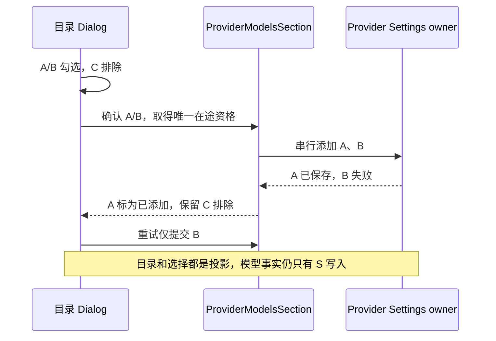

# 定制模型目录与工作流回归复查

## 范围与依据

2026-11-05，继续核对 `main@12e77221` 的本仓定制功能，保留所有既有未提交改动。当前本地仅有 main，已存 origin/main 同步；不进行同步、发行或用户数据迁移。

既有总结模型、Markdown、配置菜单、自定义模型目录、个人 Key 额度、自动归档、Composer Recent、独立任务目录、隐藏动画和更新审计的 source 基线外层 78/78 通过。若 wrapper 执行内层测试，不重复加总或当成真机验收。

确认两类遗漏：目录弹窗在部分添加成功后重新全选，破坏 [模型目录规格](../../.agents/specs/custom-provider-model-catalog.md) 的失败重试规则；工作流定制回归未适配官方 3.17.1 的接口，33 个源测试中 6 项失败，无法持续验证原有留白/模型绑定规则。

## 规则与所有者

- Dialog 只拥有用户排除的候选 ID；勾选结果从当前未添加候选派生。打开时清空排除项，同次添加成功不重置选择；不保存第二份 Provider 模型事实。
- ProviderModelsSection 独占在途确认，串行调用现有 addPersonalModel，成功项仍由现有列表反馈投影。重复确认零额外写入，失败释放资格并允许重试。
- 获取失败显示既有本地化 request-failed 提示；添加失败保留原有部分失败计数。异常和 Provider/model ID 不进入日志或界面错误文本。
- workflow actor 的 persona 名字必须为绑定表自有键。`toString`、`constructor`、`__proto__` 等合法模型名字仍必须显式绑定，原型成员不构成绑定；缺失时抛现有 WorkflowActorModelUnboundError，不回退到其它模型。
- 工作流回归按当前 `ListEventsOptions` 显式请求 `types: "all"`、`reportItems: "all"`，保留原子提交、失败零副作用与冷恢复断言。CreateWorkflow resolver 用当前第三参数传模型目录；错误断言检查现有错误类型及 modelName，不再把编译诊断 9011 当作 actor 运行错误文案。
- UI 和 workflow actor 均沿用既有服务与运行时所有者；不新增状态库、持久化、公开接口或依赖。Desktop continuous、Web replayable、owner/lease 与 workspace identity 边界保持现有合同。

## 验收场景

| ID     | 操作                                            | 断言与验证层                                                                  |
| ------ | ----------------------------------------------- | ----------------------------------------------------------------------------- |
| PCAT01 | 三候选，取消 C，A 成功 B 失败，重试             | 原确认仅 A/B；重试仅 B；A 只读；C 保持取消。生产组件 DOM，另留浏览器复验入口  |
| PCAT02 | 取消弹窗后重新获取，目录仍含 C                  | 未添加候选恢复默认勾选。生产组件 DOM，另留浏览器复验入口                      |
| PCAT03 | 保存中在同一同步栈再确认，首批失败后重试        | 第二次确认零调用，失败后可重试。生产 callback                                 |
| PCAT04 | 获取/添加抛错携带合成敏感 marker                | 稳定双语提示，日志不含 marker、原始异常或业务 ID。生产 callback/组件          |
| WFCA01 | 缺省/显式原型名称绑定及真实模型解析             | 缺失抛指定错误；自有绑定保留 reasoning。真实生产函数                          |
| WFCA02 | 原子补全失败、成功补全、冷恢复与 stale approval | 当前 journal 接口下全部原断言实际执行，保留零副作用边界。真实 sandbox/journal |

所有数据、缓存、HOME/TEMP 和证据仅位于当前工作树的 project-test-sandbox。浏览器使用现有隔离夹具；Ego 运行时不继承 shell 隔离环境，不将其用户 profile 用于此轮测试。未执行的 Electron/实体手机/真远端/真实 Provider 或安装包验证如实标注。

## 执行结果

使用当前工作树内已有 Node 24.14.0 / corepack pnpm 10.33.2。生产改动限于目录 Dialog、ProviderModelsSection 与 workflow actor 查表；其余为规格及回归适配，没有恢复退役模块、修改公开协议或重建安装包。

| 验证               | 实际结果                                                                                                                          |
| ------------------ | --------------------------------------------------------------------------------------------------------------------------------- |
| 定制功能基线       | 修复前选取的 source 外层 78/78，零 skipped；见 `source-tests-L787Nv`，不等价全量语料                                              |
| 目录 callback 红绿 | 修复前 8 项中 7 项失败：同步重复写入、双语原始异常及日志参数；修复后 8/8                                                          |
| 目录组件 DOM       | 首次执行命中双语选择/错误文案的四项预期断言；最终真实父组件、Radix Dialog 与 intl 的 4/4 通过，覆盖取消、部分失败、重试及重新获取 |
| 工作流红绿         | 原有 33 项中 6 项失败；补原型绑定用例并对齐 actor 错误断言后，修复前 37 项中 9 项失败；修复后 37/37，零 skipped                   |
| Release 同入口复验 | `node --test --test-concurrency=1` 执行两个公开入口，外层 2/2；内部目录 12、工作流 37，计数不与包装层相加                         |
| 类型               | 根 typecheck、bootstrap 的 `tsc --noEmit` 均 exit 0                                                                               |
| Lint               | 根 Lint 为 0 warnings / 0 errors；目标 workflow actor 独立 Lint exit 0，未执行 CLI 全包独立 Lint                                  |
| 格式与架构         | 根 fmt:check、六个 CLI 改动文件独立格式检查、changed 架构及 diff 空白检查通过；架构 violations/baseline/new 均为 0                |

回归实现放在 `scripts/ci/fixtures/`，公开入口 `scripts/ci/provider-model-catalog-ui-regression.test.mjs` 为 UI 源设置正确 tsconfig；不将需要别名的私有用例直接放入 `scripts/ci/*.test.mjs` 的 Release 发现范围。保留工作流全部原子性、stale approval、真实 sandbox 与冷恢复断言，没有以放宽生产接口或删断言消除旧测试失败。

`ui` 和 `zcode-cli` 阅读包当前标记 `managed: false`；架构零违规不等价这两个 legacy 模块内部已全面治理，也不替代上述运行时回归。

初次 callback 装载缺少 UI 别名、浏览器夹具缺 SVG loader；初次 DOM 夹具重绑环境丢失 node:test 身份，且撤销 globals 早于 Radix 延迟焦点清理。这些夹具问题已修正，最终 source 计数和失败传播按真实子进程记录。CLI 四份测试最初独立格式检查失败，逐文件整理后六份改动文件检查通过；中间失败不改写为始终通过。

证据均位于 `.run-logs/project-only-validation/`：目录 callback 红测 `source-tests-YS1kM4/children/source-tests-h5fRz3`、DOM 首次红测 `source-tests-kx7aHT`、目录绿测 `source-tests-A3DrzX`、工作流红测 `source-tests-ZyU7Js/children/source-tests-a62lJv` 与绿测 `source-tests-zftTEC`；最终 Release 同入口复验 `custom-third-node-pg7Gq8`。根 typecheck/Lint/架构/格式分别为 `custom-third-pnpm-MnKPGG`、`custom-third-pnpm-qSDPte`、`custom-third-pnpm-mK4fKw`、`custom-third-pnpm-CYLzZ9`，bootstrap 类型为 `custom-third-pnpm-3ochnL`，CLI 格式为 `custom-third-pnpm-K3B52P`。

本机 Chrome 和 Edge 的隔离 profile 均创建在项目 sandbox，但当前执行环境拒绝 DevTools 调试连接，两次 launch 均 timeout；没有执行浏览器交互或通过截图验收。准备的 `scripts/ci/provider-model-catalog-smoke.mjs` 保留为浏览器复验入口，不能把 DOM 结果记为 Electron、完整 CSS 布局、实体手机、真实远端/Provider 或安装包验收；没有执行全量业务语料、完整 GitHub Checks 或 macOS/Windows 发行验证。

当前本地仅 main，已存 origin/main 与 HEAD 同为 `12e77221`，没有其他本地待合并定制分支；未重新查询远端或同步官方。现有官方 3.17.1 基线与本仓定制入口以本次源码和用例为准，不宣称所有历史遗漏已查尽。改动保留本地，未提交、推送或触发 Actions。
