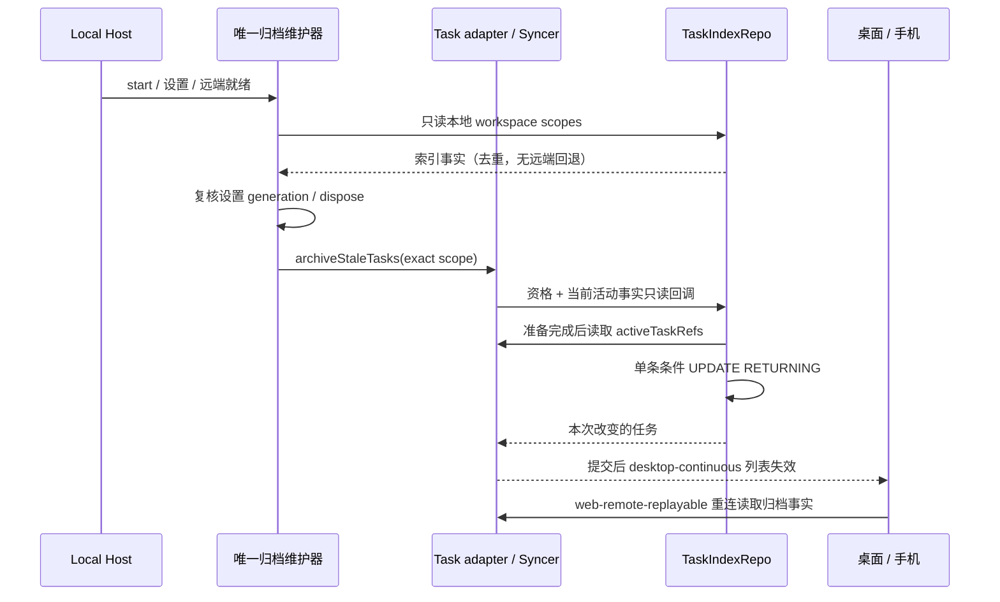

# 定制功能后续复查与归档收口

## 范围与确认依据

2026-11-05，在 `main@12e77221` 的已有未提交修复上继续复查。保留现有工作树，版本维持官方 3.17.1；不进行上游同步、提交、推送或安装包构建。

总结模型、Markdown 复制、环境配置入口、自定义模型目录、个人 Key 额度、Gemini、Composer Recent、无项目任务目录及 fork 审计边界的现有定向回归先通过。该结果不代表全仓或真机验收。

确认自动归档的合并接线违背本 fork [自动归档规格](task-auto-archive.md)：`node.ts` 同时启动 project scheduler 与 fork maintenance。前者使用仅按时间的 `ProjectRepository.archiveInactive`，会跳过本 fork 的已读、completed 资格；后者仍只从旧 recent/open/default 路径收集范围，漏掉已经关闭的独立任务目录。

此外，`cli_last_outcome` 是最后一次持久终态，不是当前运行状态。重新运行的会话可以保留旧 completed 终态；归档不能因此覆盖 syncer 已观察到的活动会话。

## 产品规则与所有者

- 每个 Local Host 只启动已有 `TaskAutoArchiveMaintenance`：就绪首轮、30 分钟周期、相关设置和远端就绪补扫。列表读取无写入，保留跨窗口广播与停止等待。
- 本地范围为当前 tasks-index 已索引的本地会话 workspace scope，加上原 recent/open/default 范围。独立目录、虚拟项目以及已关闭任务都由数据库事实列举，不枚举文件系统、不启动 CLI、不从执行 cwd 猜身份。
- 已归档或已删除行不参与索引范围；重复目录只查询一次。带非空 identity 或其他 Host 归属的行不进入本地扫描，远端继续复用现有精确连接路由。
- 资格保持本 fork 的未删除、未归档、未置顶、无未读、CLI completed 且严格超期。实际设置 schema 的缺省保留期为 7 天，已保存值保持不变。
- 当前活动事实仍由 `ZCodeTaskIndexSyncer.activeTaskRefs()` 持有。adapter 向 Repo 提供只读查询回调，Repo 在准备完成后、执行 SQL 前读取，按完整 workspace key 排除当前活动任务。不能缓存旧活动列表或向 CLI 事实列写入运行状态。
- `TaskIndexRepo` 仍是归档状态的唯一写者；单条带资格和活动排除条件的 UPDATE 原子提交，再由现有 adapter 发列表通知。不新增队列、表、设置、协议字段或第二份计时器。
- 索引范围读取失败只跳过该来源并记录固定诊断，旧已知范围继续；读取期间设置换代或释放 Host 时，旧扫描不得继续提交。

接口：`TaskIndexRepo.listLocalWorkspaceScopes()` 只读去重 scope；通过 `TaskAutoArchiveMaintenanceOptions.listLocalWorkspaceScopes` 注入。Repo 的活动排除回调仅用于内部 adapter，不扩大 Renderer 归档 API。

## 回归与验收场景

| ID    | 前置与动作                                                        | 必须断言                                                                           |
| ----- | ----------------------------------------------------------------- | ---------------------------------------------------------------------------------- |
| CFA01 | 生产 Host 装配静态接线                                            | 只构造 fork maintenance，索引来源实际注入，不启动 project scheduler                |
| CFA02 | 无 recent/open 记录的两个独立目录及普通项目；真实 SQLite 启动扫描 | 超期已读 completed 被归档；未读、error、pin、已删和同路径远端保留；相同 scope 去重 |
| CFA03 | 旧 completed 会话在归档等待期间成为 active；再停止活动            | 运行时不归档，停止后可归档；其他 identity 的同 ID 不阻挡本地；CLI 时间不变         |
| CFA04 | 索引读取未返回时关闭设置或 dispose；索引读取失败                  | 旧代不提交、退出后无新提交；失败时原范围继续，下一轮可重试                         |
| CFA05 | 桌面订阅与手机断线后的归档读取                                    | 提交后通知，断线恢复按同一持久事实读取；不建立新 Host 或 Agent                     |

工程证据使用当前 `taskAutoArchive` SQLite/adapter/Controller 回归与 Host 接线检查。UI 候选延续 archive-management：在独立任务目录预置 CFA02 的历史，关闭所有任务后开启自动归档；核对归档列表及手机重连。未实际运行的界面、实体手机或真实远端不得记为通过。

现有 AMT02 候选还保留官方的「超期未读也归档」断言，与本 fork 资格冲突。本次先在 case catalog / coverage matrix 裁决为超期已读 completed 归档、未读保留，再同步 E2E 断言；保留同名标题、旧开关重置、近期任务点击及重启持久化场景。历史官方 E2E 记录不能用作此断言修改后的运行证据。

归档 CI 入口必须通过现有 `runSourceTests` 自行建立项目内沙箱，不依赖外层已经设置 `PROJECT_TEST_SANDBOX_ROOT`。SQLite 夹具统一由 `createProjectTestFixture` 创建，清理前重新校验路径；新 scope 回归同时检查真实项目归属、仅远端/已删/已归档目录不会进入本地范围。

## 执行记录

实现前：固定 Node 24.14.0 / corepack pnpm 10.33.2，现有定制 source 外层 232/232；根 typecheck、Lint、fmt:check、changed 架构均通过。日志：`.run-logs/project-only-validation/custom-second-gates-fNuVwA/logs/` 与 `source-tests-6hqLnJ/logs/source-tests.log`。wrapper 内源测试另有计数，不与外层相加。

实现前新增回归失败，日志为 `source-tests-ueTfW1/logs/source-tests.log`：实际 resumed 会话被归档，生产入口仍构造第二个 scheduler，索引来源未读取且新 Repo 接口缺席。先有规格/失败证据，再实现单调度、索引范围及活动排除；没有降低资格或撤去失败断言。

最终源码及测试检查使用同一固定工具链，HOME/TEMP/数据库/日志/缓存均留在当前工作树；没有使用真实 `.zcodium`。SQLite 合成夹具清理前重新确认路径。

| 验证                                                  | 实际结果                                                                                       | 日志（均位于 `.run-logs/project-only-validation/`）                                                                     |
| ----------------------------------------------------- | ---------------------------------------------------------------------------------------------- | ----------------------------------------------------------------------------------------------------------------------- |
| 定制、Provider、Gemini、Recent、独立目录及审计 source | 外层 233/233，0 skipped；包括 wrapper，内层不重复加总                                          | `source-tests-72VxOW/logs/source-tests.log`                                                                             |
| 归档接线/服务/路由/Controller                         | 外层 2/2，内层 16/16；其中服务回归 13 项                                                       | `source-tests-hhPxWF/logs/source-tests.log` 与 `source-tests-hhPxWF/children/source-tests-JL1gyX/logs/source-tests.log` |
| 无预设 sandbox root 的归档 CI 入口                    | 外层 2/2，自行绑定项目内源测试沙箱                                                             | `custom-second-standalone-archive-fhFWmz/logs/standalone-archive.log`                                                   |
| 根 typecheck                                          | 首次 TS6305 因 scheduler 声明产物缺失；项目内重生成声明后复跑 exit 0                           | 首次 `custom-second-gates-Kia75g/logs/typecheck.log`；最终 `custom-second-scheduler-types-DdHkcS/logs/typecheck.log`    |
| services 归档测试 noEmit                              | exit 0，沿用当前 services 配置及 shared/rpc 引用                                               | `custom-second-gates-Kia75g/logs/services-test-typecheck.log`                                                           |
| Desktop typecheck:e2e / 归档 fixture check            | 均 exit 0；没有执行 Electron 交互                                                              | `custom-second-gates-Kia75g/logs/e2e-typecheck.log`、`e2e-fixture.log`                                                  |
| 根 Lint / fmt:check                                   | 均 exit 0；Lint 0 warnings / 0 errors，格式继承守卫保留 1605 个匹配文件                        | `custom-second-gates-Kia75g/logs/lint.log`、`format.log`                                                                |
| changed 架构                                          | violations / baseline / new 均 0；session 仍为 managed:false，不代表此模块全部边界已被机器覆盖 | `custom-second-gates-Kia75g/logs/architecture.log`                                                                      |
| Git 空白检查                                          | exit 0；未提交或暂存本轮改动                                                                   | `git diff --check`                                                                                                      |

一次批量格式写入以 3221226505 失败，底层报告无法写入 maintenance 源文件；项目内小夹具和同文件单独复查通过，逐文件格式整理与根 fmt:check 最终通过。失败日志为 `custom-second-format-MIAwU8/logs/format-write.log`，原始触发原因尚未确认。scheduler 声明缺失也仅修复本地类型产物，没有修改源码/tsconfig 或确定其最初丢失原因；不把这两次中间失败归成已经修好的产品 bug。

未运行完整 Electron/实体手机、真实 SSH/WSL、真实模型运行或跨 Host 活动窗口；CFA05 的服务/Controller 通知与恢复读取不是上述端到端验收。AMT02 仅对齐断言并通过类型/fixture 检查，保持待运行，不晋升 formal/CI。未重跑 CLI 全包独立 Lint、完整业务语料、安装包或跨平台发行验收；这些旧欠账以维护记录为准。未同步、改版本、提交、推送或触发 Actions。
