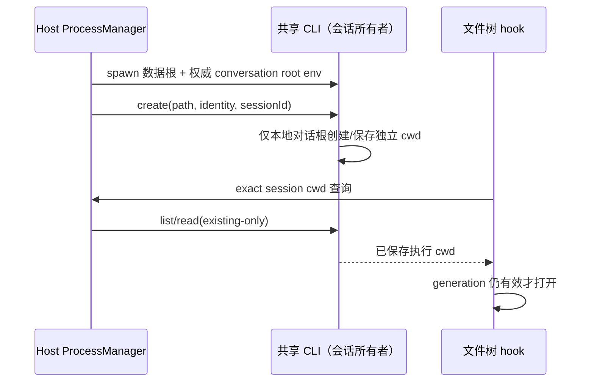
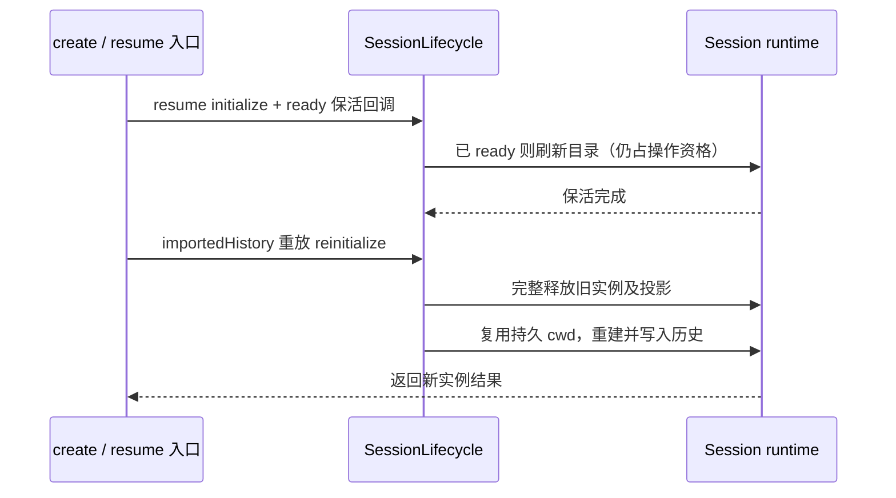

# 定制功能合并回归修复

## 范围与依据

用户授权按现有 spec 检查并修复合并回归。基线为官方 3.17.1 合并 `85866798`；保留当前工作树其他改动。
本次是 presentation、validation、commit-effect、recovery 修复，不改变数据身份或迁移用户数据。
权威规则：`.agents/specs/copy-conversation-markdown.md`、`.agents/specs/provider-config-menu-entry.md`、
`.agents/specs/summary-model-selection.md`、`docs/specs/conversation-session-workspace.md`。

## UI Surface Matrix

| 场景          | 入口/共享实现                                                  | 状态所有者与校验                                     | 动作与权威来源                                                                       | 模式边界                                                          |
| ------------- | -------------------------------------------------------------- | ---------------------------------------------------- | ------------------------------------------------------------------------------------ | ----------------------------------------------------------------- |
| 复制完整会话  | Header → TaskActionMenuContent → useCopyConversationMarkdown   | hook 单飞；稳定 ID、writer 可用                      | exact workspace 的 conversationRowsRangeV4 → 当前设备剪贴板                          | 桌面/Web 宽窄布局；运行中可读                                     |
| 前往配置      | Header、普通任务行、分组任务行 → useTaskListItemContextActions | useBuiltinProviderConfigFile；加载/缺失/能力不足禁用 | 平台查询环境物化副本 → openExternalFile                                              | 当前设备环境级配置，手机不提供原生打开能力时禁用/隐藏             |
| 查看任务文件  | useProjectFileTree                                             | 请求 generation；远端 identity 必须有对应 attachment | resolveTaskExecutionWorkspacePath → listSessions/readSession(existing-only) → 文件树 | 本地取 base service；远端只取精确 attachment，不按同名 cwd 借本地 |
| 无项目会话    | Host ProcessManager → shared CLI                               | Host 给权威对话根；CLI 按请求 path + identity 判定   | CLI 创建/恢复并持久化 cwd                                                            | 共享进程仍以数据根启动；项目/远端不启用                           |
| fork 总结偏好 | createRecord → inherit startup → Runtime                       | Host 偏好唯一所有者；record 保存读取回调             | 每次辅助任务调用既有 preferences 通道                                                | 不缓存选择，不复制后台运行/队列                                   |

## 共享和分歧

三个配置菜单共用一条查询与打开路径；不读取 workspace Provider 占位路径，不在文件缺失时打开父目录。
常驻 Header 显式以 taskMenuOpen 启用配置查询；普通任务菜单只在打开时挂载，分组菜单使用 contextMenuOpen。不能只验证 hook 的 enabled 开关而漏掉实际调用者。
Markdown 仍只在顶部菜单显示。项目文件树打开用户所选 root；任务文件树打开该 session 的 cwd。
共享 CLI 进程的 spawn cwd 与会话 cwd 是不同事实。总结偏好继承读取通道，模型选择由每次调度读取。

## 关系、所有者与持久化

| 级别           | 关系                                                    | 检查依据                                     |
| -------------- | ------------------------------------------------------- | -------------------------------------------- |
| must-inspect   | 菜单可见性 → 已存在复制 hook                            | 菜单调用者与真实浏览器夹具                   |
| must-inspect   | 共享进程启动 → env 标记 → CLI 每请求目录判定            | 真实子进程与真实 CLI create/resume           |
| must-inspect   | task 索引身份根 → 精确 session 执行 cwd → 文件树        | identity 冲突、迟到查询及 existing-only 断言 |
| must-inspect   | 环境物化 owner → 平台 → 菜单                            | 物化路径测试、菜单加载/缺失/失败交互         |
| must-inspect   | 父 record → fork startup → 辅助任务回调                 | 真实 createSessionRecordForV4 产出的 record  |
| should-inspect | 总结 Runtime、自动归档、Browser Use、模型目录、启动资源 | 既有定制 spec 与可运行回归；修复过时测试接口 |

CLI 是 session cwd/正文的唯一写者，Host 是任务组织态和全局偏好的唯一写者；UI 只保存操作中的请求资格。
不新增库列、队列或执行目录缓存；directory/path 两分、workspaceIdentity fallback、owner/lease 与两种传输边界保持原契约。

## Codegraph Evidence 与图谱漂移

本会话无 codegraph 工具/索引能力；以精确调用点、当前源码和运行时探针补充深度 2 的证据，不声称静态全仓无遗漏。
种子：TaskActionMenuContent、useTaskListItemContextActions、useProjectFileTree、buildAgentConversationWorkspaceEnv、createRecord。
直接调用者为 Header/TaskListItem/GroupedTaskRow、ProcessManager、CLI materialize/fork。
现有语义图未描述这五条定制接线；本次记录 proposed delta（恢复既有 spec 语义），不改写其他人的图谱工作。

## 已接受场景与剪枝

| ID              | 设置                                              | 动作           | 断言/证据                                                                                         |
| --------------- | ------------------------------------------------- | -------------- | ------------------------------------------------------------------------------------------------- |
| CUSTOM-MERGE-01 | 长会话、双语、宽窄屏、运行中/失败                 | 顶部复制       | 菜单位于 ID 后；完整多页、单飞、失败不写部分文本；现有浏览器 smoke                                |
| CUSTOM-MERGE-02 | 共享/独立 CLI，敌意继承 env                       | create/resume  | spawn cwd 正确；独立目录不同且恢复稳定；项目/identity 不启用                                      |
| CUSTOM-MERGE-03 | 本地与同 cwd 远端任务、迟到查询                   | 查看任务文件   | exact session cwd；旧请求不打开；离线不查本地；浏览器 hook 夹具                                   |
| CUSTOM-MERGE-04 | 配置存在/缺失/加载/平台不支持/打开失败            | 各菜单前往配置 | 仅打开生效物化文件；禁用原因、失败提示；浏览器夹具                                                |
| CUSTOM-MERGE-05 | 实际创建父 record、偏好随后变化                   | inherit/fork   | 子回调与父相同，调用读取最新 Host 偏好；CLI 回归                                                  |
| CUSTOM-MERGE-06 | 常驻 deferred 草稿目录八天未更新、并发 ready 查询 | resume         | 保活在 owner 内执行；保留活目录、清扫删除对照目录；关闭不抢占                                     |
| CUSTOM-MERGE-07 | 同 ID 导入跨日期重放、旧 cwd 被文件/链接占位      | create/import  | 原 cwd 不漂移；更新历史不累积；占位降级不越界；普通重复 ID、跨 workspace 与竞争生命周期操作被拒绝 |

已有 spec 已决定这些场景，用户已授权恢复，不需重新定义产品语义。全 OS × 全远端组合按 exact identity 与平台能力不变量剪枝；保留本地/远端同名路径代表。
不把 source wiring 或浏览器夹具计为打包桌面/手机真机验收。未定义新行为：无；未获请求不提交、推送或构建。

## 验证交接

补充确认两处生命周期入口回归：

- CUSTOM-MERGE-06：常驻恢复也必须在生命周期操作内刷新独立目录 mtime；ready 分支不能跳过保活，关闭不能与保活交叉。
- CUSTOM-MERGE-07：带 importedHistory 的同 ID 重放仍按既有规则复用持久化 cwd；普通创建继续拒绝重复 ID，并发创建保留 ID claim。已有实例先由生命周期 owner 完整释放，再重建并更新导入历史；软删行可按原导入规则恢复。初始化失败沿用 owner 的清理与 faulted 契约。

生命周期内部 initialize 增加 ready 回调，只在已 ready 的同一在途操作内执行；内部 reinitialize 复用 restart 的释放与初始化路径，由产品入口负责存在性规则。公开 ensureReady/stop/restart 的存在性和幂等语义不变。
恢复若遇已有在途操作，先等待其结果再在 owner 内执行保活；导入重放遇已有生命周期操作时返回 conflict，不能合并到无导入回调的 restart 后返回空创建结果。

补齐已接线的浏览器权限拒绝英文文案；删除已退休网络采样 UI 的中文孤立键，不恢复采样模块。
触及的配置/任务路径动作日志仅保留固定诊断，不输出用户路径、剪贴板文本或原始异常。

case catalog 与 coverage matrix 引用本组 CUSTOM-MERGE ID，执行前标 planned/partial，只有对应层实际通过才记录证据。
使用项目内 sandbox；不使用真实数据、系统 temp 或外部用户 profile。执行 focused 回归、typecheck、lint、格式及 changed 架构检查。
最终结果和环境限制在本文件补记。

## 执行结果（2026-11-05）

- 定制功能与审计边界 source 回归：208/208 通过（Markdown、配置物化、总结 Runtime/Host 偏好、Browser 子代理、自动归档、目录规则/接线、共享进程 env、审计守卫）。日志：`.run-logs/project-only-validation/source-tests-1u8V2D/logs/source-tests.log`。
- 生命周期 controller：16/16 通过，包含 ready 保活串行与导入重建竞争拒绝。日志：`.run-logs/project-only-validation/custom-lifecycle-YHYYre/logs/vitest.log`。
- 真实 CLI：A1-shared、A8、A12、A13 全通过，确认共享 spawn cwd 下独立目录与恢复、导入替换历史及占位降级。日志：`.run-logs/project-only-validation/cwd-cli-e2e-6hanwb/logs/e2e.log`。
- React 交互夹具使用仓库已有 Electron 内核：Markdown 44 组菜单及 pending/切换会话场景通过；配置菜单 64 组双语/宽窄屏/本地及远端/加载/缺失/失败场景及 exact 本地/远端文件树、fallback、离线、迟到、卸载、断开连接旧响应通过。配置日志：`.run-logs/project-only-validation/custom-feature-ui-final-pvN0nh/logs/browser.log`；Markdown 目录：`.run-logs/project-only-validation/markdown-feature-ui-XvVenc`。
- 先前调查已通过的模型目录 26 项与启动生产资源检查没有对应产品改动，沿用调查日志 `.run-logs/project-only-validation/feature-audit-verification-iXr0zb/logs/retained-feature-checks.log`，不虚称本轮重复执行。
- 初次验证使用系统 Node 24.18.0；收尾找到项目内已有的 Node 24.14.0（与 `mise.toml` 一致），最终门禁及关键回归用固定版本复跑，未下载或安装运行时。本机 Chrome/Edge 在隔离 HOME 下拒绝调试启动，改用项目内 Electron 夹具后通过；这不是打包 ZCodium 的真机验收。
- 测试、浏览器配置、缓存与日志均在当前项目 sandbox；Windows 链接夹具先检查两端和祖先，再由固定 .NET API 创建（包括悬空链接），未扩大 Node 写白名单。
- 固定 Node 24.14.0 最终复跑：根 typecheck、bootstrap typecheck、根 Lint（0 errors / 0 warnings）、全仓 fmt:check、changed 架构（0 violations / baseline / new）全部通过；source 208/208、生命周期 16/16、真实 CLI 4/4、Markdown 44 组及配置菜单 64 组全部通过。最终门禁、CLI 与浏览器日志位于 `.run-logs/project-only-validation/custom-feature-pinned-final-5TJ1Xl/logs/`；source 日志为 `.run-logs/project-only-validation/source-tests-x5JJ5D/logs/source-tests.log`。并发修复后的 A1-shared/A8 也另复跑 2/2，通过日志 `.run-logs/project-only-validation/cwd-cli-final-m1fa16/logs/e2e.log`。差异空白检查通过。
- 未提交、推送、触发构建或迁移真实用户数据。未运行整仓所有测试、打包桌面、实体手机或真实 SSH/WSL/Docker 验收；本轮结论限于已检查的定制入口与证据层。
