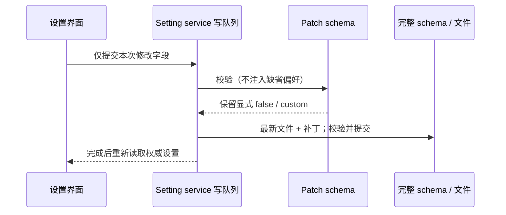

# 本仓定制回归修复（2026-11-22）

## 范围与所有者

以当前源码对官方 3.18.2 基线的差异为范围，只修复本仓定制引入的缺陷。保留当前本地 main，不推送、不打包。官方继承代码不作一般性整顿。

TaskIndexRepo 在已有 tasks-index 连接内拥有归档事务；AutomationRepo 的既有暂停函数在调用方事务内更新关联定义。自动归档的条件 UPDATE 和暂停之间没有 await，保持多连接认领、活动观察及提交后通知。失败回滚整个工作区，运行轮次保持原状态。

Setting service 是偏好保存的唯一所有者；完整 schema 负责旧配置缺省值，patch schema 只接纳明确提交的字段。三个工具分组字段缺省为 true，显式 false 必须保存；远控模式完整配置缺省为 lan，未提交模式的补丁不得补入 lan。Renderer 沿用现有回调和刷新，不增加第二份状态。

## 接受的回归场景

| 编号  | 动作                                                | 必须得到的结果                                                                                                                               | 验证入口                                                                  |
| ----- | --------------------------------------------------- | -------------------------------------------------------------------------------------------------------------------------------------------- | ------------------------------------------------------------------------- |
| CF-01 | 自动归档过期已读完成任务                            | 所有关联启用中定时任务同时暂停；置顶、未读、活动及其他 identity 不受影响                                                                     | taskAutoArchive.test.ts，真实 SQLite                                      |
| CF-02 | 暂停写入失败；归档后手动重启再补扫                  | 失败全部回滚且不通知；补扫不再次暂停                                                                                                         | 同上，SQLite 触发器故障注入                                               |
| CF-03 | 关闭三个分组开关并重新读取，随后保存其他偏好        | 三个 false 保留；无效类型拒绝；旧配置默认 true                                                                                               | official317-setting-persistence.test.mjs，实际 Setting service            |
| CF-04 | 保存 custom 地址/设备/恢复上下文后修改字体等        | 模式和相关字段保留；明确切换 lan 才改变模式                                                                                                  | 同上                                                                      |
| CF-05 | 主助手、Output Style、匿名/具名工作流和调用方提示词 | 内置声明移除，身份/Harness/工作流契约和调用方原文保留                                                                                        | core 现有上下文测试                                                       |
| CF-06 | 英文/中文设置页操作分组开关                         | 使用对应语言的名称与说明，不显示翻译键；重载后保持关闭                                                                                       | 真实 AgentBehavior 控件 + 生产回调 + Setting service 浏览器夹具           |
| CF-07 | 新 tasks-index 初始化及重开                         | 历史 TS 迁移通过本仓严格校验；历史描述哈希不变，重开不重跑                                                                                   | taskAutoArchive.test.ts，真实迁移及账本比对                               |
| CF-08 | 三个分组开关修改、恢复与无关偏好更新                | SessionPane 把最新三个标量传入唯一 rowContext；memo 依赖随值失效，工具渲染器立即改变分组。桌面和手机共用此链路，分享页继续使用自身展示默认值 | 生产 SessionPane 与 ConversationTurnGroup 的 memo 表达式 + 浏览器受控记录 |

CF-08 的状态所有者仍为 Setting service / useSettings，SessionPane 仅投影三个标量，不建立新订阅、effect、计时器或状态。rowContext 的 memo 依赖列出这三个标量，避免读取整个设置对象导致无关保存重建所有行。

组件浏览器证据用于真实控件操作与保存链路检查，不冒充 Electron 全应用、真实手机或远端验收。检查其他自定义设置时追踪 UI 写入、schema、持久化及消费者，按当前实现判断，不以旧文档代替源码。

## 执行结果

当前正式维护标准按用户调整后的范围执行：官方 3.18.2 是正确基线；本仓新加或替换行为必须保留既有 owner/接口，确认的定制缺陷有真实失败与通过证据，必需静态检查通过，限制如实保留。当前 main 已含官方基线，未再次同步旧的撤回功能线。

### 本轮关闭的产品缺陷

1. 自动归档没有暂停关联定时任务：复用既有暂停函数，同事务提交/回滚；保留认领和运行轮次。
2. 三个工具分组开关被完整和 patch 校验剥离：两处均声明字段，保留显式 false。
3. 其他偏好补丁注入 lan，覆盖自定义远控模式：默认值移回完整配置。
4. 本仓严格迁移 runner 与新合入的历史 TS 迁移缺指纹不兼容：固定原描述哈希，不修改官方迁移或历史账本。
5. 中文/英文的分组名称和说明遗漏：补齐现有翻译表。
6. SessionPane 未将分组设置传给 rowContext：传递三个标量并加入 memo 依赖，渲染器即时更新。

主助手及工作流子任务的四份提示词/测试定制纳入当前本地主线；本仓已有 WebFetch/DOCX 文案定制仍保留。此次产品源码没有修改工具权限判断。

### 实际验证

所有证据位于 `.run-logs/project-only-validation/`，Node 24.14.0，corepack pnpm 10.33.2；数据、HOME、TEMP、缓存、日志及浏览器 profile 均在当前项目内。

| 范围                             | 结果与证据目录                                                                                                                                                                                                                                                       |
| -------------------------------- | -------------------------------------------------------------------------------------------------------------------------------------------------------------------------------------------------------------------------------------------------------------------- |
| 修复前设置保存与默认补丁         | 3 项失败、2 项通过：`custom-fixes-0SXFp1`，三个字段丢失与补丁多出 lan                                                                                                                                                                                                |
| 修复前自动归档                   | 2 项失败、13 项通过：`custom-fixes-DhzlgC`，关联定义仍启用、暂停故障未触发                                                                                                                                                                                           |
| 迁移兼容问题                     | 首次启动失败见 `custom-fixes-NDZLUI`；补齐历史指纹后实际初始化和账本再次迁移均通过                                                                                                                                                                                   |
| 自动归档最终服务/路由/Controller | 18 项源测试与 2 项 wrapper 通过：`custom-fixes-Hq2WMF`；覆盖多连接、当前活动、identity、回滚及恢复读取                                                                                                                                                               |
| 设置保存及运行时同步             | 11/11：`custom-fixes-Ik20iV`，包含实际 Setting service 保存/重读及生产回调                                                                                                                                                                                           |
| 分组传递失败与修复               | 修复前生产 memo 得到三个缺省值，见 `custom-fixes-58hhwt`；修复后浏览器候选通过，见 `custom-fixes-ABgstn/children/custom-grouping-ui-yecFFK`                                                                                                                          |
| 提示词                           | 源码 15/15：`custom-fixes-AfG1Be`；上下文/请求压缩 Vitest 两文件 58/58：`custom-fixes-uHmMNF`；重编译 core 后上下文 10/10：`custom-fixes-IwWSL4`                                                                                                                     |
| 其他定制回归                     | 158 项先 155 通过、3 项旧 ToolSearch 快照断言失败：`custom-fixes-bFn8cl`。缺少当前插件推荐偏好的测试输入补齐后，相关 11/11 通过；未改变生产同步行为                                                                                                                  |
| 原生 Provider/工具转换           | 两文件 38/38：`custom-fixes-SbDhe0`。初次 1 项仍要求已移除的官方端点路由，按当前用户端点直连契约纠正测试；生产认证及路由未修改                                                                                                                                       |
| 新增 AppSettings 字段源码审计    | 相对官方的 8 个字段在完整/patch schema 均有声明：`custom-fixes-CL1qhX/children/custom-settings-audit-Nbhl3u`                                                                                                                                                         |
| 必需检查                         | 根 typecheck：`custom-fixes-bPPD69`；Core types：`custom-fixes-ZaYvuj`；新增服务测试 types：`custom-fixes-huNTnX`；根 Lint 0 errors / 719 既有 warnings：`custom-fixes-qdnmlC`；changed 架构 0 违规：`custom-fixes-YL8OdN`；schema 门禁 22/22：`custom-fixes-pb0kE0` |

其他定制复查包含总结模型跟随/失效回退/思考等级、模型目录/鉴权头、请求压缩、完整 Markdown 复制、本地会话文件导入导出、独立任务目录、AstrBot 选择与回复、CUA 显式开发 Helper、禁止官方云/遥测与 Linux 远端资源的守卫。结论以实际入口/消费者及这些回归为边界，不把全文件差异索引当作全量运行覆盖。

最终显式改动文件格式检查通过（`custom-fixes-06IsGb`），Git whitespace 检查通过；无关撤回说明不在格式化目标内。此前格式检查误传命令行 `--`，检查到一次性配置文件而失败；改正调用参数后通过，没有修改格式守卫。

浏览器证据使用真实 AgentBehavior 控件、生产 SettingsPage 回调、实际文件持久化，并执行当前 SessionPane / ConversationTurnGroup 的 memo 表达式及实际工具投影。覆盖英文 1280px、中文 390px、关闭/重开/刷新/无关字体保存；其他会话依赖是受控替身。没有执行完整 Electron 会话、真实模型、实体手机或真实远端连接，不升级为正式桌面 E2E。早期两次浏览器失败来自 Vite 路由和夹具依赖遗漏，未计作产品失败或通过证据。

freshness 的在线 fetch 因连接重置失败；缓存 origin/main 包含已明确撤回的原生上下文改动，不为消除差异重新 merge。当前官方基线仍为已 merge 的固定 commit。无推送、安装包构建、Actions、Release 或远端默认分支改动。无关 `native-context-rollback.md` 保持原样、未提交。
