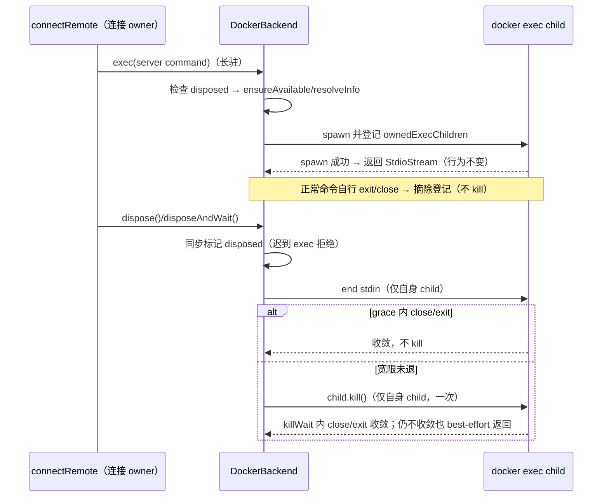

# Docker 远端 backend 的 exec 进程生命周期

## 范围与所有者

- `DockerBackend`（packages/server/src/remote/docker-backend.ts）拥有自己通过 `exec()` spawn 的全部子进程；登记表只收 `exec()` 产物（`upload` 经 `uploadViaExec → exec()` 自然登记），一次性 `execFile`（`execSimple`/`execDirect`/`detect`）不纳入，不扩大范围。
- 连接生命周期仍归 `connectRemote`（packages/server/src/remote/connect.ts）：断开/取消/退出经 `backendOwner.dispose()/disposeAndWait()` 进入本 backend；本 spec 不改变 Main/Host/CLI 的业务所有权，不改变 `IRemoteBackend` 契约（packages/server/src/remote/backend.ts）。
- `disposeAndWait` 沿用 `IRemoteBackend` 既有预算语义：默认 `graceTimeoutMs=300`、`killWaitTimeoutMs=250`（与 WSL backend 同口径），调用方可在 `connectRemote` 退出屏障内覆盖。
- 释放动作只包含：结束自身 child 的 stdin、宽限未退后 `child.kill()`、等待 close/exit 收敛。禁止 `docker stop`/`docker kill`/容器级操作，禁止触碰共享容器内的其他进程。
- `dispose` 同步标记 `disposed`；`disposeAndWait` 并发/重复调用幂等（同一 in-flight promise）。
- 有界预算：`graceTimeoutMs`/`killWaitTimeoutMs` 为 `0` 表示「本次不等待、立即进入下一步」（grace 0 → 立即 kill；killWait 0 → 有界返回），不是无限等待；每次等待都有这两个预算共同兜底。
- 重入安全：`disposeAndWait` 先在任意 child side effect（`stdin.end()`）之前发布同一个 in-flight promise；`stdin.end()` 的同步回调若重入 `disposeAndWait`，返回同一 promise，不出现双流程或重复 kill。
- 错误传播：等待内部的未知异常（如计时器故障）原样向 `disposeAndWait` 调用方传播（返回的 promise 以同一 Error reject），不得吞改为 fulfill；已知的 `stdin.end()`/`kill` 故障仍按既有 best-effort 处理（try/catch 后继续收口，不向外抛）。
- `exec()` 入口与 await 后都检查 `disposed`：关闭期间迟到的 exec 必须拒绝且不得 spawn。
- 已知边界（未验证）：kill 宿主 docker exec CLI 不保证容器内 remote server 立即退出，取决于容器 init 的信号转发；kill 失败或 killWait 到时仍未终结时，backend 只做 best-effort（结束 stdin + kill 尝试 + 有界等待）并保留所有权直到终态，不承诺无条件终止，也不宣称容器内进程归零。

## 事件顺序

## 实现要点

- `ChildProcess` 的 `error` 事件不等于进程已退出（kill 失败/IPC 失败均会触发）：仅 spawn 失败（`pid` 为空）可立即摘除登记；alive error 保留所有权，交由 `disposeAndWait` 的宽限+kill 路径 best-effort 收口。
- 复用 `createCloseEventController` 的既有语义：`exec` 返回的 `onClose` 与 stdio 行为不变，正常连接的字节流与关闭码传播不变。

## 验收与安全边界

- 回归：packages/server/src/remote/docker-backend-exec-lifecycle.test.ts（vitest + fake ChildProcess，不启动真实 Docker、不联网、不读写真实数据）；外层入口 scripts/ci/docker-backend-exec-lifecycle.test.mjs 经项目沙箱（HOME/TEMP/数据/日志限定在 .run-logs）执行并断言计数。
- 覆盖：正常自退不 kill、宽限内退出不 kill、宽限后 kill、N 个挂起 child 各只 kill 一次、重复 dispose/disposeAndWait 幂等、spawn 失败（无 pid）摘除、alive error 保留所有权且仍被 dispose 清理、关闭期间迟到 exec 不 spawn、dispose 后新 exec 拒绝、stdio/onClose 行为保留、upload 的 exec 产物登记并被回收、graceTimeoutMs:0 立即进入 kill、killWaitTimeoutMs:0 即使 kill 后仍无终结也有限返回并保留所有权、stdin.end() 同步回调重入 disposeAndWait 时返回同一 promise 且 child 只 kill 一次、等待内部未知异常（setTimeout 故障）向 disposeAndWait 调用方原样传播。
- 红灯先行：旧实现（dispose 空实现、无登记、无 disposed 检查）下新增用例失败；修复后全绿。

## 验证结果

- 红灯（旧实现）：vitest pass=1 fail=9，wrapper 断言失败退出 1；唯一通过的用例是「stdio/onClose 行为保留」（该行为本就未变）。
- 绿灯（修复后）：`node .run-logs/performance-rescan-exec-20261031.mjs docker-exec-lifecycle-green3 node --test scripts/ci/docker-backend-exec-lifecycle.test.mjs`，vitest pass=10 fail=0 exit=0，wrapper 1/1 通过。
- 边界补强轮（父代理 review 发现的两个未接受边界）：
  - 红灯（旧实现）：`docker-boundary-red`，vitest pass=10 fail=3——`graceTimeoutMs:0` 与 `killWaitTimeoutMs:0` 两例因 `timeoutMs<=0` 走 `closed.then` 无限等待，挂起至 vitest 超时（STACK_TRACE_ERROR）；重入用例 `inner !== outer`（endOwnedChildInput 之后才赋值 disposePromise，重入再走一遍完整流程）。
  - 绿灯（修复后）：`docker-boundary-green`，vitest pass=13 fail=0 exit=0；wrapper 计数已收紧为精确 13（`assert.equal(total, 13)`，少于说明套件被跳过、多于说明静默加用例，均失败）。
  - 修复内容：`waitForOwnedExecChildClose` 的 `timeoutMs<=0` 改为 `Promise.resolve(false)`（不等待而非无限等待）；`disposeAndWait` 先用 deferred completion 发布同一 in-flight promise，再做 child side effect（`stdin.end()` 仍同步），`Promise.all` 结算接到该 promise。
- 错误传播补强轮（父代理 review 发现的最后一个边界）：
  - 红灯（旧实现）：`docker-errorprop-red`，vitest pass=13 fail=1——第 14 个用例「等待内部的未知异常向 disposeAndWait 调用方原样传播」报 `promise resolved "Error: fixture wait failure" instead of rejecting`：`.then(settle, settle)` 把未知 wait 异常吞改为 fulfill；wrapper 严格断言 `passed===14` 同时失败（13!==14）。
  - 绿灯（修复后）：`docker-errorprop-green`，vitest pass=14 fail=0 exit=0，wrapper 1/1（严格断言：total=14、passed=14、pending=0、todo=0、全部用例状态 passed）。
  - 修复内容：deferred completion 增加 reject 分支（`fail`），`Promise.all` 结算改为 `.then(settle, fail)`；仍在任意 child side effect 之前赋值 `disposePromise`，`stdin.end` 仍同步，不加兜底、不新增 timer；已知 `stdin.end()`/`kill` 故障仍由各自 try/catch 按 best-effort 消化，不向外抛。 `endOwnedChildInput` 等 child side effect，`Promise.all` 结算接到该 promise（`.then(settle, settle)`），不引入任意 timer/microtask；`disposed` 仍同步标记、`stdin.end` 仍同步调用。
- 修正过的测试自身缺陷（不计为产品问题）：gate 曾解析为 undefined 被 ensureAvailable 当作 false；alive error 用例曾错误期待 exec promise 拒绝（spawn 已 resolve 出 stdio 流）；upload 用例曾用 import.meta.filename（vitest 下为 URL）导致 stat 失败，改用 fileURLToPath(import.meta.url)；两个拒绝用例曾把处理器挂在拒绝发生之后，触发 PromiseRejectionHandledWarning 使 vitest 退出码为 1，改为先同步挂 catch 再触发。
- 未验证范围：未启动真实 Docker，未验证容器内 remote server 在宿主 CLI 被 kill 后的退出行为（取决于容器 init 信号转发）；未运行真实远程连接 E2E；未触碰原有未提交文件。
