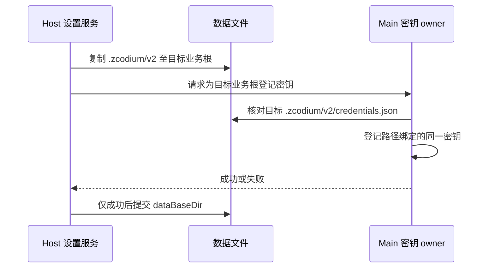

# 本仓默认数据根的运行入口对齐

## 范围与规则

本仓业务数据根为共享常量 `ZCODE_USER_DATA_DIR_NAME`（`.zcodium`），配置子目录为 `ZCODE_APP_CONFIG_SUBDIR_NAME`（`v2`）。官方 3.18.2 新增入口中的默认 `.zcode` 路径必须适配；显式用户路径、外部官方 CLI 的导入来源及只读历史记录不据此统一改写，不执行旧目录迁移。

本轮修复四个已确认的入口遗漏：

- Main 切换数据根的密钥登记目标应与 `copyDataDirectory` 的目标凭据文件相同。只登记密钥，不改变密文；复制、登记均成功后才允许设置服务提交新根。系统库仍由 Main 唯一持有，Host 不提供完整凭据文件路径。
- Main 冷启动界面语言读取应访问默认 home 下 `.zcodium/v2/setting.json`，与设置服务 bootstrap 的 home 位置一致。该文件不随可变业务数据根移动，显式传入的 settingsFile 保持。
- 默认 Source Server 服务装配向官方 alias Repo 注入选定业务根下 `.zcodium/cli/db/db.sqlite` 和 `.zcodium/server/migration-backups`。直接 Source Server 装配和服务默认构造均使用同一纯路径契约；显式 Repo 参数保持优先，官方 Repo 正文及双库合并、冻结计划、owner/lease、指纹和表迁移不改。
- 首次使用证据默认读取 home 下 `.zcodium/cli/config.json`，会话库默认 `.zcodium/cli/db/db.sqlite`，与本仓 CLI 相同。环境别名、显式用户配置、相对路径未知和读取失败的保守规则保持。

## 验收场景

所有合成文件、数据库、缓存和验证日志放在当前项目工作树；密钥库使用注入的内存替身，不访问系统真实凭据。

1. 复制真实加密凭据与来源标记，经当前 Main 消息处理代码登记密钥，冷建目标 cipher 能解密原值；旧官方目录不被创建。重复登记幂等，显式目标路径和既有拒绝边界保持。
2. home 同时存在不同语言的 `.zcode` 和 `.zcodium` 设置，默认 bootstrap 只读取本仓语言；显式文件覆盖仍可用。
3. Repo 使用默认路径解析并合并项目内的两库历史变体，当前 CLI 行被合并至 canonical identity，备份写在本仓根；原事务、无关行及重复执行不变。
4. 首次使用检查从本仓默认库获得已有会话证据，也读取本仓 user config 的自定义库路径；显式环境和未知相对路径规则不变。

完成后须通过相关源码/运行回归、typecheck、Lint、格式和 changed 架构，再本地重建 Windows 安装包并更新验证。macOS 仍须可用 Mac，不能以 Windows 回归等同于 macOS 实机验证。

## 运行界面复核发现的侧栏重复入口

数据根冷恢复截图确认本仓合并时重复加入 `agentBehavior` 设置分区，新增项使用不存在的翻译键 `settings.agentBehaviorTitle`，与官方原有“行为与工具”并存。设置分区 id 必须唯一；保留官方已有 `settings.agentBehavior.title` 的入口和原有内容，只移除重复定义。Web、Windows、macOS 配置中的 id 和分组投影都需保持唯一；完整 Electron 设置页只显示一项，不能显示原始翻译键。

## 最终验证结果（2026-11-22）

- 默认路径和设置唯一性回归 5/5，凭据相邻回归 4/4，审计边界 14/14，Source 数据根隔离回归通过。类型、格式、changed 架构通过；Lint 0 errors/719 既有 warnings。旧 alias 92 项夹具仍依赖退役迁移数组/账本，未计为通过。
- Windows x64 本地 main `e67ccf66` 生产编译和打包通过。仅 UI 定义相较 `9856af1e7` 改变，运行资源经源码无变化检查后复用该已通过的准备产物；最终包仍核验版本、品牌、PE 架构、原生资源、运行依赖与体积。
- 完整 Electron 场景 `fork-data-root-electron-2WZgSO` 通过设置服务切换业务根、冷重启读取复制凭据、写入新凭据及同根持久化；两次设置页均只显示一个“行为与工具”，不存在原始翻译键。该场景使用项目内受管测试密钥，不访问真实系统库；OS 来源登记另由实际 Main 分支与注入内存系统条目验证。
- 本机安装返回 0，exe/app.asar 摘要与最终本地包一致，安装登记版本 3.18.2；隔离启动 `installed-window-verification-J0eT2V` 显示 ZCodium、渲染器异常 0。真实用户数据、真实 Provider、实体远控与 macOS 原生构建不计本轮验收。
- 新增修复未推送，未创建 Release。用户确认无可用 Mac，macOS 保留待办。安装包未签名；最终产物清理在固定路径和无重解析点检查后仍被执行策略拒绝（blocked by policy），暂留项目内，不另建备份。
