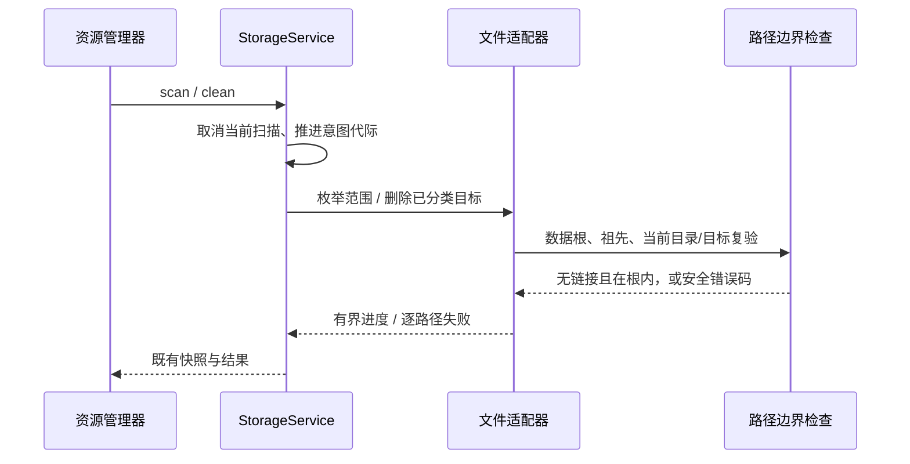
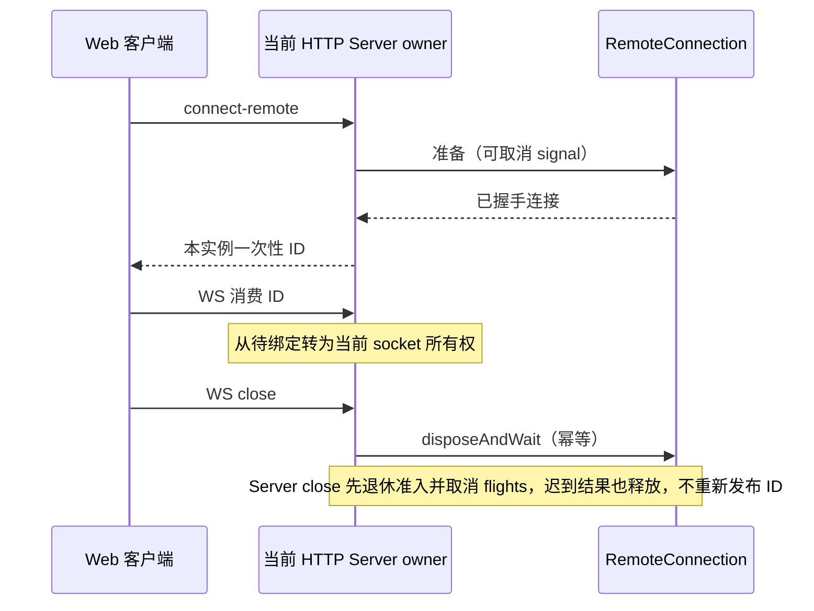
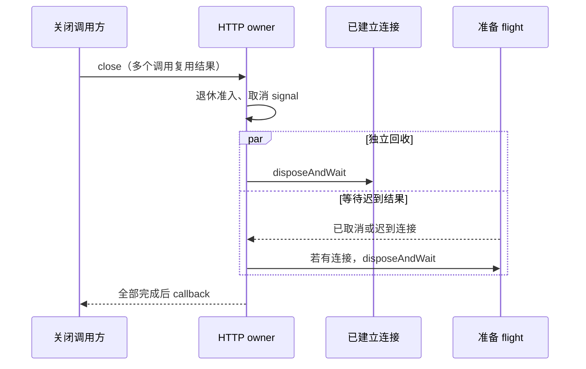

# 全仓审查：后端与桌面

日期：2026-11-06。范围为 `packages/services`、`packages/server`、`packages/zcode-server-cli`、`packages/desktop`，含 architecture-policy 登记的 36 个模块之本组 roots，以及包内未登记的脚本、配置、测试和静态资源。基线含已有未提交修改，本报告仅记录本轮新增修改。

## 已确认问题与修复规则

### 输出样式路径和 ID

`outputStyleService` 将名称/ID 直接拼为路径，允许 `../` 或 Windows 反斜杠越过样式目录。`listStyles` 移除第一处 `.md`，文件 `report.md.extra.md` 被映射到错误 ID。

规则：名称/ID 只代表直接子文件；在任何目录创建或文件修改前验证，保留有效 Unicode、空格及已有无前缀 ID；只移除文件名末尾 `.md`。回归在项目内沙箱创建目录外哨兵，验证 add/update/delete 的 `/`、`\\`、绝对路径和 NUL 均拒绝，哨兵字节不变；正常文件 ID 可完成列表、更新和删除。

### 存储清理链接边界

扫描入口直接 `opendir`，只排除枚举出的子链接；清理范围根和祖先可为链接，删除只校验词法路径。因此静态存在的 symlink/junction 就能令扫描、清理触及数据根外文件。

规则：StorageService 继续唯一拥有扫描和清理意图。FS adapter 在打开扫描目录、枚举范围和删除文件前逐段检查真实目录与链接，链接/目录越界失败关闭。枚举和删除共用一个边界实现，不能只依赖此前扫描结果。回归使用同一项目沙箱内的链接目标哨兵，验证根链接、范围祖先链接及枚举后目录替换均不删除目标；正常分类文件仍可清理。

该 guard 防止已存在或可观察到的链接，Node 路径 API 不提供原子 dirfd 防护；恶意进程在最终检查和 syscall 之间的并发替换不作已验收保证。

## 覆盖与验证

完整库存见 `.audit/full-code/backend-coverage.json`：4,462 个 rg 可见包文件，包含 3,230 个文本代码/配置文件的语法、导出和 IO 信号扫描，未发现语法解析错误。资源/文档仅登记；声明文件与 native 源码在库存中不属于 TypeScript 语法验收。36 个模块另外记录 170 个契约和关键实现文件、检查重点和限制，不能把静态库存或架构通过等同于逐行/全分支正确。下表只列本组 roots；跨组模块的其余 roots 由对应代理检查。

### HTTP 远程连接释放与分享准入

旧 HTTP 实现把待绑定远程连接存入模块全局 Map，WebSocket 消费 ID 后仅关闭 RPC facade，未释放底层 RemoteConnection；服务退出也不回收未消费 ID。不同 HTTP 实例还共享可消费 ID。普通 `/ws` 未复用现有归档 attachment 工厂，暴露了仅桌面可用的 base share service。

规则：每个 HTTP Server 独占该实例的连接准备 flight、待绑定 ID 和连接释放；WebSocket 关闭及 Server 关闭复用 RemoteConnection 的 `disposeAndWait`，同一连接只释放一次。Server 开始关闭即退休新连接准入、取消准备 flight；迟到资源释放后才能完成本次关闭，不再发布可消费 ID。关闭 upgraded sockets，避免其绕过 HTTP close。Server 关闭不能释放或消费其他实例的连接。没有新增待绑定超时规则。

分享继续由原服务持有导出/导入资源；HTTP attachment 与 stdio / Source Core 一样复用 `scopeConversationShareServiceForAttachment`，普通 replayable 客户端拒绝，trusted Desktop 沿既有连接上下文读取。

### 旧测试对齐当前 MCP 导入入口

`services/test/sharedConfigMutations.test.ts` 仍有两个并发导入场景调用已删除的 `mcpSyncService.importMcpServers`。生产导入所有者已是 `settingsSyncService.importSelected`。测试改走该公开入口读取沙箱内 Claude MCP 配置，保留真实文件锁竞争、大小写等价名称、并发 provider/MCP 字段不被覆盖以及真实 skipped 结果断言；不恢复旧接口。

## 逐模块人工检查证据

契约文件的完整路径一并列在 JSON 的 `manualReview.keyFiles`。下表强调关键实现；legacy 大模块另包含所有文件的静态扫描，人工检查深度不等于 4,462 文件逐行 review。

| 模块                             | 本组 roots                                                                                                                                                                                                                                                                                                                                                                                                                                                                                                                                                                                                                                                                                                                                                 | 已读关键实现/入口                                                                                                                                                                                                                                                                                                                                                                                                                                                                                | 检查结论及限制                                                                                                                                                                                                                                    |
| -------------------------------- | ---------------------------------------------------------------------------------------------------------------------------------------------------------------------------------------------------------------------------------------------------------------------------------------------------------------------------------------------------------------------------------------------------------------------------------------------------------------------------------------------------------------------------------------------------------------------------------------------------------------------------------------------------------------------------------------------------------------------------------------------------------- | ------------------------------------------------------------------------------------------------------------------------------------------------------------------------------------------------------------------------------------------------------------------------------------------------------------------------------------------------------------------------------------------------------------------------------------------------------------------------------------------------ | ------------------------------------------------------------------------------------------------------------------------------------------------------------------------------------------------------------------------------------------------- |
| services                         | `packages/services/src`                                                                                                                                                                                                                                                                                                                                                                                                                                                                                                                                                                                                                                                                                                                                    | `packages/services/src/collection.ts` `packages/services/src/accessor.ts` `packages/services/src/logger/serviceLogger.ts` `packages/services/src/zcode-agent/zcodeAgentService.ts` `packages/services/src/zcode-agent/zcodeAgentProcessManager.ts` `packages/services/src/settings-sync/settingsSyncService.ts`                                                                                                                                                                   | 服务注册与公开入口；Agent 进程和会话 owner；安全日志；配置文件锁与 MCP 导入现入口。HTTP share attachment 问题在 server 修复；本组 services/test 两个旧 MCP API 场景对齐当前导入入口；其余 legacy 文件完成语法/导出/IO信号扫描，未做逐分支运行验收 |
| session                          | `packages/services/src/session`                                                                                                                                                                                                                                                                                                                                                                                                                                                                                                                                                                                                                                                                                                                            | `packages/services/src/session/contract.ts` `packages/services/src/session/zcodeTaskService.ts` `packages/services/src/session/taskIndexRepo.ts` `packages/services/src/session/continuousStreamCoalescer.ts` `packages/services/src/session/sessionRealtimePort.ts` `packages/services/src/session/automationRepo.ts` `packages/services/src/session/tasksDatabase/migrations.ts`                                                                                             | CLI 与组织态所有者；workspaceIdentity；任务索引/迁移；continuous 合帧与 replayable 区分；automation 持久化。保留既有 owner/lease、索引和历史迁移边界；未声称完整会话真机验收                                                                      |
| storage                          | `packages/services/src/storage`                                                                                                                                                                                                                                                                                                                                                                                                                                                                                                                                                                                                                                                                                                                            | `packages/services/src/storage/adapters/fsBoundary.ts` `packages/services/src/storage/adapters/fsWalker.ts` `packages/services/src/storage/adapters/fsCleaner.ts`                                                                                                                                                                                                                                                                                                                          | 目录遍历、清理范围、symlink/junction、枚举后替换、取消代际与现有分类意图。修复已存在根/祖先链接越界；7 个真实文件系统回归通过；最终 syscall 间隔的恶意原子替换不作保证                                                                            |
| server                           | `packages/server/src`                                                                                                                                                                                                                                                                                                                                                                                                                                                                                                                                                                                                                                                                                                                                      | `packages/server/src/http.ts` `packages/server/src/stdio.ts` `packages/server/src/httpStaticFiles.ts` `packages/server/src/remote/connect.ts` `packages/server/src/remote/stdio-socket.ts` `packages/server/src/remote/handshake.ts`                                                                                                                                                                                                                                              | HTTP 鉴权顺序；实例连接所有权和关闭；stdio ACK/握手；协议交接与取消；路径静态文件边界。修复 HTTP 跨实例连接 Map、未释放底层连接及 share base service 暴露；7 个真实 HTTP/WS+mock transport 回归通过                                               |
| zcode-server-cli                 | `packages/zcode-server-cli/src`                                                                                                                                                                                                                                                                                                                                                                                                                                                                                                                                                                                                                                                                                                                            | `packages/zcode-server-cli/src/server-core/http.ts` `packages/zcode-server-cli/src/server-core/core.ts` `packages/zcode-server-cli/src/server-core/ingressToken.ts` `packages/zcode-server-cli/src/server-core/parentDisconnect.ts` `packages/zcode-server-cli/src/server-core/proxyStdio.ts` `packages/zcode-server-cli/src/server-core/taskActivityTracker.ts` `packages/zcode-server-cli/src/runtime/paths.ts` `packages/zcode-server-cli/src/runtime/uninstallGuard.ts` | Core HTTP 受信入口；ingress token；父进程断开；代理 stdio；任务活跃跟踪；卸载目标 owner/path。现有 Core share attachment 与 shutdown 合同作为 HTTP 修复依据；未在本机执行安装/卸载或 SSH 真机动作                                                 |
| desktop                          | `packages/desktop/src`                                                                                                                                                                                                                                                                                                                                                                                                                                                                                                                                                                                                                                                                                                                                     | `packages/desktop/src/host/windowHostAttachmentRegistry.ts` `packages/desktop/src/host/windowRemoteConnectionRegistry.ts` `packages/desktop/src/main/webRemoteControl/authorization.ts` `packages/desktop/src/main/taskRealtimeBus.ts` `packages/desktop/src/host/taskRealtimeBridge.ts`                                                                                                                                                                                             | window-scoped Host 与 attachment；连接 owner/代际；手机一次性配对 target；实时转发与 lease；Main 职责。保留手机复用原 Host 与桌面 continuous/手机 replayable 两种语义；大规模 renderer/fixture 完成静态扫描，未声称 Electron 真机全 E2E           |
| window-project-directory         | `packages/services/src/window-project-directory`                                                                                                                                                                                                                                                                                                                                                                                                                                                                                                                                                                                                                                                                                                           | `packages/services/src/window-project-directory/webRemoteProjectTreeActivity.ts`                                                                                                                                                                                                                                                                                                                                                                                                                 | 只读完整能力组；Main generation；手机 activity overlay identity/task key；订阅 retain/dispose。没有新增状态写入或远端连接 owner；未发现可确认新增缺陷                                                                                             |
| source-server-workspace          | `packages/services/src/source-server-workspace`                                                                                                                                                                                                                                                                                                                                                                                                                                                                                                                                                                                                                                                                                                            | `packages/services/src/source-server-workspace/app/service.ts` `packages/services/src/source-server-workspace/adapters/files.ts` `packages/services/src/source-server-workspace/adapters/ledger.ts` `packages/services/src/source-server-workspace/adapters/inspection.ts` `packages/services/src/source-server-workspace/domain/plan.ts` `packages/services/src/source-server-workspace/sourceServerWorkspaceIdentityChannelServer.ts`                                           | canonical identity 映射；有界文件路径；ledger/published 状态；计划执行与检查边界。保留检查/恢复 owner 及公开 identity mapper；未执行真实远端恢复                                                                                                  |
| gen-ui-service                   | `packages/services/src/gen-ui`                                                                                                                                                                                                                                                                                                                                                                                                                                                                                                                                                                                                                                                                                                                             | `packages/services/src/gen-ui/adapters/files.ts` `packages/services/src/gen-ui/adapters/stateStorage.ts` `packages/services/src/gen-ui/adapters/service.ts`                                                                                                                                                                                                                                                                                                                                | 生成目录/文件选择；state 文件读写；并发通知与服务出口。沿现有 adapter 路径和状态所有权检查；未执行浏览器视觉生成流程                                                                                                                              |
| plugin-ui-bridge                 | `packages/services/src/plugin-ui-bridge`                                                                                                                                                                                                                                                                                                                                                                                                                                                                                                                                                                                                                                                                                                                   | `packages/services/src/plugin-ui-bridge/pluginUiBridgeService.ts` `packages/services/src/plugin-ui-bridge/pluginUiSamplingService.ts` `packages/services/src/plugin-ui-bridge/instanceAccounts.ts`                                                                                                                                                                                                                                                                                         | 实例账户隔离；prepare 生命周期与 service facade；采样配置/调用边界。未发现有回归证据的新增问题；未启用插件外部网络或官方自动拉取                                                                                                                  |
| plugin-sandbox                   | `packages/desktop/src/main/pluginSandbox` `packages/desktop/src/host/pluginSandbox` `packages/desktop/src/preload/pluginSandbox` `packages/desktop/src/renderer/src/plugin-sandbox`                                                                                                                                                                                                                                                                                                                                                                                                                                                                                                                                                               | `packages/desktop/src/main/pluginSandbox/registry.ts` `packages/desktop/src/main/pluginSandbox/contract.ts` `packages/desktop/src/host/pluginSandbox/index.ts` `packages/desktop/src/preload/pluginSandbox/hostBridge.ts` `packages/desktop/src/renderer/src/plugin-sandbox/desktopPluginSandboxPlatform.ts`                                                                                                                                                                         | main/host/preload/renderer 四 roots；sandbox registry；guest 资源与 capability；renderer platform 入口。检查跨层公开端口与 guest 隔离；未执行 Electron guest 权限真机 E2E                                                                         |
| project-storage                  | `packages/services/src/project-storage`                                                                                                                                                                                                                                                                                                                                                                                                                                                                                                                                                                                                                                                                                                                    | `packages/services/src/project-storage/startup.ts` `packages/services/src/project-storage/project-repository.ts` `packages/services/src/project-storage/project-repository-queries.ts` `packages/services/src/project-storage/project-task-creation.ts` `packages/services/src/project-storage/remote-policy.ts`                                                                                                                                                                     | 启动迁移屏障；数据库事务与查询；临时任务固化；远端/project/workspace 数据归属。prepareTasksIndexStorage 现公开 startup-entry 已告知主代理用于修复旧 root fixture；未恢复退役 tasksDatabase/startup                                                |
| project                          | `packages/services/src/project`                                                                                                                                                                                                                                                                                                                                                                                                                                                                                                                                                                                                                                                                                                                            | `packages/services/src/project/index.ts` `packages/services/src/project/data/project-data.ts` `packages/services/src/project/projectRemoteIdentity.ts` `packages/services/src/project/autoArchiveScheduler.ts`                                                                                                                                                                                                                                                                          | 组织态唯一写入；多 roots/session 目录；remote identity；自动归档调度。按 session-management 检查组织态与 CLI 事实边界；未进行完整迁移用户数据验收                                                                                                 |
| task-facts                       | `packages/services/src/task-facts`                                                                                                                                                                                                                                                                                                                                                                                                                                                                                                                                                                                                                                                                                                                         | `packages/services/src/task-facts/index.ts` `packages/services/src/task-facts/repairSubagentTaskIndex.ts`                                                                                                                                                                                                                                                                                                                                                                                     | 事实摄入/reconcile；每 await 代际检查；child 索引只按 CLI 权威身份清理。未删 fork/未知类型或正文；保留 existing-only 和 workspace identity 校验                                                                                                   |
| remote-projects                  | `packages/services/src/remote-projects`                                                                                                                                                                                                                                                                                                                                                                                                                                                                                                                                                                                                                                                                                                                    | `packages/services/src/remote-projects/index.ts` `packages/services/src/remote-projects/connection-membership.ts` `packages/services/src/remote-projects/validation.ts` `packages/services/src/remote-projects/workspace-settings.ts`                                                                                                                                                                                                                                                   | membership 隔离；入口验证；移除/重加后的迟到结果；workspace 设置边界。保留远端 Host entry 与物理连接 owner；未发现确定新增缺陷                                                                                                                    |
| startup-storage                  | `packages/services/src/startup-storage`                                                                                                                                                                                                                                                                                                                                                                                                                                                                                                                                                                                                                                                                                                                    | `packages/services/src/startup-storage/index.ts`                                                                                                                                                                                                                                                                                                                                                                                                                                                 | execFile 数组参数；Agent subcommand 截断；继承 data root/env；版本化严格迁移 JSON。不打开业务 runtime/数据库；未运行真实 Agent 迁移命令                                                                                                           |
| project-catalog                  | `packages/services/src/project-catalog`                                                                                                                                                                                                                                                                                                                                                                                                                                                                                                                                                                                                                                                                                                                    | `packages/services/src/project-catalog/index.ts` `packages/services/src/project-catalog/selection-id.ts`                                                                                                                                                                                                                                                                                                                                                                                      | 只读目录；membership 与 entry 前后校验；Host/项目选择二元组；离线/删除过滤。未引入 cwd 合并或状态缓存；未发现确定新增缺陷                                                                                                                         |
| bot-project-runtime              | `packages/services/src/bot-project-runtime`                                                                                                                                                                                                                                                                                                                                                                                                                                                                                                                                                                                                                                                                                                                | `packages/services/src/bot-project-runtime/index.ts`                                                                                                                                                                                                                                                                                                                                                                                                                                             | remote identity/host 一致；membership+owner lease；taskId-only 归属；连续事件换代与 dispose。只复用现 Source task service，不建立 accepted queue；外部 Bot provider 未做实网验收                                                                  |
| project-workspace-navigation     | `packages/services/src/project-workspace-navigation`                                                                                                                                                                                                                                                                                                                                                                                                                                                                                                                                                                                                                                                                                                       | `packages/services/src/project-workspace-navigation/index.ts`                                                                                                                                                                                                                                                                                                                                                                                                                                    | 严格 request schema；task identity 查找；目录一致；provisional scope 提交前 assertCurrent。main 只转交 descriptor；未为手机创建第二连接 owner                                                                                                     |
| host-database-startup            | `packages/desktop/src/host/database-startup`                                                                                                                                                                                                                                                                                                                                                                                                                                                                                                                                                                                                                                                                                                               | `packages/desktop/src/host/database-startup/hostDatabaseStartup.ts` `packages/desktop/src/host/database-startup/storagePreparationProcesses.ts` `packages/desktop/src/host/database-startup/tasksStorageWorker.ts`                                                                                                                                                                                                                                                                         | 迁移子进程所有权；退出等待；启动屏障；worker 故障与准备结果。现有迁移 SQL/路径 owner 维持；未运行 Electron Host 启动真机流程                                                                                                                      |
| remote-input-prediction          | `packages/services/src/zcode-agent/inputPredictionSwitch.ts`                                                                                                                                                                                                                                                                                                                                                                                                                                                                                                                                                                                                                                                                                               | `packages/services/src/zcode-agent/inputPredictionSwitch.ts`                                                                                                                                                                                                                                                                                                                                                                                                                                     | hello capability 与转发共用开关；trim/default/0/1 语义。本组只审查服务侧 root；其余政策 roots 由相应组覆盖                                                                                                                                        |
| remote-resident-rows-range       | `packages/services/src/zcode-agent/resident-rows-range`                                                                                                                                                                                                                                                                                                                                                                                                                                                                                                                                                                                                                                                                                                    | `packages/services/src/zcode-agent/resident-rows-range/contract.ts`                                                                                                                                                                                                                                                                                                                                                                                                                              | runtime capability 先验；client WeakMap 与失败重试；旧 CLI 冷恢复禁止转发。本组只审查服务侧能力检查；共享/CLI 行范围实现由相应组审查                                                                                                              |
| task-groups                      | `packages/services/src/task-groups`                                                                                                                                                                                                                                                                                                                                                                                                                                                                                                                                                                                                                                                                                                                        | `packages/services/src/task-groups/index.ts` `packages/services/src/task-groups/repository.ts` `packages/services/src/task-groups/migration-v6.ts`                                                                                                                                                                                                                                                                                                                                         | 分组组织态归属；迁移事务；多根/identity 查询；历史分组恢复。按 session-management 核对历史修复意图；未对真实用户库执行迁移                                                                                                                        |
| embedded-browser-permission      | `packages/desktop/src/main/embedded-browser-permission-contract` `packages/desktop/src/main/embeddedBrowserPermissionPolicy.ts`                                                                                                                                                                                                                                                                                                                                                                                                                                                                                                                                                                                                                         | `packages/desktop/src/main/embeddedBrowserPermissionPolicy.ts`                                                                                                                                                                                                                                                                                                                                                                                                                                   | embedded browser grant policy 与权限 schema；外部来源/窗口归属。未执行真机浏览器权限弹窗                                                                                                                                                          |
| data-sync-service                | `packages/services/src/data-sync`                                                                                                                                                                                                                                                                                                                                                                                                                                                                                                                                                                                                                                                                                                                          | `packages/services/src/data-sync/directoryContent.ts` `packages/services/src/data-sync/syncUtils.ts` `packages/services/src/data-sync/userConfigSyncService.ts` `packages/services/src/data-sync/mcpDataSync.ts`                                                                                                                                                                                                                                                                        | 目录/内容 hash；合法同步 payload；scope 与配置 owner；远端同步的显式意图。不新增同步写入路径或官方配置回退；未做跨机器真实同步                                                                                                                    |
| provider-provisioning-status     | `packages/services/src/provider-provisioning-status`                                                                                                                                                                                                                                                                                                                                                                                                                                                                                                                                                                                                                                                                                                       | `packages/services/src/provider-provisioning-status/hostProviderProvisioningStatus.ts`                                                                                                                                                                                                                                                                                                                                                                                                           | UUID request identity；同步 postMessage 失败；Host dispose 拒绝全部在飞请求；迟到结果。Main lane 仍为唯一数据源，不增加超时规则                                                                                                                   |
| local-ttft-desktop               | `packages/desktop/src/renderer/src/local-ttft`                                                                                                                                                                                                                                                                                                                                                                                                                                                                                                                                                                                                                                                                                                             | `packages/desktop/src/renderer/src/local-ttft/initialize.ts`                                                                                                                                                                                                                                                                                                                                                                                                                                     | 本地记录与外部导出开关；有界批量；visibility/focus；dispose 释放 timer/listeners。不启用外部接收端或遥测；未执行真实 UI 模型首 token 计时                                                                                                         |
| file-open-apps                   | `packages/desktop/src/main/file-open-apps`                                                                                                                                                                                                                                                                                                                                                                                                                                                                                                                                                                                                                                                                                                                 | `packages/desktop/src/main/file-open-apps/index.ts` `packages/desktop/src/main/file-open-apps/windows.ts` `packages/desktop/src/main/file-open-apps/windows-default.ts` `packages/desktop/src/main/file-open-apps/mac.ts`                                                                                                                                                                                                                                                               | 平台 adapter；Windows 默认应用/命令参数；mac native 调用；shell/path 边界。未打开或安装本机真实应用；mac 原生路径未运行                                                                                                                           |
| desktop-source-connection        | `packages/desktop/src/host/source-connection` `packages/desktop/src/host/sourceServerConnectionManager.ts` `packages/desktop/src/host/sourceServerConnectionTypes.ts` `packages/desktop/src/host/sourceServerConnectionFlights.ts` `packages/desktop/src/host/sourceServerProfileRetirement.ts` `packages/desktop/src/host/sourceServerOperationFlights.ts` `packages/desktop/src/host/sourceServerDirectory.ts` `packages/desktop/src/host/sourceSettingsServiceCollection.ts` `packages/desktop/src/host/botProjectBridge.ts` `packages/desktop/src/host/windowHostAttachmentRpcPolicy.ts` `packages/desktop/src/host/legacyRemoteWorkspaceRpcContract.ts` `packages/desktop/src/main/webRemoteControl/managerTypes.ts` | `packages/desktop/src/host/sourceServerConnectionManager.ts` `packages/desktop/src/host/sourceServerConnectionFlights.ts` `packages/desktop/src/host/sourceServerOperationFlights.ts` `packages/desktop/src/host/sourceServerProfileRetirement.ts` `packages/desktop/src/host/sourceServerDirectory.ts` `packages/desktop/src/host/windowHostAttachmentRpcPolicy.ts` `packages/desktop/src/main/webRemoteControl/managerTypes.ts`                                              | connect/operation flights；退休 profile；owner/lease；attachment RPC 白名单；本组所有 roots 信号扫描。维持 Desktop window-scoped Source owner；未对实 SSH/WSL/Docker 运行回收验收                                                                 |
| desktop-source-settings-bridge   | `packages/desktop/src/renderer/src/source-settings-bridge-contract` `packages/desktop/src/renderer/src/sourceSettingsServicePortBridge.ts`                                                                                                                                                                                                                                                                                                                                                                                                                                                                                                                                                                                                              | `packages/desktop/src/renderer/src/sourceSettingsServicePortBridge.ts`                                                                                                                                                                                                                                                                                                                                                                                                                           | renderer facade 换代；公开服务端口；source settings 与手机准入分离。仅 desktop trusted attachment；未执行 UI 配置切换真机 E2E                                                                                                                     |
| desktop-test-config              | `packages/desktop/test/test-config-contract` `packages/desktop/wdio.conf.ts`                                                                                                                                                                                                                                                                                                                                                                                                                                                                                                                                                                                                                                                                            | `packages/desktop/wdio.conf.ts`                                                                                                                                                                                                                                                                                                                                                                                                                                                                  | worker/session 生命周期；隔离 HOME 和 profile；子进程环境；onPrepare/afterSession 清理与诊断。现桌面 E2E 会构建/launch，本轮未运行；需项目内沙箱配置，不能继承真实用户目录                                                                        |
| conversation-share-local-context | `packages/services/src/conversation-share/local-context-contract` `packages/services/src/conversation-share/conversationShareConnectionScope.ts` `packages/services/src/conversation-share/conversationShareWorkflowSnapshot.ts` `packages/services/src/conversation-share/conversationShareWorkflowSnapshotContent.ts`                                                                                                                                                                                                                                                                                                                                                                                                                           | `packages/services/src/conversation-share/conversationShareConnectionScope.ts` `packages/services/src/conversation-share/conversationShareWorkflowSnapshot.ts` `packages/services/src/conversation-share/conversationShareWorkflowSnapshotContent.ts`                                                                                                                                                                                                                                      | trusted downstream context；replayable deny；workflow snapshot 与正文同源；归档 facade。HTTP adapter 已复用该公开准入工厂；7场景中已验 ordinary replayable 不触 base handler                                                                      |
| subagent-runtime-config          | `packages/services/src/subagents/runtime-config-contract` `packages/services/src/subagents/subagentRuntimeConfig.ts`                                                                                                                                                                                                                                                                                                                                                                                                                                                                                                                                                                                                                                    | `packages/services/src/subagents/subagentRuntimeConfig.ts`                                                                                                                                                                                                                                                                                                                                                                                                                                       | workspace identity 缓存；scope generation/abort；稳定文件读取；首次 fallback 与后台完成；dispose。Host 保持 snapshot owner；未创建 CLI runtime 第二写入路径                                                                                       |
| user-instructions                | `packages/services/src/setting/user-instructions-contract` `packages/services/src/setting/userInstructionsPersistence.ts`                                                                                                                                                                                                                                                                                                                                                                                                                                                                                                                                                                                                                               | `packages/services/src/setting/userInstructionsPersistence.ts`                                                                                                                                                                                                                                                                                                                                                                                                                                   | UTF8 byte limit；实例 queue；跨实例文件锁；0600 私有原子保存；失败后再写。固定现 .zcodium 指令路径；未读写真实用户指令                                                                                                                            |
| server-docker-arguments          | `packages/server/src/remote/docker-arguments-contract` `packages/server/src/remote/dockerBackendArgs.ts`                                                                                                                                                                                                                                                                                                                                                                                                                                                                                                                                                                                                                                                | `packages/server/src/remote/dockerBackendArgs.ts`                                                                                                                                                                                                                                                                                                                                                                                                                                                | container 与工作目录 argv；参数数组；路径/空格/命令注入边界。不改通用 Server/CLI Linux 契约；未运行 Docker daemon                                                                                                                                 |
| output-style                     | `packages/services/src/output-style`                                                                                                                                                                                                                                                                                                                                                                                                                                                                                                                                                                                                                                                                                                                       | `packages/services/src/output-style/outputStyleService.ts`                                                                                                                                                                                                                                                                                                                                                                                                                                       | 直接子文件 ID；add/update/delete 前验证；.md 末尾扩展；安全日志。修复路径穿越和中间 .md ID；4个真实文件系统回归通过；保留合法 Unicode/空格/既有 ID                                                                                                |

## 未登记目录与验证边界

包级 package/tsconfig/build 配置、desktop scripts/test/build/native、server 构建脚本/test、services/test、server-cli scripts/test 均进入库存。重点检查 Windows/macOS 构建身份与资源来源、子进程环境、清理范围、fixture 隔离、真实服务入口和测试断言。桌面依旧仅 Windows/macOS 构建；通用 Server/CLI 的现有 Linux 测试/源码未作为桌面资源恢复。

`desktop/wdio.conf.ts`、server-cli 历史 SSH 验证脚本和既有测试存在 `tmpdir`/真实外部执行入口，只有在完整环境注入和范围证明后才能运行。本轮新回归全部复用 `project-test-sandbox.mjs` 与项目内固定 Node24 runner，HOME/USERPROFILE/TEMP/XDG/数据/缓存/日志在本工作树内，链接哨兵目标也在同一沙箱；远端 transport 被 fixture 替换，不使用真实 SSH。未执行 Electron 启动/E2E、macOS native、真实 SSH/WSL/Docker、安装/卸载或本机打包。

## 本轮验证结果

| 验证                                       | 修复前                                          | 修复后                                                                 | 证据目录                                                                |
| ------------------------------------------ | ----------------------------------------------- | ---------------------------------------------------------------------- | ----------------------------------------------------------------------- |
| output-style-path-regression               | 4 失败                                          | 4 通过                                                                 | `.run-logs/project-only-validation/output-style-after-4oAKWF`           |
| storage-path-boundary-regression           | 4 失败 / 3 通过                                 | 7 通过                                                                 | `.run-logs/project-only-validation/storage-boundary-after-Q0alRd`       |
| full-code-audit-http-regression            | 未消费释放、replayable share 两个代表场景均失败 | 7 通过                                                                 | `.run-logs/project-only-validation/http-audit-final-OwhgWl`             |
| services sharedConfigMutations 旧 API 场景 | 主代理实际发现 2 失败                           | 主代理实际验证含该文件的 57 个 Vitest + 6 个 Node 共享状态场景全部通过 | `.run-logs/project-only-validation/full-audit-root-repair-final-3bU7kf` |

HTTP 验证涵盖 socket close、待绑定 ID、跨实例隔离、upgraded socket 关闭、异步 disposeAndWait callback 等待、关闭中迟到连接返回 503 且取消 signal、replayable getCapabilities/preflight 不触 base handler。无 pending ID 超时规则；WebSocket 关闭使用即时终止来收敛已 upgrade transport。

HTTP close 后补的静态类型问题沿当前 `serve` 默认 Node HTTP 实例表达，未使用 any。定点 `tsc --noEmit -p packages/server/tsconfig.json` 已通过，日志 `.run-logs/project-only-validation/http-close-typecheck-0N0Rwv`。

根 `typecheck`、`lint`、架构全量及既有专项由主代理统一运行并在总报告记录，避免多个子代理同时生成 dist。本报告只声明上述已实际执行结果。

## 本轮新增修改路径

- `packages/services/src/output-style/outputStyleService.ts`、`packages/services/src/output-style/CONTRACT.md`：路径/ID 与安全日志规则。
- `packages/services/src/storage/adapters/fsBoundary.ts`、`fsWalker.ts`、`fsCleaner.ts`、`packages/services/src/storage/CONTRACT.md`：共用真实路径边界。
- `packages/server/src/http.ts`：per-instance 远端连接释放和 archive attachment 准入；文件内基线已有静态导入清理不归本次 HTTP 修复。
- `packages/services/test/sharedConfigMutations.test.ts`：两个退役 MCP API 并发场景迁至现 owner。
- `scripts/ci/output-style-path-regression.test.mjs`、`scripts/ci/storage-path-boundary-regression.test.mjs`、`scripts/ci/full-code-audit-http-regression.test.mjs` 与各自 `scripts/ci/fixtures/` 同名文件：真实 IO/mock transport 回归。
- 本 spec 与 `.audit/full-code/backend-coverage.json`、`backend-reviewed.json`、`update-backend-coverage.mjs`：模块库存、人工范围与生成证据。未提交、推送或打包。

## 二轮复核：关闭与扫描交错

二轮沿已有所有者和路径边界补充两项验收，不新增连接超时或存储清理范围：

- 当前 HTTP owner 开始关闭即释放已建立连接；另一条准备 flight 尚未返回时，不能阻止这些独立资源开始 `disposeAndWait`。所有并发 `close` callback 等待同一关闭结果；迟到连接仍由原 flight 释放后返回 503。
- 扫描目录已打开后，目录迭代的异步间隔仍可能发生可观察的 rename/junction 替换；逐文件元数据读取也复验现有路径边界。回归暂停真实目录迭代，在同一项目沙箱换成指向另一沙箱目录的链接，拒绝读取目标元数据并保持哨兵不变。这不扩大为最终检查与 syscall 之间的原子保证。

### 已确认与已修复

1. HTTP close 的原释放顺序先 `await connectFlights`，另一条迟到握手暂停时，已建立连接的 `disposeAndWait` 一次也未调用。红回归实际观察 `ready.releases === 0`。现在先开始 owned 连接释放，与准备 flight 的退出并行；并发 close 复用同一 Promise，迟到结果仍在原 flight 释放并返回 503。所有权、取消 signal 与错误日志规则保持既有实现。
2. Walker 在 `opendir` 前检查祖先，但之后文件只做 `lstat(entryPath)`。真实目录打开后暂停其迭代，再 rename 原目录并建立 junction，旧 dirent 与新路径交错，实际产出了界外哨兵的 42 字节元数据。现在逐文件复用已有 `assertUnlinkedStoragePath`，回归得到空 entry 与 `ELOOP`，原目录和哨兵字节均不变。仅补现有边界的检查点，未新增适配器。

### 二轮只读复核证据

- HTTP：重读 `packages/server/src/http.ts`、`packages/server/src/remote/connect.ts`、HTTP 回归 fixture 及现有 `httpConnectionLifecycle.test.ts` / `websocketOpenCallbackLifecycle.test.ts`，核对 flight 准入、per-instance 所有权、关闭幂等、协议释放和迟到结果。
- Storage/output style：重读三个 storage FS adapter、两模块 `CONTRACT.md` 和两组真实文件系统 fixture；Windows 大小写别名、缺失范围、合法 Unicode/空格/无前缀 ID、末尾 `.md` 与非法路径场景继续通过。逐文件检查增加路径深度相关的异步 IO；未作大文件数量性能基准或原子 dirfd 承诺。
- Share/日志：重读 `packages/services/src/conversation-share/conversationShareConnectionScope.ts`、`packages/services/src/zcode-agent/zcodeAgentConnectionScope.ts`、`packages/services/src/logger/serviceLogger.ts`；HTTP ordinary replayable 仍拒绝 base archive handler，连接 scope 继续沿已有 ownership 和 trusted carrier。HTTP release 异常仅记录常量安全日志，不增加新的重试或错误策略。
- Desktop：重读 `packages/desktop/src/host/source-connection/CONTRACT.md`、`sourceServerConnectionManager.ts`、`sourceServerConnectionFlights.ts`、`sourceServerOperationFlights.ts`、`windowHostAttachmentRpcPolicy.ts`，以及 `packages/desktop/src/main/webRemoteControl/hostBridge.ts`、`servicePipe.ts`、`payloadRouter.ts`、`packages/desktop/src/main/logger.ts` 和 main 注入入口。手机仍向已有 Host 请求 replayable attachment，Source Manager 保持唯一物理连接 owner，日志经既有安全出口净化；本组二轮没有 desktop 源码修改。
- 跨组 relay 只读复核：`packages/relay/src/server.ts` 与 `scripts/ci/fixtures/relay-lifecycle-regression.test.mjs`。监听错误临时 listener、失败时 sweep/WSS 回收、关闭准入、共享 close Promise 及已 upgrade 半开 WS 即时释放顺序成立，无阻塞意见。fixture 真实 raw TCP 完成 101 后不执行 WS close ACK，覆盖共享 Promise 与原生连接关闭；同步 BAD_PORT 有动态场景，异步 EADDRINUSE 本组只读源码，未新增测试或重复声明主代理验证为本组执行。

### 二轮实际验证

所有命令使用 `.run-logs/lint-cleanup-validation.mjs` 注入项目沙箱；fixtures、esbuild 输出、HOME/USERPROFILE/TEMP/XDG/数据、缓存和日志均在当前工作树。Storage gate 仅暂停真实 `opendir` 的异步迭代，metadata 和边界检查仍执行生产实现及真实文件系统；HTTP transport 沿第一轮 mock，HTTP/WS 使用真实 loopback。

| 实际命令（仓库根执行）                                                                                                                                                                                                                                  | 真实结果                                                                                                                      | 证据目录                                                                        |
| ------------------------------------------------------------------------------------------------------------------------------------------------------------------------------------------------------------------------------------------------------- | ----------------------------------------------------------------------------------------------------------------------------- | ------------------------------------------------------------------------------- |
| `node .run-logs/lint-cleanup-validation.mjs backend-round2-http-red exec node --import tsx --test --test-name-pattern="concurrent close starts ready" scripts/ci/fixtures/full-code-audit-http-regression.test.mjs`                                     | 新增代表场景 1 失败，已建立连接释放次数 0                                                                                     | `.run-logs/project-only-validation/backend-round2-http-red-S3Pysf`              |
| `node .run-logs/lint-cleanup-validation.mjs backend-round2-storage-red exec node --import tsx --test --test-name-pattern="file metadata revalidates" scripts/ci/fixtures/storage-path-boundary-regression.test.mjs`                                     | 新增代表场景 1 失败，读取界外 42 字节元数据                                                                                   | `.run-logs/project-only-validation/backend-round2-storage-red-X7U4xU`           |
| `node .run-logs/lint-cleanup-validation.mjs backend-round2-boundaries-final exec node --test scripts/ci/full-code-audit-http-regression.test.mjs scripts/ci/storage-path-boundary-regression.test.mjs scripts/ci/output-style-path-regression.test.mjs` | 3 个 outer entry 全通过；内层实际 HTTP 8 + Storage 8 + output style 4，合计 20 场景全通过                                     | `.run-logs/project-only-validation/backend-round2-boundaries-final-A0Almx`      |
| `node .run-logs/lint-cleanup-validation.mjs backend-round2-architecture-baseline architecture:check --changed`                                                                                                                                          | 开工基线失败 5 条，均属其他组未登记新文件：dev-docs App/vite、e2e-report ChartPanels、stream-animate App/http；本组无新增违规 | `.run-logs/project-only-validation/backend-round2-architecture-baseline-xUnLjF` |

二轮最终根 typecheck/lint/架构 gate 由主代理统一执行，真实结果以总报告为准。本组不将第一轮定点 typecheck 结果写作二轮全仓通过。未运行 Electron/手机真机、macOS 原生或真实 SSH/WSL/Docker，也未提交、推送或打包。

### 本组实际修改的精确文件清单

以下清单标记本子代理第一轮和第二轮实际修改；同一文件内原有及其他代理 hunks 仍须按总任务范围复核。output-style 的 `module.ts` / `contract.ts` / `contract.example.ts` 登记脚手架由主代理处理，不列为本人修改。覆盖 JSON 和生成器是第一轮审查证据，第二轮没有重新生成，以免覆盖新增报告。

| 精确路径                                                        | 一轮     | 二轮 | 内容                                                        |
| --------------------------------------------------------------- | -------- | ---- | ----------------------------------------------------------- |
| `packages/services/src/output-style/outputStyleService.ts`      | 修改     | —    | 直接子文件路径、末尾 `.md` ID、安全日志                     |
| `packages/services/src/output-style/CONTRACT.md`                | 新增     | —    | 既有输出样式及合法名称契约                                  |
| `packages/services/src/storage/adapters/fsBoundary.ts`          | 新增     | —    | 共用词法/真实路径、祖先链接检查                             |
| `packages/services/src/storage/adapters/fsWalker.ts`            | 修改     | 修改 | 一轮目录打开 guard；二轮逐文件 metadata guard               |
| `packages/services/src/storage/adapters/fsCleaner.ts`           | 修改     | —    | 枚举、删除和空父回收前复验边界                              |
| `packages/services/src/storage/CONTRACT.md`                     | 修改     | 修改 | 路径边界及可观察迭代替换规则                                |
| `packages/server/src/http.ts`                                   | 修改     | 修改 | 一轮实例资源 owner/close/share；二轮并行开始 ready 连接释放 |
| `packages/services/test/sharedConfigMutations.test.ts`          | 修改     | —    | 两个退役 MCP API 场景迁到 importSelected                    |
| `scripts/ci/output-style-path-regression.test.mjs`              | 新增     | —    | 4 场景独立 runner entry                                     |
| `scripts/ci/fixtures/output-style-path-regression.test.mjs`     | 新增     | —    | 真实沙箱文件路径及合法 ID 回归                              |
| `scripts/ci/storage-path-boundary-regression.test.mjs`          | 新增     | 修改 | 内层场景数量由 7 更新到 8                                   |
| `scripts/ci/fixtures/storage-path-boundary-regression.test.mjs` | 新增     | 修改 | 新增真实 opendir 迭代 gate 与换链接回归                     |
| `scripts/ci/full-code-audit-http-regression.test.mjs`           | 新增     | 修改 | 内层场景数量由 7 更新到 8                                   |
| `scripts/ci/fixtures/full-code-audit-http-regression.test.mjs`  | 新增     | 修改 | 新增并发 close、ready 与 late 握手交错回归                  |
| `docs/specs/full-code-audit-backend.md`                         | 新增     | 修改 | 36 模块一轮证据、二轮规则/复现/验证/清单                    |
| `.audit/full-code/backend-coverage.json`                        | 新增证据 | —    | 完整文件库存与模块 roots/人工关键文件                       |
| `.audit/full-code/backend-reviewed.json`                        | 新增证据 | —    | 36 模块人工审阅元数据                                       |
| `.audit/full-code/update-backend-coverage.mjs`                  | 新增证据 | —    | 第一轮证据生成器                                            |
