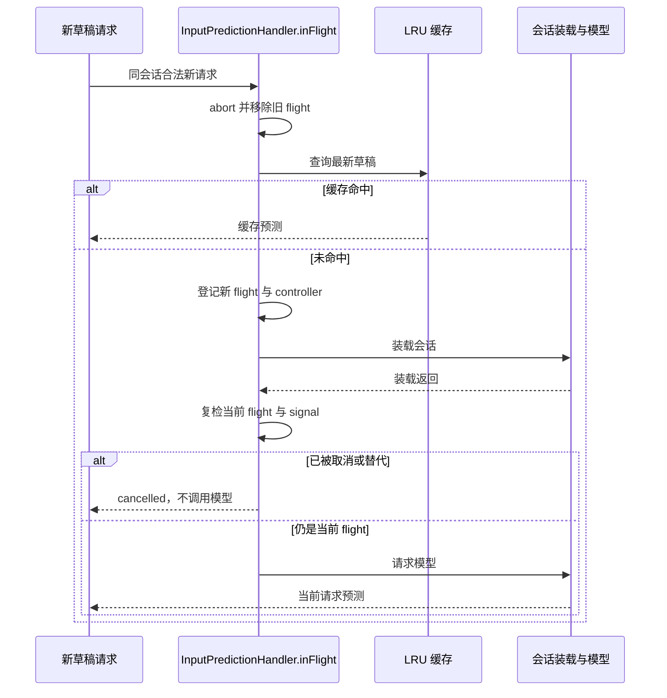
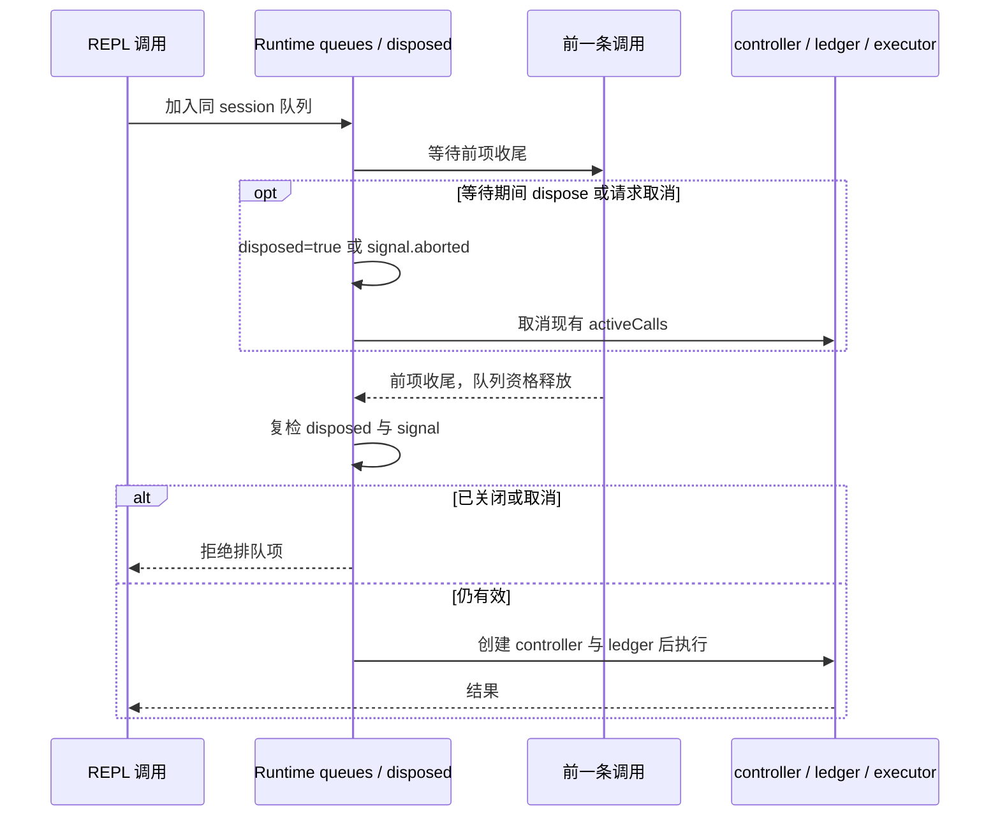
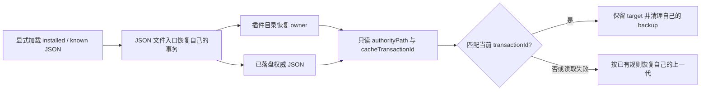

# CLI 全模块代码审查（2026-11-06）

审查对象为当前工作树 `apps/zcode-cli`，覆盖所有 package/tool/e2e package、架构策略中的 CLI roots 与其余脚本/资源目录。已有本地改动保留；本轮不提交、推送或打包。

## 方法与验证边界

逐模块阅读公开入口/契约、核心实现与失败路径，结合静态检查及选定回归测试确认问题。记录中的“检查”表示这些入口和关键路径经过审查，不表示每条路径均有真实模型、真机或全平台验收。根 typecheck/lint 与全量架构由主代理统一执行；CLI 检查与专项测试另行记录。

最终清单覆盖 27 个架构模块（1 个 legacy 聚合根、26 个 managed 模块）、38 个 manifest（CLI 根、30 个 packages、4 个 tools、3 个 e2e）。源文件/脚本枚举为 3240 个，其中非测试实现 1840 个；TS/JS 解析诊断为 0，IO/cancel 等静态风险候选为 306 条。候选数量不是 bug 数，也不是全路径验证。每个模块的 CLI roots、所读入口/契约/关键实现与结果/限制都记在末尾及 JSON。

所有测试在仓库内隔离 home/temp/cache/storage/logs，并在启动前检查目录与子进程环境。不得使用真实用户数据目录或系统临时目录；无法证明写入范围的测试不运行。

## 已确认问题与修复规则

### 会话数据清理沿父级符号链接越界

- 触发：`cli/artifacts`、`cli/debug` 或 `cli/memories/projects` 等父目录被替换为符号链接/junction。即便 session ID 与记忆目录的字符串检查合格，`lstat(cli/artifacts/<sid>)` 和 `rm` 仍先跟随父目录，实际测量/删除存储根外的同名目标。
- 状态所有者：`createNodeSessionDataFiles` 是文件测量/删除唯一 adapter；协议层只传 session ID 与 directory，不新增清理路径。
- 修复规则：对整批目标先检查 `cliStorageRoot` 到目标父目录的每层现存目录；发现符号链接/junction 或非目录立即以稳定错误拒绝，任何目标均不得开始删除。目标自身为符号链接时继续只删除链接本身，不跟随其内容。不存在的父目录按原有零大小/幂等删除处理。
- 顺序：解析目标 → 整批父目录检查 → 测量 → 删除。这里只修复可预先检出的父目录链接；检查完成后外部进程替换目录的系统级竞态不宣称已消除。
- 回归：会话父目录链接、记忆父目录链接、CLI 根链接均须拒绝；存储根外的仓库内 sentinel 保持原字节；批次中其它有效目标保持不变；原有顶层 session 链接行为与重复删除保持。

## 逐模块覆盖、结果与限制

### 输入预测命中缓存未取消旧请求

- 触发：先缓存草稿 A → 草稿 B 请求仍在模型/会话装载中 → 最新请求恢复草稿 A 命中缓存。原实现先返回缓存，B 不会取消，仍可能继续请求模型并回 `show`。
- 唯一 owner：`ConversationInputPredictionHandler.inFlight`；每条合法新请求到达都替代同会话旧请求，包括缓存命中，不改变跨会话并发或 LRU key。
- 顺序：解析 → 取消/移除旧 flight → 查缓存 → 必要时登记新 flight → 装载 → 取消复检 → 模型。旧的会话装载迟到后不得再发模型请求。
- 回归：缓存 A 替代在途 B 时立即 abort，B 回 `cancelled`；被替代的 loader 即使迟到返回有效材料，也不调用模型。

### REPL 关闭后已排队调用仍进入执行器

- 触发：同 session 的第一条 `js` 尚未完成，第二条已进入 serialized 队列；runtime.dispose 只取消 activeCalls 并清空 map，第二条已持有的等待 promise 仍会在第一条收尾后继续执行。
- 唯一 owner：Node REPL runtime 的 `disposed`、`queues`、`activeCalls`；不新增第二个队列或 call ledger。
- 修复规则：队列获得执行资格后、创建 controller/ledger/Worker/broker 前再次复检 runtime 是否关闭与请求 signal 是否取消；关闭/取消的排队项拒绝且不进入执行器。
- 回归：第一条执行中第二条排队，dispose 后释放第一条，第二条以 disposed 拒绝，执行器只调用一次。请求在排队期间取消也不得执行。

### REPL 直接 stderr 诊断携带原始异常与会话身份

- 触发：cell 异步拒绝/异常时 process guard 把原始 message/stack 写到 stderr；无进展提示另行把 session/turn ID 写到 stderr。这些路径未经过 NodeFileLogger 白名单，违反本仓安全诊断出口规则。
- 修复规则：进程异常和入口失败先调用共享 `safeLogArgs`，仅输出固定事件说明与净化后的结构；无进展提示只保留固定 kind 与数值 count，模型提示结果不变。不改变用户可见的工具执行错误结果。
- 回归：fake error 含凭据占位、路径、正文时 stderr 不包含任一原文；非 Error 拒绝原文也不可输出；错误输出管道关闭仍只触发一次 shutdown；无进展提示 stderr 无 session/turn ID。

### 离线轨迹工具保留已删除采集功能的悬空引用

- 触发：正式 CLI typecheck 加载 `tools/prompt-trajectory/src/testcases.ts` 与 5 个旧采集测试时找不到早已删除的 fixture/record/proxy/assembler 模块；package scripts 仍宣传 record/run:testcases，但当前 CLI 只接受 derive/model-io。
- 修复规则：清理退场采集 runner、source、孤儿测试与失效命令，不恢复已删除的原文采集/Provider proxy 模块；保留显式输入文件的离线 derive/model-io、连续性比较与 ToolSearch 比较。
- 回归：现有离线 Node 测试验证 derive/model-io 可执行、record/record-prompt/run-testcases 拒绝；manifest 不再包含录制命令；CLI typecheck 应越过悬空引用。

覆盖列表与逐模块阅读账本见 `.audit/full-code/cli-coverage.json` 和本文末尾；验证结果如下。

### 退场 Sites 插件未处理缺失自建 endpoint

- 触发：`resolveRuntimeZCodeEndpointOrigin` 已按 fork 规则返回 `string | undefined`，插件仍要求必有 origin；旧测试同时引用已删除的 shared 官方身份常量，令正式 CLI typecheck 失败。
- 修复规则：保留历史协议 key 只用于严格读取旧消息；测试不重新引入 shared 官方身份接口。API 接受缺失 origin，先以 `official_mcp_origin_untrusted` 拒绝，任何 fetch 都不得发生。不增加官方默认地址、账号或自动加载入口；Sites 在本仓仍不接入产品。
- 回归：origin 为 undefined/空白时，即使传入形状合格的历史 auth meta 也不发网络请求；既有有 origin 的纯 mock API 测试继续通过。

### Provider 回归工具沿用已退场的来源/采集选项

- 触发：当前 ToolExecutionContext 要求 workspaceScopeRoot，回归工具直接调用 WebSearch 时缺失；其 App/Adapter 装配仍传已移除的 sourceTitle 与 modelIoFullRetentionEnabled，正式 CLI typecheck 失败。
- 修复规则：工具上下文使用现有 fixtureDir 作为 workspaceScopeRoot；删除已不存在的来源/原文保留选项，测试按当前模型请求契约确认不附带官方产品身份头。保持显式 Provider 配置、mock transport、产品会话执行和报告脱敏。
- 回归：WebSearch 用例沿公开 handler 完成、TEXT 用例沿产品会话完成；没有 X-Title/X-ZCode-App-Version 头。不以恢复采集或官方身份接口解决类型错误。

### SQLite 启动取消与权限转换备份边界

- 触发一：`openStartup` 的 signal 已取消，但 `open` 先 mkdir/DatabaseSync 再进入会检查 signal 的迁移 runner，已拒绝的启动留下目录/数据库。
- 修复规则：SqliteSessionStore.open 是唯一连接 owner；接收预先取消的 signal 时在任何 mkdir/SQLite open 前直接抛其 reason，不通知检查/ready。目录准备异步返回后再次复检，取消时不再打开数据库；已进行的目录创建不宣称可回滚。
- 触发二：0003 把 permission 行转换到空 local_setting，备份需求只按 local_setting 的现有数据判断，因此已有 permission 行却能越过无效备份目录继续迁移。
- 修复规则：0003 的 touchedTables 显式包括源 permission 与目标 local_setting；沿通用 runner 备份判定与事务，不改变冻结 SQL、checksum、ledger ID 或表 schema。备份失败时源行、目标空表与两条既有 ledger 均保持。
- 回归：预取消打开不创建目标父目录、数据库或进度；permission 有行/local_setting 空时坏备份目录拒绝，换有效备份后迁移完成且 backup 元数据包含 permission。
- 诊断粒度限制（主代理核实 shared classifier）：`backup_failed` 不属于冻结启动错误码枚举，内层 systemCode 优先分类；无系统 cause 的备份配置拒绝沿通用 `sql_failed` 分类。UI 仍失败关闭且允许重试，本轮不新增协议码或改变此行为。

### 显式本地快照演示工具的重定向与参数错误

- 触发：上传只校验首 URL 为 loopback，fetch 默认跟随 307/308 后会把完整密文/manifest 转发到新地址；CLI 总开关位于首位时子命令不识别，位于尾部且省略 workspace 时因 indexOf=-1 把总开关当路径。
- 修复规则：保留显式 gate，upload 禁止重定向；解析子命令前移除总开关，workspace 只从确有 `--workspace` 且值非 flag 时读取，否则用 cwd/拒绝缺值。不改变演示扫描边界、密钥或生产接入。
- 回归：两个仓库内 loopback 服务模拟 307，目的服务请求数为零且原状态码保留；命令首/尾开关均只扫独立空夹具 cwd，缺失 workspace 值拒绝。

### 旧会话恢复插件缺失实现仍静态加载

- 证据：`69be408e`（2026-10-10）删除 legacy-scan/values/snapshot/store/sqlite 与 parts，提交说明是“换上游双脚本实现”，并非产品退场。当前两个入口却仍使用旧拆分模块，bundled definition 保留且默认 disabled；维护 spec 无明确删除恢复插件的裁决。
- 本轮最小边界：保留 bundled 定义/技能/命令，不恢复缺失实现或用户数据。两个入口的 `--help` 正常输出用途与当前 unavailable 状态；scan、restore 及 `--dry-run` 在任何快照读取、库打开、备份或 mkdir 前以稳定 `LEGACY_SCAN_UNAVAILABLE` / `LEGACY_RESTORE_UNAVAILABLE` 退出 2。不伪造空扫描或成功 dry-run，也不因为动态加载缺模块打印内部栈。
- 未完成能力：旧快照扫描/恢复暂不可用；后续若保留产品能力，需先对齐当前两库 owner、迁移与来源/目标规则，再独立提供实现及验收，不能从历史提交直接复活写库路径。
- 回归：help 成功；不存在或合成快照上的 scan/restore/dry-run 明确拒绝；指定库路径与全部隔离 data/home 无新增业务文件，已有 sentinel 原字节保留。

### 插件恢复 marker 的 staging 名称允许路径穿越

- 触发：`recoverAtomicTargetSync` 读取 transaction marker，只检查 stageName 前缀，然后 `join(parent, stageName)` 并递归清理。形如 `.active.stage-x/../../sentinel` 的 marker 会在 join 规范化后把清理目标移出插件目录；Windows 的反斜杠同样可触发。
- 唯一 owner：现有 atomic-directory adapter 与既有 marker/backup/staging 事务；不增加第二种恢复算法。
- 名称校验是无 IO 的纯规则，收在既有 plugins/helpers 内；恢复决策与删除仍由 atomic-directory 唯一执行，避免为局部修复把原有 396 有效行文件推过 400 行门槛。
- 修复规则：marker 的 stageName 只能是同目录 basename，且符合既有非空 staging 前缀；斜杠、反斜杠、NUL 与冒号均拒绝用于清理。非法 stageName 不触发其目录清理，原 target/backup 的恢复规则保持。
- 回归：v1/v2 marker 的穿越 staging 路径不可删除仓库内、插件根外的合成 sentinel；合法 staging 仍被清理。测试所有创建/递归清理路径先约束到项目内隔离 fixture。

### 协调恢复把 authorityPath 当作新的恢复目标

- 触发：v2 磁盘 marker 的 authorityPath 被 `authorityContainsTransactionSync` 递归交给 `recoverAtomicTargetSync`。自指 marker 会重复恢复同一目标直至栈耗尽；指向其它目录时，仅核验提交状态就会删除那个目录的 backup、staging 和 marker。
- 生产 owner：marketplace 的三处协调装配只指向 installed_plugins.json 或 known_marketplaces.json；它们通过各自 `loadInstalledPluginsSync` / `loadKnownMarketplacesSync` 的显式 JSON 读取入口恢复文件。目录恢复不得凭磁盘字符串派发另一个恢复任务。
- 修复规则：协调提交判断只读取 authorityPath 中已落盘的 JSON 与 cacheTransactionId，读取失败按未提交处理，不递归恢复或写入 authorityPath 的任何邻接路径。现有 authority 文件 owner、目录 target/backup 恢复与活跃 writer 判断保持。
- 回归：自指 marker 只检查一次原目标 owner；指向其它仓库内 fixture 的 authorityPath 不删除其 backup/staging/marker。合法协调的上一代/已提交恢复和活跃事务读取继续通过。

### 退场官方闲时派发的孤儿测试

- 依据：当前 `bootstrap/src/zcode-protocol/server.ts` 明确官方闲时派发已删除且不注册 method；`official-3.17.1-integration.md` 59/382/394 记录不恢复 OffPeak 云任务、网关和测试装配；当前 core 的 runtime/off-peak、工具 handler 与契约缺失，正式 manifest/脚本无这些测试专属调用。静态查询未发现这些测试导出或外部文件引用。
- 清理：删除仅验证旧换票、闲时取消/生命周期/模型接管的 off-peak-cancel、lifecycle、model-binding、runtime 测试。off-peak-title 保留独立的普通 session shutdown/title 收尾回归；off-peak-tool 保留普通用户/automation 的 SendMessage 和 Workflow mock 端口行为，清理旧官方专属测试及失效 import。减少对应悬空引用基线，不放宽棘轮。
- 这不删除历史行迁移/只读存储规则，不恢复官方闲时服务，也不声称遗留测试整体已通过。保留用例与完整 CLI 边界将实际运行。

### tool_reference 重复分支核实

- 四个重复 switch 位置：contracts/model 的 blockToText（首分支为裸工具名，末分支为包装文案）；adapters/model/transform 的 tool result（首分支严格要求 active Anthropic ToolSearch，末分支为宽松 text fallback）、assistant 与 user（首分支严格拒绝，末分支归入文本投影）。当前执行均命中首分支；后者不可达。
- 本轮保留首分支当前契约，清理不可达旧分支消除构建警告；不恢复宽松 fallback，也不改变工具引用在 provider/角色边界的行为。纯模型变换测试与 ToolSearch wire 回归验证当前严格规则。

### 配置指南仍宣称项目 MCP 默认可信

- 当前 `workspace-mcp-trust` 合同与实现要求 Host 用户域按 workspace identity + 精确声明摘要授权；未知、陈旧或损坏记录默认拒绝。两份 bundled guide 却宣传“项目 MCP 自动可信、untrusted 已退场”，会把真实授权拒绝误导成配置/启动错误。
- 只修文档：说明项目来源需要显式审核，配置变更后重验，设置/新会话沿现有 gate；不指导绕过授权或复制到用户配置规避拒绝。不改变用户/插件普通来源及当前连接复用规则。bundled-skills README 同步当前 CLI storage 路径与实际 SEA helper 路径，移除不存在的准备命令引用。

## 最终验证与保留欠账

固定使用项目内 Node 24.14.0 和 `corepack pnpm`，通过 `.audit/full-code/run-cli-validation.mjs` 为每轮创建项目内隔离环境。下表日志目录均相对于 `.run-logs/project-only-validation/`；各轮 `result.json` 与 `logs/output.log` 保留真实退出码及输出。重复复跑不累计为独立用例数。

| 范围 / 命令                                                                                | 实测结果                                                                                                                 | 日志目录                                                             |
| ------------------------------------------------------------------------------------------ | ------------------------------------------------------------------------------------------------------------------------ | -------------------------------------------------------------------- |
| session-data-files、input-prediction-handler、REPL process guards、Sites API 四文件 Vitest | 44 passed                                                                                                                | `full-cli-audit-pY438k`                                              |
| SQLite 预取消与 permission 备份两项定向 Vitest                                             | 2 passed / 9 skipped                                                                                                     | `full-cli-audit-yX6oWM`                                              |
| CLI 官方边界、离线 prompt trajectory、snapshot gate 三文件 Node test                       | 18 passed                                                                                                                | `full-cli-audit-D7QECo`                                              |
| model-transform、ToolSearch wire、保留 session title 与普通 tool 四文件 Vitest             | 39 passed                                                                                                                | `full-cli-audit-2HUns9`                                              |
| REPL 现有 no-progress 定向 Vitest                                                          | 1 passed / 26 skipped                                                                                                    | `full-cli-audit-tS9SuE`                                              |
| Provider regression TEXT/WebSearch 产品路径 Vitest                                         | 2 passed / 9 skipped                                                                                                     | `full-cli-audit-7muzLW`                                              |
| atomic staging 穿越及合法 coordinated recovery                                             | 2 passed / 78 skipped；红回归先复现 sentinel 被删                                                                        | `full-cli-audit-JfUNAn`（红）、`full-cli-audit-yJlFdw`（绿）         |
| authorityPath 递归 / 其它目标清理新回归，连同合法代际与活跃目录读取                        | 7 passed / 75 skipped；两项新回归先分别复现 ENOENT 与 stack overflow                                                     | `full-cli-audit-xMOJ2X`（红）、`full-cli-audit-2LeckJ`（绿）         |
| `corepack pnpm --dir apps/zcode-cli typecheck`                                             | **通过**；最后一轮已包含所有修复。仅现有 TUI/DWF/TS 生成，不下载安装包或 Linux 运行资源                                  | `full-cli-audit-PpaTXJ`                                              |
| `corepack pnpm --dir apps/zcode-cli lint`                                                  | **未通过：76 warnings / 89 errors**；全部 errors 为既有 max-lines                                                        | `full-cli-audit-EEWMme`                                              |
| 与首轮正式 CLI Lint 80 warnings / 89 errors 的比较                                         | 按 error 的规则/文件、warning 的规则/文件/消息比较，无新增诊断；移除四处 duplicate-case。位置/有效行数可能随本轮修改变化 | `full-cli-audit-zKPKPV`；`.audit/full-code/cli-lint-comparison.json` |
| 49 个本轮明确改动文件的 oxfmt API check                                                    | 通过，changed=0；不格式化其它既有修改                                                                                    | `full-cli-audit-Onq02n`                                              |
| oxfmt CLI                                                                                  | 当前 Windows 隔离命令报 Expected at least one target file，不能记为通过；用同安装包 API 完成明确文件列表检查             | `full-cli-audit-kRSUs8`                                              |
| Knip                                                                                       | 未通过，现有 unused/dependency 及退场测试欠账保留；不把全仓静态清单当作删除授权                                          | `full-cli-audit-DOXYH4`                                              |
| 最终机械扫描                                                                               | 27 模块 / 38 manifests / 3240 source-script 文件，0 parse errors / 306 风险候选                                          | `full-cli-audit-GxrZcm`                                              |

第一轮明确源码修改 / 删除清单位于 `.audit/full-code/cli-first-pass-changes.json`（49 个修改文件、11 个删除文件），不包含其它既有改动、审查辅助文件或验证生成输出。当前 node-repl-host/dist-types 的 tracked 生成文件有差异，已保留供主代理合并检查，未擅自回退。删除范围为 prompt trajectory 的 source/runner/五个采集孤儿测试，以及四个官方闲时专属测试；普通 title/tool 用例仍保留并实测。涉及跨包的根命令和悬空引用棘轮由主代理协调，未替代其它组的代码 owner。

保留限制：没有声称全部旧 CLI 测试已运行或通过；大型 vendor/Python/XML/资源实现只做枚举与入口/风险路径审查，未作逐行人工证明。没有真实 Provider API、Android/iOS/macOS 设备、office renderer/browser 端到端、发行打包或真实用户迁移验收。旧会话恢复插件的读写能力仍明确 unavailable；本轮只修加载和零写失败边界，未恢复删除的迁移模块或用户数据。父目录链接的静态拒绝不消除检查之后其它进程替换目录的系统级竞态。

根 typecheck、根 lint 与全量架构结果由主代理独立报告；CLI Lint 包含的 1715 个源码/debug/test 文件与根 Lint 的扫描口径不同，不能互相代替。

## 第二轮复核（2026-11-06）

复核对象为第一轮具体修复：atomic marker 与只读 authority、session 数据清理、输入预测取消、REPL 生命周期与诊断、SQLite 取消/备份、离线轨迹及工具禁云边界。保留原状态 owner、数据目录和产品退场裁决，不清理无依据的 89 条行数存量。

### 输入预测降级日志仍传原始异常

- 证据：`warn` 向注入 Logger 直接传 `sessionId` 与 `error.message` / `String(error)`，错误可能包含原草稿、凭据、路径。第一轮测试仅断言草稿不进入日志，但模拟异常文本没有草稿，因此未覆盖这个出口。
- 修复规则：业务服务出口只记录固定 transcript_failed / model_failed 分类与固定 module/event，不传原始异常、业务会话身份或内容。不得依赖 Logger 的全局净化保证。预测、缓存和取消状态仍由原 handler 独占，结果语义保持。
- 回归：loader 和模型各自抛 Error / 非 Error，异常含合成敏感内容及路径时仍返回 unavailable，Logger 的完整参数不包含原文、会话 ID、草稿或 request ID；现有取消、缓存与超时回归仍通过。

### 固定权威文件未先恢复导致合法目录被回滚

- 触发：known / installed 权威 JSON 暂缺，而同目录 backup 保存上一轮已经提交且匹配目录 marker 的 cacheTransactionId。`loadMarketplaceManifestSync` 可先恢复目录，`ensureMarketplaceManifestAvailable` 甚至在它之后才加载 known；`resolveInstalledPluginRoot` 也可直接用已有 record 读缓存。第一轮只读 authority 于是将合法目录判作未提交并删掉新代际。
- 修复规则：marketplace 两个入口先沿既有 `readJsonFileSync` 恢复由 storageRoot 固定解析出的 known_marketplaces.json / installed_plugins.json，再恢复各自目录。恢复文件目标不能取自磁盘 marker.authorityPath；通用 atomic 的 authority 判断继续只读，不能递归派发恢复。JSON 读取不回调目录入口，保持单向 owner 依赖。
- 回归：两个权威文件各有缺失主文件、已提交 backup 与 standalone marker，同时目录留有协调 marker / 新代 target / 旧代 backup；直接从 manifest / installed root 入口读取应先恢复固定文件、保留新代并清掉自己的旧代。自指 authority 与其它 sentinel 的零写回归继续通过。

### SQLite 目录准备期间取消的测试盲区

新增回归在 mkdir promise 发起后、恢复 await 前取消，并使用非 Error reason。结果必须保留原 reason，目录可已创建但保持空，不打开 SQLite、不通知进度；这补足第一轮预取消用例，没有新增生产代码或伪称 mkdir 可回滚。

### 二轮实测与精确变更清单

| 范围 / 命令                                                                    | 实测结果                                                                                                                   | 日志目录（同上）                                                             |
| ------------------------------------------------------------------------------ | -------------------------------------------------------------------------------------------------------------------------- | ---------------------------------------------------------------------------- |
| input-prediction、session-data-files、REPL process guards、Sites API           | **45 passed**；日志泄漏新增回归先红后绿，取消/cache 既有回归通过                                                           | `full-cli-audit-TCVLgU`（红）、`full-cli-audit-wKacwn`（绿）                 |
| 插件固定 known / installed 权威文件恢复，连同只读 authority、代际及活跃 writer | **10 passed / 74 skipped**；两个入口先分别错误返回旧代，新回归红后绿                                                       | `full-cli-audit-WcQUC0`（红）、`full-cli-audit-lr1oxW`（绿）                 |
| SQLite 预取消、mkdir 期间取消与 permission 源表备份                            | **3 passed / 9 skipped**                                                                                                   | `full-cli-audit-91yjUA`                                                      |
| CLI 官方边界、离线 prompt trajectory、snapshot gate 三文件 Node test           | **18 passed**                                                                                                              | `full-cli-audit-43p9Gn`                                                      |
| `corepack pnpm --dir apps/zcode-cli typecheck`                                 | **通过，退出 0**；覆盖当前正式 package/tool 命令，仅现有 TUI、DWF libs 与 TypeScript 声明生成                              | `full-cli-audit-oHA9ZP`                                                      |
| 正式 CLI Lint                                                                  | **未通过：76 warnings / 89 errors**；89 个 error 全为既有 max-lines                                                        | `full-cli-audit-8VDmbx`                                                      |
| 与一轮最终 CLI Lint 比较                                                       | 两边各解析 165 条；按 error 规则/文件及 warning 规则/文件/消息比较，新增 0、移除 0                                         | 对比 `full-cli-audit-EEWMme` 与 `full-cli-audit-8VDmbx` 的 `logs/output.log` |
| 两轮 union 50 个明确文件的 oxfmt API check                                     | **通过，changed=0**；定向格式化只改变其中 3 文件                                                                           | `full-cli-audit-KUpJbd`（write）、`full-cli-audit-y9c39g`（check）           |
| 二轮结束机械扫描                                                               | 27 模块 / 38 manifests / 3240 source-script 文件，1840 非测试实现，0 parse errors / 306 风险候选；刷新文件 hash 与阅读账本 | `full-cli-audit-qrSFjm`                                                      |

`.audit/full-code/cli-second-pass-changes.json` 精确列出二轮 5 个修改文件、0 个删除：预测 handler 与测试、marketplace.ts 与插件测试、SQLite 启动测试。其中 marketplace.ts 是新增到第一轮清单的唯一文件，其余 4 个继续完善第一轮文件；两轮 union `.audit/full-code/cli-changes.json` 共 50 个修改文件、11 个删除文件。两个生产修复均有中文原因注释；通用 atomic-directory 第二轮没有新增修改。

既有 tracked 生成输出为 node-repl-host/dist-types 下 `call-ledger/ledger.d.ts`、对应 map、`result.d.ts.map`、`server.d.ts` 与对应 map 共 5 文件。ledger 声明仅末尾换行差异；ledger/result map 为更早源码与声明位置漂移；server 声明及 map 体现更早 CUA 装配入口从同步返回变为 Promise 的源码改动与注释。它们没有为二轮两项生产修复手写 public 类型；当前正式校验可能重发射既有声明，原差异保留。缺少开工初始快照，不能将更早作者或生成轮次归于本轮；主代理据实际 diff 决定最终提交范围。

### 提交 hook 与正式 CLI Lint 口径

只读检查当前 `core.hooksPath=.husky/_`。仓库没有 `.husky/pre-commit`，Husky wrapper 检测不到入口即退出 0；`.husky/pre-push` 调用根 `verify:pre-push`，其 Lint 为根 `oxlint`，根 `.oxlintrc.json` 明确忽略 `apps/zcode-cli`，链内没有调用正式 CLI Lint。故 89 条 CLI max-lines 本身不会直接阻断根 commit / pre-push；其余 schema、架构、工作树与受影响工程测试仍可阻断。未实际提交或 push，未绕过 hook。

二轮开始 freshness 通过（`full-cli-audit-558qsf`）。默认 `architecture:check --changed` 以 merge-base upstream origin/main 为 base 实测失败 5 项（`full-cli-audit-NkyEFj`），均为其它组负责的 dev-docs/e2e-report/stream-animate unmanaged-new-file，已交主代理统一处理；不把它记为 CLI 修复通过或擅自改变模块登记。

<!-- CLI-MANUAL-COVERAGE -->

## 模块与 package 阅读账本

所有下列模块的声明、契约/入口和所列关键路径已读取。源文件/脚本全量枚举与 TS/JS parse、静态 import、IO/cancel 候选扫描另见 JSON；这不是逐行人工证明。被管理 roots 的 CLI 子树已列出，跨包其它 roots 由对应审查组负责。

| 模块                         | CLI roots                                                                                                                                                                                                                                                                                                                                                                                                                                                                                   | 阅读文件（入口/契约及关键路径）                                                                                                                                                                                                                                                                                                                                                                                                                                                                                                                                                                                                                                                                                                      | 结果 / 验证限制                                                                                                           |
| ---------------------------- | ------------------------------------------------------------------------------------------------------------------------------------------------------------------------------------------------------------------------------------------------------------------------------------------------------------------------------------------------------------------------------------------------------------------------------------------------------------------------------------------- | ------------------------------------------------------------------------------------------------------------------------------------------------------------------------------------------------------------------------------------------------------------------------------------------------------------------------------------------------------------------------------------------------------------------------------------------------------------------------------------------------------------------------------------------------------------------------------------------------------------------------------------------------------------------------------------------------------------------------------------ | ------------------------------------------------------------------------------------------------------------------------- |
| zcode-cli                    | `apps/zcode-cli`                                                                                                                                                                                                                                                                                                                                                                                                                                                                            | `apps/zcode-cli/AGENTS.md` `apps/zcode-cli/package.json` `apps/zcode-cli/turbo.json` `apps/zcode-cli/scripts/clean-dist.mjs`                                                                                                                                                                                                                                                                                                                                                                                                                                                                                                                                                                                                | 全部 manifest、公开入口及关键脚本边界已核验；确认修复、删除与 lint 欠账见各节。其余实现只有机械枚举，不声称逐行人工验收。 |
| office-runtime               | `apps/zcode-cli/packages/office-runtime`                                                                                                                                                                                                                                                                                                                                                                                                                                                    | `apps/zcode-cli/packages/office-runtime/index.ts` `apps/zcode-cli/packages/office-runtime/contract.ts` `apps/zcode-cli/packages/office-runtime/CONTRACT.md` `apps/zcode-cli/packages/office-runtime/src/app/documents.ts` `apps/zcode-cli/packages/office-runtime/src/adapters/files.ts` `apps/zcode-cli/packages/office-runtime/src/adapters/main.ts`                                                                                                                                                                                                                                                                                                                                                                | 核验 document owner、文件 adapter 和入口；未发现新的实证 bug。未做 office UI / 真机验收。                                 |
| mcp-ui                       | `apps/zcode-cli/packages/bootstrap/src/zcode-protocol/mcp-ui`                                                                                                                                                                                                                                                                                                                                                                                                                               | `apps/zcode-cli/packages/bootstrap/src/zcode-protocol/mcp-ui/index.ts` `apps/zcode-cli/packages/bootstrap/src/zcode-protocol/mcp-ui/contract.ts` `apps/zcode-cli/packages/bootstrap/src/zcode-protocol/mcp-ui/CONTRACT.md` `apps/zcode-cli/packages/bootstrap/src/zcode-protocol/mcp-ui/sessionAccess.ts` `apps/zcode-cli/packages/bootstrap/src/zcode-protocol/mcp-ui/samplingCalls.ts` `apps/zcode-cli/packages/bootstrap/src/zcode-protocol/mcp-ui/instances.ts`                                                                                                                                                                                                                                                   | 核验 session access、sampling 与 instance 归属；未发现新的实证 bug。跨包 UI roots 由其它组检查，未跑实际 MCP UI。         |
| cli-subagent-config          | `apps/zcode-cli/packages/bootstrap/src/runtime-subagents` `apps/zcode-cli/packages/bootstrap/tests/runtime-subagents`                                                                                                                                                                                                                                                                                                                                                                    | `apps/zcode-cli/packages/bootstrap/src/runtime-subagents/index.ts` `apps/zcode-cli/packages/bootstrap/src/runtime-subagents/contract.ts` `apps/zcode-cli/packages/bootstrap/src/runtime-subagents/CONTRACT.md`                                                                                                                                                                                                                                                                                                                                                                                                                                                                                                                 | 核验配置解析与运行时装配方向；未发现新的实证 bug。未跑真实子 Agent 模型。                                                 |
| cli-session-execution        | `apps/zcode-cli/packages/bootstrap/src/session-execution` `apps/zcode-cli/packages/bootstrap/tests/session-execution` `apps/zcode-cli/packages/bootstrap/src/zcode-protocol-v4/commands/handlers/canonical-intent-replay.ts`                                                                                                                                                                                                                                                          | `apps/zcode-cli/packages/bootstrap/src/session-execution/index.ts` `apps/zcode-cli/packages/bootstrap/src/session-execution/contract.ts` `apps/zcode-cli/packages/bootstrap/src/zcode-protocol-v4/commands/handlers/canonical-intent-replay.ts` `apps/zcode-cli/packages/bootstrap/src/session-execution/CONTRACT.md` `apps/zcode-cli/packages/bootstrap/src/session-execution/residency-lease.ts` `apps/zcode-cli/packages/bootstrap/src/session-execution/model-context.ts`                                                                                                                                                                                                                                         | 核验 residency lease、model context 与 canonical intent replay；未发现新的实证 bug。未做跨进程远程回放。                  |
| cli-arguments                | `apps/zcode-cli/packages/cli/src/argument-parsing` `apps/zcode-cli/packages/cli/src/arguments.ts` `apps/zcode-cli/packages/cli/tests/argument-parsing`                                                                                                                                                                                                                                                                                                                                | `apps/zcode-cli/packages/cli/src/arguments.ts` `apps/zcode-cli/packages/cli/src/argument-parsing/contract.ts` `apps/zcode-cli/packages/cli/src/argument-parsing/CONTRACT.md`                                                                                                                                                                                                                                                                                                                                                                                                                                                                                                                                                   | 核验解析与退场命令边界；CLI 边界 Node 回归通过。未启动用户会话。                                                          |
| workflow-tool-entrypoints    | `apps/zcode-cli/packages/core/src/tool/workflow-entrypoints` `apps/zcode-cli/packages/core/src/tool/handlers/amend-workflow.ts` `apps/zcode-cli/packages/core/src/tool/handlers/list-models.ts` `apps/zcode-cli/packages/core/src/tool/handlers/fill-workflow-hole.ts` `apps/zcode-cli/packages/core/tests/workflow-entrypoints` `apps/zcode-cli/packages/core/src/tool/handlers/workflow.ts` `apps/zcode-cli/packages/core/src/tool/handlers/amend-workflow-approval.ts` | `apps/zcode-cli/packages/core/src/tool/handlers/amend-workflow.ts` `apps/zcode-cli/packages/core/src/tool/handlers/list-models.ts` `apps/zcode-cli/packages/core/src/tool/handlers/fill-workflow-hole.ts` `apps/zcode-cli/packages/core/src/tool/workflow-entrypoints/contract.ts` `apps/zcode-cli/packages/core/src/tool/handlers/workflow.ts` `apps/zcode-cli/packages/core/src/tool/handlers/amend-workflow-approval.ts` `apps/zcode-cli/packages/core/src/tool/workflow-entrypoints/CONTRACT.md`                                                                                                                                                                                                               | 核验 workflow handler 与 approval 入口；保留普通 tool 回归通过。未做真模型 workflow 运行。                                |
| tool-result-settlement       | `apps/zcode-cli/packages/core/src/runtime/tool-result-settlement` `apps/zcode-cli/packages/core/src/runtime/methods/tool-result-settlement.ts` `apps/zcode-cli/packages/core/tests/tool-result-settlement`                                                                                                                                                                                                                                                                            | `apps/zcode-cli/packages/core/src/runtime/methods/tool-result-settlement.ts` `apps/zcode-cli/packages/core/src/runtime/tool-result-settlement/contract.ts` `apps/zcode-cli/packages/core/src/runtime/tool-result-settlement/CONTRACT.md`                                                                                                                                                                                                                                                                                                                                                                                                                                                                                       | 核验结果归属、terminal 幂等与取消收尾；未发现新的实证 bug。未做远程 transport 故障验收。                                  |
| remote-input-prediction      | `apps/zcode-cli/packages/bootstrap/src/zcode-protocol/input-prediction-handler.ts` `apps/zcode-cli/packages/core/src/runtime/methods/input-prediction-sidecar.ts`                                                                                                                                                                                                                                                                                                                        | `apps/zcode-cli/packages/bootstrap/src/zcode-protocol/input-prediction-handler.ts` `apps/zcode-cli/packages/core/src/runtime/methods/input-prediction-sidecar.ts`                                                                                                                                                                                                                                                                                                                                                                                                                                                                                                                                                                 | 修复缓存命中替代 flight、loader 迟到取消及降级日志固定分类；专项回归通过。未调用真实模型。                                |
| tool-discovery               | `apps/zcode-cli/packages/core/src/tool/search` `apps/zcode-cli/packages/core/src/tool/handlers/tool-search.ts` `apps/zcode-cli/packages/core/src/tool/handlers/deferred-tool-call.ts` `apps/zcode-cli/packages/contracts/src/tools/tool-search.ts` `apps/zcode-cli/packages/core/tests/tool-discovery`                                                                                                                                                                          | `apps/zcode-cli/packages/core/src/tool/search/contract.ts` `apps/zcode-cli/packages/core/src/tool/search/exposure.ts` `apps/zcode-cli/packages/core/src/tool/search/history.ts` `apps/zcode-cli/packages/core/src/tool/search/search.ts` `apps/zcode-cli/packages/core/src/tool/search/description.ts` `apps/zcode-cli/packages/core/src/tool/search/local-projection.ts` `apps/zcode-cli/packages/core/src/tool/handlers/tool-search.ts` `apps/zcode-cli/packages/core/src/tool/handlers/deferred-tool-call.ts` `apps/zcode-cli/packages/contracts/src/tools/tool-search.ts` `apps/zcode-cli/packages/core/src/tool/search/CONTRACT.md` `apps/zcode-cli/packages/core/src/tool/search/persistence.ts` | 核验 discovery / exposure / persistence 与严格 ToolSearch 引用；wire 回归通过。未连接真实 MCP server。                    |
| node-repl-call-ledger        | `apps/zcode-cli/packages/node-repl-host/src/call-ledger` `apps/zcode-cli/packages/node-repl-host/test/call-ledger`                                                                                                                                                                                                                                                                                                                                                                       | `apps/zcode-cli/packages/node-repl-host/src/call-ledger/contract.ts` `apps/zcode-cli/packages/node-repl-host/src/call-ledger/CONTRACT.md` `apps/zcode-cli/packages/node-repl-host/src/call-ledger/ledger.ts`                                                                                                                                                                                                                                                                                                                                                                                                                                                                                                                   | 核验 call ledger；相邻 server 修复排队取消/dispose 与安全诊断，回归通过。未做浏览器/办公工具集成。                        |
| provider-tool-rounds         | `apps/zcode-cli/packages/core/src/runtime/provider-tool-rounds` `apps/zcode-cli/packages/core/tests/provider-tool-rounds`                                                                                                                                                                                                                                                                                                                                                                | `apps/zcode-cli/packages/core/src/runtime/provider-tool-rounds/contract.ts` `apps/zcode-cli/packages/core/src/runtime/provider-tool-rounds/CONTRACT.md` `apps/zcode-cli/packages/core/src/runtime/provider-tool-rounds/rounds.ts` `apps/zcode-cli/packages/core/src/runtime/provider-tool-rounds/cards.ts`                                                                                                                                                                                                                                                                                                                                                                                                                  | 核验 round / card owner 与模型变换边界；model / wire 回归通过。真实 Provider 未验。                                       |
| provider-builtin-tool-compat | `apps/zcode-cli/packages/adapters/src/model/provider-builtin-tool-compat` `apps/zcode-cli/packages/adapters/tests/provider-builtin-tool-compat`                                                                                                                                                                                                                                                                                                                                          | `apps/zcode-cli/packages/adapters/src/model/provider-builtin-tool-compat/contract.ts` `apps/zcode-cli/packages/adapters/src/model/provider-builtin-tool-compat/CONTRACT.md` `apps/zcode-cli/packages/adapters/src/model/provider-builtin-tool-compat/compat.ts`                                                                                                                                                                                                                                                                                                                                                                                                                                                                | 核验内建工具兼容层和模型变换；wire 回归通过。真实 Provider 未验。                                                         |
| conversation-quote-context   | `apps/zcode-cli/packages/core/src/runtime/conversation-quote-context` `apps/zcode-cli/packages/core/src/runtime/helpers/conversation-quotes.ts` `apps/zcode-cli/packages/core/tests/conversation-quote-context`                                                                                                                                                                                                                                                                       | `apps/zcode-cli/packages/core/src/runtime/conversation-quote-context/contract.ts` `apps/zcode-cli/packages/core/src/runtime/helpers/conversation-quotes.ts` `apps/zcode-cli/packages/core/src/runtime/conversation-quote-context/CONTRACT.md`                                                                                                                                                                                                                                                                                                                                                                                                                                                                                  | 核验 quote 输入上下文的解析与归属；未发现新的实证 bug。未做真模型引用生成。                                               |
| tool-search-comparison       | `apps/zcode-cli/tools/prompt-trajectory/src/tool-search-comparison-contract` `apps/zcode-cli/tools/prompt-trajectory/src/tool-search-comparison.ts` `apps/zcode-cli/tools/prompt-trajectory/tests/tool-search-comparison`                                                                                                                                                                                                                                                             | `apps/zcode-cli/tools/prompt-trajectory/src/tool-search-comparison-contract/contract.ts` `apps/zcode-cli/tools/prompt-trajectory/src/tool-search-comparison.ts` `apps/zcode-cli/tools/prompt-trajectory/src/tool-search-comparison-contract/CONTRACT.md`                                                                                                                                                                                                                                                                                                                                                                                                                                                                       | 核验离线比较入口，清理相邻退场采集命令；离线回归通过。未恢复录制。                                                        |
| channel-reply-tool           | `apps/zcode-cli/packages/core/src/tool/channel-reply` `apps/zcode-cli/packages/core/src/tool/handlers/reply-to-channel.ts` `apps/zcode-cli/packages/core/tests/channel-reply`                                                                                                                                                                                                                                                                                                         | `apps/zcode-cli/packages/core/src/tool/handlers/reply-to-channel.ts` `apps/zcode-cli/packages/core/src/tool/channel-reply/contract.ts` `apps/zcode-cli/packages/core/src/tool/channel-reply/CONTRACT.md`                                                                                                                                                                                                                                                                                                                                                                                                                                                                                                                       | 核验 reply handler 的端口与来源边界；未发现新的实证 bug。未实际向外部渠道发送。                                           |
| local-ttft-cli               | `apps/zcode-cli/packages/bootstrap/src/zcode-protocol-v4/local-ttft`                                                                                                                                                                                                                                                                                                                                                                                                                        | `apps/zcode-cli/packages/bootstrap/src/zcode-protocol-v4/local-ttft/contract.ts` `apps/zcode-cli/packages/bootstrap/src/zcode-protocol-v4/local-ttft/CONTRACT.md` `apps/zcode-cli/packages/bootstrap/src/zcode-protocol-v4/local-ttft/recorder.ts` `apps/zcode-cli/packages/bootstrap/src/zcode-protocol-v4/local-ttft/model-attempt.ts`                                                                                                                                                                                                                                                                                                                                                                                    | 核验 recorder / model attempt 的安全结构指标；未发现新的实证 bug。未做真实模型时延测量。                                  |
| zcode-site-panel             | `apps/zcode-cli/packages/zcode-site-plugin/src`                                                                                                                                                                                                                                                                                                                                                                                                                                             | `apps/zcode-cli/packages/zcode-site-plugin/src/index.ts` `apps/zcode-cli/packages/zcode-site-plugin/src/contract.ts` `apps/zcode-cli/packages/zcode-site-plugin/src/CONTRACT.md` `apps/zcode-cli/packages/zcode-site-plugin/src/server/api.ts`                                                                                                                                                                                                                                                                                                                                                                                                                                                                              | 修复缺失自建 origin 的零 fetch 拒绝；纯 mock API 回归通过。Sites 仍不接入产品。                                           |
| cli-session-data-files       | `apps/zcode-cli/packages/adapters/src/storage/session-data-files`                                                                                                                                                                                                                                                                                                                                                                                                                           | `apps/zcode-cli/packages/adapters/src/storage/session-data-files/index.ts` `apps/zcode-cli/packages/adapters/src/storage/session-data-files/contract.ts` `apps/zcode-cli/packages/adapters/src/storage/session-data-files/CONTRACT.md`                                                                                                                                                                                                                                                                                                                                                                                                                                                                                         | 修复整批父目录链接预检；删除/测量与 sentinel 回归通过。外部进程更换目录的系统竞态未验。                                   |
| cli-session-data             | `apps/zcode-cli/packages/bootstrap/src/zcode-protocol/session-data`                                                                                                                                                                                                                                                                                                                                                                                                                         | `apps/zcode-cli/packages/bootstrap/src/zcode-protocol/session-data/index.ts` `apps/zcode-cli/packages/bootstrap/src/zcode-protocol/session-data/contract.ts` `apps/zcode-cli/packages/bootstrap/src/zcode-protocol/session-data/CONTRACT.md`                                                                                                                                                                                                                                                                                                                                                                                                                                                                                   | 核验协议只路由既有 file owner；相邻 files adapter 回归通过。未跑桌面/手机交互 E2E。                                       |
| provider-regression          | `apps/zcode-cli/tools/provider-regression`                                                                                                                                                                                                                                                                                                                                                                                                                                                  | `apps/zcode-cli/tools/provider-regression/index.ts` `apps/zcode-cli/tools/provider-regression/contract.ts` `apps/zcode-cli/tools/provider-regression/CONTRACT.md` `apps/zcode-cli/tools/provider-regression/src/cli.ts` `apps/zcode-cli/tools/provider-regression/src/execute.ts` `apps/zcode-cli/tools/provider-regression/src/run.ts` `apps/zcode-cli/tools/provider-regression/src/session.ts`                                                                                                                                                                                                                                                                                                                  | 对齐公开上下文与退场选项；TEXT / WebSearch mock 产品路径通过。真实 Provider API 未验。                                    |
| session-lifecycle            | `apps/zcode-cli/packages/bootstrap/src/session-lifecycle` `apps/zcode-cli/packages/bootstrap/tests/session-lifecycle`                                                                                                                                                                                                                                                                                                                                                                    | `apps/zcode-cli/packages/bootstrap/src/session-lifecycle/index.ts` `apps/zcode-cli/packages/bootstrap/src/session-lifecycle/contract.ts` `apps/zcode-cli/packages/bootstrap/src/session-lifecycle/CONTRACT.md` `apps/zcode-cli/packages/bootstrap/src/session-lifecycle/controller.ts`                                                                                                                                                                                                                                                                                                                                                                                                                                      | 核验 lifecycle controller 与收尾顺序；保留 session title 回归通过。跨 Host 真机生命周期未验。                             |
| workspace-mcp-trust          | `apps/zcode-cli/packages/bootstrap/src/workspace-mcp-trust`                                                                                                                                                                                                                                                                                                                                                                                                                                 | `apps/zcode-cli/packages/bootstrap/src/workspace-mcp-trust/index.ts` `apps/zcode-cli/packages/bootstrap/src/workspace-mcp-trust/contract.ts` `apps/zcode-cli/packages/bootstrap/src/workspace-mcp-trust/CONTRACT.md` `apps/zcode-cli/packages/bootstrap/src/workspace-mcp-trust/declaration.ts`                                                                                                                                                                                                                                                                                                                                                                                                                             | 核验声明摘要与用户域 trust owner；修正两份错误指南。未执行实际授权 UI / MCP 启动。                                        |
| provider-endpoint-routing    | `apps/zcode-cli/packages/bootstrap/src/provider-endpoint-routing-contract` `apps/zcode-cli/packages/adapters/src/model/endpoint-routing-edition/index.ts` `apps/zcode-cli/packages/adapters/src/model/provider-endpoint-routing-options.ts` `apps/zcode-cli/packages/bootstrap/src/provider-endpoint-routing.ts`                                                                                                                                                                   | `apps/zcode-cli/packages/bootstrap/src/provider-endpoint-routing-contract/contract.ts` `apps/zcode-cli/packages/adapters/src/model/endpoint-routing-edition/index.ts` `apps/zcode-cli/packages/adapters/src/model/provider-endpoint-routing-options.ts` `apps/zcode-cli/packages/bootstrap/src/provider-endpoint-routing.ts` `apps/zcode-cli/packages/bootstrap/src/provider-endpoint-routing-contract/CONTRACT.md`                                                                                                                                                                                                                                                                                                      | 核验路由选项与装配边界；未发现新的实证 bug。未连接实际 endpoint。                                                         |
| project-memory-runtime       | `apps/zcode-cli/packages/core/src/runtime/project-memory-contract` `apps/zcode-cli/packages/core/src/runtime/helpers/project-memory-dream.ts` `apps/zcode-cli/packages/core/src/runtime/helpers/project-memory-recall.ts`                                                                                                                                                                                                                                                             | `apps/zcode-cli/packages/core/src/runtime/project-memory-contract/contract.ts` `apps/zcode-cli/packages/core/src/runtime/helpers/project-memory-dream.ts` `apps/zcode-cli/packages/core/src/runtime/helpers/project-memory-recall.ts` `apps/zcode-cli/packages/core/src/runtime/project-memory-contract/CONTRACT.md`                                                                                                                                                                                                                                                                                                                                                                                                        | 核验 recall / dream 的 owner 与 workspace 归属；未发现新的实证 bug。未运行真模型记忆生成。                                |
| turn-tool-visibility         | `apps/zcode-cli/packages/core/src/runtime/turn-tool-visibility-contract` `apps/zcode-cli/packages/core/src/runtime/methods/turn-tool-visibility.ts`                                                                                                                                                                                                                                                                                                                                      | `apps/zcode-cli/packages/core/src/runtime/turn-tool-visibility-contract/contract.ts` `apps/zcode-cli/packages/core/src/runtime/methods/turn-tool-visibility.ts` `apps/zcode-cli/packages/core/src/runtime/turn-tool-visibility-contract/CONTRACT.md`                                                                                                                                                                                                                                                                                                                                                                                                                                                                           | 核验 visibility 与 active ToolSearch 边界；model / wire 回归通过。真实 Provider 未验。                                    |
| workflow-analysis-helpers    | `apps/zcode-cli/packages/dynamic-workflow/src/analysis/helpers-contract` `apps/zcode-cli/packages/dynamic-workflow/src/analysis/state-helpers.ts` `apps/zcode-cli/packages/dynamic-workflow/src/analysis/state-emission.ts` `apps/zcode-cli/packages/dynamic-workflow/src/analysis/domain-types.ts` `apps/zcode-cli/packages/dynamic-workflow/src/analysis/call-substitution.ts`                                                                                                | `apps/zcode-cli/packages/dynamic-workflow/src/analysis/helpers-contract/contract.ts` `apps/zcode-cli/packages/dynamic-workflow/src/analysis/state-helpers.ts` `apps/zcode-cli/packages/dynamic-workflow/src/analysis/state-emission.ts` `apps/zcode-cli/packages/dynamic-workflow/src/analysis/domain-types.ts` `apps/zcode-cli/packages/dynamic-workflow/src/analysis/call-substitution.ts` `apps/zcode-cli/packages/dynamic-workflow/src/analysis/helpers-contract/CONTRACT.md`                                                                                                                                                                                                                                     | 核验纯 AST state emission / substitution helpers 与生成脚本；正式 typecheck 通过。未运行真模型 workflow。                 |

38 个 manifest 包含 CLI 根、30 个 packages、4 个 tools、3 个 e2e。每个包的 manifest（含脚本/exports）均读取；无 runtime 的内容包按技能、manifest 与装配定义检查。

| Package                               | root                                                     | 阅读文件                                                                                                                                                                                                                                                                                                                                                                                                                                                                                                                                                                                                                                                                  |
| ------------------------------------- | -------------------------------------------------------- | ------------------------------------------------------------------------------------------------------------------------------------------------------------------------------------------------------------------------------------------------------------------------------------------------------------------------------------------------------------------------------------------------------------------------------------------------------------------------------------------------------------------------------------------------------------------------------------------------------------------------------------------------------------------------- |
| @zcode/typescript                     | `apps/zcode-cli/tools/typescript`                        | `apps/zcode-cli/tools/typescript/package.json` `apps/zcode-cli/tools/typescript/tsconfig.json`                                                                                                                                                                                                                                                                                                                                                                                                                                                                                                                                                                         |
| @zcode/prompt-trajectory              | `apps/zcode-cli/tools/prompt-trajectory`                 | `apps/zcode-cli/tools/prompt-trajectory/package.json` `apps/zcode-cli/tools/prompt-trajectory/README.md` `apps/zcode-cli/tools/prompt-trajectory/src/cli.ts` `apps/zcode-cli/tools/prompt-trajectory/src/tool-search-comparison.ts`                                                                                                                                                                                                                                                                                                                                                                                                                              |
| zcode-cli                             | `apps/zcode-cli`                                         | `apps/zcode-cli/package.json`                                                                                                                                                                                                                                                                                                                                                                                                                                                                                                                                                                                                                                             |
| @zcode/repo-snapshot-parody           | `apps/zcode-cli/tools/repo-snapshot-parody`              | `apps/zcode-cli/tools/repo-snapshot-parody/package.json` `apps/zcode-cli/tools/repo-snapshot-parody/README.md` `apps/zcode-cli/tools/repo-snapshot-parody/spec.md` `apps/zcode-cli/tools/repo-snapshot-parody/bin/parody.mjs` `apps/zcode-cli/tools/repo-snapshot-parody/src/cli.ts` `apps/zcode-cli/tools/repo-snapshot-parody/src/gate.ts` `apps/zcode-cli/tools/repo-snapshot-parody/src/upload.ts` `apps/zcode-cli/tools/repo-snapshot-parody/src/scan.ts`                                                                                                                                                                                       |
| zcode-memory-e2e                      | `apps/zcode-cli/e2e/memory`                              | `apps/zcode-cli/e2e/memory/package.json` `apps/zcode-cli/e2e/memory/README.md` `apps/zcode-cli/e2e/memory/run.mjs` `apps/zcode-cli/e2e/memory/memory-e2e-runtime.mjs` `apps/zcode-cli/e2e/memory/memory-bench-child.mjs`                                                                                                                                                                                                                                                                                                                                                                                                                                      |
| @zcode/android-emulator-plugin        | `apps/zcode-cli/packages/android-emulator-plugin`        | `apps/zcode-cli/packages/android-emulator-plugin/package.json` `apps/zcode-cli/packages/android-emulator-plugin/README.md` `apps/zcode-cli/packages/android-emulator-plugin/src/mcp/server.ts` `apps/zcode-cli/packages/android-emulator-plugin/src/lib/path.ts` `apps/zcode-cli/packages/android-emulator-plugin/src/lib/run.ts` `apps/zcode-cli/packages/android-emulator-plugin/src/providers/project.ts`                                                                                                                                                                                                                                               |
| zcode-file-tools-atomic-write-e2e     | `apps/zcode-cli/e2e/file-tools-atomic-write`             | `apps/zcode-cli/e2e/file-tools-atomic-write/package.json` `apps/zcode-cli/e2e/file-tools-atomic-write/README.md` `apps/zcode-cli/e2e/file-tools-atomic-write/run.mjs`                                                                                                                                                                                                                                                                                                                                                                                                                                                                                               |
| @zcode/provider-regression            | `apps/zcode-cli/tools/provider-regression`               | `apps/zcode-cli/tools/provider-regression/package.json` `apps/zcode-cli/tools/provider-regression/CONTRACT.md` `apps/zcode-cli/tools/provider-regression/src/cli.ts` `apps/zcode-cli/tools/provider-regression/src/execute.ts` `apps/zcode-cli/tools/provider-regression/src/run.ts` `apps/zcode-cli/tools/provider-regression/src/session.ts`                                                                                                                                                                                                                                                                                                             |
| zcode-compact-microcompact-e2e        | `apps/zcode-cli/e2e/compact-microcompact`                | `apps/zcode-cli/e2e/compact-microcompact/package.json` `apps/zcode-cli/e2e/compact-microcompact/README.md` `apps/zcode-cli/e2e/compact-microcompact/run.mjs` `apps/zcode-cli/e2e/compact-microcompact/workspace.mjs`                                                                                                                                                                                                                                                                                                                                                                                                                                             |
| @zcode/adapters                       | `apps/zcode-cli/packages/adapters`                       | `apps/zcode-cli/packages/adapters/package.json` `apps/zcode-cli/packages/adapters/src/index.ts` `apps/zcode-cli/packages/adapters/src/exec/execution-command.ts` `apps/zcode-cli/packages/adapters/src/fs/index.ts` `apps/zcode-cli/packages/adapters/src/http/index.ts` `apps/zcode-cli/packages/adapters/src/plugins/atomic-directory.ts` `apps/zcode-cli/packages/adapters/src/plugins/marketplace.ts` `apps/zcode-cli/packages/adapters/src/plugins/zip-source.ts` `apps/zcode-cli/packages/adapters/src/storage/session-store/sqlite-session-store.ts` `apps/zcode-cli/packages/adapters/src/storage/session-store/migration-contract.ts` |
| @zcode/shared-types                   | `apps/zcode-cli/packages/shared-types`                   | `apps/zcode-cli/packages/shared-types/package.json` `apps/zcode-cli/packages/shared-types/src/index.ts`                                                                                                                                                                                                                                                                                                                                                                                                                                                                                                                                                                |
| @zcode/dynamic-workflow-runtime       | `apps/zcode-cli/packages/dynamic-workflow-runtime`       | `apps/zcode-cli/packages/dynamic-workflow-runtime/package.json` `apps/zcode-cli/packages/dynamic-workflow-runtime/src/index.ts` `apps/zcode-cli/packages/dynamic-workflow-runtime/src/harness.ts` `apps/zcode-cli/packages/dynamic-workflow-runtime/src/child-source.ts` `apps/zcode-cli/packages/dynamic-workflow-runtime/src/child-entry-file.ts`                                                                                                                                                                                                                                                                                                           |
| @zcode/zcode-site-plugin              | `apps/zcode-cli/packages/zcode-site-plugin`              | `apps/zcode-cli/packages/zcode-site-plugin/package.json` `apps/zcode-cli/packages/zcode-site-plugin/src/index.ts` `apps/zcode-cli/packages/zcode-site-plugin/src/server/api.ts` `apps/zcode-cli/packages/zcode-site-plugin/src/CONTRACT.md`                                                                                                                                                                                                                                                                                                                                                                                                                      |
| @zcode/dynamic-workflow               | `apps/zcode-cli/packages/dynamic-workflow`               | `apps/zcode-cli/packages/dynamic-workflow/package.json` `apps/zcode-cli/packages/dynamic-workflow/src/index.ts` `apps/zcode-cli/packages/dynamic-workflow/src/analysis/state-helpers.ts` `apps/zcode-cli/packages/dynamic-workflow/src/analysis/state-emission.ts` `apps/zcode-cli/packages/dynamic-workflow/scripts/generate-libs.mjs`                                                                                                                                                                                                                                                                                                                       |
| @zcode/restore-legacy-sessions-plugin | `apps/zcode-cli/packages/restore-legacy-sessions-plugin` | `apps/zcode-cli/packages/restore-legacy-sessions-plugin/package.json` `apps/zcode-cli/packages/restore-legacy-sessions-plugin/README.md` `apps/zcode-cli/packages/restore-legacy-sessions-plugin/skills/restore-legacy-sessions/SKILL.md` `apps/zcode-cli/packages/restore-legacy-sessions-plugin/skills/restore-legacy-sessions/scripts/scan-legacy-sessions.mjs` `apps/zcode-cli/packages/restore-legacy-sessions-plugin/skills/restore-legacy-sessions/scripts/restore-conversation.mjs`                                                                                                                                                                   |
| @zcode/image-search-plugin            | `apps/zcode-cli/packages/image-search-plugin`            | `apps/zcode-cli/packages/image-search-plugin/package.json` `apps/zcode-cli/packages/image-search-plugin/README.md`                                                                                                                                                                                                                                                                                                                                                                                                                                                                                                                                                     |
| @zcode/i18n                           | `apps/zcode-cli/packages/i18n`                           | `apps/zcode-cli/packages/i18n/package.json` `apps/zcode-cli/packages/i18n/src/index.ts` `apps/zcode-cli/packages/i18n/src/locale.ts`                                                                                                                                                                                                                                                                                                                                                                                                                                                                                                                                |
| @zcode/ios-simulator-plugin           | `apps/zcode-cli/packages/ios-simulator-plugin`           | `apps/zcode-cli/packages/ios-simulator-plugin/package.json` `apps/zcode-cli/packages/ios-simulator-plugin/README.md` `apps/zcode-cli/packages/ios-simulator-plugin/src/mcp/server.ts` `apps/zcode-cli/packages/ios-simulator-plugin/src/lib/path.ts` `apps/zcode-cli/packages/ios-simulator-plugin/src/lib/run.ts` `apps/zcode-cli/packages/ios-simulator-plugin/src/providers/project.ts`                                                                                                                                                                                                                                                                 |
| @zcode/plugin-creator-plugin          | `apps/zcode-cli/packages/plugin-creator-plugin`          | `apps/zcode-cli/packages/plugin-creator-plugin/package.json` `apps/zcode-cli/packages/plugin-creator-plugin/skills/plugin-creator/scripts/marketplace-files.mjs` `apps/zcode-cli/packages/plugin-creator-plugin/skills/plugin-creator/scripts/scaffold-files.mjs` `apps/zcode-cli/packages/plugin-creator-plugin/skills/plugin-creator/scripts/create-basic-plugin.mjs` `apps/zcode-cli/packages/plugin-creator-plugin/skills/plugin-creator/scripts/upsert-dev-marketplace.mjs`                                                                                                                                                                              |
| @zcode/presentations-plugin           | `apps/zcode-cli/packages/presentations-plugin`           | `apps/zcode-cli/packages/presentations-plugin/package.json` `apps/zcode-cli/packages/presentations-plugin/skills/pptx/SKILL.md` `apps/zcode-cli/packages/presentations-plugin/skills/pptx-viewer/SKILL.md`                                                                                                                                                                                                                                                                                                                                                                                                                                                          |
| @zcode/documents-plugin               | `apps/zcode-cli/packages/documents-plugin`               | `apps/zcode-cli/packages/documents-plugin/package.json` `apps/zcode-cli/packages/documents-plugin/skills/docx/scripts/document.py` `apps/zcode-cli/packages/documents-plugin/skills/docx/scripts/utilities.py`                                                                                                                                                                                                                                                                                                                                                                                                                                                      |
| @zcode/zcode-guide-plugin             | `apps/zcode-cli/packages/zcode-guide-plugin`             | `apps/zcode-cli/packages/zcode-guide-plugin/package.json` `apps/zcode-cli/packages/zcode-guide-plugin/README.md` `apps/zcode-cli/packages/zcode-guide-plugin/skills/zcode-configuration-guide/SKILL.md` `apps/zcode-cli/packages/zcode-guide-plugin/commands/workflow.md`                                                                                                                                                                                                                                                                                                                                                                                        |
| @zcode/zcode-cua-plugin               | `apps/zcode-cli/packages/zcode-cua-plugin`               | `apps/zcode-cli/packages/zcode-cua-plugin/package.json` `apps/zcode-cli/packages/zcode-cua-plugin/scripts/computer-use-client.mjs` `apps/zcode-cli/packages/zcode-cua-plugin/scripts/computer-use-errors.mjs` `apps/zcode-cli/packages/zcode-cua-plugin/scripts/computer-use-envelope.mjs`                                                                                                                                                                                                                                                                                                                                                                       |
| @zcode/node-repl-host                 | `apps/zcode-cli/packages/node-repl-host`                 | `apps/zcode-cli/packages/node-repl-host/package.json` `apps/zcode-cli/packages/node-repl-host/src/server.ts` `apps/zcode-cli/packages/node-repl-host/src/process-lifecycle.ts` `apps/zcode-cli/packages/node-repl-host/src/call-ledger/ledger.ts` `apps/zcode-cli/packages/node-repl-host/src/result.ts`                                                                                                                                                                                                                                                                                                                                                      |
| @zcode/visualize-plugin               | `apps/zcode-cli/packages/visualize-plugin`               | `apps/zcode-cli/packages/visualize-plugin/package.json` `apps/zcode-cli/packages/visualize-plugin/skills/visualize/scripts/render.py` `apps/zcode-cli/packages/visualize-plugin/skills/visualize/scripts/vendor.py`                                                                                                                                                                                                                                                                                                                                                                                                                                                 |
| @zcode/cli                            | `apps/zcode-cli/packages/cli`                            | `apps/zcode-cli/packages/cli/package.json` `apps/zcode-cli/packages/cli/src/index.ts` `apps/zcode-cli/packages/cli/src/main.ts` `apps/zcode-cli/packages/cli/src/arguments.ts` `apps/zcode-cli/packages/cli/src/run.ts` `apps/zcode-cli/packages/cli/src/provider-runtime-env.ts` `apps/zcode-cli/packages/cli/src/retired-account-command.ts`                                                                                                                                                                                                                                                                                                          |
| @zcode/pdf-plugin                     | `apps/zcode-cli/packages/pdf-plugin`                     | `apps/zcode-cli/packages/pdf-plugin/package.json` `apps/zcode-cli/packages/pdf-plugin/skills/pdf/scripts/pdf.py` `apps/zcode-cli/packages/pdf-plugin/skills/pdf/scripts/html2pdf-next.js`                                                                                                                                                                                                                                                                                                                                                                                                                                                                           |
| @zcode/tui                            | `apps/zcode-cli/packages/tui`                            | `apps/zcode-cli/packages/tui/package.json` `apps/zcode-cli/packages/tui/src/index.ts`                                                                                                                                                                                                                                                                                                                                                                                                                                                                                                                                                                                  |
| @zcode/contracts                      | `apps/zcode-cli/packages/contracts`                      | `apps/zcode-cli/packages/contracts/package.json` `apps/zcode-cli/packages/contracts/src/index.ts` `apps/zcode-cli/packages/contracts/src/model/index.ts` `apps/zcode-cli/packages/contracts/src/interfaces/index.ts` `apps/zcode-cli/packages/contracts/src/tools/index.ts`                                                                                                                                                                                                                                                                                                                                                                                   |
| @zcode/swift-bridge                   | `apps/zcode-cli/packages/swift-bridge`                   | `apps/zcode-cli/packages/swift-bridge/package.json` `apps/zcode-cli/packages/swift-bridge/src/index.ts`                                                                                                                                                                                                                                                                                                                                                                                                                                                                                                                                                                |
| debug                                 | `apps/zcode-cli/packages/debug`                          | `apps/zcode-cli/packages/debug/package.json` `apps/zcode-cli/packages/debug/README.md` `apps/zcode-cli/packages/debug/server/index.ts` `apps/zcode-cli/packages/debug/server/sources.ts` `apps/zcode-cli/packages/debug/server/observation-events.ts`                                                                                                                                                                                                                                                                                                                                                                                                         |
| @zcode/office-runtime                 | `apps/zcode-cli/packages/office-runtime`                 | `apps/zcode-cli/packages/office-runtime/package.json` `apps/zcode-cli/packages/office-runtime/index.ts` `apps/zcode-cli/packages/office-runtime/contract.ts` `apps/zcode-cli/packages/office-runtime/src/contract.ts` `apps/zcode-cli/packages/office-runtime/src/app/documents.ts` `apps/zcode-cli/packages/office-runtime/src/adapters/main.ts` `apps/zcode-cli/packages/office-runtime/src/adapters/files.ts`                                                                                                                                                                                                                                        |
| @zcode/browser-use-plugin             | `apps/zcode-cli/packages/browser-use-plugin`             | `apps/zcode-cli/packages/browser-use-plugin/package.json` `apps/zcode-cli/packages/browser-use-plugin/README.md` `apps/zcode-cli/packages/browser-use-plugin/src/browser-client.ts` `apps/zcode-cli/packages/browser-use-plugin/scripts/build.mjs`                                                                                                                                                                                                                                                                                                                                                                                                               |
| @zcode/core                           | `apps/zcode-cli/packages/core`                           | `apps/zcode-cli/packages/core/package.json` `apps/zcode-cli/packages/core/src/index.ts` `apps/zcode-cli/packages/core/src/runtime/methods/tool-result-settlement.ts` `apps/zcode-cli/packages/core/src/runtime/methods/turn-tool-visibility.ts` `apps/zcode-cli/packages/core/src/runtime/provider-tool-rounds/rounds.ts` `apps/zcode-cli/packages/core/src/permission/broker.ts` `apps/zcode-cli/packages/core/src/compact/microcompact.ts` `apps/zcode-cli/packages/core/src/tool/handlers/reply-to-channel.ts`                                                                                                                                    |
| @zcode/skill-creator-plugin           | `apps/zcode-cli/packages/skill-creator-plugin`           | `apps/zcode-cli/packages/skill-creator-plugin/package.json` `apps/zcode-cli/packages/skill-creator-plugin/skills/skill-creator/SKILL.md`                                                                                                                                                                                                                                                                                                                                                                                                                                                                                                                               |
| @zcode/spreadsheets-plugin            | `apps/zcode-cli/packages/spreadsheets-plugin`            | `apps/zcode-cli/packages/spreadsheets-plugin/package.json` `apps/zcode-cli/packages/spreadsheets-plugin/skills/xlsx/xlsx.py`                                                                                                                                                                                                                                                                                                                                                                                                                                                                                                                                           |
| @zcode/superpowers-plugin             | `apps/zcode-cli/packages/superpowers-plugin`             | `apps/zcode-cli/packages/superpowers-plugin/package.json` `apps/zcode-cli/packages/superpowers-plugin/README.md` `apps/zcode-cli/packages/superpowers-plugin/hooks/session-start` `apps/zcode-cli/packages/superpowers-plugin/hooks/run-hook.cmd`                                                                                                                                                                                                                                                                                                                                                                                                                |
| @zcode/bootstrap                      | `apps/zcode-cli/packages/bootstrap`                      | `apps/zcode-cli/packages/bootstrap/package.json` `apps/zcode-cli/packages/bootstrap/src/index.ts` `apps/zcode-cli/packages/bootstrap/src/app/official-plugin-definitions.ts` `apps/zcode-cli/packages/bootstrap/src/zcode-protocol/server.ts` `apps/zcode-cli/packages/bootstrap/src/zcode-protocol/server-operations.ts` `apps/zcode-cli/packages/bootstrap/src/session-lifecycle/controller.ts` `apps/zcode-cli/packages/bootstrap/src/session-execution/residency-lease.ts`                                                                                                                                                                          |

额外未登记目录：`apps/zcode-cli/packages/bundled-skills`、`apps/zcode-cli/scripts`、`apps/zcode-cli/docs`、`apps/zcode-cli/dependencies`、`apps/zcode-cli/real-world-test-prompt`、`apps/zcode-cli/specs`、`apps/zcode-cli/tests`。bundled-skills 入口/README、CLI clean/SEA 辅助脚本与 e2e run/workspace 已检查；dependencies/vendor、资源模板、全部其余脚本由机械枚举覆盖。大型 Python/XML/vendor 实现与真机平台并未作逐行/真实运行验收。
