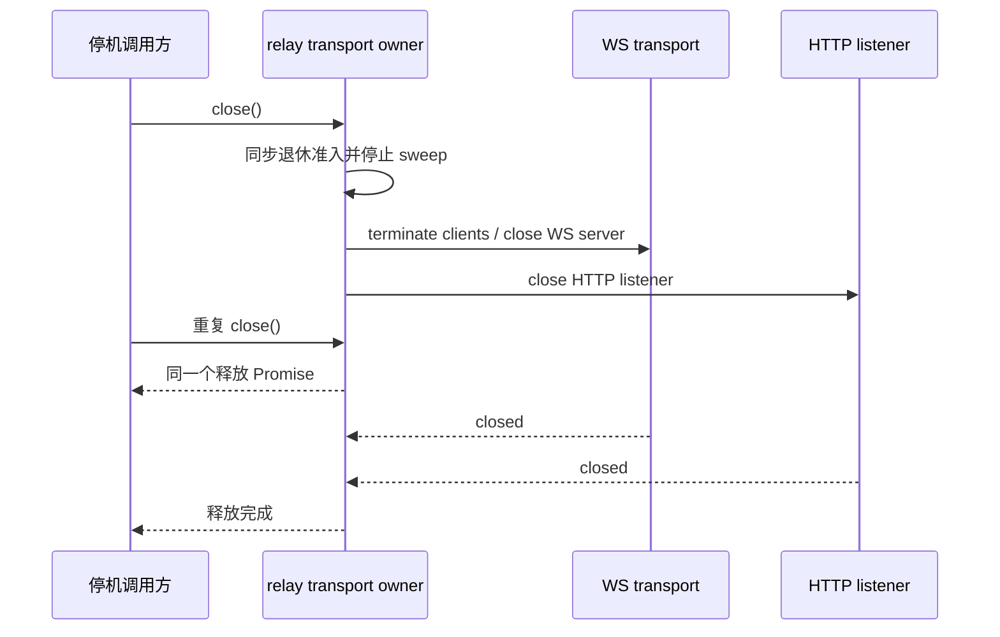

# 全仓审查：共享协议、客户端与工程入口

日期：2026-11-06。主代理覆盖 18 个登记模块的本组 roots，另检查 Android 源码、根工程脚本、配置与唯一桌面工作流。跨组 roots 由对应分区负责；每个模块的完整分配见 `.audit/full-code/coverage-summary.json`。

## 模块检查

公共入口/契约与关键失败路径已阅读，其余库存代码做结构扫描。下表不声称所有叶文件逐行人工检查，也不表示所有平台、真实模型或产品 E2E 已验收。精确库存与关键文件见 `.audit/full-code/root-coverage.json`。

| 模块                     | 检查重点                                                                  | 验证和限制                                                                |
| ------------------------ | ------------------------------------------------------------------------- | ------------------------------------------------------------------------- |
| rpc                      | reliable 重放、ACK owner、ID=0 兼容、channel/transport 关闭               | 修复重复投递和 ACK 倒退；3 个新回归，既有 Node 与 Vitest 生命周期覆盖通过 |
| shared                   | 平台/协议严格 schema、workspace identity、continuous/replayable、隐私开关 | Node 合同与选定 Vitest 通过；未进行真实远端全链路验收                     |
| provider                 | 配置 schema、显式 API Key、来源/registry/selection owner、顺序语义        | 已有 catalog 边界回归通过；不调用真实 Provider                            |
| provider-node            | 路径、原子配置、legacy 兼容、builtin 来源与 materialization               | 已有 builtin 来源边界回归通过；不读取用户配置                             |
| client                   | MessagePort/WS 生命周期、远端 facade、显式采样                            | MessagePort 关闭、sampling 和挂起调用回归通过；不连接用户服务             |
| formal-proof             | 纯动作/guard/queue 模型、D3 DAG 预算、浏览器本地 review 投影              | 独立 noEmit 类型检查通过；未启动可视化页面                                |
| zcode-cua                | runtime/driver/platform/permission 合同、SDK 路由、Windows/mac 资源边界   | 70 个 mock 合同回归通过；未运行真实驱动和 macOS 权限弹窗                  |
| relay                    | 配对/鉴权/current socket、HTTP/WS、静态真实路径、日志投影                 | 修复链接读取与原始日志；4 个新专项和 16 个既有回归通过；未部署公网/TLS    |
| source-server-protocol   | 兼容性/错误/身份合同，sourceServerId 与历史 serverId                      | 旧 fixture 对齐现接口，实际身份回归通过                                   |
| sqlite-migrations        | startup owner、ledger/checksum、备份 affected tables、恢复 schema guard   | 20 个 Host/CLI 真 SQLite fixture 场景通过；不迁移用户数据库               |
| gen-ui-protocol          | strict schema、model context、tweak 边界                                  | 合同和 context Vitest 回归通过；不生成视觉产品                            |
| mcp-apps-protocol        | host/tool/resource/sampling 合同与 schema                                 | 合同和显式 sampling 回归通过；不拉取官方插件                              |
| remote-input-prediction  | 共享请求/结果/capability 与替代/取消                                      | 本组共享合同通过；CLI/service roots 的异步修复见其分区报告                |
| local-ttft-contract      | 本地记录/导出 schema 与显式开关                                           | 静态合同阅读；未开启真实采样或导出                                        |
| protocol-session-data    | session 数据 scope、严格验证、CLI 文件 adapter 归属                       | 共享合同阅读；实际测量/清理由 CLI 分区验证                                |
| user-instructions        | UTF8/schema/规范化                                                        | 本组共享 schema；队列、原子保存与文件锁由 backend 检查                    |
| conversation-ui-metadata | 展示 metadata、create-source、只读投影                                    | 合同与关键源码阅读；未新增业务状态                                        |
| cua-test-config          | 配置/发现规则、fixture 和原生测试边界                                     | mock suite 通过；不运行 native fixture                                    |

## 修复与工程入口

RPC 重放规则、relay 的 HTTP 文件/日志边界及其事件顺序见总 spec；生产 owner 和协议分层保持现契约。relay 的真实路径检查防止可观察的链接越界，Node 路径 API 不能证明最终检查与 read syscall 间恶意并发替换的原子隔离。编码反斜杠在进入 native path 前统一为 URL 斜杠语义，避免 POSIX 与 Windows 拒绝规则分歧；实际专项运行平台为 Windows。

`desktop.yml` Release tests 加入显式 `--import tsx`，保持完整文件发现和串行运行。Source registry、当前 Host/CLI SQLite 迁移、MCP 导入/目录读取、历史闲时行保留与 shared-state 旧回归使用现公开接口，不恢复退役模块。

SQLite 历史分步 fixture 仅在项目 sandbox 复制当前迁移文件并追加测试导出，不给生产新增迁移清单 API、不复制 SQL 算法；保留旧 checksum literal，追加当前 Host5/CLI25 迁移。恢复测试明确区分旧 data 迁移可恢复和新增 DDL 后严格拒绝 schema downgrade。未将确定性 fixture 冒充真实用户迁移。

审查脚本也复检显式测试文件存在性：Node 多文件发现会跳过不存在路径。一次统一命令误写 `official317-build-boundaries.test.mjs`，该文件未执行；本次该批 39 个实际用例仍有证据，但不计入构建验证。随后使用真实 `official317-build.test.mjs` 执行 20 项，全部通过。不能把错文件名的 exit 0 解释为完整发现成功。

## 已执行证据

运行根全部位于 `.run-logs/project-only-validation/`；使用项目内 Node 24.14.0，HOME/TEMP/cache/data/logs 与子进程环境由中央 sandbox 管理。本文列实际执行批次，不把重跑或包装层和内层重复相加。

| 验证                                                | 结果                                                                                    | 运行目录                                                                               |
| --------------------------------------------------- | --------------------------------------------------------------------------------------- | -------------------------------------------------------------------------------------- |
| RPC/shared/provider Node 整批                       | 255/255；初次 253/255 的两处旧 Source fixture 失败已修后完整重跑                        | `full-audit-rpc-shared-provider-complete-L1uMIO`                                       |
| RPC/mobile raw transport/GenUI/MCP/lifecycle Vitest | 18 文件，186/186                                                                        | `full-audit-root-vitest-ySXYw5`                                                        |
| CUA mock 合同                                       | 70/70                                                                                   | `full-audit-cua-contracts-10Bn29`                                                      |
| root/HTTP/storage/UI/fork guards 统一批次           | 39 个实际外层测试通过；内部 HTTP7/output4/storage7/relay4/CEL2 不重复汇总               | `full-audit-required-regressions-XdgFL8`                                               |
| 真实 SQLite 当前 fixture                            | 20 内层通过                                                                             | `full-audit-sqlite-current-jl3nXa`                                                     |
| shared-state 专项                                   | 57 Vitest + 6 Node 均通过；当时同批其它旧 fixture 失败另外修复                          | `full-audit-root-repair-final-3bU7kf`                                                  |
| relay 最新专项                                      | 4 内层通过                                                                              | `full-audit-relay-portable-XWw9vY`                                                     |
| relay 既有 HTTP/WS/registry                         | 3 文件，16/16                                                                           | `full-audit-relay-existing-fv0hMC`                                                     |
| 构建边界与 HTTP/服务隐私                            | 初次 26/27，构建20和HTTP5通过；服务测试旧 MCP API 失败后定点2/2                         | `full-audit-build-privacy-complete-2ZD7JX` / `full-audit-service-privacy-final-Mdwxg9` |
| formal-proof 独立 tsc                               | noEmit/composite=false/incremental=false，通过；首次默认 buildinfo 写入被隔离白名单拒绝 | `full-audit-formal-proof-noemit-i99ECZ`                                                |

formal-proof 的组合选项只取消缓存/构建发射，保留源与配置的类型检查；没有放宽产品类型。根 typecheck/lint 与最终架构结果见总报告。

## Android 与治理限制

Android Gradle 默认地址及 release URL allowlist 仍指官方 endpoint；deep link 自动沿该默认地址构造。该包不在桌面 Windows/macOS 发行链，当前 root tsc 不覆盖 Kotlin。已调查 `app/build.gradle.kts`、`RemoteControlUrlPolicy.kt`、MainActivity 等入口，并向用户提出保留自建地址/仅记录/移除包的产品选择，尚未收到裁决；没有擅改产品能力、编译 Android、联网下载 SDK 或进行真机验收。

第一轮全量架构检查 0 violations，增量检查（默认 origin/main 和显式 HEAD）均有 5 个 unmanaged-new-file：dev-docs App/vite config、stream App/http、e2e-report ChartPanels。原因是修改后的上游 legacy 文件失去 snapshot 字节豁免。第二轮通过正式登记模块、公开合同与职责拆分解决，未更新 snapshot、提升阈值或写 baseline；最终结果见总报告。覆盖审查不等于全部 legacy 模块已纳管。

完整产品 Electron/Host、真实 SSH/WSL/Docker、模型 API、安装包与 macOS/Android native 未执行。没有提交、推送、PR、Actions 触发或发行打包；既有本地改动保持。

## 第二轮：relay 资源生命周期

复核启动失败和主动停机路径。`startRelayServer` 是 HTTP/WS server 与 sweep timer 的唯一 owner；监听失败必须释放已创建的 WS server/timer 后再拒绝。成功监听后，启动用 error listener 应解除，不能长期保留已结算 Promise 的 reject 闭包。

`close()` 同步退休升级准入、停止 sweep，以同一个 Promise 等待 HTTP 与 WS server 释放；重复调用等待同一次关闭。relay 不持有业务队列，停机直接终止现有 WS transport，不等待对端发送 close ACK；两端仍通过原恢复语义重连。HTTP 的在途响应由 HTTP server.close 等待，不新增业务状态或超时兜底。

回归使用 loopback 原始 WS upgrade socket，不回复 close ACK，检验释放不受对端配合影响；失败路径通过 timer spy 检验未留下 sweep。全部夹具及进程输出位于项目 sandbox，不运行真实远端。

| 第二轮验证                        | 实际结果                                                                                  | 项目内证据目录                                                              |
| --------------------------------- | ----------------------------------------------------------------------------------------- | --------------------------------------------------------------------------- |
| relay lifecycle 新回归            | 初次 2/2 失败（timer 未清理、重复关闭返回不同 Promise）；补充异步端口占用后最终 3/3 通过  | `second-relay-lifecycle-red-V1BDMp` / `second-relay-lifecycle-final-wlofDF` |
| RPC/relay/shared/client 合同      | 显式 root 配置的 18 文件、186/186 通过                                                    | `second-root-contracts-RUFcG2`                                              |
| fork/构建/隐私/重放专项           | 50/50 外层通过，当批 relay lifecycle 内层为 2 项，随后独立补齐最终 3 项；内层与重跑不相加 | `second-root-required-39YoDJ`                                               |
| 治理及 schema 工程回归            | 85 通过、1 平台 skip、0 失败                                                              | `second-engineering-gates-Yc7Kbh`                                           |
| 文档陈旧用语 / remote target gate | 文档 2,420 文件通过；private queue 不存在，remote target 检查明确 skipped                 | `second-doc-stale-gates-RO6UeN` / `second-doc-target-gates-8yjjo1`          |

一次额外从 relay 包 cwd 直接启动 Vitest，因根配置的相对 projects 解析成 `packages/relay/packages/zcode-cua/vitest.config.ts` 而启动失败，未执行测试（`second-root-adjacent-7FM4ne`）。该尝试不是当前包提供的测试脚本，也不记为通过；上述显式 root 配置已真实执行相同 relay 三文件及其他合同共 186 项。首次指定文件格式检查失败，随后按现 formatter 整理，不改格式规则；根最终检查另记总报告。

独立子代理复核 listen error listener、Promise 发布/重入、升级退休及半开 WS 释放，无阻塞意见。新增端口占用场景补齐异步 listen error 实测；不将源码阅读当作该路径先前已执行。
