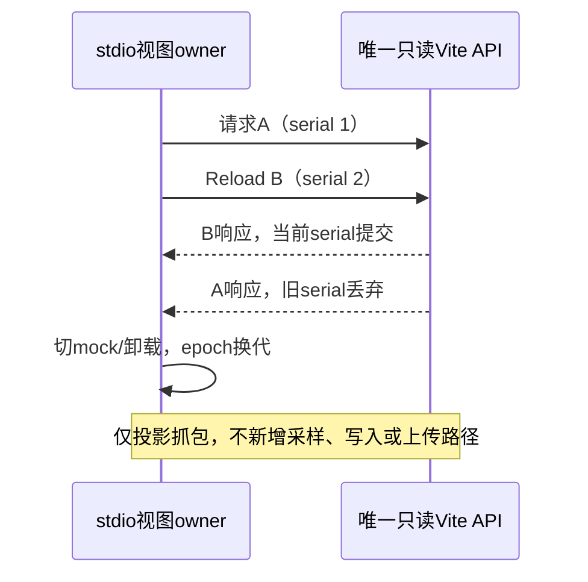
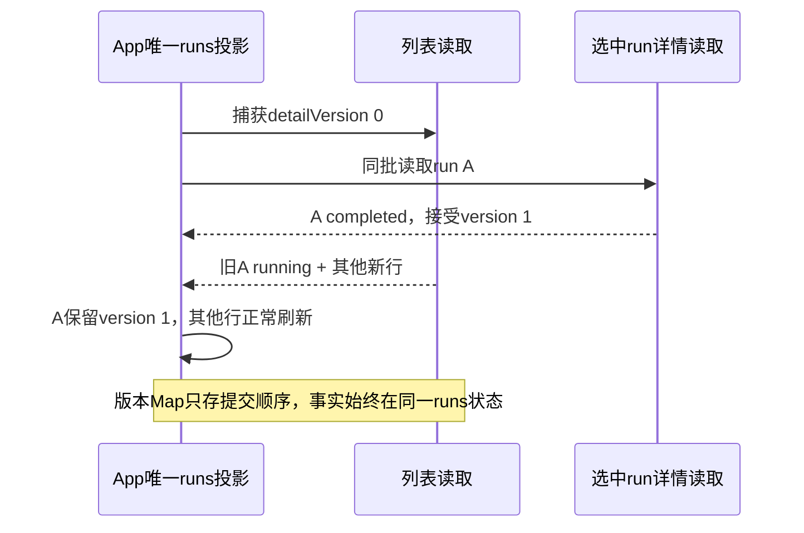
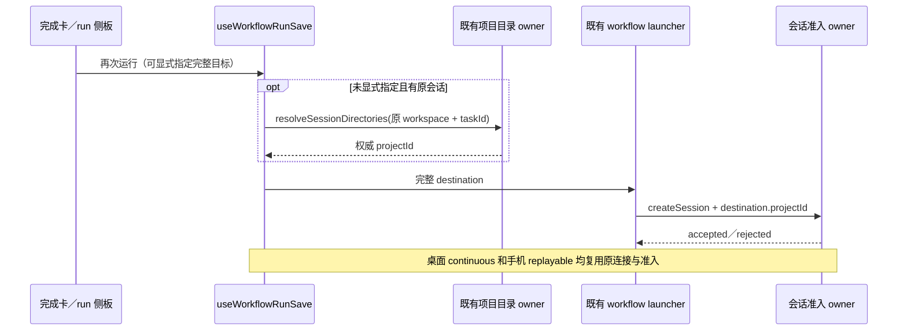
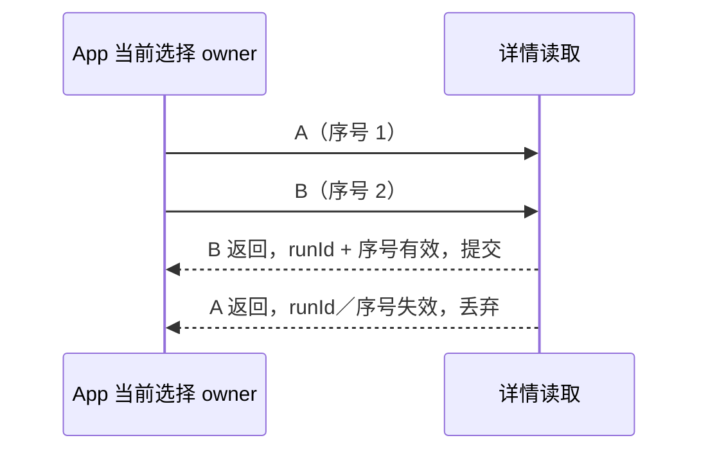

# UI 与 Web 全模块审查（2026-11-06）

## 二轮复核与正式纳管计划

二轮继续验证一轮七个修复的生产 callback 和真实 React 浏览器夹具。先保留现行为回归，再按职责拆分及纳管：stream-animate 整个 src 归独立 profiler 模块（shared 纯类型/domain，server IO/adapters，App/client UI）；e2e-report 整 src 归报告模块（shared domain，node adapter，viewer UI）。两包的真实公开入口及类型约束写入 contract、index、示例和 CONTRACT.md。

两包既有 shared/types 公开协议类型收口到同一根 contract.ts，旧路径仅类型转发以保留消费者兼容；contract 不引用 Node adapter 或 UI，shared兼容出口只依赖contract，根index组合既有公共adapter入口。示例以结构类型校验实际函数名与参数，不能创建平行方法或状态。

开发文档的静态数据、能力地图与 feature graph 保持 legacy owner；新 docs-view 拥有已有页面选择、搜索、主题与 stdio 展示状态，原 App.tsx 仅转发此公共入口。按协议过滤/domain、stdio 转换/domain、React shell/UI、协议组件/UI、stdio状态与视图/UI、stdio详情/UI划分文件，保持各状态的现有唯一 owner。原长文件的 disable 只有在职责已提取且每文件≤400的证据具备后才因失效清理，不以删注释掩盖超限。

Vite 只读插件归 dev-docs-vite-adapters：stdio tail API 与 graph虚拟模块分开实现，vite.config.ts 消费该模块公开工厂；stdio日志目录事实仍来自现services paths规则的只读适配，采样/抓包开关与默认关闭规则不改。源文件 roots 和真实公开入口正式登记，四件套表达实际消费契约；不更改 snapshot、baseline 或全局阈值。

拆分前后浏览器场景：390/1280px挂载真实开发文档App，默认stdio页读取合成missing响应；开始/停止mock replay、协议tab搜索与浅/深主题操作保持现行为。只替换fetch数据端口与未迁移地图边界，不读真实用户目录，不启动产品Host/CLI。另执行一轮workflow/image/stream/chart10场和16条callback回归。

二轮确认问题 UI-AUDIT-08：stdio刷新可重叠（初始读、每秒轮询、Reload real source），旧请求迟到会覆盖较新NDJSON或错误状态；停止mock也会立即发起读取，与effect再读重复。读取仍由stdio视图owner持有，按request serial和真实/演示epoch裁决提交；切换mock/卸载撤销旧读取，过期成功和失败均不写入。轮询等待本轮结束后再调度，手动Reload仍能请求更新；mock→real复用同一effect入口。先用延迟内存fetch证明旧回包覆盖，再补真实App的迟到回包场景。未执行的完整Vite server及用户tap数据验收如实保留。

二轮定点报告浏览器类型检查发现 UI-AUDIT-09：Chart.js 的 parsed.y 可以为 null；空点缺少实际采样值，tooltip应显示 n/a，不能由formatter当成真实0。追加null点生产callback回归后修复此一轮遗漏，并保持已验证非零CPU/内存值。

二轮交叉复核确认 UI-AUDIT-10：stream同批list与detail并发，detail先接受completed后list旧running仍能回写；初始化list旧失败不检查captured request，也会污染新刷新后的错误面。runs仍为App唯一投影owner，detail接受时仅记录每run的提交版本元数据；list捕获该版本，提交时保留读取开始后已接受的detail行，其他行正常刷新，不通过整批失效令列表永远饥饿。初始list复用refreshRuns唯一提交/失败守卫入口；config独立读取/错误归属保留。先延迟列表/初始失败证明回退，再补回归与真实stream交叉顺序E2E。

初始化默认选择由首次接受的列表完成；初始请求尚未结束时手动刷新先成功，也在当前selectedRunId为null时选择首行。后续刷新只保留已有选择，不能把默认选择绑在已过期的首次请求。

本次范围为 `packages/ui`、`packages/web`、`packages/stream-animate`、`packages/model-option-map`、`packages/e2e-report` 与 `apps/dev-docs`；`packages/share-ui`、`packages/web-share` 当前没有文件。一轮覆盖架构策略登记的27个模块；二轮正式纳管后当前为32个模块、67个roots（29个受管模块和ui/web/dev-docs三个legacy根），以及未登记包和legacy子目录。工作树原有修改不回退，本代理未提交、推送或打安装包。

覆盖清单及已实际阅读文件记录在 `.audit/full-code/ui-coverage.json`。模块入口、契约和高风险实现检查不代表所有文件逐行审查，也不代表真机或全量交互验收；未执行验证会单独注明。

接受的浏览器夹具场景：真实 `useWorkflowRunSave` 挂载后点击按钮，分别验证本地已知项目目标和远端原会话目录绑定（包括完整 hook 的 target memo）；真实 `ImagePreviewDialog` 挂载后点击下载，调用真实手机 browser adapter，捕获浏览器 download 事件并验证提示；真实 Stream Animate App 选择 B 后释放 A 的迟到详情，验证摘要与 raw 面板仍属于 B。夹具仅替换服务、启动器、远端 API、图片 surface 和国际化/toast 出口，不启动产品 Host／CLI；390px 与1280px 宽度都执行。完整任务准入、真实远端 attachment 和桌面原生保存仍为未执行 E2E。

## 确认修复：再次运行工作流保留项目准入

触发路径：完成卡或 run 侧板点击「再次运行」，`useWorkflowRunSave.launch` 从原会话目录绑定解析到 `projectId`，但调用既有启动器前重建仅含路径/identity/session 的对象。启动器创建新会话只读取 `target.projectId`，所以项目绑定被丢弃；显式选择运行项目同样丢失其项目 ID。本地可能创建未归类任务，远端可能遭项目准入拒绝。

产品规则：默认再次运行使用原会话的权威项目绑定，显式选择使用选中项目；完整目标 `{ projectId, hostId, workspacePath, workspaceIdentity, remoteSessionId }` 交给同一个 saved-workflow launcher。目录解析失败不得发起 createSession。不从相同 cwd 推断项目身份，不新增队列或 owner。存量无项目会话的 `projectId: null` 保留。

## 确认修复：Stream Animate 静态目录前缀越界

生产静态服务先 decode URL 再 resolve 文件，原 `candidate.startsWith(staticRoot)` 把同前缀兄弟目录也当作 dist 内文件。请求 `/%2e%2e%2fdist-private%2faudit.txt` 可选择 dist-private 文件。静态文件 owner 只允许 dist 本身及其子路径；越界沿用现有 index.html fallback。以 relative + isAbsolute 校验路径段边界，回归使用伪文件端口验证正常子文件和同前缀兄弟目录，不读取项目外文件；本项不宣称防护 symlink 部署或真服务器 E2E。

## 确认修复：开发文档 stdio 抓包读取当前 fork 目录

服务现有 `paths.getAppConfigDir()` 在 `{ZCODE_DATA_BASE_DIR 或 HOME 或 homedir}/.zcodium/v2`；开发文档 Vite API 仍硬编码 `homedir()/.zcode/v2/dev/stdio-traffic`，所以看不到当前 fork 的显式开发抓包，且可能展示旧上游目录。Vite 只读适配使用同一静态数据根优先级与 `.zcodium`，UI 待读取时的路径文字同步。目录事实仍归 services paths；公共 services/node 还会加载完整运行时，当前 dev-docs 无该依赖，本次保持局部适配，不创建可变 data root 或并行写入路径。测试只求值生产常量并注入合成 env/homedir；不启动 Vite API，不访问用户目录，不改变显式抓包开关、默认关闭的采样或导出规则。

回归场景：原会话绑定项目、显式跨项目目标、无会话但 host 已提供项目、`projectId: null`、目录解析拒绝；直接执行生产 callback，替换目录与 launcher 的边界。交互 E2E 场景：在两项目共用 cwd 的环境分别从完成卡与 run 侧板再次运行，校验新任务仍归属原项目；全局工作流显式选择另一个项目后校验归属选择项目；手机／远端校验完整 identity/session 沿原 attachment 传递。完整产品场景尚未执行；其边界的真实hook挂载/callback已在隔离浏览器验证，结果见下方验证表。

## 一轮历史证据

一轮图表tooltip回归先为15/16（CPU Total误为0%，应为47.25%；`.run-logs/project-only-validation/full-code-audit-ui-QYKTnu/logs/regression.log`），修复后HLPzN2为16/16。阶段性默认changed曾有4个dev-docs/stream的unmanaged-new-file（主代理记录full-audit-relay-architecture-N0iBYx）；二轮开始时加入e2e-report修改共5个，hSkURp明确失败。正式adopt与职责拆分后changed/full均清零，历史失败保留，不作为已通过结果。

默认选择的本轮回归也先红20/21（CQY4r9：null而应new），修复后X1ZpD5为21/21；同一场景另断言后续刷新保留manual-selection，真实stream-initial两宽度验证已加入最终18场浏览器结果。

## 审查与验证记录

逐模块阅读清单、发现与未覆盖边界见下表；当前32个登记模块的67个root均有实际阅读证据。

## 确认修复：E2E 报告趋势图 tooltip 数值归零

`ChartPanels.buildLineData` 将趋势点以 `{x: elapsedSeconds, y: value}` 传入 Chart.js；现有 tooltip 对 `context.raw` 整个对象调用 Number 得到 NaN，再被公共 formatNumber 显示为0。因此例如47.25%的CPU或128MB内存，hover提示总显示0。图表数据owner仍为trendData，tooltip只格式化Chart.js提供的`context.parsed.y`，不改变采样、趋势计算或状态。回归执行生产buildLineOptions与公共formatter，输入真实点形状并断言CPU/内存值。交互场景：打开含非零CPU/内存的合成报告，hover趋势点后提示与对应纵轴值一致；本次已在隔离浏览器挂载真实ChartPanels，390/1280px各一场鼠标hover验证CPU47.25%与Memory128MB通过；完整报告URL加载页面仍未执行。

## 确认修复：浏览器图片下载的结果语义

触发路径：普通 Web 图片预览下载调用平台 `saveFile`，浏览器成功交付下载并返回 `downloadStarted: true`；共享 `downloadImagePreview` 随后要求必须有本机磁盘 `path`，把已启动的下载当作失败。手机 Web 的浏览器适配器也只返回 success 而没有 path。浏览器没有磁盘保存回执，不能要求它伪造路径。

产品规则：browser adapter 成功明确返回 `downloadStarted: true`；图片下载先按该字段返回 `kind: started`，桌面有真实 path 的保存仍返回 `kind: saved`。取消优先，失败或无任何有效结果证据继续拒绝。HTTP 源和先读取字节的 data/blob 源两条原分支使用相同结果判定。

回归直接执行生产下载函数与 browser adapter，使用内存 Blob、伪 DOM 和伪 URL 边界，覆盖 HTTP/字节浏览器成功、桌面真实路径、取消、失败。E2E 场景为普通 Web 与手机远控打开图片下载，校验文件下载实际开始且提示「下载已开始」，桌面取消无成功提示；本次真实组件与手机adapter已在隔离浏览器下载成功；普通Web完整产品页面、手机attachment及桌面原生取消场景未执行。

## 确认修复：Model Option Map 正负零比较

现有有效 spec 明示 number 算术与比较遵循 JavaScript 数值语义。`jsonEquals` 使用 Object.is，令 `-(maxOutputTokens - maxOutputTokens) == 0` 对合法正数输入也为 false，因此条件 Patch 选择错误分支。改用严格数值相等保留 JSON 类型隔离和递归数组／对象比较；有限数值校验仍拒绝 NaN／Infinity，不扩展表达式能力。回归执行真实 compiler 与 evaluator，覆盖等号、不等号、嵌套容器、Patch 分支及不同 JSON 类型。

## 确认修复：Stream Animate 详情迟到回写

选择 Run A 发起详情读取，立即切换 B，B 先返回后 A 迟到；原 `refreshSelectedRun` 不检查当前 runId／请求序号，会在选择 B 时展示 A 的摘要、图表与原始输出。同一 run 的 350ms 轮询也可倒序覆盖更新结果。

详情仍归 App 的现有投影状态 owner；请求捕获 runId 和递增序号，写入前验证最新选择与序号，选择切换／卸载的 effect cleanup 作废旧请求。不将另一 run 的已加载数据在等待帧展示。详情和列表刷新错误收口到现有 error banner，不产生未处理 promise。回归用延迟的内存 fetch 边界直接执行生产 callback，覆盖跨 run 乱序、同 run 乱序、失效与错误。E2E 场景为延迟 A 请求后选择 B，释放 A 后界面仍为 B；轮询逆序不倒退指标，真实App切换A/B迟到回包已在隔离浏览器通过；轮询乱序/卸载由生产callback回归验证。

列表也按读取序号提交，初始列表不覆盖新建 run 已接受的结果，初始默认选择不抢占用户的选择；轮询等待当批读取结束后再延迟 350ms，避免持续慢网络使 latest-only 序号守卫拒绝每一个重叠回包。

<!-- UI-COVERAGE-BEGIN -->

## 逐模块覆盖与边界

下表完整列出当前32个登记模块的roots及实际阅读范围（一轮27个，二轮新增5个）。每个runtime源码均做AST结构解析（imports/exports/effect/await/parse diagnostics）；只有semanticRead非空代表实际阅读。结构扫描不能代替叶文件语义审查。未列文件逐一在机器清单保留semanticRead:null，不能据此宣称无遗漏。

| 模块                             | roots                                                                                                                                                                                                                                                                                                                                                                                                                                                                                                                                                                                                                                                                                                                                                                                                                                 | 已读契约／入口／关键实现（行范围）                                                                                                                                                                                                                                                                                                                                                                                                                                                                                                                                                                                                                                                                                                                                                                                                                                                                                                                                                                                                                                                                                                                                                                                                              | 审查不变量与发现／限制                                                                                                                                                           |
| -------------------------------- | ------------------------------------------------------------------------------------------------------------------------------------------------------------------------------------------------------------------------------------------------------------------------------------------------------------------------------------------------------------------------------------------------------------------------------------------------------------------------------------------------------------------------------------------------------------------------------------------------------------------------------------------------------------------------------------------------------------------------------------------------------------------------------------------------------------------------------------- | ----------------------------------------------------------------------------------------------------------------------------------------------------------------------------------------------------------------------------------------------------------------------------------------------------------------------------------------------------------------------------------------------------------------------------------------------------------------------------------------------------------------------------------------------------------------------------------------------------------------------------------------------------------------------------------------------------------------------------------------------------------------------------------------------------------------------------------------------------------------------------------------------------------------------------------------------------------------------------------------------------------------------------------------------------------------------------------------------------------------------------------------------------------------------------------------------------------------------------------------------- | -------------------------------------------------------------------------------------------------------------------------------------------------------------------------------- |
| `ui`                             | `packages/ui/src`                                                                                                                                                                                                                                                                                                                                                                                                                                                                                                                                                                                                                                                                                                                                                                                                                     | `packages/ui/src/logger.ts` [1–116] `packages/ui/src/index.ts` [1–101] `packages/ui/src/previewPaneCodeContent.tsx` [1–106] `packages/ui/src/composer-toolbar-layout/CONTRACT.md` [1–10] `packages/ui/src/App.tsx` [1–210] `packages/ui/src/components/ai-elements/image-preview-dialog.tsx` [1–200] `packages/ui/src/previewPaneImageContent.tsx` [1–180] `packages/ui/src/hooks/useWorkspaceServices.tsx` [1–180, 180–264] `packages/ui/src/Root.tsx` [1–200] `packages/ui/src/store/pluginManagementStoreLoading.ts` [1–300] `packages/ui/src/store/remoteWorkspaceSessionStore.ts` [1–250] `packages/ui/src/store/serviceAuthorityKey.ts` [1–13] `packages/ui/src/store/subagentsStoreLoading.ts` [1–48] `packages/ui/src/settings/saved-workflows/useSavedWorkflowLauncher.ts` [1–232]                                                                                                                                                                                                                                                                                                                                                                                                              | UI根入口/App/Root、workspaceServices注入、图片与代码预览、服务authority键、store异步加载；1490个legacy源码仅结构扫描与表列风险路径阅读，其余叶组件未逐行审查。                   |
| `web`                            | `packages/web/src`                                                                                                                                                                                                                                                                                                                                                                                                                                                                                                                                                                                                                                                                                                                                                                                                                    | `packages/web/src/saveBrowserFile.ts` [1–51] `packages/web/src/main.tsx` [1–351] `packages/web/src/communityUrl.ts` [1–11] `packages/web/src/mobile/conversationReducer.ts` [1–163] `packages/web/src/mobile/workspaceBridgeLifecycle.ts` [1–78] `packages/web/src/mobile/windowProjectDirectory.ts` [1–52] `packages/web/src/mobile/windowDirectoryPresentation.ts` [1–35] `packages/web/src/mobile/taskGrouping.ts` [1–29] `packages/web/src/mobile/taskConversationLifecycle.ts` [1–174] `packages/web/src/mobile/protocol.ts` [1–250] `packages/web/src/mobile/MobileApp.tsx` [1–250, 250–515] `packages/web/src/mobile/main.tsx` [1–21]                                                                                                                                                                                                                                                                                                                                                                                                                                                                                                                                                                   | Web入口与手机会话bridge安装/卸载、workspace/session绑定、事件reduce、目录分组、浏览器下载边界。                                                                                  |
| `side-pane-full-view`            | `packages/ui/src/side-pane-full-view`                                                                                                                                                                                                                                                                                                                                                                                                                                                                                                                                                                                                                                                                                                                                                                                                 | `packages/ui/src/side-pane-full-view/index.ts` [1–15] `packages/ui/src/side-pane-full-view/CONTRACT.md` [1–10] `packages/ui/src/side-pane-full-view/contract.ts` [1–84] `packages/ui/src/side-pane-full-view/components/ConversationHost.tsx` [1–170] `packages/ui/src/side-pane-full-view/domain/model.ts` [1–159] `packages/ui/src/side-pane-full-view/adapters/useFloatingGeometry.ts` [1–220]                                                                                                                                                                                                                                                                                                                                                                                                                                                                                                                                                                                                                                                                                                                                                                                                                                | 面板模型唯一owner、停靠/浮动几何与宿主生命周期；长组件仅表列范围已读。                                                                                                           |
| `gen-ui`                         | `packages/ui/src/gen-ui`                                                                                                                                                                                                                                                                                                                                                                                                                                                                                                                                                                                                                                                                                                                                                                                                              | `packages/ui/src/gen-ui/index.ts` [1–4] `packages/ui/src/gen-ui/host.ts` [1–4] `packages/ui/src/gen-ui/domain/references.ts` [1–83] `packages/ui/src/gen-ui/CONTRACT.md` [1–10] `packages/ui/src/gen-ui/components/GenUiCard.tsx` [1–250] `packages/ui/src/gen-ui/app/tweaks.ts` [1–104] `packages/ui/src/gen-ui/adapters/retainedPage.ts` [1–195]                                                                                                                                                                                                                                                                                                                                                                                                                                                                                                                                                                                                                                                                                                                                                                                                                                                                            | 引用解析、tweak应用、retained页面代际和卡片surface；组件大文件仅表列范围。                                                                                                       |
| `plugin-ui`                      | `packages/ui/src/plugin-ui`                                                                                                                                                                                                                                                                                                                                                                                                                                                                                                                                                                                                                                                                                                                                                                                                           | `packages/ui/src/plugin-ui/CONTRACT.md` [1–28] `packages/ui/src/plugin-ui/index.ts` [1–56] `packages/ui/src/plugin-ui/domain/pluginUiLogicalScope.ts` [1–22] `packages/ui/src/plugin-ui/app/pluginUiPageManager.ts` [1–136] `packages/ui/src/plugin-ui/app/pluginUiHostTeardown.ts` [1–57] `packages/ui/src/plugin-ui/app/pluginUiHostController.ts` [1–394] `packages/ui/src/plugin-ui/app/pluginUiHostBridge.ts` [1–123] `packages/ui/src/plugin-ui/app/pluginUiHostAppHandlers.ts` [1–111] `packages/ui/src/plugin-ui/adapters/pluginUiManagedPageController.ts` [1–200] `packages/ui/src/plugin-ui/adapters/messagePortTransport.ts` [1–41] `packages/ui/src/plugin-ui/adapters/usePublishPluginUiInstanceDerivation.ts` [1–23]                                                                                                                                                                                                                                                                                                                                                                                                                                                                               | 沙箱prepare/validate/dispose顺序、端口initId与实例generation、握手一次性、回收busy、工具取消/资源订阅、页面保留owner；未跑真实插件guest。                                        |
| `project-sidebar`                | `packages/ui/src/project-sidebar`                                                                                                                                                                                                                                                                                                                                                                                                                                                                                                                                                                                                                                                                                                                                                                                                     | `packages/ui/src/project-sidebar/ProjectDirectoryProvider.tsx` [1–172] `packages/ui/src/project-sidebar/index.tsx` [1–388] `packages/ui/src/project-sidebar/useProjectTree.ts` [1–398, 1–235, 235–398] `packages/ui/src/project-sidebar/useProjectTaskNavigation.ts` [1–122] `packages/ui/src/project-sidebar/useProjectFileTree.ts` [1–121] `packages/ui/src/project-sidebar/useProjectDirectoryServices.ts` [1–21] `packages/ui/src/project-sidebar/CONTRACT.md` [1–125]                                                                                                                                                                                                                                                                                                                                                                                                                                                                                                                                                                                                                                                                                                                                                    | 目录事实与活动投影分离、Source代际、刷新serial、accepted placement、导航取消、卸载清理、远端身份建构；110个源码中的表列风险路径已读。                                            |
| `workspace-config-catalog`       | `packages/ui/src/workspace-config-catalog`                                                                                                                                                                                                                                                                                                                                                                                                                                                                                                                                                                                                                                                                                                                                                                                            | `packages/ui/src/workspace-config-catalog/useConfigWorkspaceTargets.ts` [1–55] `packages/ui/src/workspace-config-catalog/index.ts` [1–8] `packages/ui/src/workspace-config-catalog/contract.ts` [1–26] `packages/ui/src/workspace-config-catalog/CONTRACT.md` [1–12] `packages/ui/src/workspace-config-catalog/catalog.ts` [1–52]                                                                                                                                                                                                                                                                                                                                                                                                                                                                                                                                                                                                                                                                                                                                                                                                                                                                                                   | 配置目录仅来自窗口目录投影、workspaceIdentity隔离与local fallback。                                                                                                              |
| `conversation-workspace-target`  | `packages/ui/src/conversation-workspace-target`                                                                                                                                                                                                                                                                                                                                                                                                                                                                                                                                                                                                                                                                                                                                                                                       | `packages/ui/src/conversation-workspace-target/sourceIdentity.ts` [1–40] `packages/ui/src/conversation-workspace-target/resolve.ts` [1–34] `packages/ui/src/conversation-workspace-target/index.ts` [1–8] `packages/ui/src/conversation-workspace-target/contract.ts` [1–36] `packages/ui/src/conversation-workspace-target/CONTRACT.md` [1–12]                                                                                                                                                                                                                                                                                                                                                                                                                                                                                                                                                                                                                                                                                                                                                                                                                                                                                     | 源身份构造与完整workspace/identity/session目标解析，不按cwd推断远端身份。                                                                                                        |
| `remote-connection-flow`         | `packages/ui/src/remote-connection-flow`                                                                                                                                                                                                                                                                                                                                                                                                                                                                                                                                                                                                                                                                                                                                                                                              | `packages/ui/src/remote-connection-flow/flowDismissal.ts` [1–164] `packages/ui/src/remote-connection-flow/flowConnection.ts` [1–343, 1–180] `packages/ui/src/remote-connection-flow/CONTRACT.md` [1–67] `packages/ui/src/remote-connection-flow/flowRecovery.ts` [1–138] `packages/ui/src/remote-connection-flow/index.ts` [1–396]                                                                                                                                                                                                                                                                                                                                                                                                                                                                                                                                                                                                                                                                                                                                                                                                                                                                                                  | requestId/epoch防迟到复活、取消临时attachment、前后台completion、设备管理无目录副作用、失败恢复。                                                                                |
| `project-workflow`               | `packages/ui/src/project-workflow`                                                                                                                                                                                                                                                                                                                                                                                                                                                                                                                                                                                                                                                                                                                                                                                                    | `packages/ui/src/project-workflow/WorkflowRunSaveControls.tsx` [1–180] `packages/ui/src/project-workflow/WorkflowRunPaneSaveSlots.tsx` [1–89] `packages/ui/src/project-workflow/useWorkflowRunSave.ts` [1–177] `packages/ui/src/project-workflow/contract.ts` [1–63] `packages/ui/src/project-workflow/CONTRACT.md` [1–10]                                                                                                                                                                                                                                                                                                                                                                                                                                                                                                                                                                                                                                                                                                                                                                                                                                                                                                          | 再次运行目标memo与launch、原会话权威projectId、显式跨项目目的地、null绑定、解析失败不准入；UI-AUDIT-01。                                                                         |
| `mobile-ui`                      | `packages/ui/src/components/mobile-ui`                                                                                                                                                                                                                                                                                                                                                                                                                                                                                                                                                                                                                                                                                                                                                                                                | `packages/ui/src/components/mobile-ui/ZCodeAppLogo.tsx` [1–22] `packages/ui/src/components/mobile-ui/index.ts` [1–5] `packages/ui/src/components/mobile-ui/DevicePlatformIcon.tsx` [1–58] `packages/ui/src/components/mobile-ui/CONTRACT.md` [1–8] `packages/ui/src/components/mobile-ui/bottom-sheet.tsx` [1–90]                                                                                                                                                                                                                                                                                                                                                                                                                                                                                                                                                                                                                                                                                                                                                                                                                                                                                                                   | bottom-sheet关闭/焦点/视口边界与移动导航/Logo；无视觉验收。                                                                                                                      |
| `web-remote-control-ui`          | `packages/ui/src/web-remote-control` `packages/ui/src/hooks/useWebRemoteControlStatus.ts`                                                                                                                                                                                                                                                                                                                                                                                                                                                                                                                                                                                                                                                                                                                                          | `packages/ui/src/hooks/useWebRemoteControlStatus.ts` [1–93] `packages/ui/src/web-remote-control/WebRemoteControlTaskViewReporter.tsx` [1–102] `packages/ui/src/web-remote-control/index.ts` [1–3] `packages/ui/src/web-remote-control/CONTRACT.md` [1–10]                                                                                                                                                                                                                                                                                                                                                                                                                                                                                                                                                                                                                                                                                                                                                                                                                                                                                                                                                                              | 任务视图报告启停与状态服务hook，Host事实仅投影。                                                                                                                                 |
| `conversation-share-interaction` | `packages/ui/src/conversation-share-interaction`                                                                                                                                                                                                                                                                                                                                                                                                                                                                                                                                                                                                                                                                                                                                                                                      | `packages/ui/src/conversation-share-interaction/index.ts` [1–7] `packages/ui/src/conversation-share-interaction/conversationSharePreflightResponse.ts` [1–142] `packages/ui/src/conversation-share-interaction/conversationSharePreflightRequest.ts` [1–31] `packages/ui/src/conversation-share-interaction/conversationSharePopoverActions.ts` [1–240] `packages/ui/src/conversation-share-interaction/CONTRACT.md` [1–11]                                                                                                                                                                                                                                                                                                                                                                                                                                                                                                                                                                                                                                                                                                                                                                                                         | 分享preflight请求/响应校验、取消/错误和popover按钮边界；不恢复官方云分享依赖。                                                                                                   |
| `workspace-plugin-preview`       | `packages/ui/src/workspace-plugin-preview`                                                                                                                                                                                                                                                                                                                                                                                                                                                                                                                                                                                                                                                                                                                                                                                            | `packages/ui/src/workspace-plugin-preview/WorkspacePluginPreview.tsx` [1–245] `packages/ui/src/workspace-plugin-preview/index.ts` [1–6] `packages/ui/src/workspace-plugin-preview/CONTRACT.md` [1–8]                                                                                                                                                                                                                                                                                                                                                                                                                                                                                                                                                                                                                                                                                                                                                                                                                                                                                                                                                                                                                                      | 预览工作区目标与sandbox生命周期，保持已有插件UI公共入口。                                                                                                                        |
| `data-sync`                      | `packages/ui/src/data-sync`                                                                                                                                                                                                                                                                                                                                                                                                                                                                                                                                                                                                                                                                                                                                                                                                           | `packages/ui/src/data-sync/index.ts` [1–26] `packages/ui/src/data-sync/CONTRACT.md` [1–30] `packages/ui/src/data-sync/app/useDataSyncProviders.ts` [1–132] `packages/ui/src/data-sync/app/useDataSyncDialog.ts` [1–270, 271–379] `packages/ui/src/data-sync/app/loadDataSyncCategory.ts` [1–119]                                                                                                                                                                                                                                                                                                                                                                                                                                                                                                                                                                                                                                                                                                                                                                                                                                                                                                                                    | provider可用性、generation防过期读取、dialog提交/冲突/错误流程；长dialog仅表列范围。                                                                                             |
| `settings-scope`                 | `packages/ui/src/settings-scope`                                                                                                                                                                                                                                                                                                                                                                                                                                                                                                                                                                                                                                                                                                                                                                                                      | `packages/ui/src/settings-scope/index.ts` [1–36] `packages/ui/src/settings-scope/domain/scope.ts` [1–208] `packages/ui/src/settings-scope/contract.ts` [1–100] `packages/ui/src/settings-scope/CONTRACT.md` [1–20] `packages/ui/src/settings-scope/app/useSettingsScopeForm.ts` [1–41] `packages/ui/src/settings-scope/app/useSettingsScope.ts` [1–263]                                                                                                                                                                                                                                                                                                                                                                                                                                                                                                                                                                                                                                                                                                                                                                                                                                                                          | 作用域单owner、表单draft与事实分离、workspace fallback、异步读取作用域校验。                                                                                                     |
| `ui-file-menu`                   | `packages/ui/src/file-menu` `packages/ui/src/OpenSplitButton.types.ts` `packages/ui/src/OpenSplitButtonDropdownActions.tsx` `packages/ui/src/OpenSplitButtonTrigger.tsx`                                                                                                                                                                                                                                                                                                                                                                                                                                                                                                                                                                                                                                                     | `packages/ui/src/OpenSplitButtonTrigger.tsx` [1–102] `packages/ui/src/OpenSplitButtonDropdownActions.tsx` [1–87] `packages/ui/src/OpenSplitButton.types.ts` [1–38] `packages/ui/src/file-menu/useFileApplications.ts` [1–118] `packages/ui/src/file-menu/index.ts` [1–14] `packages/ui/src/file-menu/fileCopy.ts` [1–50] `packages/ui/src/file-menu/CONTRACT.md` [1–12]                                                                                                                                                                                                                                                                                                                                                                                                                                                                                                                                                                                                                                                                                                                                                                                                                                                       | 文件copy/open应用服务路由、split按钮受控动作和目标类型、remote identity贯穿。                                                                                                    |
| `web-platform`                   | `packages/web/src/platform`                                                                                                                                                                                                                                                                                                                                                                                                                                                                                                                                                                                                                                                                                                                                                                                                           | `packages/web/src/platform/saveBrowserFile.ts` [1–92] `packages/web/src/platform/module.ts` [1–11] `packages/web/src/platform/index.ts` [1–218] `packages/web/src/platform/contract.ts` [1–25] `packages/web/src/platform/CONTRACT.md` [1–11] `packages/web/src/platform/contract.example.ts` [1–7]                                                                                                                                                                                                                                                                                                                                                                                                                                                                                                                                                                                                                                                                                                                                                                                                                                                                                                                              | 手机浏览器下载文件名/字节界限、URL保留与释放、started结果不伪造磁盘path；UI-AUDIT-02。                                                                                           |
| `image-preview-editor`           | `packages/ui/src/image-preview-editor`                                                                                                                                                                                                                                                                                                                                                                                                                                                                                                                                                                                                                                                                                                                                                                                                | `packages/ui/src/image-preview-editor/index.ts` [1–10] `packages/ui/src/image-preview-editor/ImagePreviewSurface.tsx` [1–280] `packages/ui/src/image-preview-editor/geometry.ts` [1–71] `packages/ui/src/image-preview-editor/CONTRACT.md` [1–10] `packages/ui/src/image-preview-editor/composerTarget.ts` [1–30]                                                                                                                                                                                                                                                                                                                                                                                                                                                                                                                                                                                                                                                                                                                                                                                                                                                                                                                   | canvas/surface几何、composer目标、对象URL与图片预览边界；下载修复调用位于legacy UI。                                                                                             |
| `windows-caption-menu`           | `packages/ui/src/windows-caption-menu` `packages/ui/src/WindowsCaptionMenuButton.tsx`                                                                                                                                                                                                                                                                                                                                                                                                                                                                                                                                                                                                                                                                                                                                              | `packages/ui/src/WindowsCaptionMenuButton.tsx` [1–306] `packages/ui/src/windows-caption-menu/contract.ts` [1–3] `packages/ui/src/windows-caption-menu/CONTRACT.md` [1–6]                                                                                                                                                                                                                                                                                                                                                                                                                                                                                                                                                                                                                                                                                                                                                                                                                                                                                                                                                                                                                                                                  | 菜单契约/更新状态/平台hook路径；实际Windows原生菜单未跑，首次读取竞态未证明，不作bug结论。                                                                                       |
| `source-server-ui`               | `packages/ui/src/source-server-ui-contract` `packages/ui/src/hooks/useSourceServerManagementSnapshot.ts` `packages/ui/src/lib/remoteConnectionPresentation.ts` `packages/ui/src/lib/remoteConnectionPresentationErrors.ts` `packages/ui/src/remote-connection/RemoteConnectionSelection.tsx` `packages/ui/src/remote/remoteWorkspaceController.ts` `packages/ui/src/remote/remoteWorkspaceProjection.ts` `packages/ui/src/store/sourceServerDisplayNameRegistry.ts` `packages/ui/src/store/sourceServerStatusRegistry.ts` `packages/ui/src/settings/SourceServerProfileEditor.tsx`                                                                                                                                                                                                                         | `packages/ui/src/hooks/useSourceServerManagementSnapshot.ts` [1–93] `packages/ui/src/lib/remoteConnectionPresentation.ts` [1–333] `packages/ui/src/lib/remoteConnectionPresentationErrors.ts` [1–196] `packages/ui/src/remote/remoteWorkspaceProjection.ts` [1–233] `packages/ui/src/remote/remoteWorkspaceController.ts` [1–100] `packages/ui/src/remote-connection/RemoteConnectionSelection.tsx` [1–315] `packages/ui/src/source-server-ui-contract/contract.ts` [1–33] `packages/ui/src/source-server-ui-contract/CONTRACT.md` [1–6] `packages/ui/src/store/sourceServerDisplayNameRegistry.ts` [1–57] `packages/ui/src/settings/SourceServerProfileEditor.tsx` [1–125] `packages/ui/src/store/sourceServerStatusRegistry.ts` [1–71]                                                                                                                                                                                                                                                                                                                                                                                                                                                                          | snapshot generation提交、设备权威状态与profile代际、主动断开中性态、手动安装/版本详情、远端目标编辑。                                                                            |
| `conversation-render-parts`      | `packages/ui/src/v4/render-parts-contract` `packages/ui/src/app-shell/WorkflowRunPhasePills.tsx` `packages/ui/src/v4/ConversationBackgroundWorks.tsx` `packages/ui/src/v4/conversationTurnRenderUnitTypes.ts` `packages/ui/src/v4/buildTaskListResultFromSessions.ts` `packages/ui/src/v4/conversationFileSummaryActions.ts` `packages/ui/src/v4/conversationRowsPartition.ts` `packages/ui/src/v4/conversationTurnNavigatorPosition.ts` `packages/ui/src/v4/conversationTurnNavigatorTypes.ts` `packages/ui/src/v4/conversationTurnRenderPartition.ts` `packages/ui/src/v4/workbenchPointerDragDrop.ts` `packages/ui/src/v4/conversationTimelineFindCache.ts` `packages/ui/src/v4/conversationTimelineFindTypes.ts` `packages/ui/src/app-shell/workflow-artifacts/WorkflowArtifactHeader.tsx` | `packages/ui/src/app-shell/WorkflowRunPhasePills.tsx` [1–163] `packages/ui/src/app-shell/workflow-artifacts/WorkflowArtifactHeader.tsx` [1–200] `packages/ui/src/v4/buildTaskListResultFromSessions.ts` [1–197] `packages/ui/src/v4/ConversationBackgroundWorks.tsx` [1–89] `packages/ui/src/v4/conversationFileSummaryActions.ts` [1–64] `packages/ui/src/v4/conversationRowsPartition.ts` [1–72] `packages/ui/src/v4/conversationTimelineFindTypes.ts` [1–27] `packages/ui/src/v4/conversationTimelineFindCache.ts` [1–101] `packages/ui/src/v4/conversationTurnRenderPartition.ts` [1–189] `packages/ui/src/v4/conversationTurnNavigatorTypes.ts` [1–66] `packages/ui/src/v4/conversationTurnNavigatorPosition.ts` [1–147] `packages/ui/src/v4/conversationTurnRenderUnitTypes.ts` [1–68] `packages/ui/src/v4/workbenchPointerDragDrop.ts` [1–97] `packages/ui/src/v4/render-parts-contract/contract.ts` [1–31] `packages/ui/src/v4/render-parts-contract/CONTRACT.md` [1–14]                                                                                                                                                                                                                      | CLI全序/turn分区、导航定位、只读缓存不可变身份、background取消交由Host、diff按执行cwd读、产物版本数组步进。                                                                      |
| `web-theme-seed`                 | `packages/web/src/theme-seed-contract` `packages/web/src/webThemeSeed.ts`                                                                                                                                                                                                                                                                                                                                                                                                                                                                                                                                                                                                                                                                                                                                                          | `packages/web/src/webThemeSeed.ts` [1–30] `packages/web/src/theme-seed-contract/CONTRACT.md` [1–6]                                                                                                                                                                                                                                                                                                                                                                                                                                                                                                                                                                                                                                                                                                                                                                                                                                                                                                                                                                                                                                                                                                                                           | seed版本/字段白名单、localStorage异常、主题只读初始化与广播owner。                                                                                                               |
| `local-ttft-renderer`            | `packages/ui/src/v4/diagnostics/local-ttft`                                                                                                                                                                                                                                                                                                                                                                                                                                                                                                                                                                                                                                                                                                                                                                                           | `packages/ui/src/v4/diagnostics/local-ttft/localTtftPendingStart.ts` [1–47] `packages/ui/src/v4/diagnostics/local-ttft/localTtftObserverCore.ts` [1–399, 255–399] `packages/ui/src/v4/diagnostics/local-ttft/contract.ts` [1–7] `packages/ui/src/v4/diagnostics/local-ttft/CONTRACT.md` [1–6]                                                                                                                                                                                                                                                                                                                                                                                                                                                                                                                                                                                                                                                                                                                                                                                                                                                                                                                                          | pending input身份、首帧观察排除工具/思考、序号去重及observer清理；不启动技术采样。                                                                                               |
| `plugin-store-display`           | `packages/ui/src/settings/plugin-store-display-contract` `packages/ui/src/settings/pluginStoreActions.ts` `packages/ui/src/settings/PluginStorePaidPlanBadge.tsx`                                                                                                                                                                                                                                                                                                                                                                                                                                                                                                                                                                                                                                                               | `packages/ui/src/settings/pluginStoreActions.ts` [1–17] `packages/ui/src/settings/PluginStorePaidPlanBadge.tsx` [1–37] `packages/ui/src/settings/plugin-store-display-contract/contract.ts` [1–4] `packages/ui/src/settings/plugin-store-display-contract/CONTRACT.md` [1–6]                                                                                                                                                                                                                                                                                                                                                                                                                                                                                                                                                                                                                                                                                                                                                                                                                                                                                                                                                           | 插件显示契约、产品动作与已剥离付费面；不拉取官方市场。                                                                                                                           |
| `pending-command-recovery`       | `packages/ui/src/v4/pending-command-recovery-contract` `packages/ui/src/v4/pendingCommandRegistryTypes.ts` `packages/ui/src/v4/pendingCommandRegistryHelpers.ts` `packages/ui/src/v4/pendingCommandComposer.ts`                                                                                                                                                                                                                                                                                                                                                                                                                                                                                                                                                                                                              | `packages/ui/src/v4/pendingCommandRegistryTypes.ts` [1–49] `packages/ui/src/v4/pendingCommandRegistryHelpers.ts` [1–132] `packages/ui/src/v4/pendingCommandComposer.ts` [1–84] `packages/ui/src/v4/pending-command-recovery-contract/contract.ts` [1–5] `packages/ui/src/v4/pending-command-recovery-contract/CONTRACT.md` [1–6]                                                                                                                                                                                                                                                                                                                                                                                                                                                                                                                                                                                                                                                                                                                                                                                                                                                                                                    | pending registry身份、local fallback、accepted overlay与composer恢复不另存队列。                                                                                                 |
| `store-state-contracts`          | `packages/ui/src/store/state-contracts`                                                                                                                                                                                                                                                                                                                                                                                                                                                                                                                                                                                                                                                                                                                                                                                               | `packages/ui/src/store/state-contracts/contract.ts` [1–162] `packages/ui/src/store/state-contracts/CONTRACT.md` [1–4]                                                                                                                                                                                                                                                                                                                                                                                                                                                                                                                                                                                                                                                                                                                                                                                                                                                                                                                                                                                                                                                                                                                        | store字段归属、authority/generation约束；实现加载检查在legacy UI报告列出。                                                                                                       |
| `dev-docs-legacy`                | `apps/dev-docs`                                                                                                                                                                                                                                                                                                                                                                                                                                                                                                                                                                                                                                                                                                                                                                                                                       | `apps/dev-docs/tsconfig.json` [1–17] `apps/dev-docs/src/main.tsx` [1–11] `apps/dev-docs/src/feature-boundary-graph/FeatureBoundaryGraphView.tsx` [1–230] `apps/dev-docs/src/feature-boundary-graph/featureBoundaryGraphLayout.ts` [1–82] `apps/dev-docs/src/data/protocolDocs.ts` [1–50] `apps/dev-docs/src/capability-map/useCapabilityMapLayout.ts` [1–31] `apps/dev-docs/src/capability-map/useCapabilityMapHighlight.ts` [1–62] `apps/dev-docs/src/capability-map/CapabilityMapView.tsx` [1–329]                                                                                                                                                                                                                                                                                                                                                                                                                                                                                                                                                                                                                                                                                                                       | 静态协议/图谱数据和能力/边界地图仍归旧owner，公共入口未移走；表列风险路径已读，数据条目仅结构/schema检查，不宣称逐条核实。                                                       |
| `stream-animate`                 | `packages/stream-animate/src`                                                                                                                                                                                                                                                                                                                                                                                                                                                                                                                                                                                                                                                                                                                                                                                                         | `packages/stream-animate/src/shared/types.ts` [1–3] `packages/stream-animate/src/server/index.ts` [1–22] `packages/stream-animate/src/server/http.ts` [1–290] `packages/stream-animate/src/server/frameForecast.ts` [1–131] `packages/stream-animate/src/server/frameBuckets.ts` [1–49] `packages/stream-animate/src/server/deepseekRunner.ts` [1–317] `packages/stream-animate/src/server/dataStore.ts` [1–104] `packages/stream-animate/src/server/cli.ts` [1–67] `packages/stream-animate/src/module.ts` [1–7] `packages/stream-animate/src/main.tsx` [1–11] `packages/stream-animate/src/index.ts` [1–8] `packages/stream-animate/src/contract.ts` [1–113] `packages/stream-animate/src/CONTRACT.md` [1–10] `packages/stream-animate/src/contract.example.ts` [1–8] `packages/stream-animate/src/client/RunSummaryPanel.tsx` [1–60] `packages/stream-animate/src/client/RunHistory.tsx` [1–48] `packages/stream-animate/src/client/RunForm.tsx` [1–121] `packages/stream-animate/src/client/FrameChart.tsx` [1–201] `packages/stream-animate/src/client/api.ts` [1–98] `packages/stream-animate/src/client/Aggregates.tsx` [1–47] `packages/stream-animate/src/App.tsx` [1–203] | 整src正式纳管；run状态仍归server，App仅投影。contract纯协议类型、shared旧路径转发；请求serial/轮询/静态边界及列表/detail交叉提交、config/list初始化独立裁决；UI-AUDIT-04/05/10。 |
| `e2e-report`                     | `packages/e2e-report/src`                                                                                                                                                                                                                                                                                                                                                                                                                                                                                                                                                                                                                                                                                                                                                                                                             | `packages/e2e-report/src/viewer/trendData.ts` [1–369] `packages/e2e-report/src/viewer/reportData.ts` [1–23] `packages/e2e-report/src/viewer/main.tsx` [1–17] `packages/e2e-report/src/viewer/format.ts` [1–50] `packages/e2e-report/src/viewer/CoveragePanel.tsx` [1–188] `packages/e2e-report/src/viewer/ChartPanels.tsx` [1–239] `packages/e2e-report/src/viewer/App.tsx` [1–308] `packages/e2e-report/src/shared/types.ts` [1–3] `packages/e2e-report/src/node/index.ts` [1–43] `packages/e2e-report/src/module.ts` [1–7] `packages/e2e-report/src/index.ts` [1–8] `packages/e2e-report/src/contract.ts` [1–156] `packages/e2e-report/src/CONTRACT.md` [1–6] `packages/e2e-report/src/contract.example.ts` [1–8]                                                                                                                                                                                                                                                                                                                                                                                                                                                                                      | 整src正式纳管；真实node入口/URL/类型契约、viewer/trend/coverage、Chart tooltip非零值与null点边界；UI-AUDIT-07/09。                                                               |
| `dev-docs-view`                  | `apps/dev-docs/src/docs-view` `apps/dev-docs/src/App.tsx`                                                                                                                                                                                                                                                                                                                                                                                                                                                                                                                                                                                                                                                                                                                                                                          | `apps/dev-docs/src/docs-view/ui/TrafficFrameDetail.tsx` [1–122] `apps/dev-docs/src/docs-view/ui/TrafficControls.tsx` [1–66] `apps/dev-docs/src/docs-view/ui/StructureSection.tsx` [1–139] `apps/dev-docs/src/docs-view/ui/StdioTrafficView.tsx` [1–218] `apps/dev-docs/src/docs-view/ui/Navigation.tsx` [1–74] `apps/dev-docs/src/docs-view/ui/ConceptPanels.tsx` [1–161] `apps/dev-docs/src/docs-view/ui/App.tsx` [1–298] `apps/dev-docs/src/docs-view/module.ts` [1–7] `apps/dev-docs/src/docs-view/index.ts` [1–3] `apps/dev-docs/src/docs-view/domain/trafficFrames.ts` [1–182] `apps/dev-docs/src/docs-view/domain/presentation.ts` [1–80] `apps/dev-docs/src/docs-view/domain/mockTraffic.ts` [1–93] `apps/dev-docs/src/docs-view/contract.ts` [1–51] `apps/dev-docs/src/docs-view/CONTRACT.md` [1–6] `apps/dev-docs/src/docs-view/contract.example.ts` [1–7] `apps/dev-docs/src/docs-view/adapters/useStdioTraffic.ts` [1–262] `apps/dev-docs/src/App.tsx` [1–3]                                                                                                                                                                                                                         | 全部17个文件复核；App/search/theme与stdio挂载owner保留。旧成功/失败、切mock/卸载按serial作废，串行poll与stopMock单入口；UI-AUDIT-08。                                            |
| `dev-docs-vite-adapters`         | `apps/dev-docs/vite-adapters` `apps/dev-docs/vite.config.ts`                                                                                                                                                                                                                                                                                                                                                                                                                                                                                                                                                                                                                                                                                                                                                                       | `apps/dev-docs/vite.config.ts` [1–12] `apps/dev-docs/vite-adapters/stdioTrafficApiPlugin.ts` [1–191] `apps/dev-docs/vite-adapters/module.ts` [1–7] `apps/dev-docs/vite-adapters/index.ts` [1–4] `apps/dev-docs/vite-adapters/featureBoundaryGraphPlugin.ts` [1–60] `apps/dev-docs/vite-adapters/contract.ts` [1–16] `apps/dev-docs/vite-adapters/CONTRACT.md` [1–6] `apps/dev-docs/vite-adapters/contract.example.ts` [1–8]                                                                                                                                                                                                                                                                                                                                                                                                                                                                                                                                                                                                                                                                                                                                                                                                | 全部8个文件复核；两个真实Vite工厂、tail API字段/数据根、graph源路径/HMR缓存及file-root配置入口保持原行为；UI-AUDIT-06。                                                          |

## 未登记包、空目录及包级支持文件

| 包                               | roots                       | 已读文件（行范围）                                                                                                                                                                                                                                                                                                                                                                                                                             | 审查与限制                                                                                                       |
| -------------------------------- | --------------------------- | ---------------------------------------------------------------------------------------------------------------------------------------------------------------------------------------------------------------------------------------------------------------------------------------------------------------------------------------------------------------------------------------------------------------------------------------------- | ---------------------------------------------------------------------------------------------------------------- |
| `package:share-ui`               | `packages/share-ui`         | 空目录／未读runtime源码                                                                                                                                                                                                                                                                                                                                                                                                                        | 当前空目录，无源码或package.json。                                                                               |
| `package:web-share`              | `packages/web-share`        | 空目录／未读runtime源码                                                                                                                                                                                                                                                                                                                                                                                                                        | 当前空目录，无源码或package.json。                                                                               |
| `package:model-option-map`       | `packages/model-option-map` | `packages/model-option-map/src/types.ts` [1–37] `packages/model-option-map/src/tokenizer.ts` [1–142] `packages/model-option-map/src/parser.ts` [1–241] `packages/model-option-map/src/option-maps.ts` [1–43] `packages/model-option-map/src/merge-patch.ts` [1–98] `packages/model-option-map/src/index.ts` [1–6] `packages/model-option-map/src/evaluator.ts` [1–216] `packages/model-option-map/src/compiler.ts` [1–93] | 8个源码全部阅读：tokenizer/parser/compiler/evaluator、严格JSON类型、有限数、merge patch、默认映射；UI-AUDIT-03。 |
| `package:ui-support`             | `packages/ui`               | `packages/ui/vitest.holes.config.ts` [1–16] `packages/ui/vitest.config.ts` [1–7] `packages/ui/vite/pdfJsCMapsPlugin.ts` [1–80]                                                                                                                                                                                                                                                                                                           | vitest已退役配置、PDF CMaps构建插件；tests/scripts/config单列，231个测试源码未宣称全部语义审查。                 |
| `package:web-support`            | `packages/web`              | `packages/web/vite.config.ts` [1–87] `packages/web/vite/remoteFrontendVersion.mjs` [1–54]                                                                                                                                                                                                                                                                                                                                                   | Vite构建配置、remote前端版本路径；1174个文件含大量非源码工件，runtime源码仅2个，21个测试源码未全量运行。         |
| `package:stream-animate-support` | `packages/stream-animate`   | `packages/stream-animate/vite.config.ts` [1–25] `packages/stream-animate/tsconfig.server.json` [1–23] `packages/stream-animate/tsconfig.json` [1–24]                                                                                                                                                                                                                                                                                     | src以外的Vite/包配置与browser/server类型include，新增contract覆盖两套types；不构建dist或真实profiler数据。       |
| `package:e2e-report-support`     | `packages/e2e-report`       | `packages/e2e-report/vite.config.ts` [1–25] `packages/e2e-report/tsconfig.json` [1–19]                                                                                                                                                                                                                                                                                                                                                      | src以外的Vite/包配置、node/viewer类型入口；保留既有package公共node路径。                                         |

**ui legacy 未登记源码子目录**（最长roots匹配已剔除受管模块；文件级完整归属见JSON）：`BotsDialog`、`GitPane`、`ToolCallBlocks`、`ToolCallBlocks/renderers`、`WorkspaceHeaderSections`、`WorkspaceSidebar`、`app-shell`、`app-shell/workflow-artifacts`、`app-shell/workflow-artifacts/presets`、`assets/channel-icons`、`browser-use`、`chat-input-toolbar`、`command-center`、`components`、`components/ai-elements`、`components/icons`、`components/lib`、`components/ui`、`components/workflow-graph`、`components/workflow-run-line`、`components/workflow-timeline`、`composer-toolbar-layout`、`cua-permission`、`git-action-menu`、`git-branch-switcher`、`git-graph`、`hooks`、`i18n`、`i18n/locales`、`lib`、`lib/diagnostics`、`mentions`、`mentions/components`、`mentions/nodes`、`mentions/providers`、`onboarding`、`presentation`、`prompt-editor`、`quickpick`、`remote`、`remote-connection`、`request-security-edition`、`resource-manager`、`resource-manager/storage`、`root`、`settings`、`settings-sync`、`settings/model-provider-section`、`settings/saved-workflows`、`settings/usage-stats`、`shortcuts`、`store`、`terminal`、`v4`、`v4/composer`、`v4/diagnostics`、`workers`、`workspace-file-search`、`workspace-file-tree`、`workspace-grouped-tasks`。

**web legacy 未登记源码子目录**（最长roots匹配已剔除受管模块；文件级完整归属见JSON）：`mobile`。

本清单排除dist/dist-types生成物，共0项；当前AST解析异常0项。契约与边界检查全部走过，不代表上述大型legacy根的每个叶文件已逐行审查。

## 二轮实际验证与限制

- 生产callback：21/21，内部CEL2/2。最新日志`.run-logs/project-only-validation/full-code-audit-ui-X1ZpD5/logs/regression.log`。UI08在旧App及拆分hook入口均fail-before：16/17，audit-old覆盖audit-new；UI10先红19/21，completed被running覆盖且旧初始错误回写（`.run-logs/project-only-validation/full-code-audit-ui-LcYN78/logs/regression.log`），修复后最新21/21。新增过期失败/模式失效/当前错误分支、Chart null点、stream跨lane、config独立读取、首次接受列表默认选择及保留手动选择断言。
- 定点types：dev-docs、stream browser/server、e2e-report node/viewer五套全部通过，结果`.run-logs/project-only-validation/full-audit-ui-round2-types-wZIpUc/logs/results.json`。中间漏contract include和parsed.y nullable失败已修复，未计为通过。
- 默认changed：5个unmanaged-new-file基线失败经正式adopt与职责拆分清零；最新`.run-logs/project-only-validation/full-audit-ui-round2-final-changed-jAD0J3/logs/output.log`=0。全量`.run-logs/project-only-validation/full-audit-ui-round2-full-JinAae/logs/output.log`=0。旧104个模块/global完全不变，其他代理output-style增加保留，本代理增加5个模块；policy仅110行新增，未改snapshot/baseline/阈值。
- 真实React/Chart.js/browser夹具：390/1280px各9场，共18/18无pageerror；结果`.run-logs/project-only-validation/full-code-audit-ui-browser-Jfy300/logs/result.json`。包含本地/远端workflow、真实图片download完成、stream切换迟到、已完成详情与旧列表交叉顺序及手动刷新先成功的默认选择/旧初始化错误、Chart非零hover、Docs原交互和Reload旧响应。18次隐藏截图超时，仅DOM/callback/download证据。旧定位器pre/getByText失败不计为成功，依据真实code元素修正后完整执行通过。
- 路径安全：固定Node24、createProjectTestSandbox审查入口；全部home/temp/cache/browser profile/session/crash/download/log均在工作树，子进程显式env，拒绝重解析点。Loopback route与disable-background-networking；全部数据为合成fixture。未启动产品Host/CLI、完整Electron产品链、真实远端attachment、原生save、真实Vite/tap用户数据及static/symlink部署，无视觉验收。
- 根typecheck/lint与提交前完整gates由主代理汇总，此处不以定点结果替代根检查。

## 一轮与二轮精确文件清单

一轮16个生产/契约/spec/回归路径（审查工具另列）：

- `packages/ui/src/project-workflow/useWorkflowRunSave.ts`
- `packages/ui/src/project-workflow/CONTRACT.md`
- `packages/ui/src/components/ai-elements/image-preview-dialog.tsx`
- `packages/ui/src/image-preview-editor/CONTRACT.md`
- `packages/web/src/platform/saveBrowserFile.ts`
- `packages/web/src/platform/CONTRACT.md`
- `packages/model-option-map/src/evaluator.ts`
- `packages/stream-animate/src/App.tsx`
- `packages/stream-animate/src/server/http.ts`
- `apps/dev-docs/src/App.tsx`
- `apps/dev-docs/vite.config.ts`
- `packages/e2e-report/src/viewer/ChartPanels.tsx`
- `scripts/ci/full-code-audit-ui-regression.test.mjs`
- `scripts/ci/fixtures/full-code-audit-model-options.test.mjs`
- `scripts/ci/fixtures/full-code-audit-ui.jsx`
- `docs/specs/full-code-audit-ui.md`

二轮48个生产/契约/策略/spec/回归路径（与一轮重叠保留）：

- `apps/dev-docs/src/App.tsx`
- `apps/dev-docs/src/docs-view/CONTRACT.md`
- `apps/dev-docs/src/docs-view/adapters/useStdioTraffic.ts`
- `apps/dev-docs/src/docs-view/contract.example.ts`
- `apps/dev-docs/src/docs-view/contract.ts`
- `apps/dev-docs/src/docs-view/domain/mockTraffic.ts`
- `apps/dev-docs/src/docs-view/domain/presentation.ts`
- `apps/dev-docs/src/docs-view/domain/trafficFrames.ts`
- `apps/dev-docs/src/docs-view/index.ts`
- `apps/dev-docs/src/docs-view/module.ts`
- `apps/dev-docs/src/docs-view/ui/App.tsx`
- `apps/dev-docs/src/docs-view/ui/ConceptPanels.tsx`
- `apps/dev-docs/src/docs-view/ui/Navigation.tsx`
- `apps/dev-docs/src/docs-view/ui/StdioTrafficView.tsx`
- `apps/dev-docs/src/docs-view/ui/StructureSection.tsx`
- `apps/dev-docs/src/docs-view/ui/TrafficControls.tsx`
- `apps/dev-docs/src/docs-view/ui/TrafficFrameDetail.tsx`
- `apps/dev-docs/tsconfig.json`
- `apps/dev-docs/vite-adapters/CONTRACT.md`
- `apps/dev-docs/vite-adapters/contract.example.ts`
- `apps/dev-docs/vite-adapters/contract.ts`
- `apps/dev-docs/vite-adapters/featureBoundaryGraphPlugin.ts`
- `apps/dev-docs/vite-adapters/index.ts`
- `apps/dev-docs/vite-adapters/module.ts`
- `apps/dev-docs/vite-adapters/stdioTrafficApiPlugin.ts`
- `apps/dev-docs/vite.config.ts`
- `architecture-policy.yaml`
- `docs/specs/full-code-audit-ui.md`
- `packages/e2e-report/src/CONTRACT.md`
- `packages/e2e-report/src/contract.example.ts`
- `packages/e2e-report/src/contract.ts`
- `packages/e2e-report/src/index.ts`
- `packages/e2e-report/src/module.ts`
- `packages/e2e-report/src/shared/types.ts`
- `packages/e2e-report/src/viewer/ChartPanels.tsx`
- `packages/e2e-report/tsconfig.json`
- `packages/stream-animate/src/App.tsx`
- `packages/stream-animate/src/CONTRACT.md`
- `packages/stream-animate/src/contract.example.ts`
- `packages/stream-animate/src/contract.ts`
- `packages/stream-animate/src/index.ts`
- `packages/stream-animate/src/module.ts`
- `packages/stream-animate/src/server/http.ts`
- `packages/stream-animate/src/shared/types.ts`
- `packages/stream-animate/tsconfig.json`
- `packages/stream-animate/tsconfig.server.json`
- `scripts/ci/fixtures/full-code-audit-ui.jsx`
- `scripts/ci/full-code-audit-ui-regression.test.mjs`

机器清单与审查/验证runner：`.audit/full-code/ui-coverage.json`、`.audit/full-code/ui-reviewed.json`、`.audit/full-code/ui-changes.json`；可通过`.audit/full-code/final-ui-report.mjs`再生成最终结果。没有修改上述独占范围之外的生产代码，未提交、推送或打包。

<!-- UI-COVERAGE-END -->
