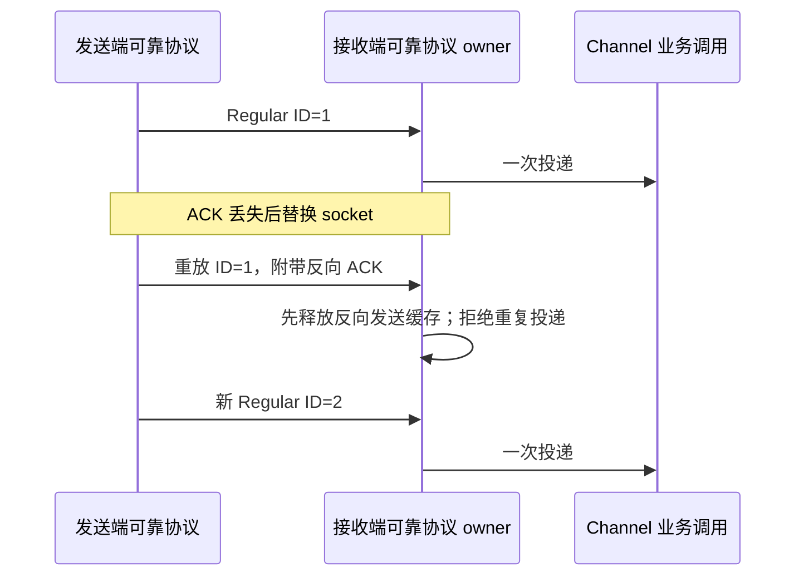

# 全仓代码检查与修复

日期：2026-11-06。基线版本 3.17.1，Git HEAD 为 `12e7722184a306215dc4cc9a9a83123180e9b7c0`；freshness 通过。本文保留第一轮结果，并单独记录用户要求的第二轮复核。第二轮已获提交及仅推送 `origin = No-ni/ZCodium` 的授权；不触发发行构建。

第二轮最终覆盖 110 个登记模块、212 个 policy roots，缺口为 0；根 typecheck、Lint、增量及全量架构均通过。第一轮的 5 项增量架构失败已通过正式纳管和职责拆分解决，历史结果保留在下文。

## 范围与证据

以当前 `architecture-policy.yaml` 的全部模块（含 legacy）和当前包目录为清单。根模块与嵌套受管模块分别记录，跨包模块按 roots 分配，空目录标注为空。每模块阅读公共契约/入口，并检查关键实现、调用路径和现有测试；文件枚举或规则扫描不等同于逐行人工审核，也不等同于全量真机验收。

- UI：ui、web、stream-animate、model-option-map、e2e-report、dev-docs，以及 share-ui/web-share 目录。
- 后端：services、server、zcode-server-cli、desktop。
- CLI：apps/zcode-cli 的所有包、tools、运行及工程入口。
- 主代理：shared、rpc、client、provider、provider-node、relay、formal-proof、zcode-cua、android，以及根工程脚本和工作流。

分区证据分别写在 [UI](full-code-audit-ui.md)、[后端/桌面](full-code-audit-backend.md)、[CLI](full-code-audit-cli.md)、[主代理](full-code-audit-root.md)；此处汇总覆盖、修复、验证与已知限制。

## 修复与验证约束

确认实际触发路径后，先更新对应 spec/contract 和回归证据，再修复。每项修复应说明原行为、预期行为、唯一状态所有者及验收场景；异步状态变更记录事件图。保留既有身份、数据根和 fork 审计边界，不为检查通过恢复已删除的云/遥测功能。

测试 HOME、TEMP、缓存、数据和日志只使用当前工作树内项目隔离目录，先审查重解析点、输出路径和子进程环境。固定 Node 24.14.0 与 corepack pnpm。根 typecheck/lint、全量架构检查及 fork 审计守卫必须记录真实结果。未经执行的 E2E/真机/远端场景写明未验证。

## 本轮主代理检查

### RPC 可靠传输重放

已确认 `PersistentProtocol.readMessages` 对所有 Regular 帧都再次投递并覆盖 incomingAckId。ACK 未送达而断线时，对端重放已收帧会重复触发上层事件或已完成 RPC，并让 ACK 倒退。

传输 owner 为 PersistentProtocol；有序 Regular 帧（ID 从 1 开始）只在 ID 大于 incomingAckId 时交给上层。重复帧的 piggyback ACK 仍先处理。兼容非可靠 SocketProtocol 的 ID=0 帧，它们独立投递但不覆盖有序 ACK。不上移业务状态、去重表或队列。

验收：重连去重、ACK 单调、重复帧反向 ACK、零号 SocketProtocol 兼容。此层不更改 desktop-continuous 或 web-remote-replayable 的业务恢复规则，手机 raw ACK owner 仍是现有独立 adapter。新 3 项实测先失败、修复后通过，另有既有传输合同和生命周期回归通过。

### CI TypeScript 源码解析

`desktop.yml` 的 Release tests 直接执行 `node --test scripts/ci/*.test.mjs`。部分入口间接加载 exports 指向 `.ts` 且使用 `.js` specifier 的源码；Node 24 的原生类型擦除不能解析这些 `.js`→`.ts` 路径。两个隐私回归入口在旧命令下共有 4 个失败，加入 `--import tsx` 后 5 项全部通过。Release tests 显式使用仓库依赖 tsx，和现有源码回归 runner 一致，避免依赖宿主隐式 loader；保持全部文件发现及串行隔离策略。

### 回归入口与当前源码对齐

Source registry 的源码回归须使用 UI 自身 tsconfig 解析 `@/*`，不能用根工程配置代替包内路径契约。Host 存储启动测试使用 project-storage 的现公开 startup-entry，不恢复已迁走的 tasksDatabase/startup 文件。历史闲时队列测试仍验证旧行只读保留，数据与备份改用项目隔离 fixture；不恢复闲时服务。

MCP 日志隐私回归仍调用已移除的 listLocalUserMcpCandidates，改用当前 IMcpSyncService.loadMcpFromUserDirectory 的 servers 结果。保留坏 rename 的真实迁移失败、内存 enabled:false、磁盘旧字段不变及原始目录/命令/异常不进入日志的断言，不恢复旧 API 或削弱隐私检查。

共享状态专项使用明确的五个 SSH/MCP 回归文件及现有 setup，独立于已退役的 App 单测全量发现。Vitest 采用 runner 配置加载、缓存只写子 sandbox；入口需传播真实失败码和实际测试数。它不改变工程套件清单，也不代表外部 SSH 或真实凭据验收。

### 自托管 relay 静态文件与日志

静态目录 owner 为 relay HTTP adapter。解码后的请求路径必须以路径段判断位于配置目录内，不能用字符串前缀接受同名前缀的兄弟目录。读取前还需核对真实 root/target，拒绝文件或目录链接指向 root 之外；SPA fallback 的 mobile.html 遵守相同边界。所有回归的兄弟目录和链接目标均为项目内合成 fixture，不触碰用户数据。

relay 已实测确认的越界是链接读取。旧绝对路径 normalize 会把编码的 .. 请求抹去并进入 200 SPA fallback；不能据此前缀扫描声称旧版编码请求已读到兄弟目录。新解析顺序明确将这种请求拒绝为 403，与真实路径读取校验共用一个根边界。

relay 的配对、鉴权及日志出口只保留固定事件、数字和既有允许的 sid 末六位；IP、监听 host/path、真实静态目录、原始错误文本不得交给 logger。CLI 输出静态目录是否配置的布尔值及固定失败分类，避免 JSON fields.message 覆盖生命周期事件。网络鉴权和限流仍使用原 IP，只改变日志投影。

验收：编码斜杠/反斜杠的兄弟目录穿越返回 403；链接越界和 fallback 链接拒绝；正常静态页及 SPA fallback 仍可读；监听和启动失败输出不含配置路径/IP/原始异常。不会改变 relay 的鉴权、转发或 desktop/mobile 的业务恢复 owner。

## 第一轮覆盖清单

105 个登记模块、205 个 policy roots 均有分区审查记录；交叉模块按 roots 合并，缺失模块/roots 均为 0。root18、backend36、UI27、CLI27 有重叠，不能直接相加为唯一模块总数。CLI 另登记 38 个 package/tool/e2e 包；UI 另覆盖未登记工具包和 share-ui/web-share 空目录；Android、根工程与构建脚本单独记录。

初始库存 6,755 项保留作开工证据。最终库存剔除已删除/生成输出后为 6,708 个登记 roots 下 JS/TS 源码及合同文件，TypeScript AST 实际解析 6,617 个 JS/TS 文件，0 parse diagnostics、0 重复 literal case；合同文档不计 AST，Python/Swift/Kotlin/native 资源也不冒充 TS 解析。全文件结构扫描与模块入口/关键风险路径阅读是不同证据；没有宣称每个叶文件逐行人工 review、全分支运行或全仓不存在其余 bug。

合并证据：`.audit/full-code/coverage-summary.json`、`inventory-current.json`、`source-scan.json`；各组覆盖/已读关键文件见对应 `*-coverage.json` 与分区报告。源文件扫描不是运行验收，架构清单也包含 legacy 未纳管模块。

## 本轮修复汇总

| 范围           | 生产/工具修复                                                                                                                                                                                                                   | 回归入口修复                                                                                                          |
| -------------- | ------------------------------------------------------------------------------------------------------------------------------------------------------------------------------------------------------------------------------- | --------------------------------------------------------------------------------------------------------------------- |
| RPC/工程/relay | RPC 重放重复投递与 ACK 倒退；relay 静态链接越界、fallback 共用根边界、原始路径/IP/错误日志                                                                                                                                      | Release tests 显式 tsx；Source identity/SQLite/MCP/shared-state/历史闲时 fixture 对齐当前公开接口                     |
| 后端/桌面      | output-style 名称/ID 穿越及中间 .md ID 错配；storage 根/祖先链接越界；HTTP 全局连接 Map、资源释放/关闭、replayable share 准入                                                                                                   | MCP 并发导入旧 API 对齐；真实项目内 IO/HTTP/WS 回归                                                                   |
| CLI            | session 文件清理祖先链接；缓存预测替代/loader 迟到；REPL 排队关闭/取消与原始 stderr；SQLite 预取消和 permission 备份；本地快照重定向/参数；插件 marker staging 穿越与 authorityPath 递归恢复/栈溢出；缺自建 Sites origin 先拒绝 | 清理退场采集/官方闲时孤儿入口和不可达 tool_reference 分支；Provider 工具现契约；旧恢复插件明确 unavailable、零业务 IO |
| UI/工具        | workflow 再运行丢 project/host target；Web 下载成功误报；CEL 正负零比较；stream 迟到详情/列表与重叠轮询；静态目录前缀；dev-docs 数据根；图表 tooltip 点对象误归零                                                               | 16 场源回归 + CEL2；10 场隔离实际 React/Chart.js 浏览器交互                                                           |

每项原因、唯一 owner、事件顺序、中文修复注释和回归证据在对应合同/分区报告中。CLI authority 核验现在只读已落盘 cacheTransactionId；installed_plugins/known_marketplaces 文件仍由各自原 loader 负责显式恢复，不从磁盘 marker 递归派发任意文件清理。

## 第一轮验证与限制

全部显式运行使用项目内 Node 24.14.0 / corepack pnpm，合成数据与子进程输出只写获准工作树；测试不会读取真实 `.zcodium`。原生扩展/任意进程的系统级隔离不能仅由 Node permission 推导。

| 检查                     | 实际最终结果                                                                                        | 项目内证据目录                                                          |
| ------------------------ | --------------------------------------------------------------------------------------------------- | ----------------------------------------------------------------------- |
| 根 typecheck             | 通过                                                                                                | `full-audit-final-typecheck-kXRNIV`                                     |
| 根 lint                  | 0 errors / 0 warnings，5,623 文件                                                                   | `full-audit-lint-final-clean-WzxgHh`                                    |
| CLI 正式 typecheck       | 通过，含最终 marker authority 修复                                                                  | `full-cli-audit-PpaTXJ`                                                 |
| CLI 正式 lint            | 89 errors / 76 warnings；89 errors 均为既有 max-lines，无新增诊断，4 个 duplicate-case warning 消除 | `full-cli-audit-EEWMme`；`.audit/full-code/cli-lint-comparison.json`    |
| 全量架构                 | 0 violations / 0 baseline                                                                           | `full-audit-architecture-complete-xT0clc`                               |
| 默认 changed 架构        | **失败，5 个 unmanaged-new-file**                                                                   | `full-audit-architecture-default-AbbBMY`                                |
| 显式 HEAD changed 架构   | **同样失败，5 项**；没有用换 base 冒充默认通过                                                      | `full-audit-architecture-head-JG4ueV`                                   |
| RPC/shared/provider Node | 255/255，已完整复跑                                                                                 | `full-audit-rpc-shared-provider-complete-L1uMIO`                        |
| root Vitest / CUA 合同   | 186/186 / 70/70                                                                                     | `full-audit-root-vitest-ySXYw5` / `full-audit-cua-contracts-10Bn29`     |
| 统一专项/审计守卫        | 39 实际外层均通过；fork 守卫11包含其中，wrapper/inner 不相加                                        | `full-audit-required-regressions-XdgFL8`                                |
| SQLite 当前 fixture      | 20 内层通过                                                                                         | `full-audit-sqlite-current-jl3nXa`                                      |
| UI 源回归/浏览器         | 16/16 + CEL2/2；实际 hook/组件/Chart.js 10 场通过                                                   | UI 报告中的 HLPzN2 / Cy2ppI / Xm9JJz                                    |
| relay 新/旧回归          | 4 内层 + 16 既有通过                                                                                | `full-audit-relay-portable-XWw9vY` / `full-audit-relay-existing-fv0hMC` |
| Git 差异空白检查         | `git diff --check` 通过                                                                             | 最终收尾再次执行，退出码 0                                              |

增量架构 5 项为 dev-docs App/vite config、stream App/http、e2e-report ChartPanels。修改后的上游 legacy 文件失去 snapshot 字节豁免；本轮没有更新 snapshot、写 baseline、提高阈值或删除修复来掩盖失败。此项治理仍需后续纳管/拆分规划；全量架构通过不替代增量结果。

旧会话恢复插件仍缺失实际 scan/restore 实现，本轮仅让帮助可用、能力稳定报 unavailable 且不读写业务数据，不能写成恢复能力已完成。Android 官方默认 endpoint/URL allowlist 的保留自建或移除方案已向用户提出，尚待裁决；未编译 Android或下载SDK。

浏览器回归使用真实 React hook/组件与 Chart.js，外部服务/launcher/图像 surface 等端口由 fixture 替代；隐藏窗口截图不可用，保存 DOM/result 证据，不算视觉验收。未执行完整产品 Electron/Host、真实 SSH/WSL/Docker/模型 API、实体手机、macOS native、安装包与全量业务语料。不将这些未执行项目写为通过。

第一轮结束时成果留在当前工作树，尚未提交或推送；原有未提交改动未回退。第二轮复核及发布范围另记下节；本任务没有 PR/issue、上游同步、版本调整、Actions 触发或发行打包。

工作树中已有 5 个受版本管理的 node-repl-host/dist-types 生成文件，保留其现状；CLI 的 49 个源码格式验证清单不涵盖这些生成文件，不将该格式结果扩写为全部工作树文件通过。

## 第二轮复核与收口

用户要求完成后再检查一轮，发现问题继续修复，最终提交并推送。三名子代理继续负责后端、CLI 和 UI，主代理复核 relay、工程入口及分区结果；后端另对 UI 拆分和异步状态进行独立交叉复核。源码和测试冻结后重新执行根必需检查，不沿用修改前的结果。

| 范围    | 第二轮确认并修复                                                                                                                                                                         |
| ------- | ---------------------------------------------------------------------------------------------------------------------------------------------------------------------------------------- |
| 后端    | HTTP close 立即开始释放已建立连接，不被另一迟到握手阻塞；storage 在 opendir 后逐文件读取前再次核对祖先路径，拒绝 rename/junction 替换造成的根外元数据读取                                |
| CLI     | 输入预测日志只保留固定失败分类，不透传业务 ID 和原始异常；插件合法崩溃恢复先由原 installed/known marketplace owner 恢复固定 authority 文件，再执行只读核验；补 SQLite mkdir 期间取消回归 |
| relay   | listen 失败释放 WS server 和 sweep；关闭同步退休升级入口、直接终止半开 WS 对端，以同一 Promise 幂等等待 HTTP/WS 释放                                                                     |
| UI/工具 | stdio 迟到读取不覆盖新刷新；Chart.js null 采样显示 n/a；stream 旧列表不回退已接受的详情，初始旧失败不污染新读取，首次有效列表仍默认选择且不抢用户已有选择                                |
| 架构    | 正式登记 stream-animate、e2e-report、dev-docs legacy/view/Vite adapters 五模块并补真实合同；长 UI/Vite 入口按现有职责拆分，保留公共类型转发及数据/地图 owner                             |

这些修复的失败回归、中文原因注释、事件顺序及真实 IO/浏览器证据见四份分区报告。交叉复核发现的 stream 初始化默认选择回归也先补失败断言后修复，没有因已通过部分检查而忽略新问题。

最终 policy 是 110 模块/212 roots；原 HEAD 的 104 个模块及 global 语义完全未变，新增为第一轮 output-style 和第二轮上述五模块，差异仅新增 110 行。未刷新 snapshot/baseline、抬高阈值或恢复退役官方模块。

最终登记 roots 下有 6,793 个源码及合同文件，AST 实际解析 6,698 个 JS/TS 文件，0 parse diagnostics、0 duplicate literal case。第二轮新纳管目录让既有工具源码也进入当前库存，因此与第一轮数量不直接按新增文件相减。全模块覆盖和 AST 扫描仍不等同于逐叶文件逐行人工审查或全平台运行验收。

入库的精简相对路径覆盖证据见 [证据目录](full-code-audit-evidence/README.md)：110 模块/212 roots 均有分区记录，UI 新增模块的每个 root 均有实际阅读文件。完整机械库存、重复源码摘要及绑定本机工具链的一次性脚本保留在被忽略的 `.audit`，不作为可复用仓库工具提交；合成测试及日志仍在被忽略的项目 sandbox。

| 第二轮最终检查                 | 实际结果                                                                           | 项目内证据标签                                                    |
| ------------------------------ | ---------------------------------------------------------------------------------- | ----------------------------------------------------------------- |
| 根 typecheck                   | 通过，生产代码最终冻结后执行                                                       | `audit-publish-typecheck-1UiTZw`                                  |
| 根 Lint                        | 0 errors / 0 warnings，5,636 文件                                                  | `audit-publish-lint-K1lt0f`                                       |
| 默认 changed 架构              | 0 violations / 0 baseline / 0 new；使用实际 origin/main 基线                       | `audit-publish-changed-OJdDKW`                                    |
| 全量架构                       | 0 violations / 0 baseline / 0 new                                                  | `audit-publish-architecture-JFLL7P`                               |
| CLI 正式 typecheck / Lint      | 类型通过；Lint 89 errors / 76 warnings，与第一轮最终逐诊断比较 added=0 / removed=0 | `full-cli-audit-oHA9ZP` / `full-cli-audit-8VDmbx`                 |
| 后端 HTTP/storage/output-style | 20 场内层通过，新增握手/路径替换场景均先失败                                       | `backend-round2-boundaries-final-A0Almx`                          |
| CLI 定向回归                   | prediction 四文件45、插件恢复10及其他取消/工具场景通过；计数不重复累加             | CLI 分区报告第二轮证据                                            |
| relay 生命周期                 | 3/3 内层通过；timer、幂等关闭、异步端口占用真实回归                                | `second-relay-lifecycle-final-wlofDF`                             |
| root 合同 / fork与隐私专项     | 18 文件186/186；另50/50外层，wrapper/inner及重跑不相加                             | `second-root-contracts-RUFcG2` / `second-root-required-39YoDJ`    |
| 治理及 schema 工程回归         | 85 passed / 1 平台 skipped / 0 failed                                              | `second-engineering-gates-Yc7Kbh`                                 |
| UI 源回归 / CEL / 定点类型     | 21/21 + CEL2/2；5套类型检查通过                                                    | `full-code-audit-ui-X1ZpD5` / `full-audit-ui-round2-types-wZIpUc` |
| 真实 React/browser             | 18/18、无 pageerror；18 次隐藏截图超时，不算视觉验收                               | UI 报告 `Jfy300`                                                  |

首次全仓 fmt:check 报 54 个未格式化文件，包含本机审查产物和实际修改文件（`second-final-format-PukngV`）。实际源文件、fixture 与报告使用现 formatter 整理；本机产物按仓库 hygiene 规则忽略，精简覆盖证据仍需接受格式检查。没有用永久源码排除、snapshot 或 baseline 更新掩盖修改文件。

最终 `fmt:check` 通过，8,089 个匹配文件符合现格式规则，1,602 个继承文件按现有双快照校验保留（`audit-publish-format-HGILhB`）；最终报告标签整理后另对文档执行同一格式检查。`git diff --check` 通过。

旧恢复插件 unavailable、Android 端点产品决策待裁决、CLI 既有 max-lines 债和完整产品/真机/Provider/远端/安装包未验收继续保留。浏览器 fixture 证明真实组件及 hook 交互，不能替代完整 Electron/Vite/远端产品验收。

提交范围按用户全仓检查要求包含当前已复核的源码、测试和文档，以及此前同工作树的功能修复；本机日志、缓存、测试数据与扫描大产物不入库。仅推送本 fork 的 main，不同步上游、不提 PR/issue、不改版本、不触发 Actions 或打包。实际提交及远端状态以 Git 历史和本次正常 pre-push hook 的输出为准。
