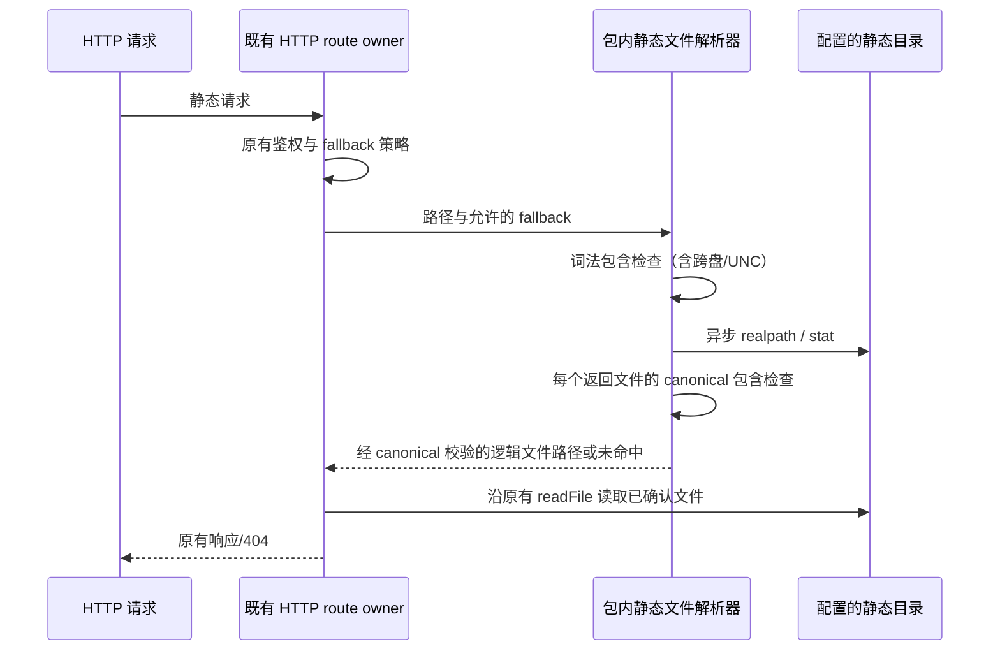

# HTTP 静态资源的目录边界

## 行为、所有者与接口

HTTP 路由仍是请求、鉴权、Content-Type、缓存头与 SPA fallback 策略的唯一所有者。包内私有 `httpStaticFiles` 复用现有静态文件解析入口，只负责路径解析与异步文件查询，不增加连接、业务状态或新的文件读取入口，也不导出到包公开入口。

- `isInsideDirectory(root, candidate)` 依据平台的 `relative`、`isAbsolute` 与分隔符判断目录包含关系；只有完整的 `..` 段表示上级目录。根本身和合法 `..` 前缀文件名不得误拒绝。Windows 跨盘符和跨 UNC share 的相对结果仍是绝对路径，必须拒绝。纯路径 helper 允许提供 Node 的 POSIX/Windows path 实现以在同一测试进程验证两种规则。
- `resolveStaticFile(staticRoot, pathname, spaFallback)` 保留现有路径解码、目录 index 和缺失文件 fallback 行为。调用方继续用 `isStaticFallbackAllowed` 约束 `/api/` 与 `/ws`，不借本修复改变鉴权和业务路由。
- 词法路径越界直接返回未命中，不读取目标、不进入 SPA fallback。配置的静态根先 canonicalize；每个可返回文件（含目录 index、SPA index）都必须经 `realpath` 确认仍位于 canonical root 内；通过检查后仍返回原逻辑路径，以保留文件 alias 的 MIME 和 index 缓存头语义。静态根内部指向根外的文件链接/目录 junction 不得突破边界；配置的根自身是别名、或链接指向根内文件时仍可用。
- 所有文件 IO 保持异步。缺失目录、缺失文件与原有文件查询失败保留未命中/fallback 语义；不记录请求原文、真实路径或原始错误，不改协议、工作区身份、owner/lease、desktop-continuous 或 web-remote-replayable。
- 静态产物目录是部署者管理的只读目录。本校验不声称在恶意并发 rename/重解析点替换时提供原子 filesystem sandbox；不引入测试或产品对真实用户文件的扫描。无数据迁移。

## 验收场景与实际验证边界

1. 纯内存路径矩阵同时使用 `path.posix` / `path.win32`：根、子文件、合法 `..` 前缀/后缀名称、根外同级与上级、Windows 不同盘符和 UNC share。
2. 中央 project sandbox 内的合成 fixture：普通文件、编码文件名、目录 index、SPA 开关、缺失文件/根和词法越界。
3. 重解析点用仅映射本次项目内 fixture 的 `realpath/stat/readFile` 模拟验证：指向静态根外的请求即使开启 SPA 也返回未命中；根内 alias 和静态根 alias 仍工作。Node 局部写权限禁止创建真实 junction/symlink，本轮不放宽权限、不把模拟验收写成原生重解析点验收；所有原生 IO 仍在已校验的项目 fixture，不使用系统 TEMP 或真实 `.zcodium`。
4. 真实 loopback HTTP 入口验证普通响应/缓存头、合法 `..` 前缀文件、junction 越界 404、受保护路径不回退，以及 SPA 深链兼容。服务以端口 0 启动并在测试 finally 关闭，不替代用户运行的应用。
5. 先对保持旧行为的解析入口实际跑红，再修复并跑绿；最终执行根 typecheck、lint、格式与 changed 架构检查。此处的合成文件与 HTTP 验证不等于打包、Electron 或实体手机全量验收。

## 实际回归记录

- 保留旧实现的首次实际执行：35 项，22 通过、13 失败。合法点前缀、Windows 跨盘/UNC、根外 alias/junction 的行为缺口均已触发；[红测日志](../../.run-logs/project-only-validation/source-tests-0X60Mw/logs/source-tests.log#L487-L490)记录真实失败，不把 fixture 权限失败当作产品复现。
- 修复后独立执行：35 项，35 通过、0 失败；[绿测日志](../../.run-logs/project-only-validation/source-tests-S4AKFA/logs/source-tests.log#L225-L228)。逻辑文件名对应的 MIME 与 index 缓存语义保持不变。
- 回归入口要求至少执行 35 项，拒绝仅装载套件或缺少参数化场景的假绿。Windows/UNC 规则是纯路径矩阵，alias/junction 是项目合成 fixture 的 builtin 映射；不宣称已完成原生重解析点或并发替换验收。
